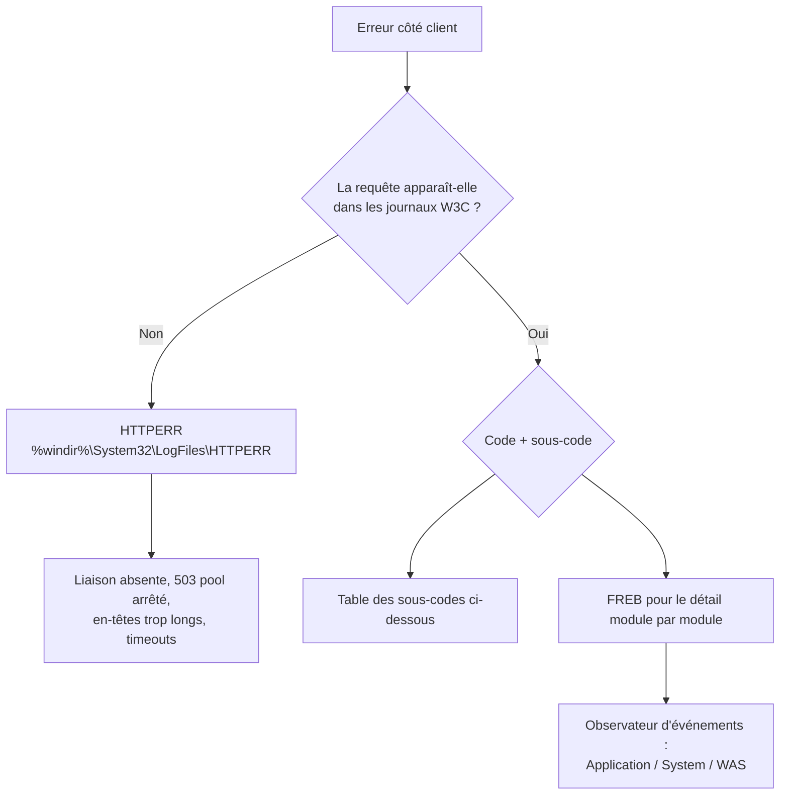

## Où regarder ?



## Journaux W3C

Emplacement par défaut : `C:\inetpub\logs\LogFiles\W3SVC<ID du site>\u_exAAMMJJ.log` (heure **UTC**).

```powershell
# Déplacer les journaux, rotation quotidienne, champs étendus
Set-WebConfigurationProperty -PSPath IIS:\ -Filter system.applicationHost/sites/siteDefaults/logFile -Name directory -Value "E:\Logs\IIS"
Set-WebConfigurationProperty -PSPath IIS:\ -Filter system.applicationHost/sites/siteDefaults/logFile -Name period -Value "Daily"
Set-WebConfigurationProperty -PSPath IIS:\ -Filter system.applicationHost/sites/siteDefaults/logFile -Name logExtFileFlags `
  -Value "Date,Time,ClientIP,UserName,SiteName,ComputerName,ServerIP,Method,UriStem,UriQuery,HttpStatus,Win32Status,BytesSent,BytesRecv,TimeTaken,ServerPort,UserAgent,Referer,Host,HttpSubStatus,ProtocolVersion"
# Utiliser l'heure locale pour le nom de fichier et le changement de fichier
Set-WebConfigurationProperty -PSPath IIS:\ -Filter system.applicationHost/sites/siteDefaults/logFile -Name localTimeRollover -Value $true
```

### Champs personnalisés (IIS 8.5+)

Indispensable derrière un répartiteur de charge pour récupérer l'IP réelle du client :

```powershell
Add-WebConfigurationProperty -PSPath IIS:\ -Filter "system.applicationHost/sites/siteDefaults/logFile/customFields" -Name "." `
  -Value @{logFieldName='X-Forwarded-For'; sourceName='X-Forwarded-For'; sourceType='RequestHeader'}
Add-WebConfigurationProperty -PSPath IIS:\ -Filter "system.applicationHost/sites/siteDefaults/logFile/customFields" -Name "." `
  -Value @{logFieldName='Correlation-Id'; sourceName='X-Correlation-ID'; sourceType='ResponseHeader'}
```

> [!TIP]
> Pour l'envoi vers un SIEM ou ELK, choisissez la journalisation **ETW** ou **Les deux** (`logTargetW3C="File,ETW"`) : les événements peuvent alors être collectés en temps réel (Winlogbeat, Azure Monitor Agent, NXLog).

### Champ `time-taken`

En millisecondes, mesuré jusqu'à l'envoi du dernier octet au client : une valeur élevée peut venir d'un client lent (réseau) et pas seulement du serveur.

### Champ `sc-win32-status`

| Valeur | Signification |
| --- | --- |
| 0 | Succès |
| 2 / 3 | Fichier / chemin introuvable |
| 5 | Accès refusé (ACL) |
| 64 | Le client a fermé la connexion |
| 121 | Délai dépassé (sémaphore) |
| 1236 | Connexion interrompue par le serveur local |

## HTTPERR (HTTP.sys)

`%windir%\System32\LogFiles\HTTPERR\httperr*.log` — requêtes rejetées **avant** d'atteindre IIS.

| Raison (`s-reason`) | Cause |
| --- | --- |
| `AppOffline` / `AppPoolTimer` / `Disabled` | Pool arrêté (protection échecs rapides, manuel) |
| `QueueFull` | File du pool pleine → 503 |
| `BadRequest` / `FieldLength` / `RequestLength` | Requête malformée, en-tête trop long (tickets Kerberos) |
| `Hostname` | Aucune liaison ne correspond au nom d'hôte |
| `Timer_ConnectionIdle`, `Timer_MinBytesPerSecond`, `Timer_HeaderWait` | Délais dépassés (souvent bénins, ou attaque lente) |
| `Connection_Abandoned_By_ReqQueue` | Le processus de travail s'est arrêté pendant la requête (plantage, recyclage) |

## Suivi des demandes ayant échoué (FREB)

Trace XML détaillée de chaque événement du pipeline pour les requêtes qui correspondent à un filtre.

```powershell
Install-WindowsFeature Web-Http-Tracing
# Activer pour un site (100 fichiers max)
Set-WebConfigurationProperty -PSPath IIS:\ -Filter "system.applicationHost/sites/site[@name='intranet']/traceFailedRequestsLogging" -Name enabled -Value $true
Set-WebConfigurationProperty -PSPath IIS:\ -Filter "system.applicationHost/sites/site[@name='intranet']/traceFailedRequestsLogging" -Name maxLogFiles -Value 100
```

```xml
<!-- web.config : tracer les 401, 403 et 500-599, ou les requêtes de plus de 10 s -->
<system.webServer>
  <tracing>
    <traceFailedRequests>
      <add path="*">
        <traceAreas>
          <add provider="ASP" verbosity="Verbose" />
          <add provider="ASPNET" areas="Infrastructure,Module,Page,AppServices" verbosity="Verbose" />
          <add provider="ISAPI Extension" verbosity="Verbose" />
          <add provider="WWW Server" areas="Authentication,Security,Filter,StaticFile,CGI,Compression,Cache,RequestNotifications,Module,FastCGI,WebSocket,Rewrite,RequestRouting" verbosity="Verbose" />
        </traceAreas>
        <failureDefinitions timeTaken="00:00:10" statusCodes="401.3,403,500-599" />
      </add>
    </traceFailedRequests>
  </tracing>
</system.webServer>
```

Les fichiers `fr000001.xml` (dossier `C:\inetpub\logs\FailedReqLogFiles\W3SVC<ID>`) s'ouvrent dans un navigateur grâce à `freb.xsl` : onglet **Request Summary** (module en erreur, code), **Compact View** (chronologie).

## Codes et sous-codes HTTP d'IIS

| Code | Signification | Piste |
| --- | --- | --- |
| **400** Bad Request | Requête invalide / en-tête trop long | HTTPERR, `MaxFieldLength` |
| **401.1** | Identifiants refusés | Mot de passe, compte verrouillé, domaine |
| **401.2** | Pas de méthode d'authentification commune (souvent le 1er aller-retour de Negotiate) | Méthodes activées sur le site |
| **401.3** | ACL NTFS refuse l'accès | Droits de l'utilisateur ou du compte anonyme |
| **401.5** | Refusé par un module ISAPI/CGI | Application |
| **403.4** | SSL requis | Utiliser HTTPS |
| **403.7** | Certificat client requis | Paramètres SSL |
| **403.14** | Exploration de répertoire interdite et pas de document par défaut | `defaultDocument` |
| **403.16 / 403.17** | Certificat client non approuvé / expiré | Chaîne de l'AC cliente |
| **403.503** | Refusé par restriction IP | `ipSecurity` |
| **404.0** | Fichier introuvable | Chemin, casse sur partage, réécriture |
| **404.2** | Restriction ISAPI/CGI | *Restrictions ISAPI et CGI* |
| **404.3** | Type MIME non défini | `staticContent/mimeMap` |
| **404.4** | Aucun handler | Mappage de gestionnaires |
| **404.7 / 404.8 / 404.13** | Filtrage des demandes (extension / segment / taille) | `requestFiltering` |
| **405** | Verbe non autorisé par le handler | WebDAV qui intercepte PUT/DELETE : retirer le module |
| **500.0** | Erreur du module ou de l'application | Journaux applicatifs, FREB |
| **500.19** | Configuration invalide (XML, section verrouillée, module manquant) | Message détaillé en local, `appcmd unlock` |
| **500.21** | Module non reconnu (ASP.NET non installé) | Fonctionnalités, Hosting Bundle |
| **500.22 / 500.23** | Configuration ASP.NET non compatible avec le mode intégré | Migrer `httpModules`/`httpHandlers` vers `system.webServer` |
| **500.50 – 500.52** | Erreur URL Rewrite (variable serveur non autorisée…) | `allowedServerVariables` |
| **502.2 / 502.3** | Erreur / délai du proxy ARR ou du backend | Backend arrêté, `proxy timeout` |
| **503** | Service indisponible | Pool arrêté, file pleine, HTTPERR |

```powershell
# Afficher les erreurs détaillées temporairement à distance (le temps du diagnostic)
Set-WebConfigurationProperty -PSPath IIS:\ -Location "intranet" -Filter system.webServer/httpErrors -Name errorMode -Value Detailed
```

## Observateur d'événements

| Journal / source | Événements utiles |
| --- | --- |
| System / **WAS** | 5002 (pool désactivé : protection contre les échecs rapides), 5009/5011 (processus arrêté de manière inattendue), 5010 (ping sans réponse), 5186 (recyclage), 5021 (identité invalide) |
| Application / **ASP.NET 4.0** | 1309 (exception non gérée), 1310 (erreur de configuration) |
| Application / **IIS AspNetCore Module V2** | Échecs de démarrage ASP.NET Core |
| Application / **Application Error** | Plantage de `w3wp.exe` (module fautif, code d'exception) |
| Microsoft-Windows-IIS-Configuration/Operational | Modifications de configuration (à activer) |

```powershell
Get-WinEvent -FilterHashtable @{LogName='System'; ProviderName='Microsoft-Windows-WAS'; StartTime=(Get-Date).AddDays(-1)} |
  Select-Object TimeCreated, Id, Message | Format-List
```

## Analyser les journaux

### PowerShell

```powershell
# Top des URL en erreur 5xx sur le fichier du jour
$log = Get-ChildItem "C:\inetpub\logs\LogFiles\W3SVC1" | Sort-Object LastWriteTime | Select-Object -Last 1
$fields = (Get-Content $log.FullName | Where-Object { $_ -like '#Fields:*' } | Select-Object -Last 1).Substring(9).Split(' ')
Get-Content $log.FullName | Where-Object { $_ -notlike '#*' } | ConvertFrom-Csv -Delimiter ' ' -Header $fields |
  Where-Object { [int]$_.'sc-status' -ge 500 } | Group-Object 'cs-uri-stem' | Sort-Object Count -Descending | Select-Object -First 10 Count, Name
```

### Log Parser 2.2

```powershell
$lp = "C:\Program Files (x86)\Log Parser 2.2\LogParser.exe"
# Requêtes les plus lentes
& $lp -i:IISW3C "SELECT TOP 20 cs-uri-stem, AVG(time-taken) AS moy, MAX(time-taken) AS max, COUNT(*) AS nb FROM C:\inetpub\logs\LogFiles\W3SVC1\u_ex*.log GROUP BY cs-uri-stem ORDER BY moy DESC"
# Répartition des codes par heure
& $lp -i:IISW3C "SELECT QUANTIZE(time, 3600) AS heure, sc-status, COUNT(*) FROM u_ex*.log GROUP BY heure, sc-status ORDER BY heure"
# IP générant le plus de 401 (brute force)
& $lp -i:IISW3C "SELECT TOP 20 c-ip, COUNT(*) AS echecs FROM u_ex*.log WHERE sc-status=401 AND sc-substatus=1 GROUP BY c-ip ORDER BY echecs DESC"
```

## Processus bloqués ou gourmands

```powershell
& "$env:windir\system32\inetsrv\appcmd.exe" list wp                       # PID ↔ pool
& "$env:windir\system32\inetsrv\appcmd.exe" list requests /elapsed:10000   # requêtes > 10 s
# Vidage mémoire pour analyse (Sysinternals ProcDump) quand le CPU dépasse 90 % pendant 10 s
procdump.exe -ma -c 90 -s 10 -n 3 <PID>
```

Analysez les dumps avec **DebugDiag** (analyse automatique des blocages et fuites) ou WinDbg.

## Sauvegarde et restauration de la configuration

```powershell
$appcmd = "$env:windir\system32\inetsrv\appcmd.exe"
& $appcmd add backup "avant-migration-$(Get-Date -Format yyyyMMdd-HHmm)"
& $appcmd list backup
& $appcmd restore backup "avant-migration-20260115-0900"

# Module IISAdministration
Backup-IISConfiguration -Name "quotidien"
Restore-IISConfiguration -Name "quotidien"
```

Les sauvegardes sont stockées dans `%windir%\system32\inetsrv\backup`. Elles contiennent la configuration, **pas les contenus** des sites ni les certificats.

## Configuration partagée (fermes)

Tous les serveurs lisent `applicationHost.config` depuis un partage :

1. Sur le serveur de référence : *Configuration partagée* → **Exporter la configuration** (avec mot de passe des clés de chiffrement).
2. Sur chaque serveur : **Activer la configuration partagée** → chemin UNC + compte d'accès + mot de passe des clés.

Alternatives : **IIS Web Farm Framework** (obsolète), réplication par Web Deploy, ou configuration en tant que code (DSC `WebAdministrationDsc`, Ansible `community.windows.win_iis_*`).

## Supervision

À surveiller depuis l'outil de supervision ([[01-centreon/05-supervision-agents|Centreon]] par exemple) :

- Services `W3SVC`, `WAS` (et `FTPSVC`, `WMSVC` si utilisés) démarrés.
- État des pools (démarrés), nombre de redémarrages/recyclages.
- Compteurs : requêtes/s, connexions, file HTTP.sys, erreurs 5xx/s.
- Sondes HTTP(S) externes : code attendu, temps de réponse, contenu, expiration du certificat.
