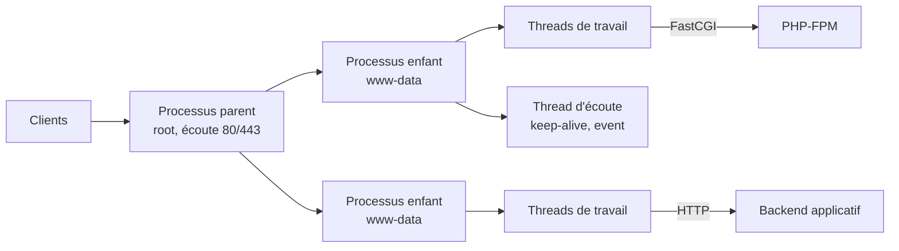

**Apache HTTP Server** (`httpd`, paquet `apache2` sous Debian) est le serveur web open source historique de la fondation Apache. Il reste très présent grâce à sa **modularité**, à la configuration décentralisée par `.htaccess` et à sa compatibilité avec la plupart des applications (PHP, Python, CGI, reverse proxy). La branche actuelle est **2.4.x**.

## Architecture modulaire

Le cœur d'Apache est minimal ; tout le reste est fourni par des **modules** chargés dynamiquement (`LoadModule`) :

| Famille | Modules principaux |
| --- | --- |
| Multi-Processing Module (**MPM**) | `mpm_event`, `mpm_worker`, `mpm_prefork` (un seul actif) |
| Contenu | `mod_dir`, `mod_alias`, `mod_rewrite`, `mod_mime`, `mod_autoindex`, `mod_negotiation` |
| TLS / protocoles | `mod_ssl`, `mod_http2`, `mod_md` (ACME intégré) |
| Proxy | `mod_proxy`, `mod_proxy_http`, `mod_proxy_fcgi`, `mod_proxy_balancer`, `mod_proxy_wstunnel`, `mod_proxy_hcheck` |
| Authentification | `mod_auth_basic`, `mod_authn_file`, `mod_authnz_ldap`, `mod_auth_gssapi` (Kerberos), `mod_authz_core`, `mod_authz_host` |
| Performance | `mod_deflate`, `mod_brotli`, `mod_expires`, `mod_headers`, `mod_cache`, `mod_cache_disk` |
| Diagnostic | `mod_status`, `mod_info`, `mod_log_config`, `mod_logio` |
| Sécurité (tiers) | `mod_security2` (WAF), `mod_evasive`, `mod_qos` |

```bash
apachectl -M          # modules chargés (Debian : apache2ctl -M)
apachectl -V          # version, MPM, chemins de compilation
```

## Les MPM

| MPM | Fonctionnement | Usage |
| --- | --- | --- |
| **event** (défaut moderne) | Processus multithreadés ; un thread dédié gère les connexions *keep-alive* inactives | **Recommandé**, notamment avec PHP-FPM ou en reverse proxy |
| **worker** | Processus multithreadés, un thread par connexion | Ancien compromis |
| **prefork** | Un processus par connexion, sans threads | Uniquement pour `mod_php` ou des modules non *thread-safe* |



> [!TIP]
> Le couple **MPM event + PHP-FPM** remplace avantageusement `prefork + mod_php` : moins de mémoire, isolation des sites par pool PHP, HTTP/2 possible (incompatible avec prefork).

## Traitement d'une requête

1. **Sélection du virtual host** selon l'IP, le port et l'en-tête `Host` (ou le SNI en TLS).
2. **Traduction de l'URL** en fichier ou en gestionnaire : `Alias`, `mod_rewrite`, `ProxyPass`, `DocumentRoot`.
3. **Contrôle d'accès** : authentification (`AuthType`), autorisation (`Require`).
4. **Contenu** : fichier statique, gestionnaire (`SetHandler`), proxy.
5. **Filtres de sortie** : compression, en-têtes, cache.
6. **Journalisation** (`CustomLog`, `ErrorLog`).

## Contextes de configuration

| Contexte | Portée |
| --- | --- |
| Serveur (global) | Tout le serveur |
| `<VirtualHost>` | Un site |
| `<Directory>` / `<DirectoryMatch>` | Un dossier du système de fichiers (et sous-dossiers) |
| `<Files>` / `<FilesMatch>` | Des fichiers par nom |
| `<Location>` / `<LocationMatch>` | Un chemin d'URL (y compris virtuel : proxy, gestionnaire) |
| `.htaccess` | Un dossier, si `AllowOverride` l'autorise |
| `<If>` / `<ElseIf>` / `<Else>` | Condition évaluée à chaque requête (2.4) |

Ordre de fusion : `<Directory>` (du moins au plus spécifique) puis `.htaccess`, puis `<DirectoryMatch>`, `<Files>`, `<Location>`. Une section `<Location>` l'emporte donc sur `<Directory>`.

> [!WARNING]
> N'utilisez **pas** `<Location>` pour protéger des fichiers : un même fichier peut être atteint par plusieurs URL (alias, casse sous Windows). Protégez les fichiers avec `<Directory>` / `<Files>` ; réservez `<Location>` au contenu virtuel (proxy, `server-status`).

## Organisation des fichiers

| Élément | Debian / Ubuntu | RHEL / Rocky / Alma | Windows (Apache Lounge) | macOS (Homebrew) |
| --- | --- | --- | --- | --- |
| Configuration principale | `/etc/apache2/apache2.conf` | `/etc/httpd/conf/httpd.conf` | `C:\Apache24\conf\httpd.conf` | `$(brew --prefix)/etc/httpd/httpd.conf` |
| Ports | `ports.conf` | dans `httpd.conf` (`Listen`) | `httpd.conf` | `httpd.conf` (8080 par défaut) |
| Sites | `sites-available/` + `sites-enabled/` (`a2ensite`) | `conf.d/*.conf` | `conf/extra/httpd-vhosts.conf` | `extra/httpd-vhosts.conf` |
| Modules | `mods-available/` + `mods-enabled/` (`a2enmod`) | `conf.modules.d/*.conf` | `LoadModule` dans `httpd.conf` | `LoadModule` |
| Fragments globaux | `conf-available/` + `conf-enabled/` (`a2enconf`) | `conf.d/` | `conf/extra/` | `extra/` |
| Racine web par défaut | `/var/www/html` | `/var/www/html` | `C:\Apache24\htdocs` | `$(brew --prefix)/var/www` |
| Journaux | `/var/log/apache2/` | `/var/log/httpd/` | `C:\Apache24\logs\` | `$(brew --prefix)/var/log/httpd/` |
| Utilisateur | `www-data` | `apache` | compte du service | utilisateur courant / `_www` |
| Service | `apache2` | `httpd` | `Apache2.4` | `brew services … httpd` |

## Ports

| Port | Usage |
| --- | --- |
| TCP 80 | HTTP |
| TCP 443 | HTTPS (TLS, HTTP/2) |
| TCP 8080 / 8443 | Ports alternatifs fréquents |

## Apache, Nginx, Caddy ou IIS ?

| Critère | Apache | [[03-nginx/01-presentation\|Nginx]] | [[04-caddy/01-presentation-installation\|Caddy]] | [[01-iis/01-presentation\|IIS]] |
| --- | --- | --- | --- | --- |
| Configuration par dossier (`.htaccess`) | Oui | Non | Non | `web.config` |
| Modules dynamiques nombreux | Oui | Limités | Recompilation (xcaddy) | Oui (Windows) |
| Performances en fichiers statiques / proxy | Bonnes (event) | Excellentes | Très bonnes | Bonnes |
| HTTPS automatique | `mod_md` | Non (certbot) | **Natif** | Non (win-acme) |
| Hébergement mutualisé (PHP, `.htaccess`) | **Référence** | Moins adapté | Moins adapté | ASP.NET |

## Suite du parcours

1. [[02-installation|Installation (Linux, Windows, macOS)]]
2. [[03-virtual-hosts-configuration|Virtual hosts et configuration de base]]
3. [[04-https-tls|HTTPS, TLS et HTTP/2]]
4. [[05-php-applications|PHP-FPM et applications]]
5. [[06-reverse-proxy-repartition|Reverse proxy et répartition de charge]]
6. [[07-securite-authentification|Sécurité et authentification]]
7. [[08-performances-logs-depannage|Performances, journaux et dépannage]]
