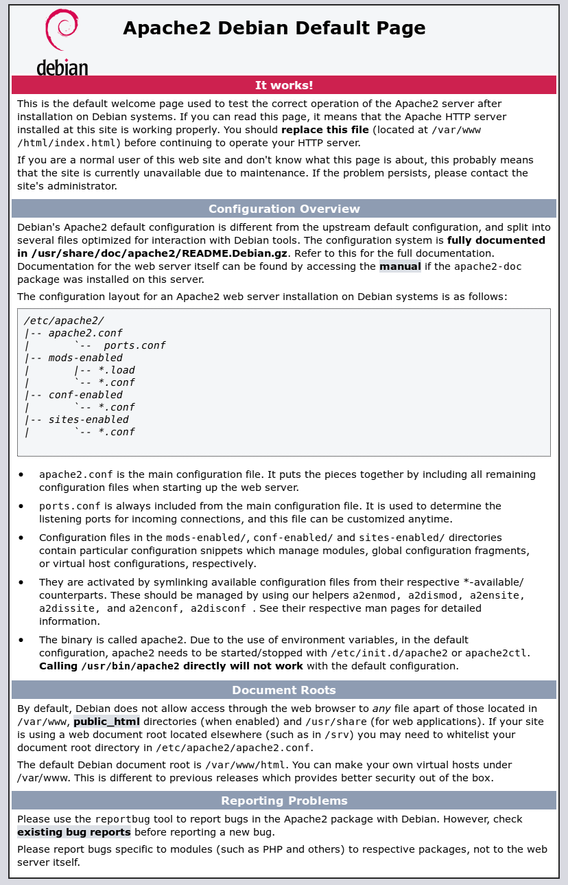

## Debian / Ubuntu

```bash
sudo apt update
sudo apt install apache2
systemctl status apache2
curl -I http://localhost
```

Ouvrez ensuite `http://<adresse-du-serveur>/` dans un navigateur : la **page par défaut d'Apache2 sous Debian** (« It works! ») confirme que le service répond. Elle résume aussi l'organisation de la configuration Debian (`apache2.conf`, `ports.conf`, `mods-enabled/`, `conf-enabled/`, `sites-enabled/`) et la racine des documents `/var/www/html`.



> [!TIP]
> Remplacez ou supprimez `/var/www/html/index.html` avant la mise en production : cette page révèle le logiciel et la distribution utilisés. Si le navigateur n'affiche rien alors que `curl -I http://localhost` répond, vérifiez le pare-feu (`sudo ufw allow 'Apache'` ou `sudo nft list ruleset`).

Outils propres à Debian :

| Commande | Rôle |
| --- | --- |
| `a2enmod ssl rewrite headers http2 proxy_fcgi` | Activer des modules (liens dans `mods-enabled/`) |
| `a2dismod status` | Désactiver un module |
| `a2ensite intranet` / `a2dissite 000-default` | Activer / désactiver un site de `sites-available/` |
| `a2enconf security` / `a2disconf serve-cgi-bin` | Fragments de configuration globaux |
| `a2query -m` / `a2query -M` | Modules actifs / MPM actif |
| `apache2ctl configtest` | Vérifier la syntaxe |

```bash
# Passer du MPM prefork (installé avec mod_php) au MPM event
sudo a2dismod php8.2 mpm_prefork
sudo a2enmod mpm_event proxy_fcgi setenvif
sudo systemctl restart apache2
```

## RHEL / Rocky Linux / AlmaLinux

```bash
sudo dnf install httpd mod_ssl
sudo systemctl enable --now httpd
sudo firewall-cmd --permanent --add-service=http --add-service=https
sudo firewall-cmd --reload
```

- Les modules se chargent via `/etc/httpd/conf.modules.d/*.conf` (commenter une ligne `LoadModule` pour désactiver).
- Les sites se placent dans `/etc/httpd/conf.d/<site>.conf`.
- Le MPM se choisit dans `/etc/httpd/conf.modules.d/00-mpm.conf` (event par défaut).

### SELinux

```bash
# Contenu hors de /var/www : appliquer le bon contexte
sudo semanage fcontext -a -t httpd_sys_content_t "/srv/www(/.*)?"
sudo semanage fcontext -a -t httpd_sys_rw_content_t "/srv/www/intranet/uploads(/.*)?"
sudo restorecon -Rv /srv/www

# Apache en reverse proxy vers un backend réseau
sudo setsebool -P httpd_can_network_connect on
# Connexion à une base de données distante
sudo setsebool -P httpd_can_network_connect_db on
# Port non standard
sudo semanage port -a -t http_port_t -p tcp 8081

# Diagnostic des refus
sudo ausearch -m avc -c httpd --start recent | audit2why
```

> [!WARNING]
> Ne désactivez pas SELinux pour « faire marcher » Apache : 95 % des refus se règlent avec un contexte de fichier ou un booléen.

## Windows : Apache Lounge

La fondation Apache ne fournit pas de binaires Windows ; la distribution de référence est **Apache Lounge** (`apachelounge.com`), compilée avec Visual C++.

1. Installer le **redistribuable Visual C++** (x64) indiqué sur la page de téléchargement.
2. Extraire l'archive dans `C:\Apache24` (chemin par défaut de `SRVROOT`).
3. Ajuster `C:\Apache24\conf\httpd.conf` : `Define SRVROOT "C:/Apache24"`, `ServerName`, `Listen`.
4. Installer et démarrer le service :

```powershell
cd C:\Apache24\bin
.\httpd.exe -t                                  # vérifier la configuration
.\httpd.exe -k install -n "Apache2.4"           # créer le service Windows
Start-Service Apache2.4
New-NetFirewallRule -DisplayName "Apache HTTP/HTTPS" -Direction Inbound -Protocol TCP -LocalPort 80,443 -Action Allow
```

| Particularité Windows | Détail |
| --- | --- |
| Séparateurs de chemin | Utiliser `/` dans `httpd.conf` (`DocumentRoot "C:/Sites/intranet"`) |
| MPM | `mpm_winnt` (un processus, nombreux threads : `ThreadsPerChild`) |
| PHP | Via `mod_fcgid` + `php-cgi.exe`, ou PHP-FPM non disponible : préférer FastCGI |
| Compte de service | `LocalSystem` par défaut : créer un compte dédié (`sc config Apache2.4 obj= ".\svc-apache" password= "…"`) |
| Conflit de port | IIS, Skype ou un autre service sur 80/443 (`netstat -ano \| findstr :80`) |

> [!NOTE]
> Sur Windows Server, IIS reste le choix naturel pour ASP.NET. Apache se justifie pour des applications PHP existantes ou une configuration commune avec des serveurs Linux.

## macOS

### Homebrew (recommandé)

```bash
brew install httpd
brew services start httpd          # écoute sur 8080 par défaut
curl -I http://localhost:8080
# Configuration : $(brew --prefix)/etc/httpd/httpd.conf ; journaux : $(brew --prefix)/var/log/httpd/
```

Pour écouter sur le port 80, modifier `Listen 80` et lancer avec les droits root : `sudo brew services start httpd`.

### Apache intégré à macOS

macOS embarque `httpd` (`/usr/sbin/httpd`, configuration `/etc/apache2/httpd.conf`), pilotable par `sudo apachectl start`. Il est peu mis à jour et sans PHP depuis macOS 12 : préférez Homebrew pour le développement.

## Docker

```bash
docker run -d --name apache -p 8080:80 -v "$PWD/site":/usr/local/apache2/htdocs:ro httpd:2.4
```

## Vérifications après installation

```bash
apachectl configtest                 # « Syntax OK »
apachectl -S                         # virtual hosts actifs, ports, fichiers
apachectl -M | grep -E "mpm|ssl|http2"
ss -tlnp | grep -E ':80|:443'
curl -I http://localhost
tail -f /var/log/apache2/error.log   # RHEL : /var/log/httpd/error_log
```

## Premiers réglages globaux

```apache /etc/apache2/conf-available/security.conf (Debian)
ServerTokens Prod          # « Server: Apache » sans version ni OS
ServerSignature Off        # pas de signature dans les pages d'erreur
TraceEnable Off            # désactiver la méthode TRACE
```

```apache /etc/apache2/apache2.conf (extrait)
ServerName web01.exemple.fr          # évite l'avertissement « Could not reliably determine the server's fully qualified domain name »
Timeout 60
KeepAlive On
MaxKeepAliveRequests 100
KeepAliveTimeout 5
```

```bash
sudo apache2ctl configtest && sudo systemctl reload apache2
```

`reload` (*graceful*) recharge la configuration sans couper les connexions en cours ; `restart` les interrompt.
