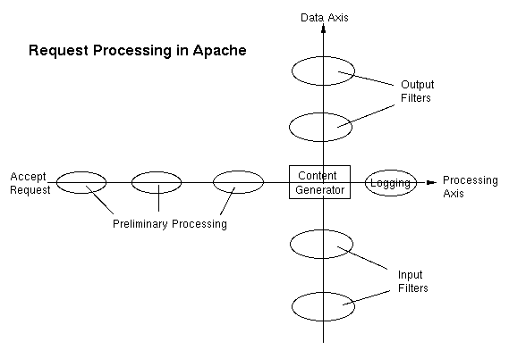
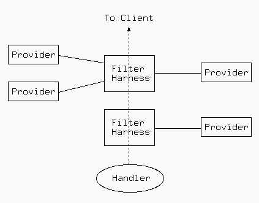

Ce document décrit l'utilisation des filtres avec Apache.

## Le filtrage avec Apache 2

- [[12-modules/mod_filter|mod_filter]]
- [[12-modules/mod_deflate|mod_deflate]]
- [[12-modules/mod_ext_filter|mod_ext_filter]]
- [[12-modules/mod_include|mod_include]]
- [[12-modules/mod_charset_lite|mod_charset_lite]]
- [[12-modules/mod_reflector|mod_reflector]]
- [[12-modules/mod_buffer|mod_buffer]]
- [[12-modules/mod_data|mod_data]]
- [[12-modules/mod_ratelimit|mod_ratelimit]]
- [[12-modules/mod_reqtimeout|mod_reqtimeout]]
- [[12-modules/mod_request|mod_request]]
- [[12-modules/mod_sed|mod_sed]]
- [[12-modules/mod_substitute|mod_substitute]]
- [[12-modules/mod_xml2enc|mod_xml2enc]]
- [[12-modules/mod_proxy_html|mod_proxy_html]]
- [[13-directives/filterchain|FilterChain]]
- [[13-directives/filterdeclare|FilterDeclare]]
- [[13-directives/filterprotocol|FilterProtocol]]
- [[13-directives/filterprovider|FilterProvider]]
- [[13-directives/addinputfilter|AddInputFilter]]
- [[13-directives/addoutputfilter|AddOutputFilter]]
- [[13-directives/removeinputfilter|RemoveInputFilter]]
- [[13-directives/removeoutputfilter|RemoveOutputFilter]]
- [[13-directives/reflectorheader|ReflectorHeader]]
- [[13-directives/extfilterdefine|ExtFilterDefine]]
- [[13-directives/extfilteroptions|ExtFilterOptions]]
- [[13-directives/setinputfilter|SetInputFilter]]
- [[13-directives/setoutputfilter|SetOutputFilter]]

La chaîne de filtrage est disponible depuis la version 2.0 d'Apache, et permet aux applications de traiter les données en entrée et en sortie d'une manière hautement flexible et configurable, quelle que soit la provenance de ces données. Il est possible de pré-traiter les données en entrée, et post-traiter les données en sortie, selon vos souhaits. Ces traitements sont tout à fait indépendants des traditionnelles phases de traitement des requêtes.

Voici quelques exemples de filtrage avec la distribution standard d'Apache:

- [[12-modules/mod_include|mod_include]], implémente les inclusions côté serveur.
- [[12-modules/mod_ssl|mod_ssl]], implémente le cryptage SSL (https).
- [[12-modules/mod_deflate|mod_deflate]], implémente la compression/décompression à la volée.
- [[12-modules/mod_charset_lite|mod_charset_lite]], transcodage entre différents jeux de caractères.
- [[12-modules/mod_ext_filter|mod_ext_filter]], utilisation d'un programme externe comme filtre.

Apache utilise aussi plusieurs filtres en interne pour accomplir des tâches comme le découpage des grosses requêtes (chunking) et la gestion des requêtes portant sur une partie d'un fichier (byte-range).

Un grand choix d'applications sont implémentées par des modules de filtrage tiers. En voici quelques exemples :

- Traitement et réécriture HTML et XML
- Transformations XSLT et inclusions XML (XIncludes)
- Support de l'espace de nommage XML
- Gestion du chargement de fichier et décodage des formulaires HTML
- Traitement d'image
- Protection des applications vulnérables comme les scripts PHP
- Edition de texte par Chercher/Remplacer

## Filtrage intelligent

[[12-modules/mod_filter|mod_filter]], inclus dans les version 2.1 et supérieures d'Apache, permet de configurer la chaîne de filtrage dynamiquement à l'exécution. Ainsi par exemple, vous pouvez définir un proxy pour réécrire du code HTML avec un filtre HTML et traiter des images JPEG avec un filtre totalement séparé, bien que le proxy ne possède aucune information préliminaire sur ce que le serveur à l'origine des données à filtrer va envoyer. Ceci fonctionne grâce à l'utilisation d'un gestionnaire de filtre, qui distribue les tâches à différents fournisseurs de filtrage en fonction du contenu réel à filtrer à l'exécution. Tout filtre peut se voir soit inséré directement dans la chaîne et lancé inconditionnellement, soit utilisé comme un fournisseur de filtrage et inséré dynamiquement. Par exemple,

- un filtre de traitement HTML sera lancé uniquement si le contenu est de type text/html ou application/xhtml+xml
- Un filtre de compression sera lancé uniquement si les données en entrée sont de type compressible et non déjà compressées
- Un filtre de conversion de jeux de caractères ne sera inséré que si le document texte n'est pas déjà dans le jeu de caractères voulu

## Présentation des filtres en tant que service HTTP

Les filtres permettent de traiter les requêtes des clients avant traitement par le serveur, ainsi que les contenus issus du serveur avant de les renvoyer au client. Le module [[12-modules/mod_reflector|mod_reflector]] permet aussi d'utiliser les filtres pour traiter les requêtes des clients avant de les renvoyer directement à ces derniers.

Le module [[12-modules/mod_reflector|mod_reflector]] reçoit les requêtes POST des clients, et en répercute le corps dans la requête POST constituant la réponse, lors de l'envoi de cette dernière au client en passant à travers la pile de filtres en sortie.

Cette technique peut être utilisée comme alternative à un service web s'exécutant à l'intérieur de la pile d'un serveur d'applications, où un filtre en sortie effectue la transformation requise sur le corps de la requête. Par exemple, on peut utiliser le module [[12-modules/mod_deflate|mod_deflate]] pour fournir un service général de compression ; un filtre de transformation d'images peut aussi se voir mué en service de transformation d'images.

## Utilisation des filtres

Il y a deux manières d'utiliser le filtrage : Simple et Dynamique. En général, vous utiliserez l'une ou l'autre méthode; le mélange des deux peut avoir des conséquences inattendues (bien que le filtrage simple en entrée puisse être associé sans problème avec le filtrage simple ou dynamique en sortie).

La méthode Simple est la seule permettant de configurer les filtres en entrée, et suffit pour les filtres en sortie pour lesquels vous avez besoin d'une chaîne de filtres statique. Les directives correspondantes sont [[13-directives/setinputfilter|SetInputFilter]], [[13-directives/setoutputfilter|SetOutputFilter]], [[13-directives/addinputfilter|AddInputFilter]], [[13-directives/addoutputfilter|AddOutputFilter]], [[13-directives/removeinputfilter|RemoveInputFilter]], et [[13-directives/removeoutputfilter|RemoveOutputFilter]].

La méthode Dynamique permet une configuration dynamique des filtres en sortie à la fois statique et flexible, comme discuté dans la page [[12-modules/mod_filter|mod_filter]]. Les directives correspondantes sont [[13-directives/filterchain|FilterChain]], [[13-directives/filterdeclare|FilterDeclare]], et [[13-directives/filterprovider|FilterProvider]].

Une autre directive [[13-directives/addoutputfilterbytype|AddOutputFilterByType]] est encore supportée, mais obsolète. Utilisez la configuration dynamique à la place.

---

*Source : documentation officielle d’Apache HTTP Server 2.4 (traduction française de la Fondation Apache), © Apache Software Foundation, licence Apache 2.0.*
