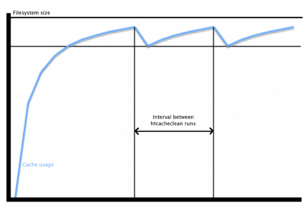

Ce document complète la documentation de référence des modules [[12-modules/mod_cache|mod_cache]], [[12-modules/mod_cache_disk|mod_cache_disk]], [[12-modules/mod_file_cache|mod_file_cache]] et du programme [[10-commandes/htcacheclean|htcacheclean]]. Il décrit l'utilisation des fonctionnalités de mise en cache du serveur HTTP Apache pour accélérer les services web et mandataire, tout en évitant les problèmes courants et les erreurs de configuration.

## Introduction

Le serveur HTTP Apache offre tout un ensemble de fonctionnalités de mise en cache qui ont été conçues pour améliorer les performances du serveur de différentes manières.

**Mise en cache HTTP à trois états RFC2616**

[[12-modules/mod_cache|mod_cache]] et son module de fournisseur [[12-modules/mod_cache_disk|mod_cache_disk]] proposent une mise en cache intelligente de niveau HTTP. Le contenu proprement dit est stocké dans le cache, et mod\_cache vise à respecter tous les en-têtes HTTP, ainsi que les options qui contrôlent la mise en cache du contenu comme décrit dans la [RFC 2616](https://www.rfc-editor.org/rfc/rfc2616). [[12-modules/mod_cache|mod_cache]] peut gérer des configurations de mise en cache simples, mais aussi complexes comme dans les cas où vous avez à faire à des contenus mandatés, à des contenus locaux dynamiques, ou lorsque vous avez besoin d'accélérer l'accès aux fichiers locaux situés sur disque supposé lent.

**Mise en cache d'objets partagés de forme clé/valeur à deux états**

L'[[11-guides/01-generalites/le-cache-des-objets-partages-du-serveur-http-apache|API du cache d'objets partagés]] (socache) et ses modules de fournisseurs proposent une mise en cache d'objets partagés à base de couples clé/valeur de niveau serveur. Ces modules sont conçus pour la mise en cache de données de bas niveau comme les sessions SSL et les données d'authentification. les serveurs d'arrière-plan permettent le stockage des données au niveau serveur en mémoire partagée, ou au niveau datacenter dans un cache comme memcache ou distcache.

**Mise en cache de fichiers spécialisée**

[[12-modules/mod_file_cache|mod_file_cache]] offre la possibilité de précharger des fichiers en mémoire au démarrage du serveur, et peut améliorer les temps d'accès et sauvegarder les gestionnaires de fichiers pour les fichiers qui font l'objet d'accès fréquents, évitant ainsi d'avoir à accéder au disque à chaque requête.

Pour tirer parti efficacement de ce document, les bases de HTTP doivent vous être familières, et vous devez avoir lu les sections [[11-guides/01-generalites/mise-en-correspondance-des-urls-avec-le-systeme-de-fichiers|Mise en correspondance des URLs avec le système de fichiers]] et [[11-guides/01-generalites/negociation-de-contenu|Négociation sur le contenu]] du guide de l'utilisateur.

## Mise en cache HTTP à trois états RFC2616

- [[12-modules/mod_cache|mod_cache]]
- [[12-modules/mod_cache_disk|mod_cache_disk]]
- [[13-directives/cacheenable|CacheEnable]]
- [[13-directives/cachedisable|CacheDisable]]
- [[13-directives/usecanonicalname|UseCanonicalName]]
- [[13-directives/cachenegotiateddocs|CacheNegotiatedDocs]]

Le module [[12-modules/mod_cache|mod_cache]] permet de tirer avantage du mécanisme de mise en cache en ligne faisant partie intégrante du protocole HTTP, et décrit dans la [RFC 2616](https://www.rfc-editor.org/rfc/rfc2616).

A la différence d'un cache simple clé/valeur à deux états où le contenu est supprimé lorsqu'il est périmé, un cache HTTP comporte un mécanisme permettant de conserver temporairement un contenu périmé, de demander au serveur original si ce contenu périmé a été modifié, et dans le cas contraire de le rendre à nouveau valable.

Une entrée d'un cache HTTP peut se présenter sous un de ces trois états :

**Frais**

Si un contenu est suffisamment récent (plus jeune que sa **durée de fraîcheur**), il est considéré comme **frais**. Un cache HTTP peut servir un contenu frais sans avoir à demander quoi que ce soit au serveur d'origine.

**Périmé**

Si le contenu est trop ancien (plus vieux que sa **durée de fraîcheur**), il est considéré comme **périmé**. Un cache HTTP doit contacter le serveur original pour vérifier si le contenu, même s'il est périmé, est encore à jour avant de le servir au client. Soit le serveur original va répondre en envoyant un contenu de remplacement si le contenu périmé n'est plus à jour, soit dans le cas idéal il renverra un code pour signaler au cache que le contenu est encore à jour, et qu'il est inutile de le générer ou de l'envoyer à nouveau. Le contenu repasse à l'état "frais" et le cycle continue.

Le protocole HTTP permet au cache de servir des données périmées dans certaines circonstances, comme lorsqu'une tentative de rafraîchir une entrée depuis un serveur original se solde par un échec avec un code d'erreur 5xx, ou lorsqu'une autre requête est déjà en train d'essayer de rafraîchir la même entrée. Dans ces cas, un en-tête `Warning` est ajouté à la réponse.

**Non Existent**

Si le cache est plein, il se réserve la possibilité de supprimer des entrées pour faire de la place. Une entrée peut être supprimée à tout moment, qu'elle soit fraîche ou périmée. L'outil [[10-commandes/htcacheclean|htcacheclean]] peut être utilisé à la demande, ou lancé en tant que démon afin de conserver la taille du cache ou le nombre d'inodes en deçà de valeurs spécifiées. Cet outil essaie cependant de supprimer les entrées périmées avant les entrées fraîches.

Le fonctionnement détaillé d'un cache HTTP est décrit dans la [RFC 2616](https://www.rfc-editor.org/rfc/rfc2616).

### Interaction avec le serveur

Le module [[12-modules/mod_cache|mod_cache]] interagit avec le serveur à deux niveaux possibles en fonction de la directive [[13-directives/cachequickhandler|CacheQuickHandler]] :

**Phase du gestionnaire rapide**

Cette phase se déroule très tôt au cours du traitement de la requête, juste après l'interprétation de cette dernière. Si le contenu se trouve dans le cache, il est servi immédiatement et pratiquement tout le reste du traitement de la requête est court-circuité.

Dans ce scénario, le cache se comporte comme s'il avait été "boulonné" à l'entrée du serveur.

Ce mode possède les meilleures performances car la majorité des traitements au niveau du serveur sont court-circuités. Cependant, il court-circuite aussi les phases d'authentification et d'autorisation du traitement au niveau du serveur, et il doit donc être utilisé avec prudence lorsque que ces phases sont importantes.

Les requêtes contenant un en-tête "Authorization" header (par exemple dans le cas de l'authentification HTTP basique) ne peuvent ni être mises en cache, ni servies depuis le cache lorsque [[12-modules/mod_cache|mod_cache]] s'exécute dans cette phase.

**Phase du gestionnaire normal**

Cette phase se déroule très tard au cours du traitement de la requête, en fait après toutes les phases de ce traitement.

Dans ce scénario, le cache se comporte comme s'il avait été "boulonné" à la sortie du serveur.

Ce mode offre la plus grande souplesse, car il permet de faire intervenir la mise en cache en un point précisément spécifié de la chaîne de filtrage, et le contenu issu du cache peut être filtré ou personnalisé avant d'être servi au client.

Si l'URL ne se trouve pas dans le cache, [[12-modules/mod_cache|mod_cache]] ajoutera un [[11-guides/01-generalites/filtres|filtre]] à la chaîne de filtrage afin d'enregistrer la réponse dans le cache, puis passera la main pour permettre le déroulement normal de la suite du traitement de la requête. Si la mise en cache du contenu est autorisée, il sera enregistré dans le cache pour pouvoir être servi à nouveau ; dans le cas contraire, le contenu sera ignoré.

Si le contenu trouvé dans le cache est périmé, le module [[12-modules/mod_cache|mod_cache]] convertit la requête en **requête conditionnelle**. Si le serveur original renvoie une réponse normale, elle est enregistrée dans le cache en lieu et place du contenu périmé. Si le serveur original renvoie une réponse "304 Not Modified", le contenu repasse à l'état "frais" et est servi par le filtre au lieu d'être sauvegardé.

### Amélioration du taux de présence dans le cache

Lorsqu'un serveur virtuel est connu sous la forme d'un des nombreux alias du serveur, la définition de la directive [[13-directives/usecanonicalname|UseCanonicalName]] à `On` peut augmenter de manière significative le nombre de correspondances positives dans le cache. Cela est dû au fait que la clé du cache contient le nom d'hôte du serveur virtuel. Avec [[13-directives/usecanonicalname|UseCanonicalName]] positionnée à `On`, les hôtes virtuels possédant plusieurs noms de serveur ou alias ne généreront pas d'entités de cache différentes, et le contenu sera mis en cache en faisant référence au nom d'hôte canonique.

### Durée de fraîcheur

Un contenu bien formé destiné à être mis en cache doit déclarer explicitement une durée de fraîcheur à l'aide des champs `max-age` ou `s-maxage` de l'en-tête `Cache-Control`, ou en incluant un en-tête `Expires`.

De plus, un client peut passer outre la durée de fraîcheur définie pour le serveur d'origine en ajoutant son propre en-tête `Cache-Control` à la requête. Dans ce cas, c'est la durée de fraîcheur la plus basse entre la requête et la réponse qui l'emporte.

Lorsque cette durée de fraîcheur est absente de la requête ou de la réponse, une durée de fraîcheur par défaut s'applique. La durée de fraîcheur par défaut des entrées du cache est d'une heure ; elle peut cependant être facilement modifiée à l'aide de la directive [[13-directives/cachedefaultexpire|CacheDefaultExpire]].

Si une réponse ne contient pas d'en-tête `Expires` mais inclut un en-tête `Last-Modified`, [[12-modules/mod_cache|mod_cache]] peut déduire une durée de fraîcheur en se basant sur une heuristique, qui peut être contrôlée à l'aide de la directive [[13-directives/cachelastmodifiedfactor|CacheLastModifiedFactor]].

Pour les contenus locaux, ou les contenus distants qui ne spécifient pas leur propre en-tête `Expires`, [[12-modules/mod_expires|mod_expires]] permet de régler finement la durée de fraîcheur à l'aide des paramètres `max-age` et `Expires`.

On peut aussi contrôler la durée de fraîcheur maximale en utilisant la directive [[13-directives/cachemaxexpire|CacheMaxExpire]].

### Guide succinct des requêtes conditionnelles

Lorsqu'un contenu du cache est périmé, httpd modifie la requête pour en faire une requête conditionnelle

Lorsque la réponse originale du cache contient un en-tête `ETag`, [[12-modules/mod_cache|mod_cache]] ajoute un en-tête `If-None-Match` à la requête envoyée au serveur d'origine. Lorsque la réponse originale du cache contient un en-tête `Last-Modified`, [[12-modules/mod_cache|mod_cache]] ajoute un en-tête `If-Modified-Since` à la requête envoyée au serveur d'origine. Dans ces deux cas, la requête devient une requête **conditionnelle**.

Lorsqu'un serveur d'origine reçoit une requête conditionnelle, il vérifie si le paramètre Etag ou Last-Modified a été modifié en fonction des paramètres de la requête. Si ce n'est pas le cas, il répondra avec le message lapidaire "304 Not Modified". Cela informe le cache que le contenu est périmé mais encore à jour, et peut être utilisé tel quel pour les prochaines requêtes jusqu'à ce qu'il atteigne à nouveau sa date de péremption.

Si le contenu a été modifié, il est servi comme s'il s'agissait d'une requête normale et non conditionnelle.

Les requêtes conditionnelles offrent deux avantages. D'une part, il est facile de déterminer si le contenu du serveur d'origine correspond à celui situé dans le cache, et ainsi d'économiser la consommation de ressources nécessaire au transfert du contenu dans son ensemble.

D'autre part, un serveur d'origine bien conçu sera configuré de telle manière que les requêtes conditionnelles nécessitent pour leur production bien moins de ressources qu'une réponse complète. Dans le cas des fichiers statiques, il suffit en général d'un appel système de type `stat()` ou similaire pour déterminer si la taille ou la date de modification du fichier a été modifiée. Ainsi, même un contenu local pourra être servi plus rapidement depuis le cache s'il n'a pas été modifié.

Il serait souhaitable que tous les serveurs d'origine supportent les requêtes conditionnelles, car dans le cas contraire, ils répondent comme s'il s'agissait d'une requête normale, et le cache répond comme si le contenu avait été modifié et enregistre ce dernier. Le cache se comporte alors comme un simple cache à deux état, où le contenu est servi s'il est à jour, ou supprimé dans le cas contraire.

### Que peut-on mettre en cache ?

La liste complète des conditions nécessaires pour qu'une réponse puisse être enregistrée dans un cache HTTP est fournie dans la [RFC 2616](https://www.rfc-editor.org/rfc/rfc2616) (Response Cacheability), et peut se résumer ainsi :

1. La mise en cache doit être activée pour cette URL. Voir les directives [[13-directives/cacheenable|CacheEnable]] et [[13-directives/cachedisable|CacheDisable]].
2. Si la reponse possède un code de statut HTTP autre que 200, 203, 300, 301 ou 410, elle doit aussi comporter un en-tête "Expires" ou "Cache-Control".
3. La requête doit être de type HTTP GET.
4. Si la réponse contient un en-tête "Authorization:", elle doit aussi contenir une option "s-maxage", "must-revalidate" ou "public" dans l'en-tête "Cache-Control:".
5. Si l'URL contient une chaîne de requête (provenant par exemple d'une méthode GET de formulaire HTML), elle ne sera pas mise en cache, à moins que la réponse ne spécifie explicitement un délai d'expiration à l'aide d'un en-tête "Expires:" ou une directive max-age ou s-maxage de l'en-tête "Cache-Control:" comme indiqué dans les sections 13.2.1. et 13.9 de la RFC2616.
6. Si la réponse a un statut de 200 (OK), elle doit aussi contenir au moins un des en-têtes "Etag", "Last-Modified" ou "Expires", ou une directive max-age ou s-maxage de l'en-tête "Cache-Control:", à moins que la directive [[13-directives/cacheignorenolastmod|CacheIgnoreNoLastMod]] ne précise d'autres contraintes.
7. Si la réponse contient l'option "private" dans un en-tête "Cache-Control:", elle ne sera pas mise en cache à moins que la directive [[13-directives/cachestoreprivate|CacheStorePrivate]] ne précise d'autres contraintes.
8. De même, si la réponse contient l'option "no-store" dans un en-tête "Cache-Control:", elle ne sera pas mise en cache à moins que la directive [[13-directives/cachestorenostore|CacheStoreNoStore]] n'ait été utilisée.
9. Une réponse ne sera pas mise en cache si elle comporte un en-tête "Vary:" contenant le caractère "\*" qui correspond à toute chaîne de caractères.

### Qu'est ce qui ne doit pas être mis en cache ?

Le client qui crée la requête ou le serveur d'origine qui génère la réponse doit être à même de déterminer si le contenu doit pouvoir être mis en cache ou non en définissant correctement l'en-tête `Cache-Control`, et [[12-modules/mod_cache|mod_cache]] sera alors en mesure de satisfaire les souhaits du client ou du serveur de manière appropriée.

Les contenus qui varient au cours du temps, ou en fonction de particularités de la requête non prises en compte par la négociation HTTP ne doivent pas être mis en cache. Ce type de contenu doit se déclarer lui-même "à ne pas mettre en cache" à l'aide de l'en-tête `Cache-Control`.

Si le contenu change souvent, suite par exemple à une durée de fraîcheur de l'ordre de la minute ou de la seconde, il peut tout de même être mis en cache, mais il est alors fortement souhaitable que le serveur d'origine supporte correctement les **requêtes conditionnelles** afin que des réponses complètes ne soient pas systématiquement générées.

Un contenu qui varie en fonction d'en-têtes de requête fournis par le client peut être mis en cache, sous réserve d'une utilisation appropriée de l'en-tête de réponse `Vary`.

### Contenu variable et/ou négocié

Lorsque le serveur d'origine est configuré pour servir des contenus différents en fonction de la valeur de certains en-têtes de la requête, par exemple pour servir une ressource en plusieurs langages à partir d'une seule URL, le mécanisme de mise en cache d'HTTP permet de mettre en cache plusieurs variantes de la même page à partir d'une seule URL.

Pour y parvenir, le serveur d'origine ajoute un en-tête `Vary` pour indiquer quels en-têtes doivent être pris en compte par un cache pour déterminer si deux variantes sont différentes l'une de l'autre.

Si par exemple, une réponse est reçue avec l'en-tête Vary suivant,

```
Vary: negotiate,accept-language,accept-charset
```

[[12-modules/mod_cache|mod_cache]] ne servira aux demandeurs que le contenu mis en cache qui correspond au contenu des en-têtes accept-language et accept-charset de la requête originale.

Plusieurs variantes d'un contenu peuvent être mises en cache simultanément ; [[12-modules/mod_cache|mod_cache]] utilise l'en-tête `Vary` et les valeurs correspondantes des en-têtes de la requête spécifiés dans ce dernier pour déterminer quelle variante doit être servie au client.

## Exemples de configuration du cache

- [[12-modules/mod_cache|mod_cache]]
- [[12-modules/mod_cache_disk|mod_cache_disk]]
- [[12-modules/mod_cache_socache|mod_cache_socache]]
- [[12-modules/mod_socache_memcache|mod_socache_memcache]]
- [[13-directives/cacheenable|CacheEnable]]
- [[13-directives/cacheroot|CacheRoot]]
- [[13-directives/cachedirlevels|CacheDirLevels]]
- [[13-directives/cachedirlength|CacheDirLength]]
- [[13-directives/cachesocache|CacheSocache]]

### Mise en cache sur disque

Le module [[12-modules/mod_cache|mod_cache]] s'appuie sur des implémentations de stockage sous-jacentes spécifiques pour gérer le cache ; à ce titre, [[12-modules/mod_cache_disk|mod_cache_disk]] fournit la prise en charge de la mise en cache sur disque.

En général, le module se configure comme suit :

```apache
CacheRoot   "/var/cache/apache/"
CacheEnable disk /
CacheDirLevels 2
CacheDirLength 1
```

Il est important de savoir que, les fichiers mis en cache étant stockés localement, la mise en cache par l'intermédiaire du système d'exploitation sera en général aussi appliquée à leurs accès. Si bien que même si les fichiers sont stockés sur disque, s'il font l'objet d'accès fréquents, il est probable que le système d'exploitation s'appliquera à ce qu'ils soient servis à partir de la mémoire.

### Comprendre le stockage dans le cache

Pour stocker des entités dans le cache, le module [[12-modules/mod_cache_disk|mod_cache_disk]] crée une empreinte (hash) de 22 caractères de l'URL qui a fait l'objet d'une requête. Cette empreinte comprend le nom d'hôte, le protocole, le port, le chemin et tout argument de type CGI associé à l'URL, ainsi que les éléments spécifiés dans l'en-tête Vary afin d'être sûr que plusieurs URLs n'interfèrent pas entre elles.

Chaque position de l'empreinte peut contenir un caractère choisi parmi 64 caractères différents, il y a donc 64^22 possibilités pour une empreinte. Par exemple, une URL peut posséder l'empreinte `xyTGxSMO2b68mBCykqkp1w`. Cette empreinte est utilisée pour préfixer les noms de fichiers spécifiques à cette URL à l'intérieur du cache ; cependant, elle est tout d'abord placée dans les répertoires du cache selon les directives [[13-directives/cachedirlevels|CacheDirLevels]] et [[13-directives/cachedirlength|CacheDirLength]].

La directive [[13-directives/cachedirlevels|CacheDirLevels]] définit le nombre de niveaux de sous-répertoires, et [[13-directives/cachedirlength|CacheDirLength]] le nombre de caractères composant le nom des sous-répertoires. Dans l'exemple donné plus haut, l'empreinte se trouvera à : `/var/cache/apache/x/y/TGxSMO2b68mBCykqkp1w`.

Cette technique a pour but principal de réduire le nombre de sous-répertoires ou de fichiers contenus dans un répertoire particulier, car le fonctionnement de la plupart des systèmes de fichiers est ralenti quand ce nombre augmente. Avec la valeur "1" pour la directive [[13-directives/cachedirlength|CacheDirLength]], il peut y avoir au plus 64 sous-répertoires à un niveau quelconque. Avec la valeur "2", il peut y en avoir 64 \* 64, etc... A moins d'avoir une bonne raison pour ne pas le faire, l'utilisation de la valeur "1" pour la directive [[13-directives/cachedirlength|CacheDirLength]] est recommandée.

Le paramétrage de la directive [[13-directives/cachedirlevels|CacheDirLevels]] dépend du nombre de fichiers que vous pensez stocker dans le cache. Avec une valeur de "2" comme dans l'exemple donné plus haut, 4096 sous-répertoires peuvent être créés au total. Avec 1 million de fichiers dans le cache, cela équivaut à environ 245 URLs mises en cache dans chaque répertoire.

Chaque URL nécessite au moins deux fichiers dans le cache. Ce sont en général un fichier ".header", qui contient des meta-informations à propos de l'URL, comme la date de son arrivée à expiration, et un fichier ".data" qui est la copie exacte du contenu à servir.

Dans le cas d'un contenu négocié via l'en-tête "Vary", un répertoire ".vary" sera créé pour l'URL en question. Ce répertoire contiendra de multiples fichiers ".data" correspondant aux différents contenus négociés.

### Maintenance du cache sur disque

Le module [[12-modules/mod_cache_disk|mod_cache_disk]] n'effectue aucune régulation de l'espace disque utilisé par le cache, bien qu'il s'arrête en douceur en cas d'erreur disque et se comporte alors comme si le cache n'avait jamais existé.

Par contre, l'utilitaire [[10-commandes/htcacheclean|htcacheclean]] fourni avec httpd vous permet de nettoyer le cache périodiquement. Déterminer la fréquence à laquelle lancer [[10-commandes/htcacheclean|htcacheclean]] et la taille souhaitée pour le cache est une tâche relativement complexe et il vous faudra de nombreux essais et erreurs pour arriver à sélectionner des valeurs optimales.

[[10-commandes/htcacheclean|htcacheclean]] opère selon deux modes. Il peut s'exécuter comme démon résident, ou être lancé périodiquement par cron. [[10-commandes/htcacheclean|htcacheclean]] peut mettre une heure ou plus pour traiter de très grands caches (plusieurs dizaines de Gigaoctets) et si vous l'exécutez à partir de cron, il vous est conseillé de déterminer la durée typique d'un traitement, afin d'éviter d'exécuter plusieurs instances à la fois.

Il est aussi conseillé d'attribuer un niveau de priorité "nice" approprié à htcacheclean de façon à ce qu'il n'effectue pas trop d'accès disque pendant le fonctionnement du serveur.


*Figure 1*: Croissance typique du cache / séquence de nettoyage.

Comme [[12-modules/mod_cache_disk|mod_cache_disk]] ne tient pas compte de l'espace utilisé, vous devez vous assurer que [[10-commandes/htcacheclean|htcacheclean]] est configuré de façon à laisser suffisamment d'"espace de croissance" à la suite d'un nettoyage.

### Cache en mémoire

En utilisant le module [[12-modules/mod_cache_socache|mod_cache_socache]], [[12-modules/mod_cache|mod_cache]] peut mettre en cache des données à partir de diverses implémentations aussi nommées "fournisseurs". Par exemple, en utilisant le module [[12-modules/mod_socache_memcache|mod_socache_memcache]], on peut spécifier que c'est [memcached](http://memcached.org) qui doit être utilisé comme mécanisme de stockage sous-jacent.

Typiquement, le module sera configuré comme suit :

```apache
CacheEnable socache /
CacheSocache memcache:memcd.example.com:11211
```

En outre, il est possible de spécifier plusieurs serveurs `memcached` en les ajoutant à la fin de la ligne `CacheSocache memcache:` et en les séparant par des virgules :

```apache
CacheEnable socache /
CacheSocache memcache:mem1.example.com:11211,mem2.example.com:11212
```

Divers autres fournisseurs [[12-modules/mod_cache_socache|mod_cache_socache]] utilisent aussi ce format. Par exemple :

```apache
CacheEnable socache /
CacheSocache shmcb:/path/to/datafile(512000)
```

```apache
CacheEnable socache /
CacheSocache dbm:/path/to/datafile
```

## Mise en cache générale d'objets partagés à deux états de forme clé/valeur

- [[12-modules/mod_authn_socache|mod_authn_socache]]
- [[12-modules/mod_socache_dbm|mod_socache_dbm]]
- [[12-modules/mod_socache_dc|mod_socache_dc]]
- [[12-modules/mod_socache_memcache|mod_socache_memcache]]
- [[12-modules/mod_socache_shmcb|mod_socache_shmcb]]
- [[12-modules/mod_ssl|mod_ssl]]
- [[13-directives/authncachesocache|AuthnCacheSOCache]]
- [[13-directives/sslsessioncache|SSLSessionCache]]
- [[13-directives/sslstaplingcache|SSLStaplingCache]]

Le serveur HTTP Apache fournit un cache d'objets partagés de bas niveau pour la mise en cache d'informations comme les sessions SSL ou les données d'authentification dans l'interface [[11-guides/01-generalites/le-cache-des-objets-partages-du-serveur-http-apache|socache]].

Pour chaque implémentation, un module supplémentaire est fourni qui offre les services d'arrière-plan suivants :

**[[12-modules/mod_socache_dbm|mod_socache_dbm]]**

Cache d'objets partagés basé sur DBM.

**[[12-modules/mod_socache_dc|mod_socache_dc]]**

Cache d'objets partagés basé sur Distcache.

**[[12-modules/mod_socache_memcache|mod_socache_memcache]]**

Cache d'objets partagés basé sur Memcache.

**[[12-modules/mod_socache_shmcb|mod_socache_shmcb]]**

Cache d'objets partagés basé sur la mémoire partagée.

### Mise en cache des données d'authentification

- [[12-modules/mod_authn_socache|mod_authn_socache]]
- [[13-directives/authncachesocache|AuthnCacheSOCache]]

Le module [[12-modules/mod_authn_socache|mod_authn_socache]] permet la mise en cache des données issues d'une authentification, diminuant ainsi la charge des serveurs d'authentification d'arrière-plan.

### Mise en cache des sessions SSL

- [[12-modules/mod_ssl|mod_ssl]]
- [[13-directives/sslsessioncache|SSLSessionCache]]
- [[13-directives/sslstaplingcache|SSLStaplingCache]]

Le module [[12-modules/mod_ssl|mod_ssl]] utilise l'interface `socache` pour fournir un cache de session et un cache de base.

## Mise en cache à base de fichiers spécialisés

- [[12-modules/mod_file_cache|mod_file_cache]]
- [[13-directives/cachefile|CacheFile]]
- [[13-directives/mmapfile|MMapFile]]

Sur les plateformes où le système de fichiers peut être lent, ou lorsque les descripteurs de fichiers sont gourmands en ressources, il est possible de précharger des fichiers en mémoire au démarrage du serveur.

Sur les systèmes où l'ouverture des fichiers est lente, il est possible d'ouvrir le fichier au démarrage du serveur et de mettre en cache le descripteur de fichier. Ces options peuvent vous aider sur les systèmes où l'accès aux fichiers statiques est lent.

### Mise en cache des descripteurs de fichier

Le processus d'ouverture d'un fichier peut être en soi une source de ralentissement, en particulier sur les systèmes de fichiers sur le réseau. httpd permet d'éviter ce ralentissement en maintenant un cache des descripteurs de fichiers ouverts pour les fichiers souvent servis. Actuellement, httpd fournit une seule implémentation de mise en cache des descripteurs de fichiers.

#### CacheFile

La forme la plus basique de mise en cache que propose httpd est la mise en cache des descripteurs de fichiers fournie par le module [[12-modules/mod_file_cache|mod_file_cache]]. Plutôt que de mettre en cache le contenu des fichiers, ce cache maintient une table des descripteurs de fichiers ouverts. Les fichiers devant faire l'objet d'une mise en cache de ce type sont spécifiés dans le fichier de configuration via la directive [[13-directives/cachefile|CacheFile]].

La directive [[13-directives/cachefile|CacheFile]] informe httpd qu'il doit ouvrir le fichier lors de son démarrage et qu'il doit réutiliser le descripteur de fichier mis en cache pour tous les accès futurs à ce fichier.

```apache
CacheFile /usr/local/apache2/htdocs/index.html
```

Si vous désirez mettre en cache un grand nombre de fichiers de cette manière, vous devez vous assurer que le nombre maximal de fichiers ouverts pour votre système d'exploitation est défini à une valeur suffisante.

Bien que l'utilisation de la directive [[13-directives/cachefile|CacheFile]] n'entraîne pas de mise en cache du contenu du fichier proprement dit, elle implique que si le fichier est modifié pendant l'exécution du serveur, ces modifications ne seront pas prises en compte. Le fichier sera toujours servi dans l'état où il se trouvait au moment du démarrage du serveur.

Si le fichier est supprimé pendant l'exécution du serveur, ce dernier conservera le descripteur de fichier ouvert associé et servira le fichier dans l'état où il se trouvait au moment du démarrage du serveur. Cela signifie aussi que même si le fichier a été supprimé, et n'apparaît donc plus dans le système de fichiers, l'espace disque libéré ne sera disponible qu'une fois le serveur httpd arrêté et donc le descripteur de fichier fermé.

### In-Memory Caching

Servir un contenu directement depuis la mémoire système est universellement reconnu comme la méthode la plus rapide. Lire des fichiers depuis un contrôleur de disque ou pire, depuis un réseau distant est plus lent de plusieurs ordres de grandeur. Les contrôleurs de disque réalisent en général des opérations mécaniques, et l'accès au réseau est limité par la bande passante dont vous disposez. Par contre, les temps d'accès à la mémoire sont de l'ordre de la nano-seconde.

Cependant la mémoire système n'est pas bon marché ; à capacité égale, c'est de loin le type de stockage le plus coûteux et il est important de s'assurer qu'elle est utilisée efficacement. Le fait de mettre en cache des fichiers en mémoire diminue d'autant la quantité de mémoire système disponible. Comme nous le verrons plus loin, ce n'est pas un problème en soi dans le cas de la mise en cache par l'intermédiaire du système d'exploitation, mais si l'on utilise la mise en cache en mémoire propre à httpd, il faut prendre garde à ne pas allouer trop de mémoire au cache. Sinon le système sera contraint d'utiliser le swap, ce qui dégradera sensiblement les performances.

#### Mise en cache par l'intermédiaire du système d'exploitation

Dans la plupart des systèmes d'exploitation modernes, c'est le noyau qui gère directement la mise en cache en mémoire des données relatives aux fichiers. C'est une fonctionnalité puissante, et les systèmes d'exploitation s'en acquittent fort bien pour la plus grande partie. Considérons par exemple, dans le cas de Linux, la différence entre le temps nécessaire à la première lecture d'un fichier et le temps nécessaire à sa deuxième lecture;

```
colm@coroebus:~$ time cat testfile > /dev/null
real    0m0.065s
user    0m0.000s
sys     0m0.001s
colm@coroebus:~$ time cat testfile > /dev/null
real    0m0.003s
user    0m0.003s
sys     0m0.000s
```

Même pour ce petit fichier, il y a une grande différence entre les temps nécessaires pour lire le fichier. Cela est dû au fait que le noyau a mis en cache le contenu du fichier en mémoire.

En s'assurant de toujours pouvoir disposer de mémoire système, vous pouvez être assuré qu'il y aura de plus en plus de contenus de fichiers stockés dans ce cache. Cela peut s'avérer une méthode de mise en cache en mémoire très efficace, et ne nécessite aucune configuration supplémentaire de httpd.

De plus, comme le système d'exploitation sait si des fichiers ont été supprimés ou modifiés, il peut effacer automatiquement des contenus de fichiers du cache lorsque cela s'avère nécessaire. Cela constitue un gros avantage par rapport à la mise en cache en mémoire de httpd qui n'a aucune possibilité de savoir si un fichier a été modifié.

En dépit des performances et des avantages de la mise en cache automatique par le système d'exploitation, la mise en cache en mémoire peut être effectuée plus efficacement par httpd dans certaines circonstances.

#### Mise en cache à l'aide de la directive MMapFile

La directive [[13-directives/mmapfile|MMapFile]] fournie par le module [[12-modules/mod_file_cache|mod_file_cache]] vous permet de demander à httpd de charger un contenu de fichier statique en mémoire lors de son démarrage (à l'aide de l'appel système mmap). httpd utilisera le contenu chargé en mémoire pour satisfaire ultérieurement toutes les demandes d'accès à ce fichier.

```apache
MMapFile /usr/local/apache2/htdocs/index.html
```

Comme dans le cas de la directive [[13-directives/cachefile|CacheFile]], toute modification du fichier ne sera plus prise en compte par httpd une fois ce dernier démarré.

La directive [[13-directives/mmapfile|MMapFile]] ne gardant pas la trace de la quantité de mémoire qu'elle alloue, vous devez prendre garde de ne pas en abuser. Chaque processus enfant de httpd utilisant sa propre réplique de la mémoire allouée, il est donc d'une importance critique de s'assurer que les fichiers chargés ne sont pas d'une taille trop importante afin d'épargner au système l'utilisation du swap.

## Considérations sur la sécurité

### Autorisation et contrôle d'accès

Utiliser [[12-modules/mod_cache|mod_cache]] revient sensiblement à la même chose qu'avoir un mandataire inverse intégré (reverse-proxy). Les requêtes seront servies par le module de mise en cache sauf si ce dernier détermine qu'un processus d'arrière-plan doit être appelé. La mise en cache de ressources locales modifie considérablement le modèle de sécurité de httpd.

Comme le parcours de la hiérarchie d'un système de fichiers pour examiner le contenu d'éventuels fichiers `.htaccess` serait une opération très coûteuse en ressources, annulant partiellement de ce fait l'intérêt de la mise en cache (accélérer le traitement des requêtes), [[12-modules/mod_cache|mod_cache]] ne se préoccupe pas de savoir s'il a l'autorisation de servir une entité mise en cache. En d'autres termes, si [[12-modules/mod_cache|mod_cache]] a mis en cache un certain contenu, ce dernier sera servi à partir du cache tant qu'il ne sera pas arrivé à expiration.

Si par exemple, votre configuration autorise l'accès à une ressource en fonction de l'adresse IP, vous devez vous assurer que ce contenu n'est pas mis en cache. Ceci est possible en utilisant la directive [[13-directives/cachedisable|CacheDisable]], ou le module [[12-modules/mod_expires|mod_expires]]. Livré à lui-même, [[12-modules/mod_cache|mod_cache]] - pratiquement comme un mandataire inverse - mettrait en cache le contenu lors de sa mise à disposition, et le servirait ensuite à tout client, vers n'importe quelle adresse IP.

Lorsque la directive [[13-directives/cachequickhandler|CacheQuickHandler]] est définie à `Off`, toutes les phases du traitement de la requête sont exécutées et le modèle de sécurité reste le même.

### Piratages locaux

Etant donné que les réponses vers les utilisateurs finaux peuvent être servies depuis le cache, ce dernier est une cible potentielle pour ceux qui veulent défigurer un contenu ou interférer avec lui. Il est important de garder à l'esprit que l'utilisateur sous lequel tourne httpd doit toujours avoir l'accès en écriture dans le cache. Ceci est en contraste total avec la recommandation usuelle d'interdire à l'utilisateur sous lequel tourne Apache l'accès en écriture à tout contenu.

Si l'utilisateur sous lequel tourne Apache est compromis, par exemple à cause d'une faille de sécurité dans un processus CGI, il est possible que le cache fasse l'objet d'une attaque. Il est relativement aisé d'insérer ou de modifier une entité dans le cache en utilisant le module [[12-modules/mod_cache_disk|mod_cache_disk]].

Cela représente un risque relativement élevé par rapport aux autres types d'attaques qu'il est possible de mener sous l'utilisateur apache. Si vous utilisez [[12-modules/mod_cache_disk|mod_cache_disk]], vous devez garder ceci à l'esprit : effectuez toujours les mises à jour de httpd quand des correctifs de sécurité sont annoncés et exécutez les processus CGI sous un utilisateur autre qu'apache en utilisant [[11-guides/01-generalites/support-suexec|suEXEC]] dans la mesure du possible.

### Empoisonnement du cache (Cache Poisoning)

Si vous utilisez httpd comme serveur mandataire avec mise en cache, vous vous exposez aussi à un éventuel "Empoisonnement du cache" (Cache poisoning). L'empoisonnement du cache est un terme général pour désigner les attaques au cours desquelles l'attaquant fait en sorte que le serveur mandataire renvoie à un contenu incorrect (et souvent indésirable) en provenance du serveur d'origine.

Par exemple, si les serveur DNS qu'utilise votre système où tourne httpd sont vulnérables à l'empoisonnement du cache des DNS, un attaquant pourra contrôler vers où httpd se connecte lorsqu'il demande un contenu depuis le serveur d'origine. Un autre exemple est constitué par les attaques ainsi nommées "Dissimulation de requêtes HTTP" (HTTP request-smuggling).

Ce document n'est pas le bon endroit pour une discussion approfondie à propos de la Dissimulation de requêtes HTTP (utilisez plutôt votre moteur de recherche favori) ; il est cependant important de savoir qu'il est possible d'élaborer une série de requêtes, et d'exploiter une vulnérabilité d'un serveur web d'origine de façon que l'attaquant puisse contrôler entièrement le contenu renvoyé par le mandataire.

### Déni de Service / Cachebusting

Le mécanisme utilisé via l'en-tête Vary permet de mettre en cache simultanément plusieurs variantes d'une ressource avec la même URL. Le cache sélectionne la variante correcte à envoyer au client en fonction des valeurs d'en-tête fournies par ce dernier. Ce mécanisme peut devenir un problème lorsqu'on tente d'appliquer le mécanisme des variantes à un en-tête connu pour pouvoir posséder un grand nombre de valeurs possibles en utilisation normal, comme par exemple l'en-tête `User-Agent`. En fonction de la popularité du site web, des milliers ou même des millions d'entrées de cache dupliquées peuvent être créées pour la même URL, submergeant les autres entrées du cache.

Dans d'autres cas, il peut être nécessaire de modifier l'URL d'une ressource particulière à chaque requête, en général en lui ajoutant une chaîne "cachebuster". Si ce contenu est déclaré comme pouvant être mis en cache par un serveur avec une durée de fraîcheur significative, ces entrées peuvent submerger les entrées légitimes du cache. Alors que [[12-modules/mod_cache|mod_cache]] fournit une directive [[13-directives/cacheignoreurlsessionidentifiers|CacheIgnoreURLSessionIdentifiers]], cette dernière doit être utilisée avec prudence pour s'assurer que les caches du navigateur ou du mandataire le plus proche (downstream proxy) ne sont pas victimes du même problème de Déni de service.

---

*Source : documentation officielle d’Apache HTTP Server 2.4 (traduction française de la Fondation Apache), © Apache Software Foundation, licence Apache 2.0.*
