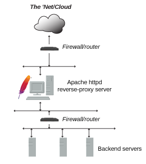
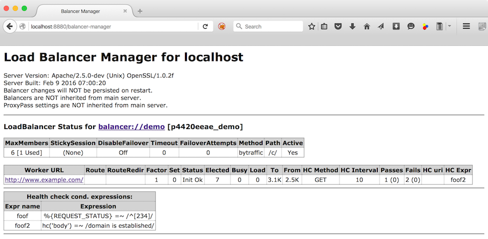
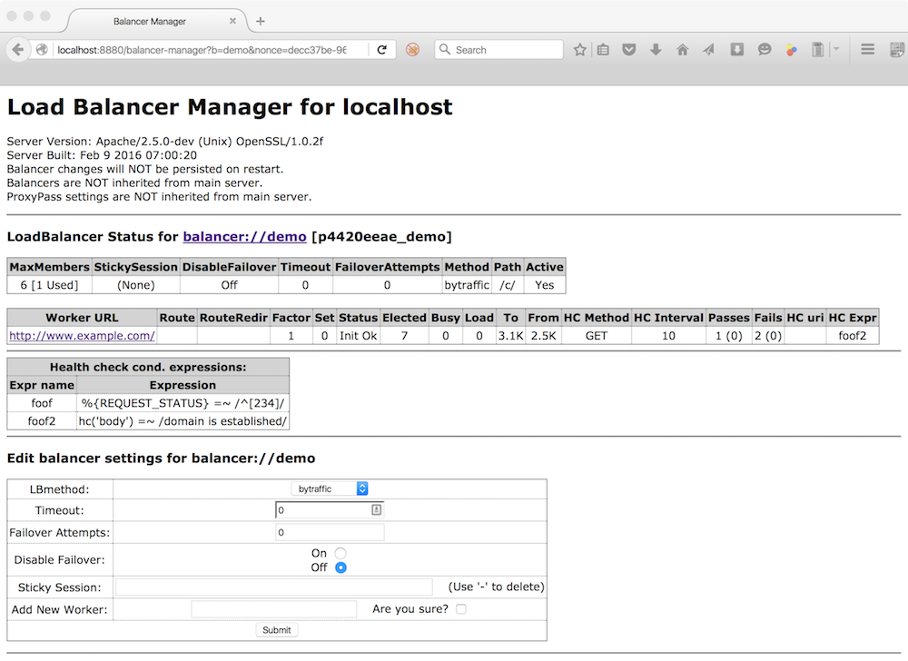
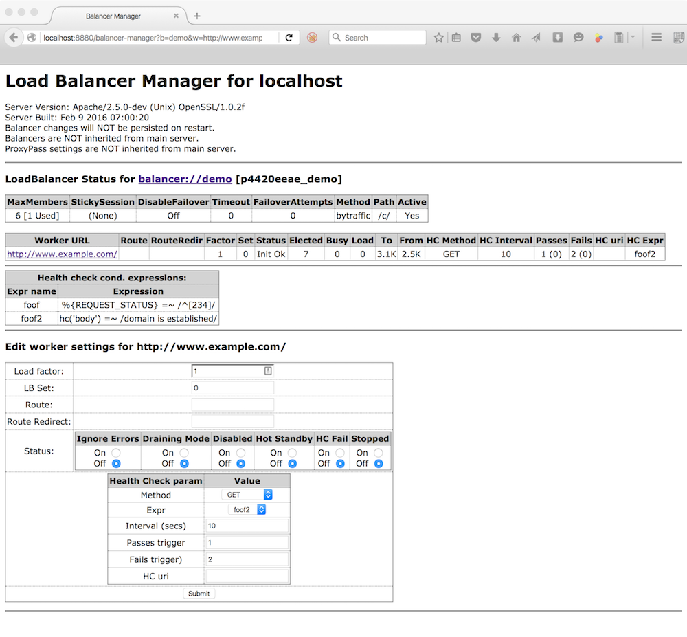

En plus de servir directement du contenu statique et dynamique, Apache httpd peut remplir les fonctions d’un serveur mandataire inverse (parfois appelé passerelle).

Dans ce mode, httpd ne génère pas le contenu lui-même. Il redirige chaque requête client vers un ou plusieurs serveurs dorsaux qui n’ont pas d’accès direct au réseau externe. Le serveur dorsal traite la requête et renvoie le contenu à httpd qui, à son tour, envoie la réponse HTTP au client.

Les buts courants de ce dispositif comprennent la sécurité, la haute disponibilité, la répartition de charge et l’authentification centralisée. L’infrastructure dorsale doit être isolée du réseau externe ; du point de vue du client, le mandataire inverse *est* la seule source de tout contenu.

Voici un exemple typique d'implémentation de cette fonctionnalité :



## Mandataire inverse

- [[12-modules/mod_proxy|mod_proxy]]
- [[12-modules/mod_proxy_balancer|mod_proxy_balancer]]
- [[12-modules/mod_proxy_hcheck|mod_proxy_hcheck]]
- [[13-directives/proxypass|ProxyPass]]
- [[13-directives/balancermember|BalancerMember]]

## Mandatement inverse simple

La directive [[13-directives/proxypass|ProxyPass]] permet de rediriger les requêtes entrantes vers un serveur d'arrière-plan (ou un cluster de serveurs plus connu sous le nom de groupe `Balancer`). Dans cet exemple le plus simple, toutes les requêtes (`"/"`) sont redirigées vers un serveur d'arrière-plan unique :

```apache
ProxyPass "/"  "http://www.example.com/"
```

Pour s’assurer que les en-têtes `Location:` générés par le serveur dorsal soient modifiés pour pointer vers le mandataire inverse, et non vers le serveur d'arrière-plan, la directive [[13-directives/proxypassreverse|ProxyPassReverse]] est en général requise :

```apache
ProxyPass "/"  "http://www.example.com/"
ProxyPassReverse "/"  "http://www.example.com/"
```

Il est possible de spécifier les URIs qui peuvent être mandatés, comme le montre l'exemple suivant :

```apache
ProxyPass "/images"  "http://www.example.com/"
ProxyPassReverse "/images"  "http://www.example.com/"
```

Dans l'exemple précédent, si le chemin d'une requête commence par `/images`, elle sera redirigée vers le serveur d'arrière-plan spécifié ; dans le cas contraire, elle sera traitée localement.

## Grappes et répartiteurs de charge

La configuration à un seul serveur dorsal ci-avant comporte un défaut évident : si ce serveur dorsal est éteint ou surchargé, le contenu mandaté ne sera pas disponible. Ce dont on a besoin ici est un groupe de serveurs dorsaux parmi lesquels le serveur mandataire pourra basculer et répartir la charge. Ce groupe est parfois appelé *grappe* (cluster) ; Apache httpd le nomme *répartiteur de charge* (balancer). Un répartiteur de charge se définit en utilisant les directives [[13-directives/proxy|<Proxy>]] et [[13-directives/balancermember|BalancerMember]] :

```apache
<Proxy balancer://myset>
BalancerMember http://www2.example.com:8080
BalancerMember http://www3.example.com:8080
ProxySet lbmethod=bytraffic
</Proxy>

ProxyPass "/images/"  "balancer://myset/"
ProxyPassReverse "/images/"  "balancer://myset/"
```

Le protocole `balancer://` indique à httpd que l'on souhaite créer un répartiteur de charge nommé *myset*. Ce répartiteur comporte deux serveurs d'arrière-plan référencés dans la terminologie httpd sous le nom de *BalancerMembers*. Avec cet exemple, toute requête dont le chemin commence par `/images` sera mandatée vers *un* des deux serveurs d'arrière-plan. La directive [[13-directives/proxyset|ProxySet]] définit ici pour le répartiteur *myset* un algorithme de répartition de charge basé sur le trafic entrées/sorties.

> [!TIP]
> **Remarque**
>
> Les *BalancerMembers* sont aussi souvent référencés sous le terme *workers*.

## Configuration du répartiteur de charge et de ses membres (workers)

Les répartiteurs de charge et leurs membres sont configurés à l’aide de paramètres de la directive [[13-directives/proxypass|ProxyPass]]. Par exemple, pour que `http://www3.example.com:8080` gère le trafic avec un facteur 3 et un délai d’une seconde :

```apache
<Proxy balancer://myset>
BalancerMember http://www2.example.com:8080
BalancerMember http://www3.example.com:8080 loadfactor=3 timeout=1
ProxySet lbmethod=bytraffic
</Proxy>

ProxyPass "/images"  "balancer://myset/"
ProxyPassReverse "/images"  "balancer://myset/"
```

## Gestion des indisponibilités (Failover)

Vous pouvez définir finement des scénarios pour les cas d'indisponibilité d'un ou plusieurs serveurs dorsaux en spécifiant quels répartiteurs et leurs membres doivent alors prendre le relai. Dans l'exemple suivant, trois scénarios sont envisagés :

1. `http://spare1.example.com:8080` et `http://spare2.example.com:8080` ne sont sollicités que si `http://www2.example.com:8080` ou `http://www3.example.com:8080` est indisponible (un serveur de remplacement sera utilisé à la place d'un membre indisponible du même jeu de serveurs cibles).
2. `http://hstandby.example.com:8080` n'est sollicité que si tous les autres serveurs cibles du jeu de serveurs `0` sont indisponibles.
3. Les serveurs `http://bkup1.example.com:8080` et `http://bkup2.example.com:8080` du jeu `1` ne seront sollicités que si tous les serveurs du jeu `0`, tous les serveurs de remplacement et tous les serveurs de standby sont indisponibles.

Il est ainsi possible de définir un ou plusieurs serveurs de remplacement ou de standby pour chaque jeu de serveurs du répartiteur de charge.

```apache
<Proxy balancer://myset>
BalancerMember http://www2.example.com:8080
BalancerMember http://www3.example.com:8080 loadfactor=3 timeout=1
BalancerMember http://spare1.example.com:8080 status=+R
BalancerMember http://spare2.example.com:8080 status=+R
BalancerMember http://hstandby.example.com:8080 status=+H
BalancerMember http://bkup1.example.com:8080 lbset=1
BalancerMember http://bkup2.example.com:8080 lbset=1
ProxySet lbmethod=byrequests
</Proxy>

ProxyPass "/images/"  "balancer://myset/"
ProxyPassReverse "/images/"  "balancer://myset/"
```

Les serveurs de remplacement à chaud remplacent les serveurs indisponibles (en phase de vidage, arrêtés ou en état d’erreur) du même jeu de serveurs du répartiteur de charge. Les serveurs de standby à chaud ne sont activés que si tous les serveurs et serveurs de remplacement du jeu de serveurs du répartiteur de charge sont indisponibles. Les jeux de serveurs du répartiteur de charge sont sollicités dans l'ordre du plus bas lbset vers le plus haut.

## Gestion du répartiteur de charge

Apache httpd comporte un *gestionnaire de répartiteur de charge* (balancer-manager) intégré. Comme [[12-modules/mod_status|mod_status]], il affiche la configuration et l’état actuels de vos répartiteurs de charge et de leurs membres. Il vous permet aussi de les reconfigurer à l’exécution — par exemple pour ajouter de nouveaux membres à un répartiteur existant. Pour l’activer, ajoutez les lignes suivantes à votre configuration :

```apache
<Location "/balancer-manager">
SetHandler balancer-manager
Require host localhost
</Location>
```

> [!WARNING]
> **Avertissement**
>
> N'activez le *balancer-manager* que si vous avez déjà [[12-modules/mod_proxy|sécurisé votre serveur]]. Assurez-vous en particulier que l'accès à l'URL soit fortement restreint.

Lorsque vous accédez au serveur mandataire avec une adresse du style `http://rproxy.example.com/balancer-manager/`, la page suivante s'affiche :



Ce formulaire permet de modifier certains paramètres, de désactiver ou d'ajouter des serveurs dorsaux, et de modifier les règles de répartition de charge. Si l’on clique sur le répartiteur, la page suivante s'affiche :



Si on clique sur un membre du groupe de répartition de charge, la page suivante s'affiche :



Si vous souhaitez que ces modifications soient conservées après un redémarrage du serveur, assurez-vous que la directive [[13-directives/balancerpersist|BalancerPersist]] soit définie à On.

## Vérification dynamique du bon fonctionnement d'un serveur dorsal

Avant de mandater une requête, httpd peut *"tester"* si le serveur dorsal est disponible en définissant le paramètre `ping` de ce serveur via la directive [[13-directives/proxypass|ProxyPass]]. Cependant, il est souvent plus judicieux de vérifier le bon fonctionnement d'un serveur *hors ibande* via le module [[12-modules/mod_proxy_hcheck|mod_proxy_hcheck]].

## Drapeaux d'état d'un membre du groupe de répartition de charge

*balancer-manager* permet d'afficher et de modifier l'état d'un membre du groupe de répartition de charge. Les différents états et leurs significations sont les suivants :

| Drapeau | Sigle | Description |
| --- | --- | --- |
|   | *Ok* | Le serveur est disponible |
|   | *Init* | Le serveur a été initialisé |
| `D` | *Dis* | Le serveur est désactivé et n'accepte aucune requête ; il sera retesté automatiquement. |
| `S` | *Stop* | Le serveur a été arrêté par l'administrateur ; il n'accepte aucune requête et il ne sera pas retesté automatiquement. |
| `I` | *Ign* | Les erreurs concernant ce serveur sont ignorées et il sera donc toujours considéré comme disponible. |
| `R` | *Spar* | Le serveur cible sert de remplaçant à chaud. Lorsqu'un serveur cible avec un lbset donné est inutilisable (maintenance, arrêt, en erreur, etc...), un serveur de remplacement à chaud libre de même lbset sera utilisé à sa place. Les remplaçants à chaud permettent de s'assurer qu'un nombre déterminé de serveurs cibles sera toujours disponible pour un répartiteur de charge. |
| `H` | *Stby* | Le serveur est en mode hot-standby et ne sera donc utilisé que si aucun autre serveur ou serveur de remplacement n'est disponible dans le jeu de serveurs du répartiteur de charge. |
| `E` | *Err* | Le serveur est en erreur, en général suite à un test préalable à une requête ; aucune requête ne lui sera soumise, mais il sera retesté en fonction de la valeur de son paramètre `retry`. |
| `N` | *Drn* | Le serveur est en mode drain ; il n'acceptera de requêtes que dans le cadre des sessions persistantes qui lui sont réservées et ignorera toutes les autres. |
| `C` | *HcFl* | Le serveur a échoué au test dynamique de bon fonctionnement et ne sera utilisé que lorsqu'il aura réussi un test ultérieur. |

---

*Source : documentation officielle d’Apache HTTP Server 2.4 (traduction française de la Fondation Apache), © Apache Software Foundation, licence Apache 2.0.*
