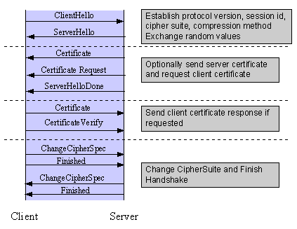
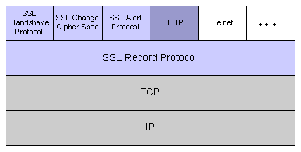
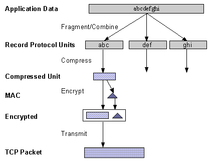

Ce chapitre en guise d'introduction est destiné aux lecteurs pour lesquels le Web, HTTP et Apache sont familiers, mais ne sont pas des experts en matière de sécurité. Il n'a pas la prétention d'être un guide détaillé sur le protocole SSL, il ne traitera pas non plus des techniques spécifiques de gestion des certificats dans une organisation, ni des importants problèmes légaux de brevets ou des restrictions d'importation ou d'exportation. Il se veut plutôt une base de travail pour les utilisateurs de [[12-modules/mod_ssl|mod_ssl]] en rassemblant différents concepts, définitions et exemples comme point de départ pour une exploration plus détaillée.

## Techniques de chiffrement

La maîtrise de SSL nécessite la compréhension des algorithmes de chiffrement, des fonctions relatives aux empreintes de messages (comme les fonctions de type hash ou non réversibles), et des signatures numériques. Ces techniques pourraient faire l'objet d'un ouvrage à elles seules (voir par exemple \[AC96\]) et constituent les bases de la confidentialité, de l'intégrité et de l'authentification.

### Algorithmes de chiffrement

Supposons qu'Alice veuille envoyer un message à sa banque pour transférer une certaine somme. Alice souhaiterait que le message soit privé, car il contient des informations comme son numéro de compte et le montant du transfert. Une solution consisterait à utiliser un algorithme de chiffrement, technique qui permet de remplacer un message par sa version chiffrée, illisible jusqu'à ce qu'elle soit déchiffrée. Sous sa forme chiffrée, le message ne peut être déchiffré qu'en utilisant une clé secrète. Sans la clé, le message est inutilisable : les bons algorithmes de chiffrement rendent si difficile la restitution du texte original par des intrus que ceux-ci y gaspilleraient leurs efforts.

Il existe deux catégories d'algorithmes de chiffrement : conventionnel ou à clé publique.

**Chiffrement conventionnel**

aussi connu sous le nom de chiffrement symétrique, il nécessite le partage d'une clé entre l'expéditeur et le destinataire : une portion d'information secrète permettant de chiffrer et déchiffrer un message. Tant que cette clé reste secrète, personne à part l'expéditeur et le destinataire ne peut lire le message. Si Alice et sa banque partagent une clé secrète, ils peuvent donc s'envoyer l'un à l'autre des messages privés. Le fait de partager une clé entre l'expéditeur et le destinataire avant de communiquer, tout en la maintenant secrète vis à vis des autres, peut toutefois poser des problèmes.

**Chiffrement à clé publique**

aussi connu sous le nom de chiffrement asymétrique, il résoud le problème d'échange de clé en définissant un algorithme qui utilise deux clés, chacune d'entre elles pouvant être utilisée pour chiffrer un message. Si une des clés a été utilisée pour chiffrer le message, on doit utiliser l'autre clé pour le déchiffrer. Il est ainsi possible de recevoir des messages sécurisés simplement en rendant publique une des clés (la clé publique), et en gardant l'autre clé secrète (la clé privée).

Tout le monde peut chiffrer un message en utilisant la clé publique, mais seul le propriétaire de la clé privée sera en mesure de le lire. De cette façon, Alice peut envoyer des messages privés au propriétaire d'une paire de clés (sa banque), en les chiffrant à l'aide de la clé publique. Seule la banque sera en mesure de les déchiffrer.

### Empreinte d'un message

Bien qu'Alice puisse chiffrer son message pour le rendre privé, il subsiste toujours le risque que quelqu'un puisse modifier le message original ou le remplacer par un autre, afin d'effectuer le transfert de fonds à son profit, par exemple. Une solution pour garantir l'intégrité du message consisterait pour Alice à créer un résumé concentré de son message qu'elle enverrait à sa banque avec ce dernier. A la réception du message, la banque crée son propre résumé et le compare avec celui qu'Alice a envoyé. Si les deux résumés sont identiques, le message reçu n'a pas été modifié.

Un résumé tel que celui-ci est appelé *empreinte numérique de message* (message digest), *fonction irréversible* (one-way function) ou *fonction de hashage* (hash function). Une empreinte de message constitue une représentation courte et de longueur fixe, d'un message plus long et de longueur variable. Les algorithmes de création d'empreintes sont conçus pour produire une empreinte unique pour chaque message. Les empreintes de messages sont conçues pour que la restitution du message à partir de l'empreinte soit d'une difficulté insurmontable, et qu'il soit (en théorie) impossible de trouver deux messages différents qui produisent la même empreinte -- ce qui élimine la possibilité de remplacer un message par un autre en conservant la même empreinte.

Trouver le moyen d'envoyer l'empreinte de manière sécurisée à la banque constitue un autre défit auquel Alice doit faire face ; si l'empreinte n'est pas envoyée de manière sécurisée, son intégrité peut être compromise, et avec elle, la possibilité pour la banque de vérifier l'intégrité du message original. L'intégrité du message ne peut être vérifiée que si l'empreinte qui lui est associée est envoyée de manière sécurisée.

Une solution pour envoyer l'empreinte de manière sécurisée consiste à l'inclure dans une signature numérique.

### Signatures numériques

Quand Alice envoie un message à sa banque, cette dernière doit s'assurer que le message a bien été envoyé par elle, pour éviter qu'un intrus puisse effectuer une transaction sur son compte. Une *signature numérique*, créée par Alice et incluse dans le message, permet d'atteindre cet objectif.

Les signatures numériques peuvent être créées en chiffrant une empreinte de message, ainsi que d'autres informations (comme un numéro d'ordre) avec la clé privée de l'expéditeur. Bien que tout le monde puisse *déchiffrer* la signature à l'aide de la clé publique, seul l'expéditeur connait la clé privée. Ce qui implique que seul l'expéditeur peut avoir signé le message. Inclure l'empreinte dans la signature entraîne que cette dernière n'est valable que pour ce message ; ceci assure aussi l'intégrité du message car personne ne peut modifier l'empreinte et ensuite signer le message.

Afin de se prémunir contre l'interception et la réutilisation de la signature par un intrus quelques jours plus tard, la signature contient un numéro d'ordre unique. Ceci protège la banque contre une plainte frauduleuse de la part d'Alice alléguant qu'elle n'a pas envoyé le message -- elle seule peut l'avoir signé (non-répudiation).

## Certificats

Bien qu'Alice soit parvenue à envoyer un message privé à sa banque, après l'avoir signé et avoir ainsi assuré l'intégrité du message, elle doit encore vérifier qu'elle communique réellement avec la banque. C'est à dire qu'elle doit s'assurer que la clé publique qu'elle utilise appartient bien à la paire de clés de la banque, et non à celle d'un intrus. De même, la banque doit vérifier que la signature du message a bien été construite avec la clé privée d'Alice.

Si chaque partie possède un certificat qui valide l'identité de l'autre, confirme la clé publique, et est signé par un organisme de confiance, alors les deux protagonistes peuvent être sûrs que la personne avec laquelle ils communiquent est bien celle avec laquelle ils désirent le faire. Un tel organisme de confiance s'appelle une *Autorité de Certification*, et on utilise les certificats à des fins d'authentification.

### Contenu d'un certificat

Un certificat associe une clé publique avec l'identité réelle d'un individu, d'un serveur, ou d'une autre entité plus connue sous le nom de sujet. Comme on le voit dans le Tableau 1, les information concernant le sujet comprennent des informations d'identification (le nom distinctif ou distinguished name - dn), ainsi que la clé publique. Il comporte aussi l'identification et la signature de l'autorité de certification qui a délivré le certificat, ainsi que la période de validité de ce dernier. Il peut aussi contenir des informations supplémentaires (ou extensions) telles que des informations de gestion destinées à l'autorité de certification, comme un numéro de série.

#### Tableau 1: Information contenues dans un certificat

| Sujet | Nom distinctif, Clé publique |
| --- | --- |
| Fournisseur | Nom distinctif, Signature |
| Période de validité | Pas avant, Pas après |
| Informations de gestion | Version, Numéro de série |
| Extensions | Contraintes de base, Drapeaux Netscape, etc. |

Un nom distinctif sert à fournir une identité dans un contexte spécifique -- par exemple, un individu peut posséder un certificat personnel, et aussi un certificat en tant qu'employé. Les noms distinctifs doivent respecter le standard X509 \[X509\], qui définit les champs, les noms de champs, et les abréviations utilisées pour faire référence aux champs (voir Tableau 2).

#### Tableau 2: Informations contenues dans le nom distinctif

| Champ du DN | Abrév. | Description | Exemple |
| --- | --- | --- | --- |
| Nom complet (Common Name) | CN | Nom certifié | CN=Joe Average |
| Organisation or Entreprise | O | Nom est associé à cette organisation | O=Snake Oil, Ltd. |
| Unité organisationnelle (Organizational Unit) | OU | Nom est associé avec cette unité organisationnelle, par exemple un département | OU=Research Institute |
| Ville/Localisation | L | Nom est localisé dans cette ville | L=Snake City |
| Etat/Province | ST | Nom est localisé dans cet état/province | ST=Desert |
| Pays | C | Nom est localisé dans ce pays (code ISO) | C=XZ |

Une autorité de certification peut définir une contrainte spécifiant quels champs du nom distinctif sont optionnels et lesquels sont obligatoires. Elle peut aussi imposer des contraintes sur le contenu des champs, ce que peuvent aussi faire les utilisateurs de certificats. Par exemple, un navigateur Netscape peut exiger, dans le cas d'un certificat de serveur, que le nom complet (Common Name) corresponde à un nom générique contenant le nom de domaine du serveur, comme `*.snakeoil.com`.

Le format binaire d'un certificat est défini en utilisant la notation ASN.1 \[ASN1\] \[PKCS\]. Cette notation definit la manière de spécifier les contenus, et les règles d'encodage définissent la manière dont ces information sont converties au format binaire. L'encodage binaire du certificat est défini par les Règles d'Encodage Distinctives (Distinguished Encoding Rules - DER), qui se basent d'une manière plus générale sur les Règles d'Encodage de Base (Basic Encoding Rules - BER). Pour les transmissions qui ne supportent pas le format binaire, ce dernier peut être converti au format ASCII en utilisant le codage Base64 \[MIME\]. Lorsqu'il est placé entre des délimiteurs de début et de fin (comme ci-dessous), on dit que le certificat est encodé au format PEM ("Privacy Enhanced Mail").

**Exemple de certificat encodé au format PEM (snakeoil.crt)**

```
    -----BEGIN CERTIFICATE-----
MIIC7jCCAlegAwIBAgIBATANBgkqhkiG9w0BAQQFADCBqTELMAkGA1UEBhMCWFkx
FTATBgNVBAgTDFNuYWtlIERlc2VydDETMBEGA1UEBxMKU25ha2UgVG93bjEXMBUG
A1UEChMOU25ha2UgT2lsLCBMdGQxHjAcBgNVBAsTFUNlcnRpZmljYXRlIEF1dGhv
cml0eTEVMBMGA1UEAxMMU25ha2UgT2lsIENBMR4wHAYJKoZIhvcNAQkBFg9jYUBz
bmFrZW9pbC5kb20wHhcNOTgxMDIxMDg1ODM2WhcNOTkxMDIxMDg1ODM2WjCBpzEL
MAkGA1UEBhMCWFkxFTATBgNVBAgTDFNuYWtlIERlc2VydDETMBEGA1UEBxMKU25h
a2UgVG93bjEXMBUGA1UEChMOU25ha2UgT2lsLCBMdGQxFzAVBgNVBAsTDldlYnNl
cnZlciBUZWFtMRkwFwYDVQQDExB3d3cuc25ha2VvaWwuZG9tMR8wHQYJKoZIhvcN
AQkBFhB3d3dAc25ha2VvaWwuZG9tMIGfMA0GCSqGSIb3DQEBAQUAA4GNADCBiQKB
gQDH9Ge/s2zcH+da+rPTx/DPRp3xGjHZ4GG6pCmvADIEtBtKBFAcZ64n+Dy7Np8b
vKR+yy5DGQiijsH1D/j8HlGE+q4TZ8OFk7BNBFazHxFbYI4OKMiCxdKzdif1yfaa
lWoANFlAzlSdbxeGVHoT0K+gT5w3UxwZKv2DLbCTzLZyPwIDAQABoyYwJDAPBgNV
HRMECDAGAQH/AgEAMBEGCWCGSAGG+EIBAQQEAwIAQDANBgkqhkiG9w0BAQQFAAOB
gQAZUIHAL4D09oE6Lv2k56Gp38OBDuILvwLg1v1KL8mQR+KFjghCrtpqaztZqcDt
2q2QoyulCgSzHbEGmi0EsdkPfg6mp0penssIFePYNI+/8u9HT4LuKMJX15hxBam7
dUHzICxBVC1lnHyYGjDuAMhe396lYAn8bCld1/L4NMGBCQ==
-----END CERTIFICATE-----
```

### Autorités de certification

En vérifiant les informations contenues dans une demande de certificat avant de l'accorder, l'autorité de certification s'assure de l'identité du propriétaire de la clé privée issue de sa paire de clés. Par exemple, Si Alice demande un certificat personnel, l'autorité de certification doit d'abord s'assurer qu'elle correspond vraiment à la personne à laquelle la demande de certificat fait référence.

#### Chaînes de certification

Une autorité de certification peut aussi émettre un certificat à destination d'une autre autorité de certification. Pour vérifier un certificat, Alice peut être amenée à vérifier le certificat de l'émetteur pour chaque autorité de certification parente, jusqu'à ce qu'elle en atteigne une en qui elle a confiance. Elle peut aussi ne faire confiance qu'aux certificats faisant l'objet d'une chaîne limitée d'émetteurs, afin de réduire le risque de rencontrer un "mauvais" certificat dans la chaîne.

#### Création d'une autorité de certification racine

Comme indiqué plus haut, chaque certificat nécessite la validation de l'identité du sujet par un émetteur de certificats de niveau supérieur, et ceci en remontant jusqu'à l'Autorité de Certification (CA) racine. Ceci pose un problème : qui va se porter garant du certificat de l'autorité racine qui ne possède pas d'émetteur de certificat ? C'est uniquement dans ce cas que le certificat est auto-signé, l'émetteur du certificat et son sujet étant confondus. Les navigateurs sont préconfigurés avec une liste d'autorités de certification de confiance, mais il est important d'être extrèmement prudent avant de faire confiance à un certificat auto-signé. La large publication d'une clé publique par l'autorité racine réduit cependant les risques encourus en faisant confiance à cette clé -- si quelqu'un publiait une clé en se faisant passer pour l'autorité, il serait vite démasqué.

Quelques compagnies, comme [Thawte](http://www.thawte.com/) et [VeriSign](http://www.verisign.com/), se sont proclamées elles-mêmes Autorités de Certification. Ces compagnies proposent les services suivant :

- Vérification des demandes de certificats
- Traitement des demandes de certificats
- Emission et gestion des certificats

Vous pouvez aussi créer votre propre autorité de certification. Bien que risqué dans l'environnement de l'Internet, ceci peut s'avérer utile dans un Intranet, où l'organisme peut vérifier facilement les identités des individus et des serveurs.

#### Gestion des certificats

Constituer une autorité de certification représente une responsabilité qui nécessite une solide infrastructure administrative, technique et gestionnaire. Les autorités de certification ne se contentent pas d'émettre des certificats, elles doivent aussi les gérer -- à savoir elles déterminent leur durée de validité, elles les renouvellent, et elles maintiennent des listes de certificats qui ont été émis dans le passé mais ne sont plus valides (Listes de révocations de certificats, ou CRLs).

Par exemple, si Alice est titulaire d'un certificat en tant qu'employée d'une compagnie, mais vient de quitter cette compagnie, son certificat doit être révoqué. Comme les certificats ne sont émis qu'après vérification de l'identité du sujet, et peuvent être envoyés à tous ceux avec lesquels le sujet peut communiquer, il est impossible de discerner à partir du seul certificat s'il a été révoqué. Pour vérifier la validité d'un certificat, il est donc nécessaire de contacter l'autorité de certification qui l'a émis afin de pouvoir consulter ses listes de révocations de certificats -- ce qui n'est en général pas une partie automatique du processus.

> [!NOTE]
> **Note**
>
> Si votre autorité de certification ne fait pas partie de la liste des autorités de confiance de votre navigateur, il faut enregistrer le certificat de l'autorité de certification dans ce dernier, ce qui lui permettra de valider les certificats de serveurs signés par cette autorité de certification. Ceci peut être dangereux, car une fois le certificat enregistré, le navigateur acceptera tous les certificats signés par cette autorité de certification.

## Couche Points d'Accès Sécurisés - Secure Sockets Layer (SSL)

Le protocole Couche Points d'Accès Sécurisés est une couche protocolaire qui pourrait s'intercaler entre un protocole d'une couche réseau orientée connexion (comme TCP/IP) et une couche protocolaire d'application (comme HTTP). SSL fournit une communication sécurisée entre client et serveur en permettant l'authentification mutuelle, l'utilisation des signatures numériques pour la vérification de l'intégrité des données, et le chiffrement pour la confidentialité.

Ce protocole est conçu pour supporter un grand choix d'algorithmes spécifiques utilisés pour la cryptographie, les empreintes et les signatures. Ceci permet la sélection d'un algorithme pour des serveurs spécifiques en respectant la légalité, les règles d'exportation ou autres contraintes, et permet aussi au protocole de tirer parti des nouveaux algorithmes. Ces choix font l'objet d'une négociation entre client et serveur lors de l'établissement de la session protocolaire.

### Tableau 4: Versions du protocole SSL

| Version | Source | Description |
| --- | --- | --- |
| SSL v2.0 | Standard du fournisseur (de Netscape Corp.) | Premier protocole SSL pour lequel il existe des implémentations |
| SSL v3.0 | Projet Internet arrivé à expiration (de Netscape Corp.) \[SSL3\] | Comporte des révisions permettant de prévenir certaines attaques de sécurité spécifiques, ajout de chiffrements non RSA, et support des chaînes de certification |
| TLS v1.0 | Standard proposé pour l'Internet (de l'IETF) \[TLS1\] | Révision de SSL 3.0 pour mettre à jour la couche MAC vers HMAC, ajout du bourrage de bloc pour le chiffrement de bloc, standardisation de l'ordonnancement des messages et plus de messages d'alerte. |
| TLS v1.1 | Standard proposé pour l'Internet (de l'IETF) \[TLS11\] | Mise à jour de TLS 1.0 pour la protection contre les attaques de type Cipher block chaining (CBC). |
| TLS v1.2 | Standard proposé pour l'Internet (de l'IETF) \[TLS12\] | Mise à jour de TLS 1.1 rendant les condensés MD5 obsolètes, et introduisant une incompatibilité avec SSL ce qui interdit toute négociation en vue d'une utilisation de SSLv2. |
| TLS v1.3 | Standard pour l'Internet (de l'IETF) \[TLS13\] | Révision majeure de TLS 1.2 supprimant la cryptographie patrimoniale, assurant une confidentialité absolue et remaniant le protocole de négociation pour une sécurité et des performances accrues. |

Il existe plusieurs versions du protocole SSL, comme le montre le Tableau 4. Comme indiqué dans ce dernier, un des apports de SSL 3.0 est le support du chargement des chaînes de certification. Cette fonctionnalité permet à un serveur de passer au navigateur un certificat de serveur accompagné du certificat de l'émetteur. Le chargement de la chaîne permet aussi au navigateur de valider le certificat du serveur, même si les certificats de l'autorité de certification ne sont pas installés pour les émetteurs intermédiaires, car ils sont inclus dans la chaîne de certification. SSL 3.0 sert de base au standard du protocole Sécurité de la Couche Transport ou Transport Layer Security \[TLS\], actuellement en développement au sein de l'Internet Engineering Task Force (IETF).

### Etablissement d'une session

La session SSL est établie en suivant une séquence d'échanges d'informations entre client et serveur, comme le montre la Figure 1. Cette séquence peut varier, selon que le serveur est configuré pour fournir un certificat de serveur ou réclame un certificat client. Bien que dans certains cas, des étapes d'échanges d'informations supplémentaires soient nécessaires pour la gestion des informations de chiffrement, cet article résume un scénario courant. Se reporter aux spécifications SSL pour avoir la liste de toutes les possibilités.

> [!NOTE]
> **Note**
>
> Une fois la session SSL établie, elle peut être réutilisée. Ceci permet d'éviter la perte de performances due à la répétition des nombreuses étapes nécessaires à l'établissement d'une session. Pour parvenir à ceci, le serveur assigne un identifiant de session unique à chaque session SSL ; cet identifiant est mis en cache dans le serveur et le client peut l'utiliser pour des connexions ultérieures afin de réduire la durée des échanges d'informations (et ceci jusqu'à ce que l'identifiant de session arrive à expiration dans le cache du serveur).


*Figure 1* : Séquence simplifiée d'échanges d'informations SSL

Les éléments de la séquence d'échanges d'informations, tels qu'ils sont utilisés par le client et le serveur, sont énumérés ci-après :

1. Négociation de la suite de chiffrement à utiliser durant le transfert des données
2. Elaboration et échange d'une clé de session entre le client et le serveur
3. Authentification éventuelle du serveur par le client
4. Authentification éventuelle du client par le serveur

La première étape, la négociation de la suite de chiffrement, permet au client et au serveur de choisir une suite de chiffrement qu'ils supportent tous les deux. La spécification du protocole SSL 3.0 définit 31 suites de chiffrement. Une suite de chiffrement se compose des éléments suivants :

- Méthode d'échange de la clé
- Chiffrement du transfert des données
- Empreinte du message servant à créer le code d'authentification du message (MAC)

Ces trois éléments sont décrits dans les sections suivantes.

### Méthode d'échange de la clé

La méthode d'échange de la clé définit la manière dont la clé de chiffrement symétrique secrète et partagée utilisée pour le transfert des données de l'application sera acceptée par le client et le serveur. SSL 2.0 utilise l'échange de clé RSA seulement, tandis que SSL 3.0 supporte tout un choix d'algorithmes d'échange de clé incluant l'échange de clé RSA (quand les certificats sont utilisés), et l'échange de clés Diffie-Hellman (pour échanger des clés sans certificat, ou en l'absence de communication préalable entre le client et le serveur).

Les signatures numériques constituent une variante dans le choix des méthodes d'échange de clé -- utiliser les signatures ou pas, et dans l'affirmative, quel genre de signatures utiliser. La signature à l'aide d'une clé privée fournit une protection contre une attaque "man-in-the-middle" au cours de laquelle l'échange d'informations destiné à générer la clé partagée peut être intercepté \[AC96, p516\].

### Chiffrement du transfert de données

Comme décrit plus haut, SSL utilise le chiffrement symétrique conventionnel pour chiffrer les messages au cours d'une session. Il existe neuf choix possibles pour le chiffrement, y compris l'option du transfert non chiffré :

- Pas de chiffrement
- Chiffrement en continu (Stream Ciphers)

  - RC4 avec clés de 40 bits
  - RC4 avec clés de 128 bits
- Chiffrement par blocs CBC (CBC Block Ciphers)

  - RC2 avec clé de 40 bits
  - DES avec clé de 40 bits
  - DES avec clé de 56 bits
  - Triple-DES avec clé de 168 bits
  - Idea (clé de 128 bits)
  - Fortezza (clé de 96 bits)

"CBC" signifie Cipher Block Chaining (Chaînage de blocs chiffrés), c'est à dire qu'une portion du bloc de texte chiffré précédent est utilisée pour le chiffrement du bloc courant. "DES" signifie Data Encryption Standard (Standard de Chiffrement des Données) \[AC96, ch12\], et possède de nombreuses variantes (telles que DES40 et 3DES\_EDE). Parmi les algorithmes disponibles, "Idea" est actuellement un des meilleurs et des plus puissants sur le plan cryptographique, et "RC2" est un algorithme propriétaire de RSA DSI \[AC96, ch13\].

### Fonction de création d'empreinte

Le choix d'une fonction de création d'empreinte détermine la manière dont une empreinte est créée à partir d'une unité de données. SSL supporte les fonctions suivantes :

- Pas d'empreinte (choix Null)
- MD5, une empreinte de 128 bits
- Algorithme d'Empreinte Sécurisée (Secure Hash Algorithm - SHA-1), une empreinte de 160 bits

On utilise l'empreinte de message pour créer un Code d'Authentification de Message (Message Authentication Code - MAC) qui est chiffré avec le message afin de vérifier son intégrité et de se protéger contre les attaques de type "rejeu".

### Protocole de la séquence d'échanges d'informations

La séquence d'échanges d'informations utilise trois protocoles :

- Le *Protocole d'échanges d'informations SSL* pour établir la session SSl entre le client et le serveur.
- Le *Protocole de spécification du chiffrement SSL* pour l'agrément effectif de la suite de chiffrement à utiliser pour la session.
- Le *Protocole d'alertes SSL* pour la transmission de messages d'erreur SSL entre le client et le serveur.

Ces protocoles, ainsi que les données du protocole de l'application, sont encapsulés dans le *Protocole d'enregistrement SSL (SSL Record Protocol)*, comme le montre la Figure 2. Un protocole encapsulé est tranféré en tant que données par le protocole de la couche de niveau inférieur, qui ne se préoccupe pas du contenu des données. Le protocole encapsulé n'a aucune connaissance du protocole sous-jacent.


*Figure 2*: Pile du protocole SSL

L'encapsulation des protocoles de contrôle SSL dans le protocole d'enregistrement signifie que si une session active est renégociée, les protocoles de contrôle seront transmis de manière sécurisée. S'il n'y avait pas de session préalable, la suite de chiffrement Null est utilisée, ce qui signifie que les messages ne seront pas chiffrés et ne possèderont pas d'empreinte d'intégrité, jusqu'à ce que la session ait été établie.

### Transmission des données

Le protocole d'enregistrement SSL, comme le montre la Figure 3, est utilisé pour transmettre les données de l'application et les données de contrôle SSL entre le client et le serveur, les données étant nécessairement fragmentées en éléments plus petits, ou plusieurs messages de données avec protocole de niveau supérieur pouvant être combinés en un seul élément. Ce protocole peut joindre des signatures d'empreintes, compresser et chiffrer ces éléments avant de les transmettre en utilisant le protocole fiable de transport sous-jacent (Note : actuellement, aucune implémentation majeure de SSL n'inclut le support de la compression).


*Figure 3*: Protocole d'enregistrement SSL

### Sécurisation des communications HTTP

Une des utilisations courantes de SSL est la sécurisation des communication HTTP sur le Web entre un navigateur et un serveur web. Ceci n'exclut pas l'utilisation de HTTP non sécurisé - la version sécurisée (appelée HTTPS) est identique à du vrai HTTP sur SSL, mais utilise le préfixe d'URL `https` au lieu de `http`, et un port de serveur différent (par défaut le port 443). Ceci constitue pour une large part ce qu'apporte [[12-modules/mod_ssl|mod_ssl]] au serveur web Apache.

## Références

**\[AC96\]**

Bruce Schneier, « Applied Cryptography », 2nd Edition, Wiley, 1996. Voir [https://www.schneier.com/](https://www.schneier.com/) pour diverses autres productions de Bruce Schneier.

**\[ASN1\]**

ITU-T Recommendation X.208, « Specification of Abstract Syntax Notation One (ASN.1) », dernière mise à jour en 2008. Voir [http://www.itu.int/ITU-T/asn1/](http://www.itu.int/ITU-T/asn1/).

**\[X509\]**

ITU-T Recommendation X.509, « The Directory - Authentication Framework ». A titre de référence, voir [http://en.wikipedia.org/wiki/X.509](http://en.wikipedia.org/wiki/X.509).

**\[PKCS\]**

« Public Key Cryptography Standards (PKCS) », RSA Laboratories Technical Notes, Voir [https://en.wikipedia.org/wiki/PKCS](https://en.wikipedia.org/wiki/PKCS).

**\[MIME\]**

N. Freed, N. Borenstein, « Multipurpose Internet Mail Extensions (MIME) Part One: Format of Internet Message Bodies », RFC2045. Voir par exemple la [RFC 2045](https://www.rfc-editor.org/rfc/rfc2045).

**\[SSL3\]**

Alan O. Freier, Philip Karlton, Paul C. Kocher, « The SSL Protocol Version 3.0 », 1996. Voir la [RFC 6101](https://www.rfc-editor.org/rfc/rfc6101).

**\[TLS1\]**

Tim Dierks, Christopher Allen, « The TLS Protocol Version 1.0 », 1999. Voir la [RFC 2246](https://www.rfc-editor.org/rfc/rfc2246).

**\[TLS11\]**

« Le protocole TLS Version 1.1 », 2006. Voir la [RFC 4346](https://www.rfc-editor.org/rfc/rfc4346).

**\[TLS12\]**

« Le protocole TLS Version 1.2 », 2008. Voir la [RFC 5246](https://www.rfc-editor.org/rfc/rfc5246).

**\[TLS13\]**

« Le protocole Transport Layer Security (TLS) version 1.3 », 2018. Voir la [RFC 8446](https://www.rfc-editor.org/rfc/rfc8446).

---

*Source : documentation officielle d’Apache HTTP Server 2.4 (traduction française de la Fondation Apache), © Apache Software Foundation, licence Apache 2.0.*
