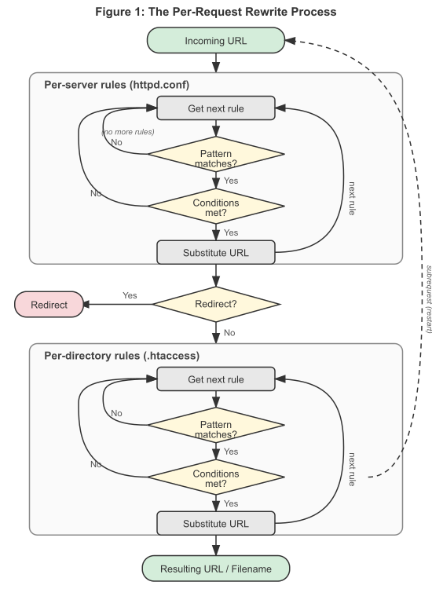
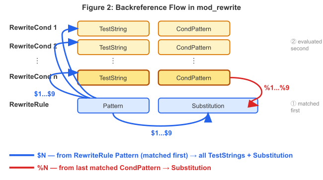

Ce document passe en revue certains détails techniques à propos du module [[12-modules/mod_rewrite|mod_rewrite]] et de la mise en correspondance des URLs

## Phases de l'API

Le traitement des requêtes par le serveur HTTP Apache se déroule en plusieurs phases. Au cours de chaque phase, un ou plusieurs modules peuvent être appelés pour traiter la partie concernée du cycle de vie de la requête. Les différentes phases peuvent consister en traduction d'URL en nom de fichier, authentification, autorisation, gestion de contenu ou journalisation (la liste n'est pas exhaustive).

[[12-modules/mod_rewrite|mod_rewrite]] agit dans deux de ces phases (ou accroches - hooks - comme on les nomme souvent) pour la réécriture des URLs.

Tout d'abord, il utilise le hook traduction URL vers nom de fichier qui intervient après la lecture de la requête HTTP, mais avant le processus d'autorisation. Ensuite, il utilise le hook Fixup, qui intervient après les phases d'autorisation, après la lecture des fichiers de configuration de niveau répertoire (fichiers `.htaccess`), mais avant l'appel du gestionnaire de contenu.

Lorsqu'une requête arrive et une fois le serveur correspondant ou le serveur virtuel déterminé, le moteur de réécriture commence à traiter toute directive [[12-modules/mod_rewrite|mod_rewrite]] apparaissant dans la configuration de niveau serveur (autrement dit dans le fichier de configuration principal du serveur et les sections [[13-directives/virtualhost|<Virtualhost>]]). Tout ce processus s'exécute au cours de la phase de traduction URL vers nom de fichier.

Quelques étapes plus loin, une fois les répertoires de données finaux trouvés, les directives de configuration de niveau répertoire (fichiers `.htaccess` et sections [[13-directives/directory|<Directory>]]) sont appliquées. Ce processus s'exécute au cours de la phase Fixup.

Dans tous ces cas, [[12-modules/mod_rewrite|mod_rewrite]] réécrit le `REQUEST_URI` soit vers un nouvel URL, soit vers un nom de fichier.

Dans un contexte de répertoire, les règles sont appliquées durant la phase "Fixup" après que l’URL a été traduit en nom de fichier. Cela modifie ce à quoi correspond le motif et la manière dont les substitutions sont gérées. Voir le document [[11-guides/05-reecriture-mod-rewrite/reecritures-au-niveau-repertoire|Réécritures en fonction du répertoire]] pour des détails pratiques à propos de la suppression du chemin, de RewriteBase et de la manière d’éviter un bouclage.

## Module Processing Order

[[12-modules/mod_rewrite|mod_rewrite]] et [[12-modules/mod_alias|mod_alias]] agissent tous les deux au cours de la phase de traduction de l’URL en nom de fichier, mais [[12-modules/mod_rewrite|mod_rewrite]] opère en premier, quel que soit l’ordre d’apparition des directives dans le fichier de configuration. Ce comportement est déterminé par la priorité des points d’accroche qu’enregistre chaque module, pas par l’ordre du code source.

La conséquence pratique : lorsque des directives [[13-directives/rewriterule|RewriteRule]] et [[13-directives/redirect|Redirect]] (ou [[13-directives/redirectmatch|RedirectMatch]]) sont présentent simultanément dans le même contexte de serveur virtuel ou global au serveur, les règles de réécriture sont évaluées en premier. Si une règle `RewriteRule` correspond et réécrit le chemin d’URL (ou renvoie une redirection), `Redirect` ne verra jamais la requête.


*Figure :* Inversion de l’ordre d’opération des modules entre les contextes global au serveur et de répertoire

```apache
# Dans cette configuration, le Redirect n’est jamais atteint pour /old,
# car la règle RewriteRule s’applique en premier — même si
# Redirect apparaît plus tôt dans le fichier.
Redirect "/old" "http://example.com/new"
RewriteRule "^/old" "/other" [L]
```

> [!NOTE]
> **Le contexte de répertoire inverse l’ordre**
>
> Dans un contexte de répertoire, la situation est différente. Les directives de [[12-modules/mod_alias|mod_alias]] comme `Redirect` s’appliquent encore dans la phase de traduction de l’URL en nom de fichier, mais les directives de [[12-modules/mod_rewrite|mod_rewrite]] s’appliquent plus tard, lors de la phase de correction. Cela signifie que dans un contexte de répertoire, `Redirect` est évaluée *avant* l’application des règles `RewriteRule`.

Du fait de l’incohérence entre les contextes, mélanger des directives de [[12-modules/mod_rewrite|mod_rewrite]] et de [[12-modules/mod_alias|mod_alias]] dans la même portée est une source courante de confusion. Un conseil simple : choisissez un module pour une tâche donnée. Si vous avez besoin de conditions de réécritures ou de comparaison de motif, utilisez exclusivement `RewriteRule`. Si une simple redirection de préfixe suffit, utilisez la directive `Redirect` et n’ajoutez pas de règles de réécritures qui pourraient interagir avec elle.

## Encodage et décodage des URLs

Apache httpd supprime l’échappement des caractères encodés pour l’URL dans le chemin d’URL de la requête avant que toute comparaison de motif de directive [[13-directives/rewriterule|RewriteRule]] ne soit effectuée. Une requête pour `/my%20page/cats%3Fdogs` est décodée en `/my page/cats?dogs`, et c’est à cette chaîne décodée qu’est comparé le motif de la directive `RewriteRule`.

Cela signifie que vous ne pouvez pas écrire un motif correspondant à la forme littérale de l’URL encodé. Si vous devez distinguer `/horses%2Fponies` de `/horses/ponies`, utilisez la variable `%{THE_REQUEST}` dans une directive [[13-directives/rewritecond|RewriteCond]] — cette variable conserve la requête originelle telle qu’elle a été envoyée par le client, avant tout décodage :

```apache
# Ne correspond qu’au caractère encodé littéral %2F,
# pas au séparateur de chemin réel
RewriteCond "%{THE_REQUEST}" "/horses%2F"
RewriteRule "^/horses/ponies$" "/special-handler" [L]
```

Après la substitution, [[12-modules/mod_rewrite|mod_rewrite]] réencode le chemin d’URL résultant en sortie. Plusieurs drapeaux permettent de contrôler ce comportement :

- [[11-guides/05-reecriture-mod-rewrite/les-drapeaux-de-reecriture|[B)]] : rétablit l’échappement des références arrières de façon que les caractères spéciaux capturés dans le chemin d’URL décodé ne soient pas interprétés comme des délimiteurs dans la substitution.
- [[11-guides/05-reecriture-mod-rewrite/les-drapeaux-de-reecriture|[BNP)]] : si \[B\] est actif, ce drapeau encode les espaces en `%20` au lieu de `+` (convient pour les éléments du chemin, pas pour la chaîne de paramètres).
- [[11-guides/05-reecriture-mod-rewrite/les-drapeaux-de-reecriture|[NE)]] : ce drapeau supprime l’échappement par défaut des caractères spéciaux dans le résultat de la substitution, permettant la transmission sans modification des littéraux `#`, `?` et d’autres caractères lors des redirections externes.

### Directive AllowEncodedSlashes

Par défaut, httpd renvoie un code 404 pour tout URL contenant une barre oblique encodée (`%2F`). La directive [[13-directives/allowencodedslashes|AllowEncodedSlashes]] permet de modifier ce comportement :

- `Off` (valeur par défaut) : rejette `%2F` avec un code 404.
- `On` : autorise `%2F` et le décode en `/` avant de le transmettre aux gestionnaires.
- `NoDecode` : autorise `%2F`, mais le conserve sous sa forme encodée de façon que l’application dorsale le distingue d’un séparateur de chemin réel.

Lorsqu’on utilise le drapeau [[11-guides/05-reecriture-mod-rewrite/les-drapeaux-de-reecriture|[B)]] avec des URLs qui peuvent contenir des barres obliques encodées, il est en général nécessaire d’utiliser `AllowEncodedSlashes NoDecode` pour éviter que httpd ne rejette le résultat réencodé.

## Traitement du jeu de règles

Maintenant, quand [[12-modules/mod_rewrite|mod_rewrite]] se lance dans ces deux phases de l'API, il lit le jeu de règles configuré depuis la structure contenant sa configuration (qui a été elle-même créée soit au démarrage d'Apache httpd pour le contexte du serveur, soit lors du parcours des répertoires par le noyau d'Apache httpd pour le contexte de répertoire). Puis le moteur de réécriture est démarré avec le jeu de règles contenu (une ou plusieurs règles associées à leurs conditions). En lui-même, le mode opératoire du moteur de réécriture d'URLs est exactement le même dans les deux contextes de configuration. Seul le traitement du résultat final diffère.


*Figure 1 :*Le processus de réécriture par requête montrant les deux phases du traitement des règles (par serveur et par répertoire)

L'ordre dans lequel les règles sont définies est important car le moteur de réécriture les traite selon une chronologie particulière (et pas très évidente). Le principe est le suivant : le moteur de réécriture traite les règles (les directives [[13-directives/rewriterule|RewriteRule]]) les unes à la suite des autres, et lorsqu'une règle s'applique, il parcourt les éventuelles conditions (directives `RewriteCond`directives) associées. Pour des raisons historiques, les conditions précèdent les règles, si bien que le déroulement du contrôle est un peu compliqué. Voir la figure 2 pour plus de détails.


*Figure 2 :*Le flux de contrôle en parcourant le jeu de règles de réécriture

L'URL est tout d'abord comparé au *Modèle* de chaque règle. Lorsqu'une règle ne s'applique pas, [[12-modules/mod_rewrite|mod_rewrite]] stoppe immédiatement le traitement de cette règle et passe à la règle suivante. Si l'URL correspond au *Modèle*, [[12-modules/mod_rewrite|mod_rewrite]] recherche la présence de conditions correspondantes (les directives Rewritecond apparaissant dans la configuration juste avant les règles de réécriture). S'il n'y en a pas, [[12-modules/mod_rewrite|mod_rewrite]] remplace l'URL par une chaîne élaborée à partir de la chaîne de *Substitution*, puis passe à la règle suivante. Si des conditions sont présentes, [[12-modules/mod_rewrite|mod_rewrite]] lance un bouclage secondaire afin de les traiter selon l'ordre dans lequel elles sont définies. La logique de traitement des conditions est différente : on ne compare pas l'URL à un modèle. Une chaîne de test *TestString* est tout d'abord élaborée en développant des variables, des références arrières, des recherches dans des tables de correspondances, etc..., puis cette chaîne de test est comparée au modèle de condition *CondPattern*. Si le modèle ne correspond pas, les autres conditions du jeu ne sont pas examinées et la règle correspondante ne s'applique pas. Si le modèle correspond, la condition suivante est examinée et ainsi de suite jusqu'à la dernière condition. Si toutes les conditions sont satisfaites, le traitement de la règle en cours se poursuit avec le remplacement de l'URL par la chaîne de *Substitution*.


*Figure 3 :*Le flux des références arrières dans une règle Tout d’abord, le motif de la règle RewriteRule est comparé ; ses captures ($1...$9) sont disponibles dans toutes les chaînes de test des conditions RewriteCond. Les dernières captures du motif de la condition qui correspondent (%1...%9) sont disponibles dans la substitution.

## Voir aussi

- [[12-modules/mod_rewrite|Documentation du module mod_rewrite]]

---

*Source : documentation officielle d’Apache HTTP Server 2.4 (traduction française de la Fondation Apache), © Apache Software Foundation, licence Apache 2.0.*
