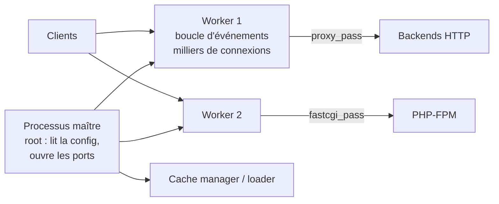
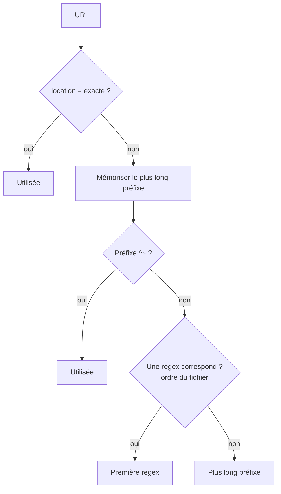

**Nginx** (prononcé « engine-x ») est un serveur web, reverse proxy, répartiteur de charge et cache HTTP réputé pour ses performances et sa faible empreinte mémoire. Il sert aussi de proxy **TCP/UDP** (module `stream`) et de proxy mail. Deux branches open source : **mainline** (nouveautés, recommandée par l'éditeur) et **stable** ; une offre commerciale **NGINX Plus** ajoute des fonctions (sondes actives, API dynamique, tableau de bord).

## Architecture événementielle



- Un **maître** (root) lit la configuration et gère les **workers** (utilisateur non privilégié).
- Chaque worker gère **des milliers de connexions** dans une boucle non bloquante (epoll/kqueue), sans thread par connexion.
- `nginx -s reload` : le maître relit la configuration, démarre de nouveaux workers et laisse les anciens terminer leurs requêtes : **aucune coupure**.

## Structure de la configuration

```nginx /etc/nginx/nginx.conf (squelette)
user  nginx;                     # www-data sous Debian
worker_processes  auto;          # un par cœur
error_log  /var/log/nginx/error.log warn;
pid        /run/nginx.pid;

events {
    worker_connections  4096;
}

http {
    include       /etc/nginx/mime.types;
    default_type  application/octet-stream;
    sendfile      on;
    keepalive_timeout 65;

    include /etc/nginx/conf.d/*.conf;          # vos sites
    # include /etc/nginx/sites-enabled/*;      # Debian/Ubuntu (paquets de la distribution)
}

stream {                                       # proxy TCP/UDP (optionnel)
    include /etc/nginx/stream.d/*.conf;
}
```

| Contexte | Contenu |
| --- | --- |
| `main` | Utilisateur, workers, journaux d'erreur, modules dynamiques (`load_module`) |
| `events` | Gestion des connexions |
| `http` | Tout ce qui concerne HTTP : `server`, `upstream`, `map`, caches, formats de journaux |
| `server` | Un site (écoute, noms, TLS) |
| `location` | Traitement d'un ensemble d'URL |
| `upstream` | Groupe de serveurs backends |
| `stream` | Proxy TCP/UDP (`server`, `upstream` propres) |

### Héritage des directives

- Les directives **simples** (`root`, `gzip`, `client_max_body_size`) sont héritées du parent si elles ne sont pas redéfinies.
- Les directives **tableau** (`add_header`, `proxy_set_header`, `fastcgi_param`) sont héritées **seulement si le niveau courant n'en définit aucune** : un seul `add_header` dans une `location` fait perdre tous ceux du `server`.

> [!WARNING]
> Ce piège de `add_header` est la cause n°1 d'en-têtes de sécurité « disparus » sur certaines URL. Regroupez les en-têtes dans un fichier inclus (`include snippets/securite.conf;`) dans **chaque** bloc qui en ajoute.

## Sélection du `server` puis de la `location`

1. **server** : correspondance `listen` (IP:port), puis `server_name` exact → joker en tête (`*.exemple.fr`) → joker en fin → expression régulière (`~^`) → serveur `default_server`.
2. **location** dans ce server :

| Syntaxe | Type | Priorité |
| --- | --- | --- |
| `location = /chemin` | Exacte | 1 (arrêt immédiat) |
| `location ^~ /prefixe/` | Préfixe prioritaire | 2 (pas de regex ensuite) |
| `location ~ \.php$` | Regex sensible à la casse | 3 (première qui correspond, dans l'ordre du fichier) |
| `location ~* \.(jpg\|png)$` | Regex insensible à la casse | 3 |
| `location /prefixe/` | Préfixe | 4 (le plus long, si aucune regex ne correspond) |



## Fichiers et emplacements

| Élément | Paquet nginx.org / RHEL | Paquet Debian/Ubuntu | Windows | macOS (Homebrew) |
| --- | --- | --- | --- | --- |
| Configuration | `/etc/nginx/nginx.conf` | `/etc/nginx/nginx.conf` | `C:\nginx\conf\nginx.conf` | `$(brew --prefix)/etc/nginx/nginx.conf` |
| Sites | `/etc/nginx/conf.d/*.conf` | `sites-available/` + `sites-enabled/` | `conf\` (include) | `servers/` |
| Racine par défaut | `/usr/share/nginx/html` | `/var/www/html` | `C:\nginx\html` | `$(brew --prefix)/var/www` |
| Journaux | `/var/log/nginx/` | `/var/log/nginx/` | `C:\nginx\logs\` | `$(brew --prefix)/var/log/nginx/` |
| Utilisateur | `nginx` | `www-data` | — | utilisateur courant |

## Cas d'usage typiques

| Usage | Article |
| --- | --- |
| Sites statiques, SPA, PHP | [[03-server-blocks-locations]] |
| HTTPS, HTTP/2, HTTP/3 | [[04-https-tls]] |
| Reverse proxy, répartition de charge, WebSocket, gRPC | [[05-reverse-proxy-repartition]] |
| Cache et performances | [[06-cache-performances]] |
| Limitation de débit, contrôle d'accès, SSO | [[07-securite]] |
| Proxy TCP/UDP, journaux, dépannage | [[08-stream-logs-depannage]] |

## Suite du parcours

1. [[02-installation|Installation (Linux, Windows, macOS, Docker)]]
2. [[03-server-blocks-locations|Server blocks, locations et configuration de base]]
3. [[04-https-tls|HTTPS, TLS, HTTP/2 et HTTP/3]]
4. [[05-reverse-proxy-repartition|Reverse proxy et répartition de charge]]
5. [[06-cache-performances|Cache et performances]]
6. [[07-securite|Sécurité, limitation de débit et authentification]]
7. [[08-stream-logs-depannage|Proxy TCP/UDP, journaux et dépannage]]
