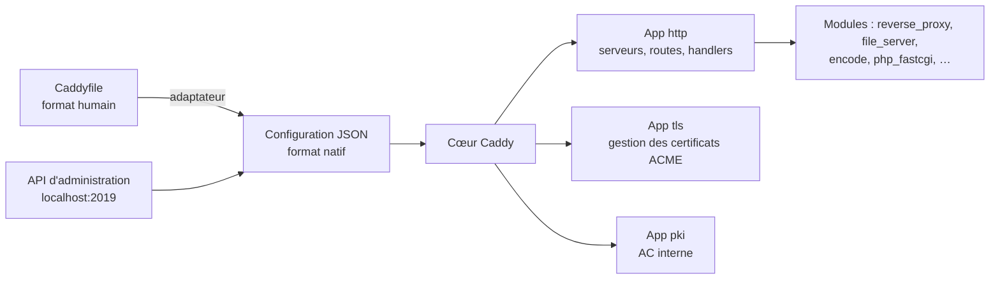

**Caddy** est un serveur web écrit en Go dont la particularité est le **HTTPS automatique** : il obtient, installe et renouvelle seul les certificats (Let's Encrypt, ZeroSSL ou une PKI interne), redirige HTTP vers HTTPS et active HTTP/2 et HTTP/3 par défaut. Sa configuration tient souvent en quelques lignes, ce qui en fait un excellent reverse proxy pour des applications internes ou de petites infrastructures.

## Architecture



| Notion | Description |
| --- | --- |
| **Caddyfile** | Format de configuration lisible, converti (« adapté ») en JSON au chargement |
| **Configuration JSON** | Format natif, complet, modifiable à chaud via l'API |
| **API d'administration** | `http://localhost:2019` : lire, charger, modifier la configuration sans redémarrage |
| **Modules** | Tout est module (handlers HTTP, fournisseurs DNS pour ACME, stockage…). Les modules tiers s'ajoutent en **recompilant** avec `xcaddy` |
| **Stockage** | Certificats et clés ACME dans le dossier de données (`/var/lib/caddy/.local/share/caddy`) |

## Points forts et limites

| Points forts | Limites |
| --- | --- |
| HTTPS automatique (y compris certificats internes) | Moins de modules « tout faits » qu'Apache/Nginx |
| Configuration très concise | Pas de `.htaccess` |
| HTTP/3 par défaut | Modules tiers = binaire personnalisé |
| API de configuration à chaud | Communauté plus petite pour les cas exotiques |
| Binaire unique sans dépendance (Linux, Windows, macOS, BSD) | |

## Installation

### Debian / Ubuntu (dépôt officiel)

```bash
sudo apt install -y debian-keyring debian-archive-keyring apt-transport-https curl
curl -1sLf 'https://dl.cloudsmith.io/public/caddy/stable/gpg.key' | sudo gpg --dearmor -o /usr/share/keyrings/caddy-stable-archive-keyring.gpg
curl -1sLf 'https://dl.cloudsmith.io/public/caddy/stable/debian.deb.txt' | sudo tee /etc/apt/sources.list.d/caddy-stable.list
sudo apt update && sudo apt install caddy
systemctl status caddy
```

### RHEL / Rocky / Alma / Fedora

```bash
sudo dnf install 'dnf-command(copr)'
sudo dnf copr enable @caddy/caddy
sudo dnf install caddy
sudo systemctl enable --now caddy
sudo firewall-cmd --permanent --add-service=http --add-service=https --add-port=443/udp && sudo firewall-cmd --reload
```

### Windows

1. Télécharger `caddy_windows_amd64.zip` (github.com/caddyserver/caddy/releases) et extraire `caddy.exe` dans `C:\caddy`.
2. Créer `C:\caddy\Caddyfile`.
3. Installer le service (Caddy sait fonctionner comme service Windows) :

```powershell
sc.exe create caddy start= auto binPath= "C:\caddy\caddy.exe run --config C:\caddy\Caddyfile"
Start-Service caddy
New-NetFirewallRule -DisplayName "Caddy" -Direction Inbound -Protocol TCP -LocalPort 80,443 -Action Allow
New-NetFirewallRule -DisplayName "Caddy HTTP/3" -Direction Inbound -Protocol UDP -LocalPort 443 -Action Allow
```

Les certificats sont stockés dans `%AppData%\Caddy` du compte du service (`LocalSystem` : `C:\Windows\System32\config\systemprofile\AppData\Roaming\Caddy`).

### macOS

```bash
brew install caddy
brew services start caddy                 # configuration : $(brew --prefix)/etc/Caddyfile
caddy trust                               # installe l'AC locale de Caddy dans le trousseau (certificats « tls internal »)
```

### Docker

```bash
docker run -d --name caddy --restart unless-stopped \
  -p 80:80 -p 443:443 -p 443:443/udp \
  -v /srv/caddy/Caddyfile:/etc/caddy/Caddyfile:ro \
  -v caddy_data:/data -v caddy_config:/config \
  caddy:2
```

> [!IMPORTANT]
> Conservez le volume **`/data`** : il contient les certificats et les comptes ACME. Le perdre force la réémission de tous les certificats (et peut déclencher les limites de taux de Let's Encrypt).

## Fichiers et emplacements (paquets Linux)

| Élément | Emplacement |
| --- | --- |
| Caddyfile | `/etc/caddy/Caddyfile` |
| Données (certificats, AC interne) | `/var/lib/caddy/.local/share/caddy/` |
| Configuration autosauvegardée (JSON) | `/var/lib/caddy/.config/caddy/autosave.json` |
| Service | `caddy.service` (utilisateur `caddy`), `caddy-api.service` (variante pilotée uniquement par l'API) |
| Journaux | journal systemd (`journalctl -u caddy`) sauf directive `log` |

## Premier site

```caddy /etc/caddy/Caddyfile
www.exemple.fr {
    root * /srv/www/site
    file_server
    encode zstd gzip
}
```

```bash
sudo caddy fmt --overwrite /etc/caddy/Caddyfile     # mise en forme canonique
sudo caddy validate --config /etc/caddy/Caddyfile
sudo systemctl reload caddy
```

Si le DNS de `www.exemple.fr` pointe vers ce serveur et que les ports 80/443 sont ouverts depuis Internet, Caddy obtient le certificat en quelques secondes.

## Commandes essentielles

| Commande | Rôle |
| --- | --- |
| `caddy run` / `caddy start` / `caddy stop` | Démarrer au premier plan / en arrière-plan / arrêter |
| `caddy reload --config Caddyfile` | Recharger sans coupure (via l'API) |
| `caddy validate` | Vérifier une configuration |
| `caddy fmt --overwrite` | Formater le Caddyfile |
| `caddy adapt --config Caddyfile --pretty` | Voir le JSON produit |
| `caddy list-modules` | Modules compilés |
| `caddy hash-password` | Hacher un mot de passe pour `basic_auth` |
| `caddy trust` / `caddy untrust` | Installer / retirer l'AC locale dans le magasin du système |
| `caddy file-server --root . --listen :8080 --browse` | Serveur de fichiers instantané |
| `caddy reverse-proxy --from app.local --to 127.0.0.1:3000` | Reverse proxy instantané (certificat interne) |
| `caddy environ` | Variables d'environnement et chemins utilisés |

## Suite du parcours

1. [[02-caddyfile-https|Caddyfile, HTTPS automatique et sites]]
2. [[03-reverse-proxy-repartition|Reverse proxy et répartition de charge]]
3. [[04-avance-api-pki-modules|API, PKI interne, TLS à la demande et modules]]
4. [[05-exploitation-depannage|Journaux, métriques et dépannage]]
