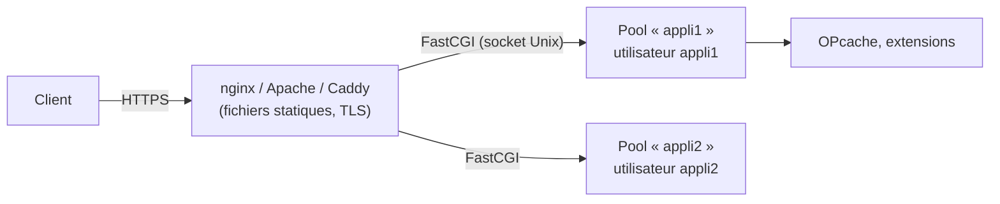

**PHP-FPM** exécute le code PHP dans des **pools** de processus persistants et répond au serveur web via le protocole **FastCGI** (socket Unix ou TCP). C'est le mode d'exécution recommandé de PHP en production : séparation entre serveur web et PHP, un utilisateur système par application, réglage fin du nombre de processus.



## Versions

Chaque version de PHP est supportée **2 ans** activement puis **2 ans** pour la sécurité (cycle porté à 4 ans au total). Vérifiez la compatibilité de l'application (WordPress, Nextcloud, GLPI…) avant une montée de version ; n'exploitez pas de version en fin de vie.

## Installation

```bash
# Debian / Ubuntu — version de la distribution
sudo apt install php-fpm php-cli php-mysql php-pgsql php-curl php-gd php-intl php-mbstring php-xml php-zip php-opcache
# Plusieurs versions (dépôt de Debian/Ubuntu maintenu par Ondřej Surý)
sudo apt install -y lsb-release ca-certificates curl
sudo curl -sSLo /tmp/debsuryorg-archive-keyring.deb https://packages.sury.org/debsuryorg-archive-keyring.deb && sudo dpkg -i /tmp/debsuryorg-archive-keyring.deb
echo "deb [signed-by=/usr/share/keyrings/deb.sury.org-php.gpg] https://packages.sury.org/php/ $(lsb_release -sc) main" | sudo tee /etc/apt/sources.list.d/php.list
sudo apt update && sudo apt install php8.3-fpm php8.4-fpm
systemctl status php8.3-fpm

# RHEL 9 — flux de modules AppStream (ou dépôt Remi pour d'autres versions)
sudo dnf module list php
sudo dnf module enable php:8.2 && sudo dnf install php-fpm php-mysqlnd php-opcache php-intl
sudo systemctl enable --now php-fpm

# macOS (développement)
brew install php && brew services start php
```

| Distribution | Configuration | Pools | Socket par défaut |
| --- | --- | --- | --- |
| Debian / Ubuntu | `/etc/php/8.3/fpm/php.ini` | `/etc/php/8.3/fpm/pool.d/*.conf` | `/run/php/php8.3-fpm.sock` |
| RHEL | `/etc/php.ini` | `/etc/php-fpm.d/*.conf` | `/run/php-fpm/www.sock` |

**Windows** : PHP-FPM n'existe pas ; on utilise PHP **NTS** (*Non Thread Safe*) avec le module **FastCGI d'IIS** (`php-cgi.exe`), voir [[01-iis/07-applications-aspnet-php|IIS et PHP]].

## php.ini (production)

```ini /etc/php/8.3/fpm/php.ini (extraits)
expose_php = Off
display_errors = Off
log_errors = On
error_log = /var/log/php/erreurs.log
memory_limit = 256M
max_execution_time = 60
upload_max_filesize = 64M
post_max_size = 64M
date.timezone = Europe/Paris
session.cookie_secure = 1
session.cookie_httponly = 1
session.cookie_samesite = Lax
session.use_strict_mode = 1
allow_url_include = Off

[opcache]
opcache.enable = 1
opcache.memory_consumption = 256
opcache.interned_strings_buffer = 32
opcache.max_accelerated_files = 20000
opcache.validate_timestamps = 1
opcache.revalidate_freq = 60
```

En production avec déploiement contrôlé, `opcache.validate_timestamps = 0` (puis rechargement de PHP-FPM à chaque déploiement) maximise les performances.

## Pools

Un **pool par application** : utilisateur dédié, socket dédié, limites et `php.ini` propres.

```ini /etc/php/8.3/fpm/pool.d/appli1.conf
[appli1]
user = appli1
group = appli1
listen = /run/php/appli1.sock
listen.owner = www-data
listen.group = www-data
listen.mode = 0660

pm = dynamic
pm.max_children = 20
pm.start_servers = 4
pm.min_spare_servers = 2
pm.max_spare_servers = 6
pm.max_requests = 1000

request_terminate_timeout = 120s
request_slowlog_timeout = 5s
slowlog = /var/log/php/appli1-lent.log
pm.status_path = /fpm-status
ping.path = /fpm-ping

php_admin_value[open_basedir] = /srv/www/appli1:/tmp
php_admin_value[upload_tmp_dir] = /srv/www/appli1/tmp
php_admin_value[error_log] = /var/log/php/appli1.log
php_admin_flag[log_errors] = on
php_admin_value[disable_functions] = exec,passthru,shell_exec,system,proc_open,popen
```

| `pm` | Comportement | Usage |
| --- | --- | --- |
| `dynamic` | Nombre de processus variable entre min et max | Cas général |
| `ondemand` | Processus créés à la demande, arrêtés après inactivité (`pm.process_idle_timeout`) | Nombreux petits sites, mémoire limitée |
| `static` | Nombre fixe | Serveur dédié à forte charge |

Dimensionnement de `pm.max_children` : `mémoire disponible pour PHP / mémoire moyenne d'un processus` (mesurer avec `ps -C php-fpm8.3 -o rss=`).

```bash
sudo php-fpm8.3 -t                 # tester la configuration
sudo systemctl reload php8.3-fpm   # rechargement sans coupure
```

## Intégration avec le serveur web

```nginx nginx
location ~ \.php$ {
    try_files $uri =404;
    fastcgi_split_path_info ^(.+\.php)(/.+)$;
    fastcgi_pass unix:/run/php/appli1.sock;
    fastcgi_index index.php;
    include fastcgi_params;
    fastcgi_param SCRIPT_FILENAME $document_root$fastcgi_script_name;
}
```

```apache Apache (mod_proxy_fcgi)
<FilesMatch "\.php$">
    SetHandler "proxy:unix:/run/php/appli1.sock|fcgi://localhost"
</FilesMatch>
```

Caddy : `php_fastcgi unix//run/php/appli1.sock`. Détails : [[02-apache/05-php-applications|Apache et PHP]], [[03-nginx/03-server-blocks-locations|nginx]].

Suite : [[02-securite-exploitation|sécurité, supervision et dépannage]].
