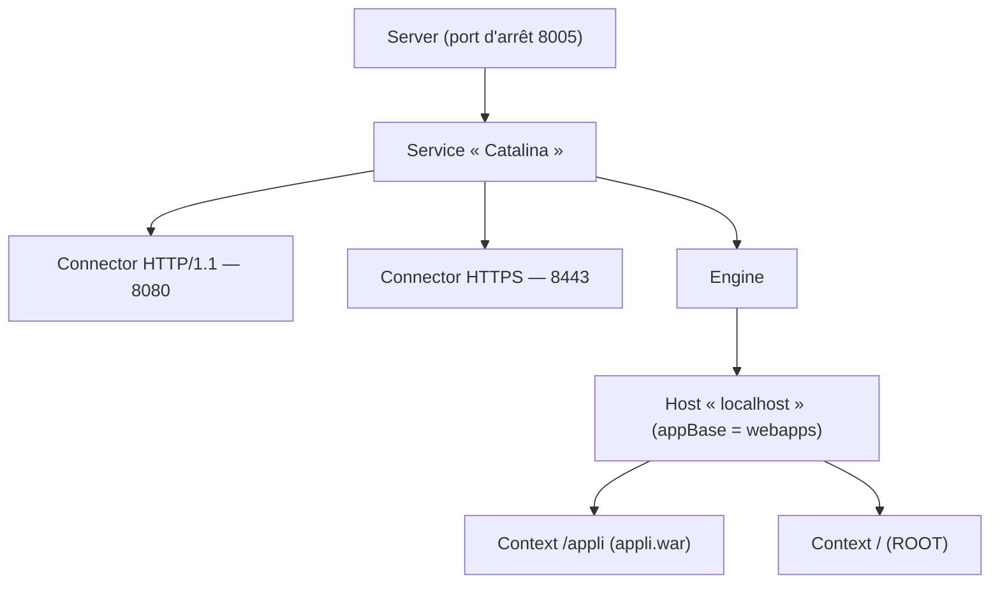

**Apache Tomcat** exécute des applications web Java (**servlets**, JSP, WebSocket) empaquetées en **WAR**. C'est le conteneur le plus utilisé : applications métier, Jenkins (historiquement), Atlassian, GLPI-agents Java, consoles de supervision, beaucoup de progiciels.

## Versions

| Tomcat | Spécification | Java minimum | Espace de noms |
| --- | --- | --- | --- |
| 9.0 | Servlet 4.0 (Java EE 8) | 8 | `javax.*` |
| **10.1** | Servlet 6.0 (Jakarta EE 10) | 11 | `jakarta.*` |
| **11.0** | Servlet 6.1 (Jakarta EE 11) | 17 | `jakarta.*` |

> [!IMPORTANT]
> Une application compilée pour `javax.*` (Tomcat 9) **ne fonctionne pas** telle quelle sur Tomcat 10+ (`jakarta.*`) : il faut une version adaptée de l'application, ou l'outil de migration Apache (*Tomcat Migration Tool for Jakarta EE*). Vérifiez la version exigée par l'éditeur.

## Architecture



| Variable | Contenu |
| --- | --- |
| `CATALINA_HOME` | Binaires de Tomcat (partagés) |
| `CATALINA_BASE` | Instance : `conf/`, `webapps/`, `logs/`, `work/`, `temp/` — plusieurs instances par serveur avec un seul `CATALINA_HOME` |

## Installation

Les paquets des distributions (`tomcat10`, `tomcat`) suivent leurs propres chemins et cycles ; l'**archive officielle** permet de choisir la version exacte et de la mettre à jour rapidement.

```bash
sudo apt install openjdk-21-jre-headless        # voir OpenJDK
sudo useradd -r -m -U -d /opt/tomcat -s /usr/sbin/nologin tomcat
VERSION=10.1.48   # dernière version de la branche, à vérifier sur tomcat.apache.org
wget https://dlcdn.apache.org/tomcat/tomcat-10/v${VERSION}/bin/apache-tomcat-${VERSION}.tar.gz
wget https://downloads.apache.org/tomcat/tomcat-10/v${VERSION}/bin/apache-tomcat-${VERSION}.tar.gz.sha512 && sha512sum -c apache-tomcat-${VERSION}.tar.gz.sha512
sudo tar xzf apache-tomcat-${VERSION}.tar.gz -C /opt/tomcat && sudo ln -sfn /opt/tomcat/apache-tomcat-${VERSION} /opt/tomcat/latest
sudo chown -R root:tomcat /opt/tomcat/latest && sudo chmod -R g+r /opt/tomcat/latest/conf
sudo chown -R tomcat:tomcat /opt/tomcat/latest/{logs,temp,work,webapps}
```

```ini /etc/systemd/system/tomcat.service
[Unit]
Description=Apache Tomcat
After=network.target

[Service]
Type=forking
User=tomcat
Group=tomcat
Environment="JAVA_HOME=/usr/lib/jvm/java-21-openjdk-amd64"
Environment="CATALINA_HOME=/opt/tomcat/latest"
Environment="CATALINA_BASE=/opt/tomcat/latest"
Environment="CATALINA_PID=/opt/tomcat/latest/temp/tomcat.pid"
Environment="CATALINA_OPTS=-Xms1g -Xmx2g -XX:+UseG1GC -Djava.awt.headless=true"
ExecStart=/opt/tomcat/latest/bin/startup.sh
ExecStop=/opt/tomcat/latest/bin/shutdown.sh
UMask=0027
Restart=on-failure

[Install]
WantedBy=multi-user.target
```

```bash
sudo systemctl daemon-reload && sudo systemctl enable --now tomcat
curl -I http://127.0.0.1:8080/
```

**Windows** : installateur `.exe` (service *Tomcat10*) ou archive + `service.bat install` ; réglages Java dans `tomcat10w.exe` (onglet Java). **macOS** : `brew install tomcat` (développement).

## Connecteurs

```xml /opt/tomcat/latest/conf/server.xml (extraits)
<Server port="-1" shutdown="SHUTDOWN">   <!-- port d'arrêt désactivé : arrêt par le service -->
  <Service name="Catalina">
    <!-- HTTP en local seulement, derrière le reverse proxy -->
    <Connector port="8080" address="127.0.0.1" protocol="HTTP/1.1"
               connectionTimeout="20000" maxThreads="200" maxPostSize="10485760"
               server="Serveur" xpoweredBy="false" />

    <!-- HTTPS direct (si pas de reverse proxy) -->
    <Connector port="8443" protocol="org.apache.coyote.http11.Http11NioProtocol" SSLEnabled="true" maxThreads="200">
      <UpgradeProtocol className="org.apache.coyote.http2.Http2Protocol" />
      <SSLHostConfig protocols="TLSv1.2+TLSv1.3">
        <Certificate certificateKeystoreFile="/etc/tomcat/serveur.p12" certificateKeystorePassword="MotDePasseMagasin" type="RSA" />
      </SSLHostConfig>
    </Connector>

    <Engine name="Catalina" defaultHost="localhost">
      <Valve className="org.apache.catalina.valves.RemoteIpValve" internalProxies="127\.0\.0\.1" />
      <Host name="localhost" appBase="webapps" unpackWARs="true" autoDeploy="false">
        <Valve className="org.apache.catalina.valves.AccessLogValve" directory="logs" prefix="acces" suffix=".log"
               pattern="%a %t &quot;%r&quot; %s %b %D" />
        <Valve className="org.apache.catalina.valves.ErrorReportValve" showReport="false" showServerInfo="false" />
      </Host>
    </Engine>
  </Service>
</Server>
```

La configuration courante place Tomcat **derrière** nginx, Apache (`mod_proxy_http`) ou HAProxy, qui termine TLS ; la valve **RemoteIpValve** restitue l'IP et le protocole du client. Le connecteur **AJP** (8009) n'est à utiliser que si nécessaire, avec un `secret` (vulnérabilité *Ghostcat* en 2020).

## Déployer une application

```bash
sudo systemctl stop tomcat
sudo cp appli-2.4.0.war /opt/tomcat/latest/webapps/appli.war      # contexte /appli
sudo systemctl start tomcat
tail -f /opt/tomcat/latest/logs/catalina.out
```

- `ROOT.war` → application à la racine `/`.
- Configuration propre à l'application (sources de données JNDI, paramètres) : `conf/Catalina/localhost/appli.xml`, plutôt que dans le WAR.
- `autoDeploy="false"` en production : déploiements contrôlés (script, Ansible).

Suite : [[02-securite-exploitation|sécurité, haute disponibilité et exploitation]].
