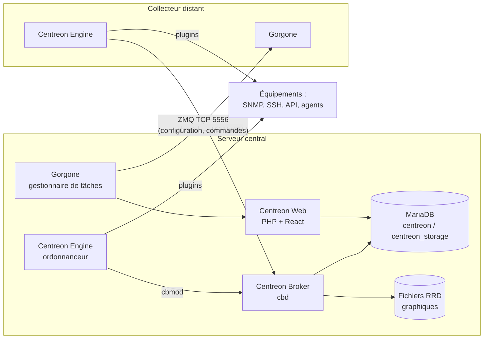
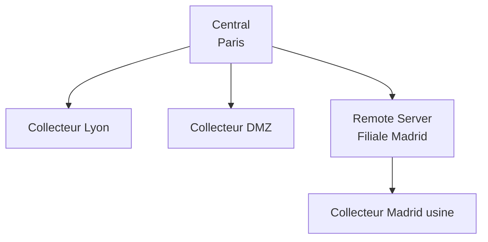

**Centreon** est une plateforme de supervision d'infrastructure d'origine française, héritière de l'écosystème Nagios. Elle surveille la **disponibilité** et les **performances** des équipements réseau, serveurs, applications et services cloud, déclenche des **alertes** et conserve l'**historique** (graphiques, rapports de disponibilité).

## Composants



| Composant | Rôle |
| --- | --- |
| **Centreon Web** | Interface de configuration et d'exploitation (PHP, API REST), stocke la configuration dans la base `centreon` |
| **Centreon Engine** (`centengine`) | Ordonnanceur des contrôles (fork de Nagios) : exécute les plugins, calcule les états, déclenche les notifications |
| **Centreon Broker** | Multiplexeur de flux : le module `cbmod` dans chaque Engine envoie les événements au démon `cbd` du central, qui les écrit en base (`centreon_storage`) et dans les fichiers RRD |
| **Centreon Gorgone** (`gorgoned`) | Gestionnaire de tâches distribué : déploie la configuration sur les collecteurs, relaie les commandes (acquittements, contrôles immédiats), lance les découvertes, installe les plugins |
| **MariaDB / MySQL** | Bases `centreon` (configuration) et `centreon_storage` (états, journaux, métriques) |
| **Plugins** | Programmes qui interrogent les cibles et renvoient un état + des données de performance (*centreon-plugins*, en Perl, plus de 600 plugins) |
| **Connecteurs de supervision** (*Monitoring Connectors*, anciennement *Plugin Packs*) | Modèles prêts à l'emploi (commandes, modèles d'hôtes et de services, règles de découverte) pour chaque technologie |
| **Centreon Monitoring Agent (CMA)** | Agent léger Linux/Windows (24.10+) basé sur OpenTelemetry |
| **centreontrapd** | Traitement des traps SNMP |

## Vocabulaire de supervision

| Terme | Définition |
| --- | --- |
| **Hôte** | Équipement supervisé (adresse IP ou nom) |
| **Service** | Point de contrôle sur un hôte (CPU, interface Gi1/0/1, certificat HTTPS…) |
| **État d'hôte** | UP, DOWN, UNREACHABLE (parent en panne) |
| **État de service** | OK, WARNING, CRITICAL, UNKNOWN |
| **État SOFT / HARD** | Une anomalie est d'abord SOFT ; elle devient HARD après *Max check attempts* contrôles consécutifs → notification |
| **Contrôle actif / passif** | Lancé par Engine / résultat reçu (trap, API, agent) |
| **Acquittement** | Prise en compte d'un incident (stoppe les notifications) |
| **Temps d'arrêt** (*downtime*) | Maintenance planifiée : pas de notification, exclu des rapports de disponibilité |
| **Données de performance** | Valeurs numériques renvoyées par le plugin (`cpu=23%;80;90`) → graphiques |
| **Seuils** | `--warning` / `--critical` au format Nagios (`80`, `10:`, `@10:20`…) |

### Sortie d'un plugin

```text
OK: CPU(s) average usage is 23.45 % | 'cpu.utilization.percentage'=23.45%;0:80;0:90;0;100
```

Code retour : `0` OK, `1` WARNING, `2` CRITICAL, `3` UNKNOWN.

## Architectures

| Architecture | Description | Quand |
| --- | --- | --- |
| **Simple** | Un serveur central qui fait tout (web, base, collecte) | Jusqu'à quelques milliers de services |
| **Base déportée** | La base MariaDB sur un serveur dédié | Volumétrie importante |
| **Distribuée** | Central + **collecteurs** (*pollers*) qui exécutent les contrôles au plus près des équipements | Sites distants, DMZ, réseaux cloisonnés, forte charge |
| **Serveurs distants** (*Remote Servers*) | Collecteurs dotés de leur propre interface et base, agrégés vers le central | Filiales autonomes, MSP, contraintes réglementaires |
| **Haute disponibilité** | Central en cluster actif/passif (édition commerciale) | Supervision critique |



## Flux et ports

| Source → Destination | Port | Usage |
| --- | --- | --- |
| Navigateurs → Central | TCP 443 (80) | Interface web, API |
| Central → Collecteur | TCP **5556** | Gorgone (ZeroMQ, chiffré) — ou collecteur → central en mode « pull » |
| Collecteur → Central | TCP **5669** | Centreon Broker (flux de données) — inversable (mode *one peer retention*) |
| Central / collecteur → équipements | UDP 161 | SNMP |
| Équipements → collecteur | UDP 162 | Traps SNMP |
| Collecteur → serveurs | TCP 22 / 5666 / 8443 | SSH, NRPE, NSClient++ REST |
| Agent CMA ↔ collecteur | TCP 4317 | OpenTelemetry (gRPC) |
| Central → MariaDB | TCP 3306 | Base de données (si déportée) |
| Central → relais SMTP | TCP 25/587 | Notifications par e-mail |

## Éditions

| Édition | Contenu |
| --- | --- |
| **Centreon Open Source** (OSS) | Cœur complet : supervision, interface, graphiques, collecteurs, API — gratuite |
| **Centreon IT-100** | Gratuite jusqu'à 100 hôtes, avec des modules commerciaux (connecteurs complets, découverte…) |
| **Centreon Business / Enterprise** | Modules : MAP (cartographie), BAM (supervision métier), MBI (rapports), découverte automatique avancée, haute disponibilité, support |

> [!NOTE]
> Une partie des connecteurs de supervision et la découverte automatique d'hôtes nécessitent une licence (ou IT-100). Les **plugins** eux-mêmes (centreon-plugins) sont libres et utilisables en ligne de commande dans tous les cas.

## Versions

Centreon publie deux versions majeures par an, nommées **AA.MM** (ex. 24.04, 24.10, 25.04, 25.10). Chaque version est supportée environ 18 mois pour les correctifs de sécurité. Systèmes supportés (selon versions) : **AlmaLinux / RHEL / Oracle Linux 8 et 9**, **Debian 12**.

## Suite du parcours

1. [[02-installation|Installation du serveur central]]
2. [[03-objets-hotes-services-modeles|Objets : commandes, modèles, hôtes et services]]
3. [[04-supervision-snmp|Supervision SNMP : Linux, Windows, équipements réseau]]
4. [[05-supervision-agents|Supervision par agent (CMA, NSClient++, SSH)]]
5. [[06-notifications-escalades|Notifications, escalades et dépendances]]
6. [[07-pollers-remote-servers|Architecture distribuée : collecteurs et serveurs distants]]
7. [[08-traps-snmp|Traps SNMP]]
8. [[09-api-automatisation|API, CLAPI et automatisation]]
9. [[10-maintenance-sauvegarde-ha|Maintenance, sauvegarde, mises à jour et haute disponibilité]]
10. [[11-depannage|Dépannage]]
