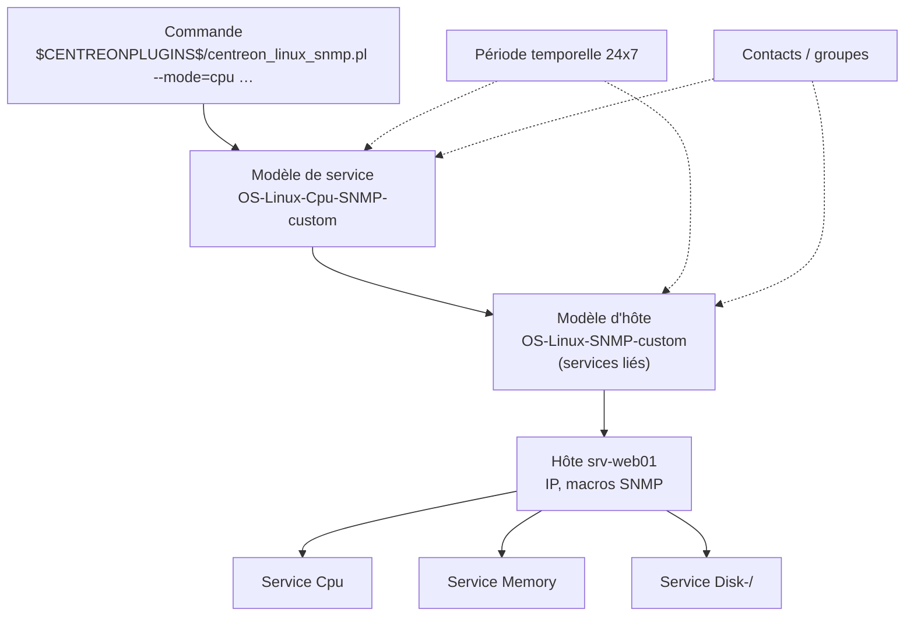

## Hiérarchie des objets



| Objet | Menu | Rôle |
| --- | --- | --- |
| **Commande** | Configuration → Commandes | Ligne de commande d'un plugin (contrôle, notification, découverte) |
| **Période temporelle** | Configuration → Utilisateurs → Périodes temporelles | Plages de contrôle et de notification (`24x7`, `heures-ouvrees`) |
| **Modèle d'hôte** | Configuration → Hôtes → Modèles | Paramètres communs + **services liés** créés automatiquement |
| **Modèle de service** | Configuration → Services → Modèles | Commande, seuils (macros), intervalles, notifications |
| **Hôte** | Configuration → Hôtes → Hôtes | Équipement supervisé, rattaché à un **collecteur** |
| **Service** | Configuration → Services | Contrôle sur un hôte (ou un groupe d'hôtes) |
| **Groupes** | Hôtes / Services → Groupes | Regroupements fonctionnels (vues, ACL, rapports) |
| **Catégories / sévérités** | Hôtes / Services → Catégories | Classement transverse ; une **sévérité** a un niveau pour trier les alertes |

### Héritage

- Un hôte peut hériter de **plusieurs** modèles d'hôtes (ordre = priorité).
- Un modèle de service hérite d'un autre modèle de service (chaîne).
- Toute valeur non renseignée est prise dans le modèle ; une valeur renseignée sur l'objet **surcharge** le modèle.
- Les **macros personnalisées** (`_HOSTSNMPCOMMUNITY`, `_SERVICEWARNING`…) suivent le même héritage.

## Macros

| Macro | Valeur |
| --- | --- |
| `$HOSTADDRESS$` | Adresse IP / nom de l'hôte |
| `$HOSTNAME$`, `$HOSTALIAS$` | Nom, alias |
| `$SERVICEDESC$` | Nom du service |
| `$_HOSTSNMPCOMMUNITY$`, `$_HOSTSNMPVERSION$` | Macros SNMP de l'hôte (champs dédiés du formulaire) |
| `$_HOSTxxx$` / `$_SERVICExxx$` | Macros personnalisées (ex. `$_SERVICEWARNING$`, `$_SERVICECRITICAL$`, `$_HOSTSNMPEXTRAOPTIONS$`) |
| `$CENTREONPLUGINS$` | Chemin des plugins (`/usr/lib/centreon/plugins`) — macro de ressource (*Configuration → Collecteurs → Ressources*) |
| `$USER1$` | Plugins Nagios historiques (`/usr/lib64/nagios/plugins`) |
| `$HOSTSTATE$`, `$SERVICESTATE$`, `$SERVICEOUTPUT$`, `$LONGDATETIME$` | Utiles dans les notifications |

> [!TIP]
> Cochez **« Mot de passe »** sur une macro qui contient un secret (communauté SNMP, mot de passe d'API) : elle est masquée dans l'interface. Les versions récentes permettent aussi de stocker les secrets dans un **coffre** (HashiCorp Vault).

## Connecteurs de supervision (Monitoring Connectors)

*Configuration → Gestionnaire de connecteurs de supervision* (anciennement *Plugin Packs*) : chaque connecteur installe en un clic les commandes, modèles d'hôtes et de services, et règles de découverte d'une technologie (Linux SNMP, Windows, Cisco, Fortinet, VMware, AWS, MySQL, HTTP…).

Le **plugin** correspondant doit être présent sur **chaque collecteur** qui supervisera ces hôtes :

```bash
dnf install centreon-plugin-Operatingsystems-Linux-Snmp centreon-plugin-Network-Cisco-Standard-Snmp
# Debian : apt install centreon-plugin-operatingsystems-linux-snmp …
ls /usr/lib/centreon/plugins/
```

> [!NOTE]
> Les versions récentes proposent l'**installation automatique des plugins** sur les collecteurs (via Gorgone) lors de l'export de configuration (*Administration → Paramètres → Centreon UI*). Sinon, le nom du paquet est indiqué dans la fiche de chaque connecteur (*docs.centreon.com → Connecteurs de supervision*).

## Créer un hôte

*Configuration → Hôtes → Hôtes → Ajouter* :

| Champ | Exemple |
| --- | --- |
| Nom | `srv-web01` (sans espace, unique) |
| Alias | `Serveur web intranet` |
| Adresse | `10.0.20.10` (ou FQDN) |
| Communauté SNMP & version | `********` / `2c` (ou v3 via macros `SNMPEXTRAOPTIONS`) |
| Collecteur | `Central` ou `Poller-Lyon` |
| Fuseau horaire | Europe/Paris |
| Modèles | `OS-Linux-SNMP-custom` (+ `App-Apache-…` si besoin) |
| **Créer aussi les services liés aux modèles** | Oui |
| Groupes / catégories / sévérité | `Serveurs-Linux`, `Production`, sévérité `Haute` |
| Parents (onglet Relations) | Commutateur d'accès → l'hôte sera UNREACHABLE (et non DOWN) si le switch tombe |

Puis **exporter la configuration** (voir plus bas).

### Ajuster un service

*Configuration → Services → Services par hôte* → service `Cpu` de `srv-web01` : modifier les macros `WARNINGAVERAGE` / `CRITICALAVERAGE`, les intervalles, ou désactiver le service.

### Paramètres d'ordonnancement

| Paramètre | Rôle | Valeur typique |
| --- | --- | --- |
| Intervalle de contrôle normal | Fréquence des contrôles (minutes) | 5 |
| Intervalle de nouvel essai | Fréquence pendant l'état SOFT | 1 |
| Nombre de contrôles avant validation (*max check attempts*) | Contrôles en erreur avant l'état HARD | 3 |
| Période de contrôle | Quand contrôler | 24x7 |
| Contrôles actifs / passifs | | Actifs (passifs pour les traps) |
| Détection d'oscillation | Supprime les notifications d'un service instable | Selon besoin |

## Groupes d'hôtes et services sur groupes

Un service peut être défini **une fois** sur un **groupe d'hôtes** : il est appliqué à tous les membres (ex. `Ping` sur `Tous-les-switches`). Pratique, mais l'ajustement fin par hôte devient impossible — à réserver aux contrôles strictement identiques.

## Exporter la configuration

Toute modification de configuration n'est effective qu'après **export** vers les collecteurs : *Configuration → Collecteurs → Collecteurs* → sélectionner → **Exporter la configuration** :

| Option | Effet |
| --- | --- |
| Générer les fichiers de configuration | Produit la configuration Engine/Broker |
| Lancer le débogage du moteur (`-v`) | Vérifie la cohérence (erreurs bloquantes affichées) |
| Déplacer les fichiers d'export | Copie vers le collecteur (via Gorgone) |
| Redémarrer / Recharger le moteur | **Recharger** suffit le plus souvent (sans coupure) |

Le bouton **Exporter la configuration** en haut à droite de l'interface fait la même chose pour tous les collecteurs modifiés.

## Exploitation : Resource Status

*Supervision → Statut des ressources* : vue unifiée des hôtes et services, filtres enregistrables (par sévérité, groupe, état, recherche `h.name:srv- s.description:Cpu status:critical`), panneau de détails (sortie, graphique, chronologie, notifications).

| Action | Effet |
| --- | --- |
| **Acquitter** | « Je prends en charge » : stoppe les notifications jusqu'au retour à OK (option *persistant*, *sticky*, *notifier*) |
| **Temps d'arrêt** | Maintenance planifiée (fixe ou flexible, récurrente via *Supervision → Temps d'arrêt → Temps d'arrêt récurrents*) |
| **Contrôler** / **Contrôle forcé** | Relancer immédiatement le plugin |
| **Soumettre un résultat** | Forcer un état (services passifs) |
| **Désactiver les notifications** | Temporaire, à éviter au profit des acquittements |

## Découverte

| Module | Usage |
| --- | --- |
| **Découverte d'hôtes** (*Configuration → Hôtes → Découverte*) | Tâches de découverte (scan SNMP d'un réseau, VMware vCenter, AWS, Azure…) avec règles de transformation et création automatique des hôtes |
| **Découverte de services** (*Configuration → Services → Découverte / Règles*) | Crée les services pour chaque interface réseau, disque, volume, VM… selon des règles (inclusions/exclusions par expression régulière), exécutable périodiquement |

Exemple : règle de découverte des interfaces d'un switch Cisco qui crée un service `Interface-<nom>` pour chaque interface `Gi*` dont la description n'est pas vide et dont l'état administratif est *up*.
