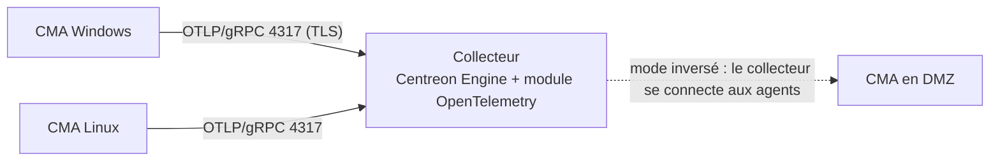

## Pourquoi un agent ?

| Méthode | Avantages | Limites |
| --- | --- | --- |
| **SNMP** | Universel, sans installation sur les équipements réseau | Peu d'informations applicatives, Windows : SNMP déprécié |
| **Agent** (CMA, NSClient++) | Contrôles locaux riches (services, journaux d'événements, compteurs, scripts), chiffré | Déploiement et mise à jour de l'agent |
| **SSH** (Linux) | Pas d'agent, commandes locales | Clés à gérer, coût de connexion |
| **NRPE** | Léger, historique | Protocole ancien, sécurité à soigner |
| **WinRM / WMI** | Pas d'agent sur Windows | Configuration des droits, ports RPC (WMI) |
| **API** | Applications, cloud, appliances | Spécifique à chaque produit |

## Centreon Monitoring Agent (CMA)

Agent officiel (Centreon 24.10+) pour Linux et Windows, fondé sur **OpenTelemetry** (gRPC, TCP **4317**), chiffré en TLS.



Principe :

1. Sur le collecteur : *Configuration → Collecteurs → Configurations d'agents* → créer une configuration de type **CMA** (port d'écoute, certificats, collecteurs concernés), puis exporter la configuration.
2. Installer l'agent sur les serveurs (MSI Windows déployable par GPO/SCCM, paquet `centreon-monitoring-agent` sous Linux) en indiquant l'adresse du collecteur et le nom d'hôte tel qu'il est déclaré dans Centreon.
3. Installer les connecteurs **Windows Centreon Monitoring Agent** / **Linux Centreon Monitoring Agent** et appliquer leurs modèles aux hôtes.

> [!NOTE]
> La CMA évolue rapidement d'une version à l'autre (contrôles natifs, mode inversé, chiffrement) : référez-vous à la documentation de votre version pour les paramètres exacts du fichier de configuration (`/etc/centreon-monitoring-agent/centagent.json` sous Linux, registre/assistant MSI sous Windows).

## NSClient++ (Windows)

Centreon distribue une version empaquetée de NSClient++ incluant les plugins Centreon compilés pour Windows (`centreon_plugins.exe`). Les contrôles sont lancés via l'**API REST** de l'agent (HTTPS, port **8443**).

```ini C:\Program Files\Centreon NSClient++\nsclient.ini (extrait)
[/settings/default]
allowed hosts = 10.0.10.40,10.0.10.41
password = Un-Mot-De-Passe-Long

[/modules]
WEBServer = enabled
CheckExternalScripts = enabled
CheckSystem = enabled

[/settings/WEB/server]
port = 8443s
certificate = ${certificate-path}/certificate.pem
```

Test depuis le collecteur :

```bash
/usr/lib/centreon/plugins/centreon_nsclient_restapi.pl --plugin=apps::nsclient::restapi::plugin --mode=query \
  --hostname=10.0.30.21 --port=8443 --proto=https --legacy-password='Un-Mot-De-Passe-Long' \
  --resource='check_centreon_plugins' \
  --arg='os::windows::local::plugin' --arg='mode=services' \
  --arg='--filter-name=^(W3SVC|WAS|NTDS|DNS|Netlogon)$' --arg='--critical-active=1:'
```

Le connecteur **Windows NSClient++ API** fournit les modèles prêts à l'emploi : CPU, mémoire, disques, services, journal d'événements, sessions, mises à jour en attente, compteurs de performance…

### Exemples de contrôles Windows utiles

| Besoin | Plugin / mode |
| --- | --- |
| Services IIS (W3SVC, WAS), état des pools | `os::windows::local::plugin` mode `services` ; `apps::iis::local::plugin` (pools, sites) |
| Santé Active Directory | `apps::activedirectory::local::plugin` modes `dcdiag`, `netdom` |
| Files d'impression, DHCP, DNS Windows | Modes dédiés des plugins Windows locaux |
| Journal d'événements (ID 4740, 1311…) | mode `eventlog` |
| Certificats du magasin local | mode `certificates` |
| Tâches planifiées en échec | mode `tasks` |

## Linux par SSH (sans agent)

```bash
# Sur le collecteur : clé SSH de l'utilisateur centreon-engine
sudo -u centreon-engine ssh-keygen -t ed25519 -N '' -f /var/lib/centreon-engine/.ssh/id_ed25519
sudo -u centreon-engine ssh-copy-id -i /var/lib/centreon-engine/.ssh/id_ed25519.pub supervision@10.0.20.10

# Contrôle local exécuté à distance
/usr/lib/centreon/plugins/centreon_linux_local.pl --plugin=os::linux::local::plugin --mode=cpu \
  --hostname=10.0.20.10 --remote --ssh-backend=libssh --ssh-username=supervision \
  --warning-average=80 --critical-average=90
```

Sur la cible : compte `supervision` sans privilège, `sudo` limité aux commandes nécessaires (ex. lecture de journaux), restriction `from="10.0.10.40"` dans `authorized_keys`.

Modes intéressants de `os::linux::local::plugin` : `cpu`, `memory`, `storage`, `systemd-sc-status` (services systemd), `ntp`, `open-files`, `process`, `traffic`, `pending-updates`, `cmd-return` (commande arbitraire).

## NRPE

```bash
# Cible
sudo dnf install centreon-nrpe4-daemon centreon-plugin-Operatingsystems-Linux-Local
# /etc/nrpe.cfg : allowed_hosts=10.0.10.40 ; dont_blame_nrpe=0 ; commandes déclarées explicitement
command[check_cpu]=/usr/lib/centreon/plugins/centreon_linux_local.pl --plugin=os::linux::local::plugin --mode=cpu --warning-average=80 --critical-average=90
# Collecteur
/usr/lib64/nagios/plugins/check_centreon_nrpe4 -H 10.0.20.10 -c check_cpu
```

## Contrôles applicatifs sans agent

| Cible | Plugin / mode | Exemple d'usage |
| --- | --- | --- |
| Site web | `apps::protocols::http::plugin` mode `response` | Code 200, contenu attendu, temps de réponse |
| Certificat TLS | `apps::protocols::x509::plugin` mode `validity` | Alerte 30 j / 15 j avant expiration ([[01-iis/04-https-certificats\|IIS]], RADIUS, LDAPS) |
| DNS | `apps::protocols::dns::plugin` mode `request` | Résolution d'un nom sur chaque serveur [[01-bind9/01-presentation\|BIND]] / AD |
| DHCP | `apps::protocols::dhcp::plugin` mode `connection` | Réponse d'un serveur DHCP (depuis un collecteur sur le bon VLAN) |
| RADIUS | `apps::protocols::radius::plugin` mode `login` | Authentification d'un compte de sonde sur [[01-freeradius/11-securite-depannage\|FreeRADIUS]] |
| LDAP | `apps::protocols::ldap::plugin` mode `login` / `search` | Bind sur les DC, LDAPS |
| NTP | `apps::protocols::ntp::plugin` mode `offset` | Dérive de l'heure des DC |
| SMTP / IMAP | `apps::protocols::smtp::plugin` / `imap` | Messagerie |
| MySQL / PostgreSQL / SQL Server | `database::mysql::plugin`, `database::postgres::plugin`, `database::mssql::plugin` | Connexions, réplication, taille, requêtes lentes |
| VMware | `apps::vmware::connector::plugin` (via centreon-vmware) | Datastores, hôtes ESXi, VM |
| Docker / Kubernetes | `cloud::kubernetes::plugin` | Nœuds, pods, déploiements |

```bash
# Exemple : sonde DNS sur un résolveur BIND
/usr/lib/centreon/plugins/centreon_protocol_dns.pl --plugin=apps::protocols::dns::plugin --mode=request \
  --nameservers=10.0.10.53 --search=www.exemple.fr --search-type=A --expected-answer='203.0.113.10' --timeout=3
```

> [!TIP]
> Pour les sondes **depuis plusieurs points du réseau** (DMZ, sites distants, VLAN invité), placez un petit collecteur dans chaque zone : la mesure reflète l'expérience réelle des utilisateurs de cette zone.
