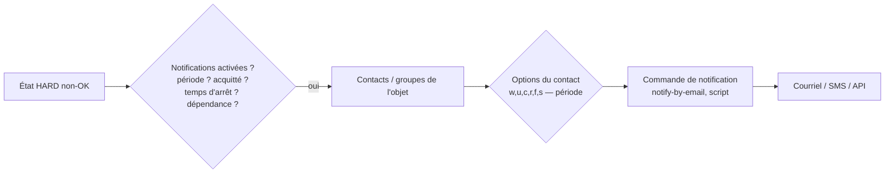

## Chaîne de notification



Une notification n'est envoyée que si **tous** les filtres sont satisfaits : état HARD, notifications activées sur l'objet et le contact, période de notification de l'objet **et** du contact, pas d'acquittement ni de temps d'arrêt, hôte parent pas en panne, dépendances respectées.

## Envoi de courriels

Le central (et chaque collecteur, car **les notifications partent du moteur qui exécute le contrôle**) doit pouvoir envoyer du courrier.

```bash
sudo dnf install -y postfix s-nail cyrus-sasl-plain     # Debian : apt install postfix bsd-mailx libsasl2-modules
```

```ini /etc/postfix/main.cf (relais authentifié)
relayhost = [smtp.exemple.fr]:587
smtp_sasl_auth_enable = yes
smtp_sasl_password_maps = hash:/etc/postfix/sasl_passwd
smtp_sasl_security_options = noanonymous
smtp_tls_security_level = encrypt
smtp_tls_CAfile = /etc/pki/tls/certs/ca-bundle.crt
inet_interfaces = loopback-only
myorigin = centreon.exemple.fr
```

```bash
echo "[smtp.exemple.fr]:587 supervision@exemple.fr:MotDePasse" | sudo tee /etc/postfix/sasl_passwd
sudo postmap /etc/postfix/sasl_passwd && sudo chmod 600 /etc/postfix/sasl_passwd*
sudo systemctl enable --now postfix
echo "Test depuis Centreon" | mail -s "Test notification" admin@exemple.fr
tail -f /var/log/maillog          # Debian : /var/log/mail.log ou journalctl -u postfix
```

## Contacts

*Configuration → Utilisateurs → Contacts / Utilisateurs* :

| Champ | Rôle |
| --- | --- |
| Alias (login), nom, e-mail, téléphone (pager) | Identité ; le pager sert aux SMS |
| Modèle de contact | Hériter des options communes |
| **Notifications activées** | Oui / Non / hérité |
| Options d'hôte | `d` DOWN, `u` UNREACHABLE, `r` rétablissement, `f` oscillation, `s` temps d'arrêt |
| Options de service | `w` WARNING, `u` UNKNOWN, `c` CRITICAL, `r` rétablissement, `f`, `s` |
| Périodes de notification | Hôtes / services (ex. `24x7` pour l'astreinte, `heures-ouvrees` pour une équipe) |
| Commandes de notification | `host-notify-by-email`, `service-notify-by-email` (HTML), scripts personnalisés |
| Accès à l'interface, ACL | Pour les utilisateurs qui se connectent |

Groupes de contacts : `Equipe-Reseau`, `Equipe-Systeme`, `Astreinte-N2`.

> [!TIP]
> Utilisez des **modèles de contacts** (*Configuration → Utilisateurs → Modèles de contacts*) : `Notif-Critique-24x7` (c,r ; d,r ; période 24x7) et `Notif-Complete-HO` (w,c,u,r ; heures ouvrées). Les nouveaux contacts n'ont plus qu'à choisir leur modèle.

## Côté hôtes et services

Dans les **modèles** (pour hériter partout) ou sur chaque objet, onglet *Notifications* :

| Paramètre | Rôle | Conseil |
| --- | --- | --- |
| Notifications activées | | Oui dans les modèles de production |
| Contacts / groupes de contacts liés | Destinataires | Utiliser des **groupes** |
| Héritage additif des contacts | Ajoute les contacts du modèle à ceux de l'objet au lieu de les remplacer | Pratique pour ajouter un responsable applicatif |
| Intervalle de notification | Minutes entre deux rappels tant que le problème dure ; `0` = une seule notification | 0 ou 60-120 |
| Délai avant première notification | Attendre N minutes avant de notifier (éviter les micro-coupures) | 5-10 pour les services non critiques |
| Période de notification | | |
| Options de notification | États déclenchant une notification | `c,r` pour les services peu critiques (pas de WARNING la nuit) |

> [!NOTE]
> Paramètre global *Administration → Paramètres → Centreon UI → Notifications* (selon version) : choix du mode d'héritage des contacts (*vertical* ou *le plus proche*). Avec l'héritage « le plus proche », l'objet prend les contacts de **son niveau le plus proche** qui en définit, sans cumul.

## Escalades

Si un problème persiste sans acquittement, prévenir un niveau supérieur. *Configuration → Notifications → Escalades* :

| Champ | Exemple |
| --- | --- |
| Première notification | 3 (à partir du 3e envoi) |
| Dernière notification | 0 (illimité) |
| Intervalle | 30 min |
| Période d'escalade | 24x7 |
| Options | `d,u` / `c` |
| Groupes de contacts | `Astreinte-N2`, puis une 2e escalade vers `Responsables-Infra` à partir de la 6e notification |
| Objets concernés | Hôtes, groupes d'hôtes, services, groupes de services, méta-services |

Avec un intervalle de notification de 30 min : notification à l'équipe à T0, T+30, puis escalade au N2 à T+60.

## Dépendances

Éviter une avalanche d'alertes quand un élément central tombe.

| Mécanisme | Effet |
| --- | --- |
| **Relation parent/enfant** (onglet *Relations* de l'hôte) | Si le parent (routeur du site) est DOWN, les enfants passent **UNREACHABLE** et ne génèrent pas de notification DOWN |
| **Dépendance d'hôtes** | Suspendre les contrôles et/ou notifications d'hôtes dépendants selon l'état de l'hôte maître |
| **Dépendance de services** | Ex. ne pas notifier « Application web » si « Base de données » est CRITICAL |
| **Dépendance de méta-services / groupes** | Idem à plus grande échelle |

*Configuration → Notifications → Dépendances* : critères d'échec d'exécution (`o,w,u,c,p,n`) et de notification.

> [!TIP]
> Les relations **parent/enfant** suffisent pour la topologie réseau : modélisez le chemin collecteur → cœur → distribution → accès → serveurs. C'est l'investissement le plus rentable contre le bruit d'alertes lors d'une coupure de lien WAN.

## Oscillation (flapping)

Un service qui change d'état très souvent est déclaré **en oscillation** : une notification `FLAPPINGSTART` est envoyée, puis les notifications d'état sont suspendues jusqu'à stabilisation. Réglage : *Détection de l'oscillation* et seuils haut/bas (%) dans les modèles.

## Notifications vers d'autres outils

### Commande personnalisée

*Configuration → Commandes → Notifications* : exemple vers un webhook Teams/Slack/Mattermost avec `curl` :

```bash
/usr/bin/curl -s -X POST -H 'Content-Type: application/json' -d '{"text":"**$NOTIFICATIONTYPE$** $HOSTNAME$ / $SERVICEDESC$ est $SERVICESTATE$ : $SERVICEOUTPUT$ ($LONGDATETIME$)"}' https://exemple.webhook.office.com/webhookb2/…
```

### Stream Connectors (Centreon Broker)

Les **Stream Connectors** sont des scripts Lua branchés sur le flux Broker : ils envoient les événements (changements d'état, métriques) en temps réel vers des outils tiers, sans passer par les notifications du moteur.

| Destination | Paquet |
| --- | --- |
| ServiceNow, Jira, GLPI (ITSM) | `centreon-stream-connector-servicenow`, … |
| PagerDuty, Opsgenie, Signl4 | |
| Elasticsearch, Splunk, Kafka, InfluxDB, Datadog | |
| Microsoft Teams, Slack | |

Configuration : *Configuration → Collecteurs → Configuration de Centreon Broker* → `central-broker-master` → onglet *Output* → **Generic – Stream connector** → chemin du script (`/usr/share/centreon-broker/lua/<connecteur>.lua`) et paramètres (URL, jeton, filtres de catégories/états), puis export de la configuration du central.

## Vérifier une notification

```bash
grep -i "notification" /var/log/centreon-engine/centengine.log | tail -20
# Exemple : [1736937600] SERVICE NOTIFICATION: Equipe-Reseau;sw-core-01;Interface-Gi1/0/48;CRITICAL;service-notify-by-email;CRITICAL: Interface 'Gi1/0/48' Status : down
```

Dans *Resource Status* → détails d'une ressource → onglet **Notifications** : contacts qui seront notifiés et historique. *Supervision → Journaux d'événements* (filtre *Notifications*) pour l'historique global.
