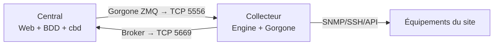

## Quand ajouter un collecteur ?

- **Sites distants** : les contrôles partent du site (pas de trafic SNMP sur le WAN, mesure de l'expérience locale).
- **Zones cloisonnées** (DMZ, réseaux industriels, VRF) : un seul flux à ouvrir entre le collecteur et le central.
- **Charge** : au-delà de quelques milliers de services, répartir l'exécution des plugins.
- **Résilience** : un collecteur continue de contrôler et met en **rétention** ses données si le central est injoignable.



## Installer un collecteur

Même procédure de dépôts que le central ([[02-installation]]), puis :

```bash
# AlmaLinux / RHEL 9
sudo dnf install -y centreon-poller
sudo systemctl enable centreon centengine gorgoned snmptrapd centreontrapd snmpd
sudo systemctl start snmptrapd centreontrapd snmpd
# Debian 12
sudo apt install -y centreon-poller
sudo systemctl enable centreon centengine gorgoned snmptrapd centreontrapd snmpd
```

Installer aussi sur le collecteur les **plugins** des connecteurs qu'il utilisera (`centreon-plugin-…`), et un relais de messagerie si les notifications partent de ce collecteur.

## Enregistrer le collecteur

### 1. Script d'enregistrement (sur le collecteur)

```bash
/usr/share/centreon/bin/registerServerTopology.sh -u admin -t poller -h 10.0.10.30 -n poller-lyon
# -h : adresse du central ; -n : nom du collecteur ; mot de passe admin demandé
# Option -ip <IP du collecteur> si plusieurs interfaces
```

### 2. Assistant (interface du central)

*Configuration → Collecteurs → Collecteurs* → **Ajouter** → *Ajouter un collecteur Centreon* → sélectionner `poller-lyon` dans la liste des serveurs en attente → *Suivant* → choisir le **serveur de rattachement** (central ou serveur distant) et, si nécessaire, cocher *Utiliser le central en tant que relais*… → *Appliquer*.

### 3. Configuration de Gorgone (sur le collecteur)

Le central génère la configuration Gorgone du collecteur : *Configuration → Collecteurs* → icône **Gorgone** du collecteur → copier la commande affichée, l'exécuter sur le collecteur. Elle ressemble à l'exemple ci-dessous (indicatif : utilisez toujours la commande générée, qui contient l'identifiant et l'empreinte de clé exacts) :

```bash
cat <<'EOF' > /etc/centreon-gorgone/config.d/40-gorgoned.yaml
name:  gorgoned-poller-lyon
description: Configuration for poller poller-lyon
gorgone:
  gorgonecore:
    id: 2
    external_com_type: tcp
    external_com_path: "*:5556"
    authorized_clients:
      - key: <empreinte de la clé du central>
    privkey: "/var/lib/centreon-gorgone/.keys/rsakey.priv.pem"
    pubkey: "/var/lib/centreon-gorgone/.keys/rsakey.pub.pem"
  modules:
    - name: action
      package: gorgone::modules::core::action::hooks
      enable: true
    - name: engine
      package: gorgone::modules::centreon::engine::hooks
      enable: true
      command_file: "/var/lib/centreon-engine/rw/centengine.cmd"
EOF
sudo systemctl restart gorgoned
```

### 4. Exporter la configuration

Sur le central : sélectionner le collecteur → **Exporter la configuration** (générer, déboguer, déplacer, **redémarrer** la première fois). Puis :

```bash
# Sur le collecteur
sudo systemctl restart centengine
# Sur le central
sudo systemctl restart gorgoned
```

Le collecteur doit apparaître **En cours d'exécution** avec une date de dernière mise à jour récente.

## Flux à ouvrir

| Sens | Port | Usage |
| --- | --- | --- |
| Central → collecteur | TCP **5556** | Gorgone : configuration, commandes (acquittement, contrôle forcé), installation de plugins |
| Collecteur → central | TCP **5669** | Centreon Broker : résultats, états, métriques |
| Collecteur → équipements | UDP 161, TCP 22/443/… | Contrôles |
| Équipements → collecteur | UDP 162 | Traps |

## Collecteur en DMZ : connexions inversées

Si la politique interdit toute connexion **entrante** vers la DMZ… ou au contraire **depuis** la DMZ vers le LAN, les deux flux peuvent être inversés :

| Flux | Normal | Inversé |
| --- | --- | --- |
| Gorgone | Central → collecteur (5556) | **Mode pull** : le collecteur se connecte au central |
| Broker | Collecteur → central (5669) | **One peer retention mode** : le central se connecte au collecteur |

- Broker inversé : *Configuration → Collecteurs → Configuration de Centreon Broker* → configuration du collecteur → sortie IPv4 en mode **serveur** (sans hôte), et activer *One peer retention mode* ; ajouter côté central une entrée de type client vers l'IP du collecteur.
- Gorgone pull : dans la configuration Gorgone du collecteur, module `pull` vers l'adresse du central ; côté central, déclarer le collecteur comme client en pull.

## Serveurs distants (Remote Servers)

Un **serveur distant** est un collecteur doté de **sa propre base et de sa propre interface web** : les équipes locales l'exploitent de manière autonome, et le central reçoit toutes les données.

```bash
sudo dnf install -y centreon centreon-mariadb      # comme un central
# … assistant web local, puis enregistrement :
/usr/share/centreon/bin/registerServerTopology.sh -u admin -t remote -h 10.0.10.30 -n remote-madrid
```

Assistant du central : *Ajouter un serveur distant Centreon* → sélectionner le serveur en attente → identifiants de la base du serveur distant → collecteurs rattachés. La configuration est **toujours** faite sur le central et exportée vers le serveur distant et ses collecteurs ; l'interface du serveur distant est en lecture/exploitation (acquittements, temps d'arrêt).

## Répartir les hôtes

- Champ **Collecteur** de chaque hôte (ou modification en masse : sélectionner des hôtes → *Plus d'actions → Modification en masse*).
- Déplacer un hôte = changer de collecteur puis exporter la configuration des **deux** collecteurs.
- Les traps doivent être envoyés au collecteur qui supervise l'hôte.

## Superviser les collecteurs

- Service *Poller-Status* / connecteur **Centreon Poller** ou **Centreon Central** : latence, nombre de contrôles, rétention Broker, état de Gorgone.
- Alerte si un collecteur n'a pas envoyé de données depuis 5 minutes (*Configuration → Collecteurs* : colonne *Dernière mise à jour*).
- Plugin `apps::centreon::local::plugin` (modes `broker-stats`, `centreon-health`, `proxy`…) exécuté sur le central.

> [!TIP]
> Latence élevée (colonne *Latence* des collecteurs ou `centengine` « check latency ») = collecteur surchargé : augmenter les ressources, réduire la fréquence des contrôles, répartir sur un collecteur supplémentaire, vérifier les plugins qui expirent (timeouts).
