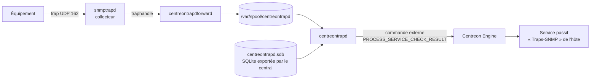

## Principe

Les traps sont des messages **envoyés spontanément** par les équipements (lien coupé, alimentation en panne, redémarrage, changement de configuration). Centreon les transforme en **résultats passifs** sur un service de l'hôte émetteur.



1. `snmptrapd` reçoit le trap et le passe à `centreontrapdforward`, qui l'écrit dans un fichier de spool (rapide, aucune perte).
2. `centreontrapd` lit le spool, identifie l'**hôte** (par IP / nom) et la définition du trap (par **OID**) dans la base SQLite locale.
3. Il calcule l'état et le message, puis soumet un résultat **passif** au service lié.

## Configurer snmptrapd (sur chaque collecteur)

```ini /etc/snmp/snmptrapd.conf
# Traps v2c : accepter la communauté utilisée par les équipements
authCommunity log,execute,net Ch4ng3-M0i-Traps
# (ou, sur un réseau maîtrisé : disableAuthorization yes)

# Traps v3 : l'engineID de l'équipement émetteur est requis pour les traps (pas pour les informs)
createUser -e 0x80000009030000AABBCCDDEE centreon SHA-512 MotDePasseAuth-Long AES MotDePassePriv-Long
authUser log,execute,net centreon

# Transfert à Centreon
traphandle default su -l centreon -c "/usr/share/centreon/bin/centreontrapdforward"
```

```ini /etc/sysconfig/snmptrapd (RHEL) — options de démarrage
OPTIONS="-On -Lsd -p /run/snmptrapd.pid"
```

`-On` : OID numériques (indispensable : centreontrapd compare des OID numériques).

```bash
sudo systemctl enable --now snmptrapd centreontrapd
sudo firewall-cmd --permanent --add-port=162/udp && sudo firewall-cmd --reload
```

> [!NOTE]
> Pour connaître l'**engineID** d'un équipement Cisco : `show snmp engineID`. Avec des **informs** v3 (traps acquittés), c'est l'engineID du récepteur qui est utilisé et la ligne `createUser` n'a pas besoin de `-e`.

## Déclarer les traps dans Centreon

### Importer une MIB

*Configuration → Traps SNMP → MIB* → choisir le **constructeur** (créé dans *Constructeurs* si besoin) et le fichier `.mib`. Centreon convertit les `NOTIFICATION-TYPE` / `TRAP-TYPE` en définitions de traps (dépendances : les MIB importées par celle-ci doivent être présentes dans `/usr/share/snmp/mibs`).

> [!TIP]
> Les **connecteurs de supervision** de nombreux équipements contiennent déjà les définitions de traps courantes. Commencez par les traps génériques (`linkDown`, `linkUp`, `coldStart`, `authenticationFailure`) puis ajoutez les traps spécifiques réellement utiles.

### Définir un trap

*Configuration → Traps SNMP → Traps SNMP → Ajouter* :

| Champ | Exemple |
| --- | --- |
| Nom | `linkDown` |
| OID | `.1.3.6.1.6.3.1.1.5.3` |
| Constructeur | Generic |
| Message de sortie | `Interface $3 ($2) est DOWN` (`$1`, `$2`… = variables du trap ; `$*` = toutes) |
| Statut par défaut | Critical |
| Soumettre le résultat | Oui |
| Modèles de services liés | `Traps-SNMP-Generic` (service passif) |

Onglet **Avancé** :

| Option | Usage |
| --- | --- |
| **Règles de correspondance** | Calculer l'état selon une variable : si `@OUTPUT@` correspond à `/up/` → OK, sinon CRITICAL ; ou si `$5` vaut `2` → WARNING |
| Remise à zéro | Remettre le service à OK après N secondes (traps sans « retour à la normale ») |
| Commande spéciale | Exécuter un script à réception (ticket, action corrective) |
| Préexécution | Commandes exécutées avant (ex. `snmpget` pour récupérer le nom d'interface à partir de l'index) |
| Routage | Rediriger vers un autre hôte (traps émis par un contrôleur pour le compte d'un équipement) |
| Contrôle de l'état | Plutôt que d'appliquer l'état, relancer le contrôle actif du service |

### Service passif

Modèle de service :

- Contrôles **actifs désactivés**, **passifs activés**.
- `max check attempts` = 1 (un trap = état HARD immédiat).
- Commande factice (`check_centreon_dummy`) avec un état de « fraîcheur » éventuel.
- Onglet *Relations → Traps SNMP liés* : les définitions de traps.

## Générer la base de traps

Après toute modification : *Configuration → Traps SNMP → Générer* → sélectionner les collecteurs → **Générer** puis **Appliquer les configurations** (recharge de centreontrapd). La base `/etc/snmp/centreon_traps/centreontrapd.sdb` est envoyée sur chaque collecteur par Gorgone.

## Configurer l'équipement

```cisco
snmp-server enable traps snmp linkdown linkup coldstart warmstart authentication
snmp-server enable traps config
snmp-server enable traps envmon fan shutdown supply temperature status
snmp-server enable traps port-security
snmp-server host 10.0.10.40 version 2c Ch4ng3-M0i-Traps
! ou en v3 : snmp-server host 10.0.10.40 version 3 priv centreon
snmp-server trap-source Vlan10
```

> [!IMPORTANT]
> L'adresse **source** du trap doit correspondre à l'adresse déclarée de l'hôte dans Centreon (sinon centreontrapd ne trouve pas l'hôte). Fixez l'interface source (`snmp-server trap-source`) ou activez la résolution par nom.

## Tester

```bash
# Simuler un linkDown depuis le collecteur lui-même (ou un autre serveur) au nom d'un hôte déclaré
snmptrap -v 2c -c Ch4ng3-M0i-Traps 10.0.10.40 '' .1.3.6.1.6.3.1.1.5.3 \
  .1.3.6.1.2.1.2.2.1.1.48 i 48 \
  .1.3.6.1.2.1.2.2.1.7.48 i 1 \
  .1.3.6.1.2.1.2.2.1.8.48 i 2

# Suivre le traitement
tail -f /var/log/centreon/centreontrapd.log
journalctl -u snmptrapd -f
```

Pour tester au nom d'un hôte précis, envoyez le trap **depuis** l'IP de cet hôte, ou déclarez temporairement l'IP de la machine de test sur un hôte de test.

## Dépannage

| Symptôme | Vérification |
| --- | --- |
| Rien dans `snmptrapd` | `tcpdump -ni any udp port 162` : le trap arrive-t-il ? pare-feu, IP du collecteur sur l'équipement |
| Reçu par snmptrapd mais ignoré | `authCommunity` / `authUser`, engineID v3 ; journal `snmptrapd` (`-Lsd`) |
| centreontrapd : `Unknown host` | L'IP source ne correspond à aucun hôte du collecteur |
| centreontrapd : `Unknown trap` | OID non défini ou base non régénérée/appliquée |
| Service non mis à jour | Service passif lié au trap absent sur l'hôte, contrôles passifs désactivés, collecteur différent de celui de l'hôte |
| Retards importants | Spool qui s'accumule (`ls /var/spool/centreontrapd \| wc -l`) : rafales de traps, préexécutions lentes |

Option de diagnostic : passer `log_trap_db` / mode debug dans `/etc/centreon/centreontrapd.pm`, puis redémarrer `centreontrapd`.
