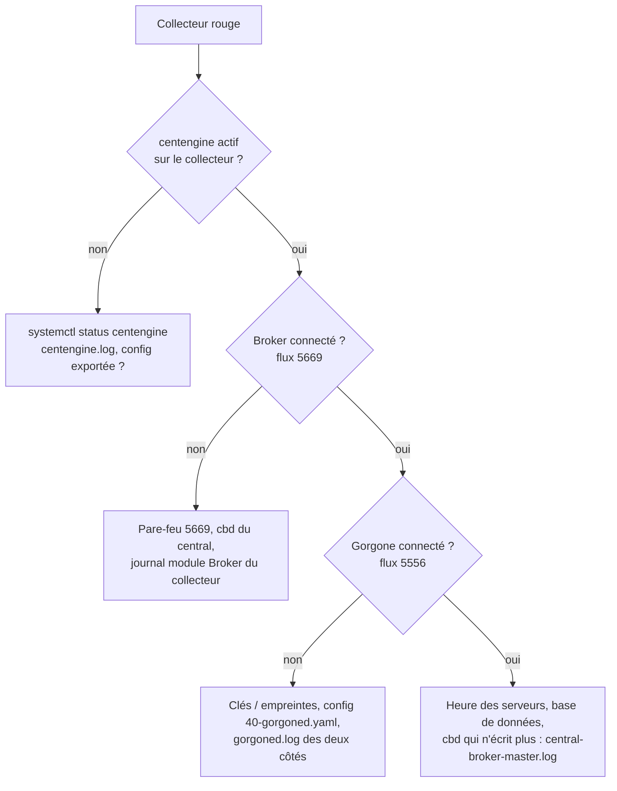

## Vue d'ensemble de l'état

```bash
systemctl status centengine cbd gorgoned centreon php-fpm httpd mariadb --no-pager | grep -E "●|Active"
ss -tlnp | grep -E ':5669|:5556|:8085|:443|:3306'
curl -s http://127.0.0.1:8085/api/internal/constatus | python3 -m json.tool     # connexions Gorgone vers les collecteurs
```

*Configuration → Collecteurs → Collecteurs* : colonnes **En cours d'exécution**, **Dernière mise à jour**, **Latence**, version.

## Collecteur « non en cours d'exécution » ou dernière mise à jour ancienne



```bash
# Sur le collecteur
tail -n 100 /var/log/centreon-broker/*module*.log          # « connection refused », « peer … is not authorized »
nc -vz <ip_central> 5669
# Sur le central
tail -n 100 /var/log/centreon-broker/central-broker-master.log
tail -n 100 /var/log/centreon-gorgone/gorgoned.log | grep -iE "error|refused|unauthorized|ping"
nc -vz <ip_collecteur> 5556
```

| Message | Cause | Solution |
| --- | --- | --- |
| Broker : `connection refused` | cbd arrêté sur le central, pare-feu | `systemctl restart cbd`, ouvrir 5669 |
| Broker : `peer … is not authorized` / problème de négociation | Configuration Broker du collecteur obsolète, chiffrement/compression incohérents | Réexporter la configuration du collecteur et redémarrer `centengine` |
| Gorgone : `unauthorized` / `cannot decrypt` | Clé du central non autorisée sur le collecteur (réinstallation) | Régénérer la configuration Gorgone du collecteur depuis l'interface, redémarrer `gorgoned` des deux côtés |
| Gorgone : `ping timeout` | Flux 5556 bloqué, `gorgoned` arrêté sur le collecteur | Pare-feu, service |

## Export de configuration en échec

| Étape | Erreur fréquente | Piste |
| --- | --- | --- |
| Génération | `Error: Could not find any host matching…` | Service rattaché à un groupe d'hôtes vide, modèle supprimé |
| Débogage (`centengine -v`) | `Error: Service … has no check command` | Commande manquante dans le modèle |
| Débogage | `Warning: … has no default contacts` | Simple avertissement |
| Déplacement | `Cannot copy files` / tâche Gorgone en échec | Gorgone non connecté, droits sur `/etc/centreon-engine` du collecteur |
| Redémarrage | Le moteur ne redémarre pas | Voir `centengine.log` sur le collecteur ; tester `centengine -v /etc/centreon-engine/centengine.cfg` |

```bash
# Tester manuellement la configuration générée (sur le collecteur)
sudo -u centreon-engine /usr/sbin/centengine -v /etc/centreon-engine/centengine.cfg
# Suivre les actions Gorgone liées à l'export
grep -i "action" /var/log/centreon-gorgone/gorgoned.log | tail -20
```

## Service en UNKNOWN

1. Lire la **sortie** dans Resource Status (message du plugin).
2. Copier la **ligne de commande** exacte : *détails du service → onglet Détails → Commande* (ou *Configuration → Services → … → icône Commande*).
3. L'exécuter sur le **collecteur** qui supervise l'hôte, **en tant que `centreon-engine`** :

```bash
sudo su - centreon-engine -s /bin/bash -c '/usr/lib/centreon/plugins/centreon_linux_snmp.pl --plugin=os::linux::snmp::plugin --mode=cpu --hostname=10.0.20.10 --snmp-version=2c --snmp-community=xxx --verbose'
```

| Sortie | Cause |
| --- | --- |
| `(No output returned from plugin)` / `Return code of 127` | Plugin absent sur ce collecteur (paquet non installé), chemin `$CENTREONPLUGINS$` incorrect |
| `UNKNOWN: Cannot load module 'xxx'` | Dépendance Perl manquante : installer le paquet indiqué (`perl-…`) |
| `UNKNOWN: SNMP GET Request : Timeout` | Agent SNMP injoignable : ACL/communauté/version, pare-feu UDP 161, `snmpwalk` pour confirmer |
| `UNKNOWN: SNMP Table Request : Cant get a single value` | OID non supporté par l'équipement / mauvais mode pour ce modèle |
| `(Service check timed out after 60.01 seconds)` | Plugin trop lent : augmenter `--timeout` / le timeout du moteur, réduire le périmètre (filtres) |
| `UNKNOWN: Need to specify '--xxx' option` | Macro vide dans le modèle (macro d'hôte non renseignée) |
| `Permission denied` sur un fichier de cache | Plugin lancé une fois en root : `chown -R centreon-engine: /var/lib/centreon/centplugins` |
| `UNKNOWN: 500 Can't connect … SSL` | Certificat de l'API cible : options `--insecure` / `--ssl-opt="SSL_verify_mode => SSL_VERIFY_NONE"` (à éviter en production) |

## Graphiques vides ou absents

- Le service renvoie-t-il des **données de performance** (partie après `|`) ?
- `cbd` du central écrit-il les RRD ? Journal `central-rrd-master.log`.
- *Administration → Paramètres → Options → Gestion des données* : RRD activé ? Vérifier `/var/lib/centreon/metrics` (droits `centreon-broker`).
- Reconstruire les RRD d'un service depuis la base : *Administration → Gestion des graphiques* → sélectionner → *Reconstruire la base RRD*.

## Notifications non reçues

```bash
grep "NOTIFICATION" /var/log/centreon-engine/centengine.log | tail      # sur le collecteur de l'hôte
tail -f /var/log/maillog
```

| Constat | Piste |
| --- | --- |
| Aucune ligne `NOTIFICATION` | État encore SOFT, notifications désactivées (objet, contact, global), période, acquittement, temps d'arrêt, dépendance, parent DOWN |
| Ligne présente mais pas de courriel | Postfix du **collecteur**, relais SMTP, anti-spam (vérifier l'expéditeur), commande de notification |
| Courriel reçu par certains seulement | Options de notification et périodes **du contact** |

## Interface web

| Problème | Piste |
| --- | --- |
| Page blanche / erreur 500 | `/var/log/php-fpm/centreon-error.log`, `/var/log/httpd/error_log` ; PHP-FPM démarré ? |
| « Unable to connect to database » | MariaDB arrêtée, mot de passe dans `/etc/centreon/conf.pma.php` et `/etc/centreon/config.d/10-database.yaml` |
| Heure incorrecte dans les journaux | `date.timezone` PHP différent du fuseau système / de l'utilisateur |
| Session expirée en boucle | Horloge du serveur, cookie, reverse proxy (en-têtes `X-Forwarded-*`) |
| Authentification LDAP refusée | *Administration → Authentification → LDAP* : tester la connexion, filtre, certificat LDAPS ([[01-active-directory/09-securite-durcissement\|LDAP signing / LDAPS]]) |

## Base de données

```bash
mysql -u root -p -e "SHOW PROCESSLIST;" | head -30          # requêtes longues
mysqlcheck -u root -p --all-databases --check | grep -v OK  # tables corrompues
df -h /var/lib/mysql
mysql centreon_storage -e "SELECT COUNT(*) FROM data_bin WHERE ctime > UNIX_TIMESTAMP() - 300;"   # insertions récentes de métriques
```

Si la file de Broker grossit (rétention dans `/var/lib/centreon-broker/*.queue.*`), c'est que la base n'absorbe plus le flux : disque, verrous, partitionnement, ressources MariaDB.

## Commandes utiles

| Commande | Usage |
| --- | --- |
| `centengine -v <cfg>` | Vérifier la configuration du moteur |
| `centreon -u admin -p '…' -a POLLERLIST` | Liste des collecteurs (CLAPI) |
| `centreon -u admin -p '…' -a APPLYCFG -v <collecteur>` | Export complet en ligne de commande |
| `echo "[$(date +%s)] SCHEDULE_FORCED_SVC_CHECK;srv-web01;Cpu;$(date +%s)" > /var/lib/centreon-engine/rw/centengine.cmd` | Forcer un contrôle via le fichier de commandes (sur le collecteur) |
| `/usr/lib/centreon/plugins/<plugin> --plugin=… --list-mode` | Modes disponibles |
| `… --mode=<mode> --help` | Options d'un mode |
| `… --verbose --debug` | Détail des requêtes du plugin |
| `rrdtool info /var/lib/centreon/metrics/<id>.rrd` | Inspecter un fichier RRD |

> [!TIP]
> La communauté Centreon (forum *The Watch*, GitHub `centreon/centreon` et `centreon/centreon-plugins`) et la documentation des connecteurs indiquent pour chaque plugin les prérequis côté équipement et les erreurs connues : c'est le premier réflexe quand un plugin renvoie un message inattendu.
