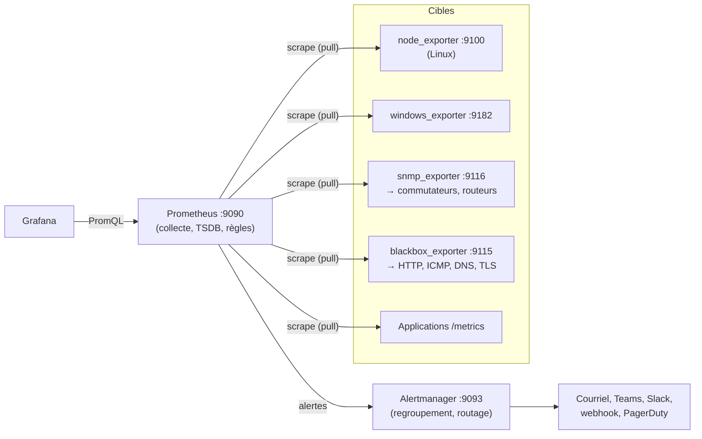

**Prometheus** (projet CNCF) collecte des **métriques numériques horodatées** en interrogeant périodiquement des points HTTP `/metrics` (modèle **pull**), les stocke dans sa base de séries temporelles et permet de les interroger (**PromQL**), de déclencher des **alertes** et d'alimenter des tableaux de bord ([[03-grafana/01-presentation-installation|Grafana]]). C'est la référence pour Kubernetes, les applications modernes, et de plus en plus pour le réseau (SNMP, gNMI).

## Architecture



| Composant | Rôle |
| --- | --- |
| Serveur Prometheus | Collecte, stockage local (TSDB), évaluation des règles |
| **Exporteurs** | Traduisent les métriques d'un système en format Prometheus |
| Alertmanager | Déduplication, regroupement, routage et silences des alertes |
| Pushgateway | Point de dépôt pour les tâches éphémères (scripts, jobs) |
| Découverte de services | Fichiers, DNS, Consul, Kubernetes, clouds… |

## Modèle de données

```text
node_network_receive_bytes_total{instance="srv-web-01:9100", job="linux", device="ens192"} 8.341e+10
```

| Type | Exemple |
| --- | --- |
| **Counter** | Compteur croissant (octets reçus, requêtes) : s'utilise avec `rate()` |
| **Gauge** | Valeur instantanée (température, espace libre) |
| Histogram / Summary | Distributions (latences) |

Chaque combinaison unique d'étiquettes est une **série** : évitez les étiquettes à valeurs illimitées (identifiants de session, adresses IP clientes) qui font exploser la **cardinalité**.

## Versions et ports

- **Prometheus 3** (fin 2024) : nouvelle interface, noms UTF-8, *remote write 2.0*, réception OTLP (OpenTelemetry), histogrammes natifs.
- Ports : **9090** (Prometheus), 9093/9094 (Alertmanager / cluster), 9100 (node_exporter), 9182 (windows_exporter), 9115 (blackbox), 9116 (snmp_exporter).

## Installation

### Paquets des distributions (simples, versions parfois anciennes)

```bash
sudo apt install prometheus prometheus-node-exporter prometheus-alertmanager \
                 prometheus-blackbox-exporter prometheus-snmp-exporter
# Configuration : /etc/prometheus/prometheus.yml ; données : /var/lib/prometheus
```

### Binaires officiels (versions récentes)

```bash
VER=3.5.0
sudo useradd --system --no-create-home --shell /usr/sbin/nologin prometheus
curl -LO https://github.com/prometheus/prometheus/releases/download/v${VER}/prometheus-${VER}.linux-amd64.tar.gz
tar xzf prometheus-${VER}.linux-amd64.tar.gz
sudo install -m 755 prometheus-${VER}.linux-amd64/{prometheus,promtool} /usr/local/bin/
sudo mkdir -p /etc/prometheus /var/lib/prometheus && sudo chown prometheus: /var/lib/prometheus
```

```ini /etc/systemd/system/prometheus.service
[Unit]
Description=Prometheus
After=network-online.target

[Service]
User=prometheus
ExecStart=/usr/local/bin/prometheus \
  --config.file=/etc/prometheus/prometheus.yml \
  --storage.tsdb.path=/var/lib/prometheus \
  --storage.tsdb.retention.time=30d \
  --web.listen-address=127.0.0.1:9090 \
  --web.enable-lifecycle
ExecReload=/bin/kill -HUP $MAINPID
Restart=on-failure

[Install]
WantedBy=multi-user.target
```

### Windows, macOS, Docker

| Plate-forme | Installation |
| --- | --- |
| Windows | Archive `prometheus-*.windows-amd64.zip` (service via NSSM ou `sc.exe`) ; **windows_exporter** (MSI) sur les serveurs supervisés |
| macOS | `brew install prometheus node_exporter` |
| Docker | `docker run -d -p 9090:9090 -v ./prometheus.yml:/etc/prometheus/prometheus.yml -v prom-data:/prometheus prom/prometheus` |
| Kubernetes | Chart **kube-prometheus-stack** (opérateur, Alertmanager, Grafana, exporteurs) |

## Premier prometheus.yml

```yaml /etc/prometheus/prometheus.yml
global:
  scrape_interval: 30s
  evaluation_interval: 30s
  external_labels:
    site: paris

rule_files:
  - /etc/prometheus/regles/*.yml

alerting:
  alertmanagers:
    - static_configs:
        - targets: [ "127.0.0.1:9093" ]

scrape_configs:
  - job_name: prometheus
    static_configs:
      - targets: [ "127.0.0.1:9090" ]

  - job_name: linux
    static_configs:
      - targets: [ "srv-web-01.corp.exemple.fr:9100", "srv-db-01.corp.exemple.fr:9100" ]
        labels: { env: production }
```

```bash
promtool check config /etc/prometheus/prometheus.yml
sudo systemctl enable --now prometheus
curl -X POST http://127.0.0.1:9090/-/reload          # recharger (avec --web.enable-lifecycle)
```

Interface : *Status → Targets* (état des cibles), *Graph* (requêtes PromQL).

## Suite du parcours

1. [[02-exporteurs-decouverte|Exporteurs (système, Windows, SNMP, blackbox) et découverte]]
2. [[03-promql-alertes|PromQL, règles et Alertmanager]]
3. [[04-stockage-ha-exploitation|Stockage, haute disponibilité et exploitation]]
