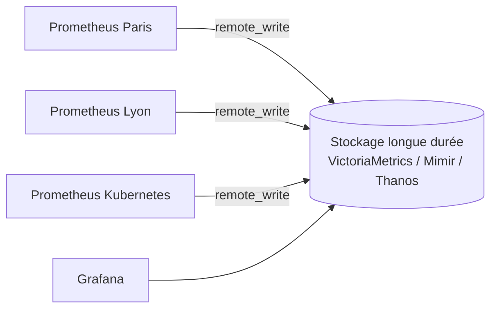

## Stockage local

| Option | Rôle |
| --- | --- |
| `--storage.tsdb.retention.time=30d` | Durée de conservation (défaut 15 jours) |
| `--storage.tsdb.retention.size=200GB` | Taille maximale (les plus anciens blocs sont supprimés) |
| `--storage.tsdb.path` | Répertoire (SSD local recommandé ; **pas de NFS**) |

Ordre de grandeur : 1 à 2 octets par échantillon après compression. 100 000 séries collectées toutes les 30 s ≈ 290 millions d'échantillons par jour ≈ 0,5 Go/jour. La **mémoire** dépend surtout du nombre de **séries actives**.

```bash
curl -s http://127.0.0.1:9090/api/v1/status/tsdb | jq '.data.headStats, .data.seriesCountByMetricName[:10]'
```

L'interface *Status → TSDB Status* montre les métriques et étiquettes responsables du plus grand nombre de séries (cardinalité).

## Longue durée et vue globale



| Solution | Principe |
| --- | --- |
| **VictoriaMetrics** | Base compatible PromQL, très économe ; version cluster |
| **Grafana Mimir** | Stockage horizontal sur objet (S3), multi-locataire |
| **Thanos** | Sidecar à côté de chaque Prometheus, blocs envoyés vers S3, requêtes globales et dédupliquées |
| Fédération | Un Prometheus central interroge `/federate` d'autres Prometheus (agrégats seulement) |

```yaml prometheus.yml (extrait)
remote_write:
  - url: https://metriques.corp.exemple.fr/api/v1/write
    basic_auth: { username: paris, password_file: /etc/prometheus/rw.pass }
    queue_config: { max_samples_per_send: 5000 }
```

Le mode **agent** (`--agent`) transforme Prometheus en simple collecteur qui transmet tout par `remote_write` (sites distants, petites machines).

## Haute disponibilité

- Deux serveurs Prometheus **identiques** collectent les mêmes cibles (étiquette externe `replica` différente) ; la déduplication se fait à la lecture (Thanos, Mimir, VictoriaMetrics) ou on accepte deux sources dans Grafana.
- **Alertmanager en cluster** (3 instances `--cluster.peer=…`) : chaque Prometheus envoie ses alertes à tous, les notifications sont dédupliquées.

## Sauvegarde

```bash
curl -X POST http://127.0.0.1:9090/api/v1/admin/tsdb/snapshot      # nécessite --web.enable-admin-api
# instantané dans <data>/snapshots/<nom> : à copier vers le stockage de sauvegarde
```

La configuration (`prometheus.yml`, règles, `alertmanager.yml`, cibles) doit être **versionnée dans Git** et déployée automatiquement ; les données historiques sont souvent moins critiques que la configuration.

## Superviser Prometheus

| Métrique / alerte | Signification |
| --- | --- |
| `up{job="prometheus"}` | Le serveur lui-même |
| `prometheus_rule_evaluation_failures_total` | Règles en erreur |
| `prometheus_notifications_dropped_total` | Alertes non transmises à Alertmanager |
| `prometheus_tsdb_head_series` | Séries actives (cardinalité) |
| `prometheus_remote_storage_samples_failed_total` | Échecs d'envoi distant |
| `alertmanager_notifications_failed_total` | Notifications en échec |

Une alerte « **chien de garde** » toujours active (`vector(1)`) envoyée à un service externe permet de détecter la panne de toute la chaîne d'alerte.

## Problèmes fréquents

| Symptôme | Cause | Solution |
| --- | --- | --- |
| Cible `DOWN` : `context deadline exceeded` | Délai de collecte trop court (SNMP lent), pare-feu | `scrape_timeout`, accès réseau, charge de l'exporteur |
| Cible `DOWN` : `connection refused` | Exporteur arrêté, mauvais port | Service, port d'écoute |
| Mémoire en forte hausse | Explosion de cardinalité | *TSDB Status*, `metric_relabel_configs` pour supprimer les étiquettes fautives |
| `out of order sample` / `duplicate sample for timestamp` | Deux sources envoient les mêmes séries, horloges décalées | Étiquettes uniques par source, NTP |
| Alerte jamais déclenchée | `for:` trop long, expression vide (métrique absente) | Tester l'expression dans l'interface, `absent()` |
| Alertes déclenchées mais pas de notification | Route, récepteur, SMTP | *Status → Alertmanagers*, `amtool`, journaux d'Alertmanager |
| Démarrage lent / `WAL corruption` | Arrêt brutal, disque plein | Laisser rejouer le WAL ; en dernier recours supprimer le WAL corrompu (perte des dernières heures) |
| Valeurs SNMP aberrantes après redémarrage d'équipement | Compteurs 32 bits qui rebouclent | Utiliser les compteurs 64 bits (`ifHC*`) et `rate()` |
