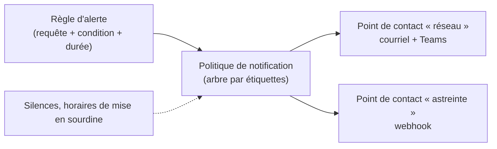

## Panneaux

| Visualisation | Usage |
| --- | --- |
| **Time series** | Évolution (débit, CPU, latence) |
| **Stat** / Gauge | Valeur actuelle avec seuils colorés |
| **Table** | Inventaire, état de nombreuses interfaces |
| Bar gauge | Classement (top N) |
| **State timeline** / Status history | États au cours du temps (lien up/down, état BGP) |
| Geomap / Node graph / Canvas | Cartes, topologies, schémas personnalisés |
| Logs | Journaux (Loki, Elasticsearch) |

Réglages clés d'un panneau : **unité** (bits/s, octets, %, secondes), **seuils** (couleurs), **décimales**, légende (valeurs min/max/moyenne), **dérogations** (*overrides*) par série.

## Variables

Les variables rendent un tableau réutilisable : un seul tableau « Interface réseau » pour tous les équipements.

| Variable | Requête (source Prometheus) |
| --- | --- |
| `site` | `label_values(ifHCInOctets, site)` |
| `equipement` | `label_values(ifHCInOctets{site="$site"}, instance)` |
| `interface` | `label_values(ifHCInOctets{instance="$equipement"}, ifName)` |

```text Requête d'un panneau utilisant les variables
rate(ifHCInOctets{instance="$equipement", ifName=~"$interface"}[$__rate_interval]) * 8
```

| Variable intégrée | Rôle |
| --- | --- |
| `$__rate_interval` | Fenêtre adaptée à l'intervalle de collecte et au zoom (à utiliser dans `rate()`) |
| `$__interval` | Pas des points affichés |
| `$__range` | Durée de la période affichée |

Activez *Multi-value* et *Include All* pour afficher plusieurs interfaces ; l'option **Repeat** duplique un panneau par valeur de variable.

## Organisation

- **Dossiers** par domaine (Réseau, Systèmes, Applications), droits par dossier.
- Lignes repliables, liens entre tableaux (vue globale → équipement → interface), **annotations** (déploiements, maintenances).
- Peu de panneaux par tableau, du général au détail ; tableaux importés **adaptés** plutôt qu'empilés.
- Tableaux versionnés (*JSON Model*, provisionnement, ou Git via l'API).

## Alertes Grafana



| Élément | Rôle |
| --- | --- |
| **Règle d'alerte** | Requête(s) + expression (réduction, seuil) + durée `pending` + étiquettes |
| **Point de contact** | Destination : courriel, Teams, Slack, webhook, PagerDuty, OpsGenie… |
| **Politique de notification** | Routage par étiquettes, regroupement, délais de répétition |
| Silence / *mute timing* | Sourdine ponctuelle ou périodique (hors heures ouvrées) |

Exemple de règle : requête `rate(ifHCInOctets{role="wan"}[5m]) * 8 / (ifHighSpeed * 1e6)`, réduction *Last*, seuil *IS ABOVE 0.9*, période d'attente 15 min, étiquette `equipe=reseau`.

> [!TIP]
> Si vos métriques sont dans Prometheus, centralisez les règles d'alerte dans **Prometheus/Alertmanager** (versionnées avec la configuration) et utilisez Grafana pour l'affichage ; réservez les alertes Grafana aux sources sans moteur d'alerte (SQL, InfluxDB, Elasticsearch). Grafana sait afficher et gérer les alertes d'un Alertmanager externe.
