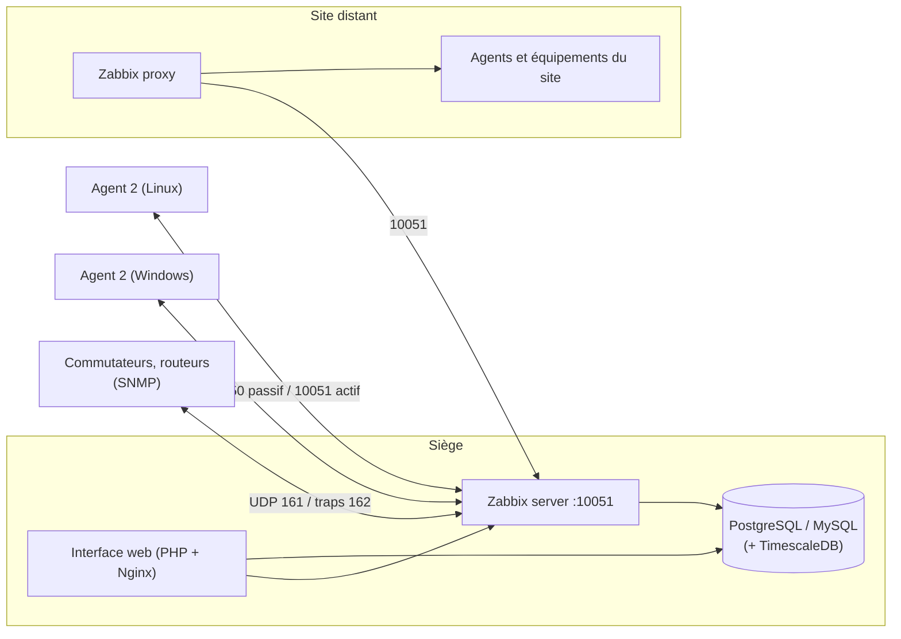

**Zabbix** est une solution de supervision libre (GPL puis AGPL) très complète : collecte par **agents**, **SNMP**, IPMI, JMX, HTTP, SSH, scripts ; **modèles** prêts à l'emploi pour des centaines de systèmes et d'équipements ; **découverte** automatique ; déclencheurs, escalades, cartes, tableaux de bord, rapports. Elle se positionne face à [[01-centreon/01-presentation|Centreon]], [[08-checkmk/01-presentation-installation|Checkmk]] et à la pile [[02-prometheus/01-presentation-installation|Prometheus]].

## Architecture



| Composant | Rôle |
| --- | --- |
| **Server** | Collecte, évaluation des déclencheurs, actions, notifications |
| Base de données | Configuration, historique, tendances (PostgreSQL + TimescaleDB recommandé pour les grands volumes) |
| Interface web | Configuration et consultation (PHP) |
| **Agent 2** (Go) | Agent moderne à greffons (Docker, MySQL, PostgreSQL, Redis…) ; l'agent 1 (C) reste disponible |
| **Proxy** | Collecte pour un site ou une zone réseau, met en tampon, puis transmet au serveur |
| Java gateway, web service | Supervision JMX, génération de rapports PDF |

| Mode de l'agent | Fonctionnement |
| --- | --- |
| Passif | Le serveur interroge l'agent (TCP 10050 vers l'agent) |
| **Actif** | L'agent récupère sa liste d'éléments et envoie les valeurs (TCP 10051 vers le serveur/proxy) : idéal derrière un NAT ou un pare-feu |

## Versions

Une version **LTS** environ tous les 18 mois (5.0, 6.0, **7.0 LTS** en 2024, 8.0 attendue), supportée 5 ans ; des versions intermédiaires (7.2, 7.4) supportées quelques mois. Choisissez une LTS en production.

## Installation (7.0 LTS, PostgreSQL, Nginx)

### Debian 12

```bash
wget https://repo.zabbix.com/zabbix/7.0/debian/pool/main/z/zabbix-release/zabbix-release_latest_7.0+debian12_all.deb
sudo dpkg -i zabbix-release_latest_7.0+debian12_all.deb && sudo apt update
sudo apt install zabbix-server-pgsql zabbix-frontend-php php8.2-pgsql zabbix-nginx-conf zabbix-sql-scripts zabbix-agent2 postgresql

sudo -u postgres createuser --pwprompt zabbix
sudo -u postgres createdb -O zabbix zabbix
zcat /usr/share/zabbix-sql-scripts/postgresql/server.sql.gz | sudo -u zabbix psql zabbix
```

### RHEL 9

```bash
sudo rpm -Uvh https://repo.zabbix.com/zabbix/7.0/rhel/9/x86_64/zabbix-release-latest-7.0.el9.noarch.rpm
sudo dnf install zabbix-server-pgsql zabbix-web-pgsql zabbix-nginx-conf zabbix-sql-scripts zabbix-selinux-policy zabbix-agent2
# (EPEL ne doit pas fournir de paquets zabbix concurrents : excludepkgs=zabbix* dans epel.repo)
```

### Configuration

```ini /etc/zabbix/zabbix_server.conf (extrait)
DBHost=localhost
DBName=zabbix
DBUser=zabbix
DBPassword=MotDePasse
```

```nginx /etc/zabbix/nginx.conf (extrait)
server {
    listen 8080;
    server_name zabbix.corp.exemple.fr;
    # … (fourni par le paquet ; publier ensuite en HTTPS)
}
```

```bash
sudo systemctl restart zabbix-server zabbix-agent2 nginx php8.2-fpm
sudo systemctl enable zabbix-server zabbix-agent2 nginx php8.2-fpm
```

Ouvrez l'interface web : l'**assistant** vérifie les prérequis PHP, la connexion à la base et le fuseau horaire. Compte initial **Admin / zabbix** → à changer immédiatement.

## Docker

Images officielles `zabbix/zabbix-server-pgsql`, `zabbix/zabbix-web-nginx-pgsql`, `zabbix/zabbix-agent2`, `zabbix/zabbix-proxy-sqlite3` (fichiers Compose fournis dans le dépôt `zabbix-docker`).

## Ports

| Port | Usage |
| --- | --- |
| 10050/TCP | Agent (mode passif) |
| **10051/TCP** | Serveur et proxys (agents actifs, proxys, envoi de données) |
| 161/UDP, 162/UDP | SNMP, traps SNMP |
| 80/443 | Interface web |

Windows et macOS ne sont pas des plates-formes serveur ; l'**agent** existe pour Windows (MSI) et macOS (paquet).

## Suite du parcours

1. [[02-agents-hotes-modeles|Agents, hôtes et modèles]]
2. [[03-supervision-reseau-snmp|Supervision réseau : SNMP, découverte, cartes]]
3. [[04-declencheurs-actions-proxys|Déclencheurs, actions, notifications et proxys]]
4. [[05-exploitation-ha-depannage|Haute disponibilité, performances et dépannage]]
