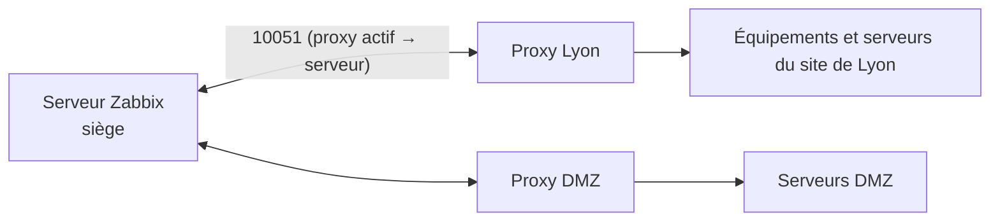

## Déclencheurs

| Expression | Signification |
| --- | --- |
| `last(/srv-web-01/agent.ping)=0` | Dernière valeur |
| `avg(/srv-web-01/system.cpu.util,10m)>90` | Moyenne sur 10 minutes |
| `nodata(/srv-web-01/agent.ping,5m)=1` | Aucune donnée depuis 5 minutes |
| `min(/r1/icmppingloss,5m)>20` | Perte > 20 % pendant 5 minutes |
| `last(/r1/net.if.status[ifOperStatus.10101])=2 and last(/r1/net.if.status[ifOperStatus.10101],#2)=1` | Passage de *up* à *down* |
| `timeleft(/srv/vfs.fs.size[/,pfree],1h,0)<1d` | Plein dans moins d'un jour (prévision) |

**Expression de rétablissement** (hystérésis) : alerte au-dessus de 90 %, fin d'alerte seulement en dessous de 80 % → évite les oscillations.

| Gravité | Usage |
| --- | --- |
| Not classified / Information | Informatif |
| Warning / Average | À traiter |
| High / **Disaster** | Impact service, astreinte |

## Types de médias et utilisateurs

| Type de média | Configuration |
| --- | --- |
| Courriel | Serveur SMTP, expéditeur |
| **Webhooks** intégrés | Microsoft Teams, Slack, Telegram, PagerDuty, Opsgenie, ServiceNow, GLPI, Jira… |
| Script | Script personnalisé (`AlertScriptsPath`) |
| SMS | Modem GSM ou passerelle |

**Groupes d'utilisateurs** : droits *lecture* ou *lecture-écriture* par **groupe d'hôtes** ; un utilisateur ne voit que ce que ses groupes autorisent. Authentification **LDAP/AD** et **SAML** (*Users → Authentication*), avec provisionnement des utilisateurs selon les groupes de l'annuaire (≥ 6.4).

## Actions

*Alerts → Actions → Trigger actions* :

| Élément | Exemple |
| --- | --- |
| Conditions | Groupe d'hôtes = Réseau, gravité ≥ High, pas en maintenance |
| Opération 1 (immédiate) | Envoyer au groupe « Exploitation réseau » (Teams + courriel) |
| Opération 2 (après 30 min, si non acquittée) | Envoyer à « Astreinte » (webhook d'astreinte) |
| Opération de rétablissement | Notifier la résolution |
| Opération de mise à jour | Notifier quand quelqu'un acquitte ou commente |

Les **acquittements** (avec message) arrêtent les escalades et tracent qui traite l'incident.

## Maintenances

*Data collection → Maintenance* : période (ponctuelle ou récurrente), hôtes ou groupes, avec ou sans collecte de données. Les problèmes survenus pendant la maintenance ne déclenchent pas d'action (selon la condition « Problem is not suppressed »).

## Proxys



```bash
sudo apt install zabbix-proxy-sqlite3
```

```ini /etc/zabbix/zabbix_proxy.conf (extrait)
ProxyMode=0                          # 0 = actif : le proxy se connecte au serveur (un seul flux sortant)
Server=zabbix.corp.exemple.fr
Hostname=proxy-lyon                  # identique au nom déclaré dans l'interface
DBName=/var/lib/zabbix/zabbix_proxy.db
ProxyOfflineBuffer=24                # heures de données conservées si le serveur est injoignable
TLSConnect=psk
TLSPSKIdentity=PSK-proxy-lyon
TLSPSKFile=/etc/zabbix/proxy.psk
```

| Avantage | Détail |
| --- | --- |
| Flux réseau | Un seul flux 10051 sortant du site, chiffré |
| Résilience | Données mises en tampon pendant une coupure du lien |
| Charge | Collecte répartie (SNMP, ICMP) |
| Cloisonnement | Zones isolées (DMZ, OT, filiales) |

Zabbix 7.0 introduit les **groupes de proxys** : plusieurs proxys se partagent les hôtes d'un groupe et se relaient en cas de panne. Les hôtes sont assignés au proxy (ou groupe de proxys) dans leur configuration.
