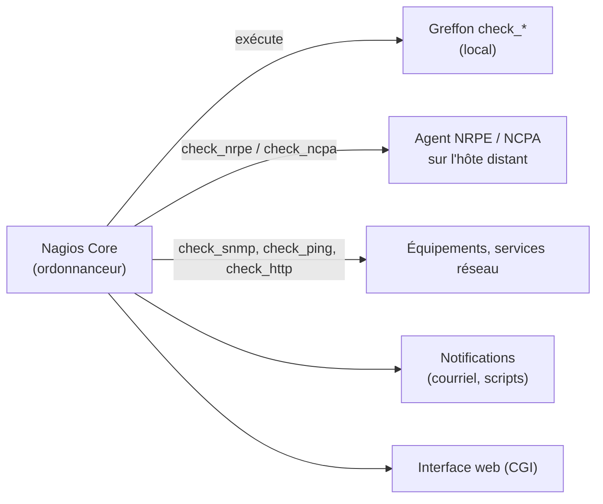

**Nagios Core** est l'outil de supervision libre historique : un ordonnanceur exécute périodiquement des **greffons** (*plugins*) qui testent un hôte ou un service et renvoient un **état** et un message. Simple et éprouvé, il a inspiré de nombreux successeurs (Icinga, Naemon, Centreon, Checkmk) qui réutilisent ses **greffons** et souvent son format de configuration.

## Principe



| Code de retour du greffon | État |
| --- | --- |
| 0 | **OK** |
| 1 | **WARNING** |
| 2 | **CRITICAL** |
| 3 | **UNKNOWN** |

Sortie : une ligne de texte, éventuellement suivie de **données de performance** (`| rta=1.2ms;100;200;0 pl=0%;20;60`).

| État d'un hôte | Signification |
| --- | --- |
| UP / DOWN / UNREACHABLE | UNREACHABLE : un hôte **parent** (routeur, pare-feu) est DOWN |

## Écosystème

| Produit | Remarque |
| --- | --- |
| **Nagios Core** | Libre (GPL), configuration par fichiers texte |
| Nagios XI | Commercial (interface de configuration, rapports) |
| [[06-icinga/01-presentation-installation\|Icinga 2]] | Réécriture moderne, distribuée, API |
| Naemon | Fork de Nagios Core |
| [[01-centreon/01-presentation\|Centreon]], [[08-checkmk/01-presentation-installation\|Checkmk]] | Plates-formes complètes réutilisant les greffons |

## Installation

### Debian / Ubuntu

```bash
sudo apt install nagios4 nagios-plugins-contrib monitoring-plugins nagios-nrpe-plugin
# Interface : http://serveur/nagios4 (Apache) ; compte web :
sudo htdigest -c /etc/nagios4/htdigest.users "Restricted Nagios4 Access" nagiosadmin
sudo systemctl enable --now nagios4 apache2
```

Sous Debian, l'authentification web est à activer dans `/etc/apache2/conf-available/nagios4-cgi.conf` (remplacer `Require ip` par `Require valid-user`) et dans `/etc/nagios4/cgi.cfg` (`use_authentication=1`).

### RHEL / Rocky / Alma

```bash
sudo dnf install epel-release
sudo dnf install nagios nagios-plugins-all nagios-plugins-nrpe
sudo htpasswd -c /etc/nagios/passwd nagiosadmin
sudo systemctl enable --now nagios httpd
sudo firewall-cmd --permanent --add-service=http && sudo firewall-cmd --reload
```

### Depuis les sources

Le site de Nagios fournit les archives de Nagios Core 4.5 et des *Nagios Plugins* : `./configure --with-httpd-conf=/etc/apache2/sites-enabled && make all && make install-groups-users install install-daemoninit install-commandmode install-config install-webconf` — utile pour disposer de la dernière version.

## Fichiers

| Fichier (Debian `nagios4` / RHEL) | Rôle |
| --- | --- |
| `/etc/nagios4/nagios.cfg` / `/etc/nagios/nagios.cfg` | Configuration principale (répertoires `cfg_dir` des objets) |
| `objects/` ou `conf.d/` | Hôtes, services, contacts, commandes, modèles |
| `resource.cfg` | Macros `$USER1$` (chemin des greffons), mots de passe |
| `cgi.cfg` | Interface web et droits |
| Greffons | `/usr/lib/nagios/plugins/` (Debian), `/usr/lib64/nagios/plugins/` (RHEL) |

```bash
sudo nagios4 -v /etc/nagios4/nagios.cfg      # RHEL : nagios -v /etc/nagios/nagios.cfg
sudo systemctl reload nagios4
```

**Vérifiez toujours** la configuration avant de recharger : une erreur empêche le redémarrage.

Windows et macOS ne sont pas des plates-formes serveur ; les hôtes Windows se supervisent par agent (NSClient++, NCPA) ou WMI/SNMP.

## Suite du parcours

1. [[02-objets-greffons-agents|Objets, greffons et agents]]
2. [[03-notifications-exploitation|Notifications, exploitation et dépannage]]
