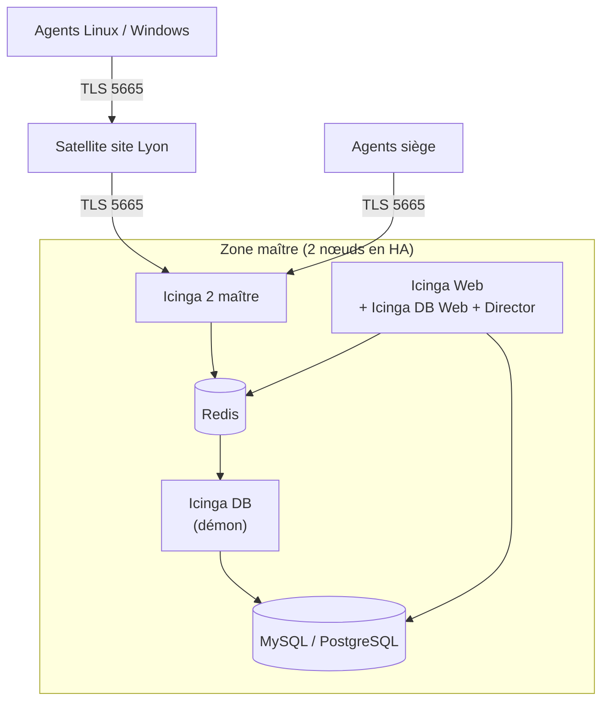

**Icinga 2** est né comme fork de Nagios puis a été réécrit : configuration par un **langage déclaratif** (règles `apply`), architecture **distribuée** native (zones maître, satellites, agents chiffrés), **API REST**, haute disponibilité. Il réutilise les greffons Nagios/Monitoring Plugins.

## Architecture



| Composant | Rôle |
| --- | --- |
| **Icinga 2** | Ordonnanceur, exécution des contrôles, notifications, API (port **5665**) |
| **Icinga DB** + Redis | Publication de l'état et de l'historique dans une base SQL (remplace l'ancien IDO) |
| **Icinga Web** | Interface (PHP), modules |
| **Director** | Configuration par l'interface/API, imports depuis l'annuaire, la CMDB, NetBox |
| Zones | Hiérarchie maître → satellites → agents ; certificats délivrés par l'AC du maître |

## Installation (Debian / Ubuntu)

```bash
sudo apt install -y apt-transport-https wget gnupg
wget -O /tmp/icinga-archive-keyring.deb \
  "https://packages.icinga.com/icinga-archive-keyring_latest+debian$(. /etc/os-release; echo "$VERSION_ID").deb"
sudo apt install /tmp/icinga-archive-keyring.deb
DIST=$(. /etc/os-release; echo "$VERSION_CODENAME")
echo "deb [signed-by=/usr/share/keyrings/icinga-archive-keyring.gpg] https://packages.icinga.com/debian icinga-${DIST} main" \
  | sudo tee /etc/apt/sources.list.d/icinga.list
sudo apt update
sudo apt install icinga2 monitoring-plugins icingadb icingadb-redis icingaweb2 icingacli icingadb-web
```

Selon les distributions (RHEL notamment), l'accès aux dépôts officiels peut nécessiter un abonnement Icinga ; Ubuntu et Debian sont disponibles librement.

## Mettre en place le maître

```bash
sudo icinga2 node wizard          # répondre « n » (pas un satellite/agent) → configuration du maître et de son AC
# ou en non interactif :
sudo icinga2 node setup --master --cn icinga-maitre.corp.exemple.fr --zone master
sudo icinga2 feature enable icingadb api
sudo systemctl restart icinga2
```

### Icinga DB

```bash
sudo systemctl enable --now icingadb-redis
sudo -u postgres psql -c "CREATE ROLE icingadb LOGIN PASSWORD 'MotDePasse';"
sudo -u postgres psql -c "CREATE DATABASE icingadb OWNER icingadb;"
sudo -u postgres psql icingadb < /usr/share/icingadb/schema/pgsql/schema.sql
```

```yaml /etc/icingadb/config.yml (extrait)
database:
  type: pgsql
  host: localhost
  database: icingadb
  user: icingadb
  password: MotDePasse
redis:
  host: localhost
  port: 6380
```

```bash
sudo systemctl enable --now icingadb
```

### Icinga Web

```bash
sudo icingacli setup token create          # jeton pour l'assistant web
# Ouvrir http://serveur/icingaweb2/setup : modules Icinga DB Web (et Director), base de l'interface,
# authentification (base locale ou LDAP/AD), connexion à la base Icinga DB et à l'API Icinga 2 (port 5665)
```

Créez un utilisateur d'API pour l'interface (`/etc/icinga2/conf.d/api-users.conf`, permissions limitées aux actions nécessaires).

## Ports

| Port | Usage |
| --- | --- |
| **5665/TCP** | API et communication entre nœuds (maître, satellites, agents) — chiffrée TLS |
| 80/443 | Icinga Web |
| 6380 | Redis d'Icinga DB (local) |

Windows et macOS ne sont pas des plates-formes de maître ; l'agent Windows est fourni par **Icinga for Windows**.

## Suite du parcours

1. [[02-configuration-agents|Configuration (DSL), agents et satellites]]
2. [[03-director-exploitation|Director, notifications et exploitation]]
