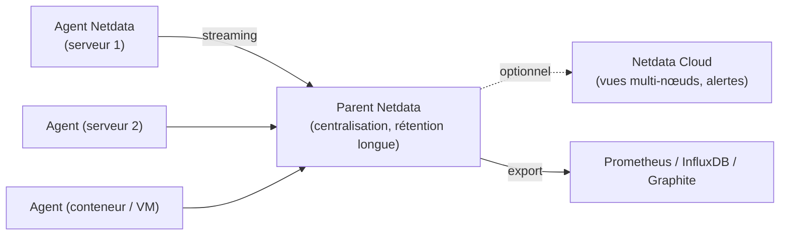

**Netdata** collecte des **milliers de métriques par seconde** sur chaque machine (système, conteneurs, services, réseau) dès l'installation, sans configuration, et les affiche dans des tableaux de bord interactifs. Il est idéal pour le **diagnostic en temps réel** (pic de latence, saturation disque, interface qui sature) et la supervision de parcs de serveurs, en complément d'outils orientés disponibilité et alertes métier.

## Architecture



| Élément | Rôle |
| --- | --- |
| **Agent** | Collecte locale (plus de 800 intégrations : système, Docker, Kubernetes, Nginx, MySQL, SNMP…), stockage, alertes, tableau de bord (port **19999**) |
| **Parent** | Reçoit le flux d'autres agents (*streaming*), conserve leur historique, centralise les alertes |
| Netdata Cloud | Service SaaS optionnel : vue unifiée, gestion des alertes et des équipes (l'interface agent locale fonctionne sans) |
| Stockage | Base `dbengine` à plusieurs niveaux (seconde, minute, heure) : rétention de plusieurs mois en quelques Go |

## Licences

L'agent est libre (GPLv3+) ; l'interface web récente et Netdata Cloud sont soumises à des conditions propres (gratuites avec limites, offres payantes). Vérifiez les conditions de la version utilisée pour un usage en entreprise.

## Installation

```bash
# Linux : script officiel (paquets natifs si disponibles), sans connexion au Cloud
wget -O /tmp/netdata-kickstart.sh https://get.netdata.cloud/kickstart.sh
sh /tmp/netdata-kickstart.sh --stable-channel --disable-telemetry
sudo systemctl status netdata
```

| Plate-forme | Installation |
| --- | --- |
| Debian / Ubuntu / RHEL | Script *kickstart* (dépôts Netdata) ; paquet `netdata` des distributions (plus ancien) |
| Docker | `docker run -d --name netdata --pid=host --network=host -v /proc:/host/proc:ro -v /sys:/host/sys:ro -v /var/run/docker.sock:/var/run/docker.sock:ro --cap-add SYS_PTRACE --cap-add SYS_ADMIN netdata/netdata` |
| Kubernetes | Chart Helm `netdata/netdata` (agent par nœud + parent) |
| macOS | `brew install netdata` |
| Windows | Agent Windows (installateur MSI, collecte via Windows Performance Counters / ETW) |

## Tableau de bord local

`http://serveur:19999` : graphiques organisés par catégorie, corrélation des anomalies (*Metric Correlations*), détection d'anomalies par apprentissage automatique (*Anomaly Advisor*).

> [!WARNING]
> Par défaut, l'agent écoute sur **toutes les interfaces** sans authentification : n'importe qui sur le réseau voit les métriques (noms de processus, utilisateurs, connexions). Restreignez l'écoute ou l'accès.

```ini /etc/netdata/netdata.conf (extrait)
[web]
    bind to = 127.0.0.1 10.0.99.15
    allow connections from = localhost 10.0.99.*
    allow dashboard from = localhost 10.0.99.*
```

```bash
sudo /etc/netdata/edit-config netdata.conf      # outil d'édition fourni (copie le fichier par défaut si besoin)
sudo systemctl restart netdata
```

Publiez le tableau de bord derrière un reverse proxy HTTPS authentifié si un accès distant est nécessaire.

## Suite

[[02-configuration-alertes-parents|Collecteurs, alertes, parents et exports]]
