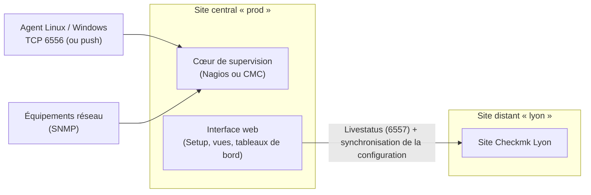

**Checkmk** (Checkmk GmbH, Munich) est une plate-forme de supervision qui automatise le travail fastidieux : l'**agent** remonte en une seule connexion tout l'état d'une machine, et la **découverte de services** crée automatiquement les contrôles (systèmes de fichiers, interfaces, services, processus). La configuration se fait par **règles** dans l'interface web (WATO / *Setup*).

## Éditions

| Édition | Licence | Remarques |
| --- | --- | --- |
| **Checkmk Raw** (communautaire, *Checkmk Community* dans les versions récentes) | GPLv2 | Cœur Nagios, fonctions essentielles |
| Checkmk Enterprise / Cloud / MSP | Commerciales | Cœur CMC (plus performant), agent bakery, tableaux de bord avancés, rapports, collecte synthétique, Kubernetes avancé |
| Free (version d'évaluation) | — | Enterprise limitée en nombre de services |

## Architecture



| Notion | Description |
| --- | --- |
| **Site** | Instance Checkmk autonome (OMD) avec son utilisateur Linux, ses services et son interface : plusieurs sites possibles par serveur |
| Agent | Script (ou binaire) renvoyant des sections de données ; transport TLS via l'*Agent Controller* |
| Découverte de services | Analyse de la sortie de l'agent ou SNMP pour proposer les services |
| Règles | Paramètres appliqués par dossiers, étiquettes, expressions |
| Supervision distribuée | Un site central pilote des sites distants (configuration poussée, vues consolidées) |

## Installation

```bash
# Debian 12 : paquet téléchargé depuis le site de Checkmk (version et édition au choix)
sudo apt install ./check-mk-raw-2.4.0p10_0.bookworm_amd64.deb
omd version

# RHEL 9
sudo dnf install ./check-mk-raw-2.4.0p10-el9-38.x86_64.rpm
```

Le paquet installe **OMD** (*Open Monitoring Distribution*) avec tous ses composants (Apache, cœur, RRD, greffons).

### Docker

```bash
docker run -d --name checkmk --restart always -p 8080:5000 -p 8000:8000 \
  -v monitoring:/omd/sites --tmpfs /opt/omd/sites/cmk/tmp:uid=1000,gid=1000 \
  checkmk/check-mk-raw:2.4.0-latest
docker logs checkmk | grep password       # mot de passe initial de cmkadmin
```

## Créer un site

```bash
sudo omd create prod                       # affiche le mot de passe de « cmkadmin »
sudo omd start prod
sudo omd status prod
sudo su - prod                             # utilisateur du site
cmk-passwd cmkadmin                        # changer le mot de passe
```

Interface : `http://serveur/prod/`. Le port 8000 est utilisé par l'**Agent Receiver** (enregistrement TLS des agents).

| Commande OMD | Rôle |
| --- | --- |
| `omd sites` | Sites et versions |
| `omd start/stop/restart <site>` | Piloter un site |
| `omd config <site>` | Options (cœur, ports, Livestatus TCP…) |
| `omd backup <site> fichier.tar.gz` / `omd restore` | Sauvegarde complète du site |
| `omd update <site>` | Passer le site à la version installée |

Les serveurs Windows et macOS sont supervisés par agents ; le serveur Checkmk lui-même fonctionne sous Linux (ou en appliance).

## Suite du parcours

1. [[02-agents-regles-snmp|Agents, découverte, règles et SNMP]]
2. [[03-notifications-exploitation|Notifications, distribution et exploitation]]
