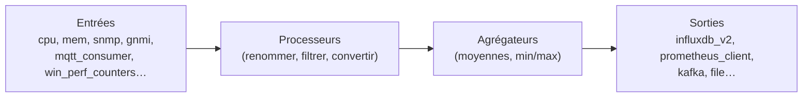

**Telegraf** est un agent de collecte de métriques (Go, licence MIT) doté de plus de 300 **greffons** : système, services, bases de données, SNMP, gNMI, MQTT, API, journaux. Il envoie les données vers [[10-influxdb/01-presentation-installation|InfluxDB]] (usage historique, pile *TIG* avec Grafana), mais aussi vers Prometheus, Kafka, Elasticsearch, fichiers, etc.



## Installation

```bash
# Debian / Ubuntu : dépôt InfluxData
curl --silent --location -O https://repos.influxdata.com/influxdata-archive.key
gpg --show-keys --with-fingerprint --with-colons ./influxdata-archive.key   # vérifier l'empreinte publiée par InfluxData
cat influxdata-archive.key | gpg --dearmor | sudo tee /etc/apt/trusted.gpg.d/influxdata-archive.gpg >/dev/null
echo 'deb [signed-by=/etc/apt/trusted.gpg.d/influxdata-archive.gpg] https://repos.influxdata.com/debian stable main' \
  | sudo tee /etc/apt/sources.list.d/influxdata.list
sudo apt update && sudo apt install telegraf
sudo systemctl enable --now telegraf
```

| Plate-forme | Installation |
| --- | --- |
| RHEL | Dépôt `repos.influxdata.com/rhel` puis `dnf install telegraf` |
| Windows | Archive ZIP ; `telegraf.exe --service install --config "C:\Program Files\Telegraf\telegraf.conf"` |
| macOS | `brew install telegraf` |
| Docker | `docker run -d -v ./telegraf.conf:/etc/telegraf/telegraf.conf:ro telegraf` |

## telegraf.conf

```telegraf /etc/telegraf/telegraf.conf
[agent]
  interval = "30s"
  flush_interval = "30s"
  hostname = ""                         # nom de la machine par défaut
  omit_hostname = false

[global_tags]
  site = "paris"
  env = "production"

# Sorties
[[outputs.influxdb_v2]]
  urls = ["https://influxdb.corp.exemple.fr:8086"]
  token = "${INFLUX_TOKEN}"
  organization = "exemple"
  bucket = "infrastructure"

[[outputs.prometheus_client]]           # expose les métriques pour Prometheus
  listen = ":9273"

# Entrées système
[[inputs.cpu]]
  percpu = false
  totalcpu = true
[[inputs.mem]]
[[inputs.disk]]
  ignore_fs = ["tmpfs", "devtmpfs", "overlay", "squashfs"]
[[inputs.net]]
[[inputs.system]]
```

Les fichiers de `/etc/telegraf/telegraf.d/*.conf` sont chargés en plus : un fichier par fonction. Les variables `${…}` viennent de l'environnement (`/etc/default/telegraf` ou unité systemd) ; Telegraf sait aussi lire des **magasins de secrets** (`[[secretstores.os]]`, `[[secretstores.jose]]`) référencés par `@{magasin:clé}`.

## Windows

```telegraf C:\Program Files\Telegraf\telegraf.d\windows.conf
[[inputs.win_perf_counters]]
  [[inputs.win_perf_counters.object]]
    ObjectName = "Processor"
    Instances = ["_Total"]
    Counters = ["% Processor Time"]
    Measurement = "win_cpu"
  [[inputs.win_perf_counters.object]]
    ObjectName = "LogicalDisk"
    Instances = ["*"]
    Counters = ["% Free Space", "Free Megabytes"]
    Measurement = "win_disk"

[[inputs.win_services]]
  service_names = ["NTDS", "DNS", "W32Time", "Netlogon"]
```

## MQTT

```telegraf /etc/telegraf/telegraf.d/mqtt.conf
[[inputs.mqtt_consumer]]
  servers = ["ssl://mqtt.corp.exemple.fr:8883"]
  topics = ["capteurs/+/+/temperature"]
  username = "telegraf"
  password = "${MQTT_PASSWORD}"
  tls_ca = "/etc/telegraf/ca.crt"
  data_format = "value"
  data_type = "float"
  [[inputs.mqtt_consumer.topic_parsing]]
    topic = "capteurs/+/+/temperature"
    tags = "_/site/capteur/_"
```

Voir le broker [[05-mosquitto/01-presentation-configuration|Mosquitto]].

## Tester

```bash
telegraf --config /etc/telegraf/telegraf.conf --test                       # exécute les entrées une fois, affiche les métriques
telegraf --config /etc/telegraf/telegraf.d/mqtt.conf --input-filter mqtt_consumer --test
sudo journalctl -u telegraf -f
```

## Suite

[[02-reseau-exploitation|Collecte réseau (SNMP, gNMI, ping, flux) et exploitation]]
