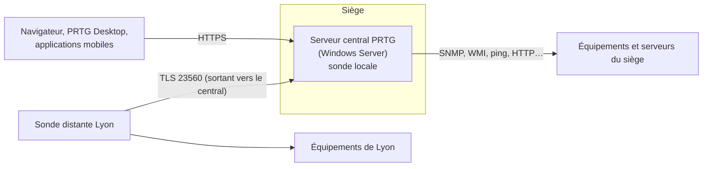

**PRTG Network Monitor** (Paessler) est une solution de supervision **commerciale**, très répandue dans les PME et les services informatiques Windows, appréciée pour sa prise en main rapide : découverte automatique, plus de 250 types de **capteurs** prêts à l'emploi (SNMP, WMI, ping, HTTP, NetFlow, bases de données, VMware, Hyper-V…), cartes, rapports et alertes, sans greffons à installer.

## Notions

| Notion | Description |
| --- | --- |
| **Capteur** | Un élément supervisé (débit d'une interface, espace d'un disque, temps de réponse HTTP) avec un ou plusieurs **canaux** |
| Appareil | Équipement ou serveur regroupant des capteurs |
| Groupe | Organisation (site, type) ; paramètres hérités (identifiants SNMP, WMI, intervalles) |
| **Sonde** | Composant qui exécute les capteurs : sonde locale (serveur central) ou **sondes distantes** (sites, DMZ) |
| Canal | Valeur d'un capteur (entrant, sortant, total) avec seuils |

La licence se calcule au **nombre de capteurs** (paliers), sous forme d'abonnement ; une version gratuite limitée à 100 capteurs est proposée.

## Architecture

## Prérequis

| Élément | Exigence |
| --- | --- |
| Système | Windows Server récent (2019/2022/2025) 64 bits, dédié de préférence |
| Ressources | Dépendent du nombre de capteurs (quelques milliers de capteurs : 4-8 cœurs, 8-16 Go de RAM, SSD) |
| Réseau | Accès aux équipements (SNMP UDP 161, WMI/RPC, ICMP, etc.) depuis la sonde qui les supervise |
| Ports | 443 (interface web), **23560** (connexion des sondes distantes) |

## Installation

1. Télécharger l'installateur depuis le compte Paessler (clé de licence fournie).
2. Lancer l'installation (serveur central + sonde locale), saisir la clé de licence et l'adresse de courriel de l'administrateur.
3. À la fin, l'**assistant de configuration** propose une **découverte automatique** du réseau local (plage d'adresses, identifiants Windows/SNMP/Linux).

| Emplacement | Contenu |
| --- | --- |
| `C:\Program Files (x86)\PRTG Network Monitor\` | Programmes |
| `C:\ProgramData\Paessler\PRTG Network Monitor\` | **Données** : configuration (`PRTG Configuration.dat`), historiques, journaux |
| Outil *PRTG Administration Tool* | Ports, certificats, chemins, service, sondes |

## Premiers réglages

- **HTTPS** avec un certificat de l'AC d'entreprise (*PRTG Administration Tool → Web Server*, ou remplacement des fichiers de certificat).
- Changer le compte `prtgadmin`, créer des comptes nominatifs ; **authentification Active Directory** (*Setup → System Administration → Core & Probes*, domaine, groupes AD associés à des groupes d'utilisateurs PRTG).
- Identifiants par défaut au niveau de la racine ou des groupes : *Credentials for Windows Systems*, *SNMP v3*, *Linux (SSH)*, *VMware*.
- Paramètres SMTP pour les notifications.

## Sondes distantes

Sur un serveur Windows du site distant : *Setup → Downloads → Remote Probe Installer*. La sonde se connecte au serveur central (TCP **23560**, TLS) : seul un flux **sortant** du site est nécessaire. Le serveur central doit **accepter** la nouvelle sonde (*Devices → Approve*), puis on y rattache les appareils du site.

Les sondes distantes servent aussi à superviser une DMZ ou un réseau cloisonné sans ouvrir de flux entrants multiples.

## Suite

[[02-capteurs-alertes-exploitation|Capteurs, alertes et exploitation]]
