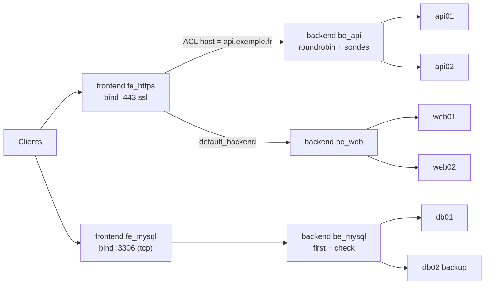
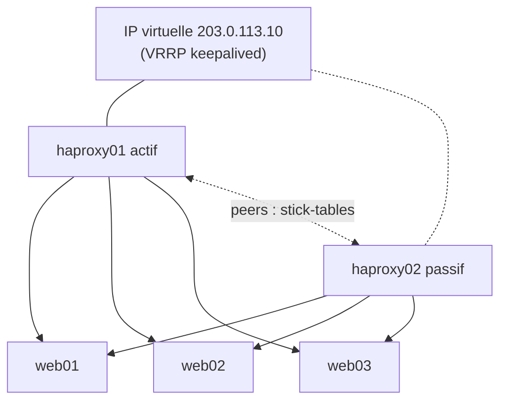

**HAProxy** (*High Availability Proxy*) est le répartiteur de charge logiciel de référence pour TCP et HTTP. Il équilibre le trafic entre des serveurs, termine le TLS, applique des règles de routage et de sécurité (ACL, limitation de débit, filtrage), et fournit des statistiques détaillées. Il est réputé pour sa **fiabilité**, ses **performances** (millions de connexions) et ses **sondes de santé** fines.

## Cas d'usage

| Usage | Mode |
| --- | --- |
| Répartir des serveurs web / API | `http` |
| Terminer le TLS et appliquer des règles HTTP (routage par nom, chemin, en-tête) | `http` |
| Répartir des bases de données, LDAP, SMTP, RDP, Kubernetes API | `tcp` |
| Router du TLS par SNI sans le déchiffrer (pass-through) | `tcp` |
| Protéger des applications (limitation de débit, blocage d'IP, WAF via SPOE) | `http` |
| Ingress controller Kubernetes | Les deux |

## Architecture de la configuration

| Section | Rôle |
| --- | --- |
| `global` | Paramètres du processus : utilisateur, threads, journalisation, TLS par défaut, socket d'administration |
| `defaults` | Valeurs par défaut pour les sections suivantes (mode, délais, options) — plusieurs `defaults` nommés possibles |
| `frontend` | Point d'entrée : adresses d'écoute (`bind`), ACL, règles, choix du backend |
| `backend` | Groupe de serveurs : algorithme, sondes, persistance |
| `listen` | Frontend + backend combinés (pratique pour le TCP ou les statistiques) |
| `peers` | Synchronisation des stick-tables entre nœuds HAProxy |
| `resolvers` | Résolution DNS dynamique des serveurs |
| `userlist` | Utilisateurs pour l'authentification basique |
| `cache`, `http-errors`, `program`, `ring`, `mailers` | Fonctions complémentaires |

## Cheminement d'une requête HTTP

1. Le **frontend** accepte la connexion (`bind`), termine le TLS si `ssl` est présent.
2. Règles `tcp-request connection` puis `http-request` : rejet, redirection, ajout d'en-têtes, suivi dans une stick-table.
3. Sélection du **backend** : `use_backend <nom> if <acl>` sinon `default_backend`.
4. Dans le backend : règles `http-request` du backend, choix d'un **serveur** (algorithme `balance`, persistance, état des sondes).
5. Réponse : règles `http-response`, compression, journalisation.

## Versions

| Branche | Type | Remarques |
| --- | --- | --- |
| 2.8 | LTS | Encore très répandue (RHEL 9, Ubuntu 24.04) |
| **3.0** | LTS (2024) | Debian 13 ; améliorations du journal, de la gestion TLS |
| **3.2** | LTS (2025) | Client **ACME intégré** (Let's Encrypt), améliorations de performances |
| Versions impaires (3.1, 3.3…) | Stables courtes | Nouveautés, support limité |

Les LTS sont maintenues 5 ans. Le site `haproxy.debian.net` fournit des paquets récents pour Debian/Ubuntu.

> [!NOTE]
> **HAProxy Enterprise** (offre commerciale) ajoute un WAF, la détection de bots, des tableaux de bord et le support. **HAProxy Data Plane API** permet de piloter la configuration par une API REST.

## Architectures types

### Paire haute disponibilité

Voir [[06-haute-disponibilite-runtime]].

### Devant un cluster Kubernetes ou des bases de données

- Port 6443 (API Kubernetes) en mode `tcp` vers les nœuds du plan de contrôle.
- Ports 80/443 vers les ingress controllers.
- MariaDB Galera / PostgreSQL : détection du primaire par sonde (`option mysql-check`, `option pgsql-check`, ou sonde HTTP d'un agent comme Patroni sur le port 8008).

## Ports usuels

| Port | Usage |
| --- | --- |
| 80 / 443 | Frontends HTTP/HTTPS |
| 8404 (au choix) | Page de statistiques / métriques Prometheus |
| Socket Unix `/run/haproxy/admin.sock` | API runtime (administration à chaud) |

## Suite du parcours

1. [[02-installation|Installation (Linux, Windows, macOS, Docker)]]
2. [[03-configuration-base|Configuration de base : frontends, backends, sondes]]
3. [[04-http-avance|HTTP avancé : ACL, routage, en-têtes, stick-tables, cache]]
4. [[05-tls|TLS : terminaison, SNI, pass-through, mTLS, ACME]]
5. [[06-haute-disponibilite-runtime|Haute disponibilité, peers et API runtime]]
6. [[07-stats-logs-depannage|Statistiques, journaux et dépannage]]
