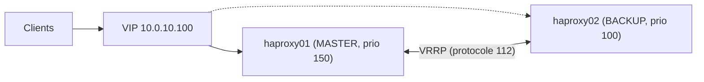

## Paire active/passive avec keepalived



```bash
sudo apt install keepalived          # RHEL : dnf install keepalived
```

```nginx /etc/keepalived/keepalived.conf (haproxy01)
global_defs {
    router_id haproxy01
    enable_script_security
    script_user root
}

vrrp_script chk_haproxy {
    script "/usr/bin/killall -0 haproxy"     # ou : curl -sf http://127.0.0.1:8404/health
    interval 2
    fall 2
    rise 2
    weight -60                                # perd 60 points de priorité si HAProxy est arrêté
}

vrrp_instance VI_WEB {
    state MASTER                    # BACKUP sur haproxy02
    interface ens192
    virtual_router_id 51            # identique sur les deux nœuds, unique sur le réseau
    priority 150                    # 100 sur haproxy02
    advert_int 1
    authentication {
        auth_type PASS
        auth_pass Vrrp51Pw          # 8 caractères max
    }
    unicast_src_ip 10.0.10.11       # VRRP unicast (réseaux sans multicast, cloud)
    unicast_peer {
        10.0.10.12
    }
    virtual_ipaddress {
        10.0.10.100/24 dev ens192
        2001:db8:10::100/64 dev ens192
    }
    track_script {
        chk_haproxy
    }
    notify_master "/usr/local/bin/notifier.sh MASTER"
}
```

```bash
sudo sysctl -w net.ipv4.ip_nonlocal_bind=1        # HAProxy peut écouter sur la VIP même sur le nœud passif
sudo systemctl enable --now keepalived
ip -br addr show ens192                            # la VIP apparaît sur le MASTER
sudo firewall-cmd --permanent --add-rich-rule='rule protocol value="vrrp" accept' && sudo firewall-cmd --reload
```

> [!TIP]
> Pour exploiter les **deux** nœuds (actif/actif), déclarez deux VIP avec des priorités inversées et publiez les deux dans le DNS (round-robin), ou utilisez l'**anycast/ECMP** via BGP (FRRouting) depuis les routeurs.

La configuration HAProxy doit être **identique** sur les deux nœuds : synchronisez-la (Git + Ansible, ou `rsync` + `haproxy -c` + `reload`).

## Synchroniser les stick-tables : peers

Sans synchronisation, une bascule fait perdre les compteurs de limitation de débit et la persistance `stick on src`.

```haproxy
peers lb_cluster
    peer haproxy01 10.0.10.11:10000
    peer haproxy02 10.0.10.12:10000

backend st_par_ip
    stick-table type ipv6 size 1m expire 10m store http_req_rate(10s),conn_cur peers lb_cluster
```

Le nom local du pair doit correspondre au nom d'hôte, ou être forcé : `haproxy -L haproxy01` / `localpeer haproxy01` dans `global`.

## Rechargements sans coupure

Les paquets récents lancent HAProxy en **mode master-worker** (`-Ws`) : `systemctl reload haproxy` démarre de nouveaux workers avec la nouvelle configuration, transfère les sockets d'écoute (`expose-fd listeners`) et laisse les anciens terminer leurs connexions.

```haproxy
global
    master-worker
    stats socket /run/haproxy/admin.sock mode 660 level admin expose-fd listeners
    hard-stop-after 30m        # limite de vie des anciens workers (connexions longues)
```

```bash
echo "show proc" | socat stdio /run/haproxy-master.sock     # processus maître/workers (si -S /run/haproxy-master.sock)
```

## API runtime (socket d'administration)

```bash
SOCK=/run/haproxy/admin.sock
alias hap='socat stdio $SOCK'
echo "help" | socat stdio $SOCK
```

### Consultation

```bash
echo "show info" | socat stdio $SOCK                  # version, uptime, connexions, maxconn
echo "show stat" | socat stdio $SOCK | cut -d, -f1,2,18,19 | column -s, -t   # pxname, svname, status, weight
echo "show servers state be_web" | socat stdio $SOCK
echo "show backend" | socat stdio $SOCK
echo "show sess" | socat stdio $SOCK | head           # sessions en cours
echo "show errors" | socat stdio $SOCK                # dernières requêtes/réponses invalides capturées
echo "show table" | socat stdio $SOCK                 # stick-tables
echo "show table st_par_ip data.http_req_rate gt 50" | socat stdio $SOCK
```

### Actions sur les serveurs

```bash
echo "set server be_web/web01 state drain" | socat stdio $SOCK     # plus de nouvelles connexions (sauf persistance)
echo "set server be_web/web01 state maint" | socat stdio $SOCK     # maintenance
echo "set server be_web/web01 state ready" | socat stdio $SOCK     # retour en service
echo "set server be_web/web01 weight 50%" | socat stdio $SOCK
echo "set server be_web/web01 addr 10.0.20.21 port 8080" | socat stdio $SOCK
echo "disable health be_web/web01" | socat stdio $SOCK
# Ajouter / supprimer un serveur dynamiquement (2.4+)
echo "add server be_web/web04 10.0.20.14:8080 check" | socat stdio $SOCK
echo "enable server be_web/web04" | socat stdio $SOCK
echo "enable health be_web/web04" | socat stdio $SOCK
echo "del server be_web/web04" | socat stdio $SOCK                  # après « set server … state maint »
```

> [!NOTE]
> Les modifications par l'API sont **perdues au rechargement** si elles ne sont pas reportées dans `haproxy.cfg`. Pour conserver l'état des serveurs (maintenance, poids) à travers un rechargement : `server-state-file` + `load-server-state-from-file global`, et `show servers state > /var/lib/haproxy/server-state` avant le reload.

### Maps, ACL, stick-tables

```bash
echo "show map /etc/haproxy/maps/hotes.map" | socat stdio $SOCK
echo "add map /etc/haproxy/maps/hotes.map wiki.exemple.fr be_outils" | socat stdio $SOCK
echo "del map /etc/haproxy/maps/hotes.map wiki.exemple.fr" | socat stdio $SOCK
echo "add acl /etc/haproxy/listes/ip-bloquees.lst 198.51.100.7" | socat stdio $SOCK
echo "clear table st_par_ip key 198.51.100.7" | socat stdio $SOCK
```

## Procédure de maintenance d'un serveur applicatif

1. `set server be_web/web01 state drain` (les sessions persistantes finissent).
2. Attendre que `scur` (sessions courantes) tombe à 0 : `show stat`.
3. `set server be_web/web01 state maint`, intervenir sur le serveur.
4. `set server be_web/web01 state ready` ; avec `slowstart 30s`, le trafic remonte progressivement.

## Data Plane API

Service REST officiel qui modifie `haproxy.cfg` de façon transactionnelle et recharge HAProxy : ajout de backends, de serveurs, de règles, depuis Ansible, Terraform ou une interface. Utile pour les plateformes où les backends changent souvent (orchestrateurs, auto-scaling).

```bash
# Exemple : lister les backends
curl -s -u admin:motdepasse http://127.0.0.1:5555/v3/services/haproxy/configuration/backends | jq '.[].name'
```
