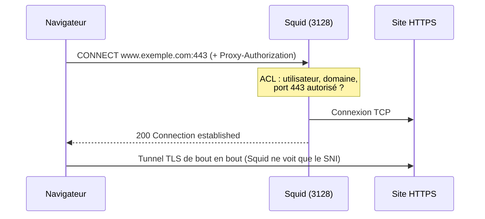
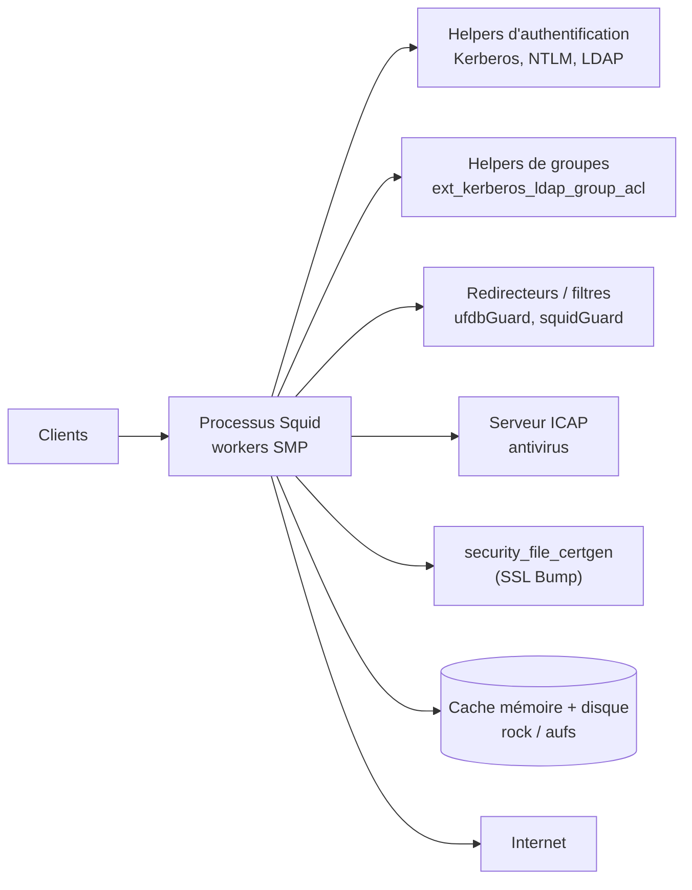

**Squid** est un proxy cache HTTP/HTTPS open source, utilisé principalement comme **proxy sortant** d'entreprise : il contrôle et journalise l'accès des utilisateurs à Internet, applique des règles par utilisateur ou par groupe Active Directory, filtre des catégories de sites, met en cache des contenus et peut inspecter le HTTPS.

## Pourquoi un proxy sortant ?

| Besoin | Fonction Squid |
| --- | --- |
| Savoir **qui** accède à **quoi** | Journal d'accès avec utilisateur authentifié |
| Restreindre par groupe, horaire, catégorie | ACL (`acl`, `http_access`), helpers de groupes, listes de blocage |
| Empêcher les flux directs vers Internet | Seul le proxy sort (pare-feu), les postes passent par lui |
| Économiser la bande passante | Cache (mises à jour, paquets, objets statiques) |
| Analyser les fichiers téléchargés | ICAP vers un antivirus (ClamAV, solutions commerciales) |
| Contrôler le HTTPS | Lecture du SNI (*peek*) ou déchiffrement (*SSL Bump*) |

## Modes de fonctionnement

| Mode | Principe | Configuration client |
| --- | --- | --- |
| **Explicite** (*forward proxy*) | Le navigateur sait qu'il passe par un proxy et lui envoie ses requêtes (`GET http://…`, `CONNECT host:443`) | Paramètre proxy, fichier PAC, WPAD, GPO |
| **Transparent** (*interception*) | Le trafic HTTP/HTTPS est redirigé vers Squid par le routeur/pare-feu, à l'insu du client | Aucune — mais **pas d'authentification** possible |
| **Reverse proxy / accélérateur** | Squid devant des serveurs web (cache) | Côté serveur — aujourd'hui plutôt [[03-varnish/01-presentation-installation\|Varnish]], Nginx ou HAProxy |

## Flux HTTPS à travers un proxy explicite

Sans déchiffrement, Squid ne connaît que le **nom du site** (via CONNECT et le SNI) — suffisant pour filtrer par domaine. Le déchiffrement (**SSL Bump**) permet de voir les URL complètes et d'analyser le contenu, au prix d'une AC interne déployée sur les postes et d'enjeux juridiques (voir [[05-cache-ssl-bump-filtrage]]).

## Architecture interne

- Squid délègue authentification, groupes, réécriture d'URL et génération de certificats à des **helpers** : processus externes qui communiquent par l'entrée/sortie standard, lancés en pool (`children`).
- Le mode **SMP** (`workers N`) répartit la charge sur plusieurs cœurs ; le cache disque partagé utilise alors le stockage `rock`.

## Ports

| Port | Usage |
| --- | --- |
| TCP **3128** | Port proxy par défaut (explicite) |
| TCP 8080 | Port alternatif fréquent |
| TCP 3129 / 3130 | Ports d'interception (transparent HTTP / HTTPS), au choix |
| UDP 3130 | ICP (échange entre caches, historique) |
| TCP 1344 | ICAP (vers le serveur antivirus) |

## Versions

| Branche | Remarques |
| --- | --- |
| 5.x | Debian 12, RHEL 9 (selon flux) |
| **6.x** | Debian 13, Ubuntu 24.04 ; branche maintenue |
| 7.x | Développement / nouvelles versions |

Le paquet Debian/Ubuntu `squid-openssl` est compilé avec OpenSSL (nécessaire pour SSL Bump) ; le paquet `squid` simple ne l'est pas toujours.

## Alternatives et compléments

| Outil | Positionnement |
| --- | --- |
| **e2guardian** | Filtrage de contenu (en complément ou à la place de Squid) |
| **ufdbGuard** / **squidGuard** | Filtrage par listes et catégories (redirecteurs Squid) |
| **Proxies cloud (SSE/SWG)** | Zscaler, Netskope, Cloudflare Gateway : même rôle en SaaS |
| **Pare-feu de nouvelle génération** | Filtrage URL intégré (FortiGate, Palo Alto, Stormshield) |

## Suite du parcours

1. [[02-installation|Installation (Linux, Windows, macOS, Docker)]]
2. [[03-acl-configuration-base|ACL et configuration de base]]
3. [[04-authentification-ad|Authentification Kerberos, NTLM et LDAP (Active Directory)]]
4. [[05-cache-ssl-bump-filtrage|Cache, SSL Bump, filtrage et antivirus]]
5. [[06-transparent-wpad-exploitation|Mode transparent, WPAD, journaux et dépannage]]
