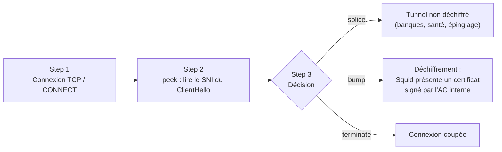

## Cache

```squid
cache_mem 2 GB                                  # cache en mémoire des objets les plus demandés
maximum_object_size_in_memory 1 MB
cache_dir rock /var/spool/squid/rock 50000 max-size=1048576     # petits objets (compatible SMP)
cache_dir aufs /var/spool/squid/aufs 200000 64 256 min-size=1048577   # gros objets (Mo)
maximum_object_size 4 GB                        # images ISO, mises à jour
cache_replacement_policy heap LFUDA             # favorise la conservation des objets volumineux populaires
memory_replacement_policy heap GDSF
```

```bash
sudo squid -k parse && sudo systemctl stop squid && sudo squid -z && sudo systemctl start squid
```

### refresh_pattern : durée de vie des objets sans en-têtes de cache

```squid
# refresh_pattern [-i] regex  min(minutes)  pourcentage  max(minutes)  [options]
refresh_pattern -i \.(deb|rpm|iso|msi|exe|cab|psf|msu)$  10080  100%  43200  refresh-ims
refresh_pattern -i windowsupdate.com/.*\.(cab|exe|msu|psf)  4320  80%  43200
refresh_pattern -i \.(jpg|png|gif|webp|svg|css|js|woff2)$  1440  50%  10080
refresh_pattern ^ftp:           1440    20%     10080
refresh_pattern -i (/cgi-bin/|\?) 0     0%      0
refresh_pattern .               0       20%     4320
```

> [!NOTE]
> Une grande partie du trafic est aujourd'hui en HTTPS : **sans SSL Bump, Squid ne peut pas mettre ces objets en cache**. Le gain de bande passante d'un proxy sortant vient alors surtout des mises à jour servies en HTTP (Windows Update, dépôts Linux). Pour Windows Update, la **Delivery Optimization** ou WSUS est souvent plus efficace.

### Mises à jour Windows : télécharger l'objet entier

```squid
range_offset_limit 200 MB windows_update        # télécharger tout le fichier même si le client demande une plage
acl windows_update dstdomain .windowsupdate.com .update.microsoft.com .download.windowsupdate.com
quick_abort_min -1 KB                           # finir le téléchargement même si le client abandonne
```

## SSL Bump : inspection HTTPS

### Étapes de décision



| Action | Effet |
| --- | --- |
| `peek` | Lire les informations TLS (SNI) sans s'engager |
| `stare` | Lire en préparant un déchiffrement |
| `splice` | Laisser passer sans déchiffrer (tunnel) |
| `bump` | Déchiffrer (homme du milieu autorisé) |
| `terminate` | Couper |

### Mise en œuvre

```bash
# 1. AC interne dédiée au proxy (ou certificat d'AC subordonnée émis par AD CS, contrainte au rôle)
sudo mkdir -p /etc/squid/ssl && cd /etc/squid/ssl
sudo openssl req -new -newkey rsa:3072 -sha256 -days 1825 -nodes -x509 \
  -subj "/C=FR/O=Exemple/CN=Exemple Proxy Inspection CA" \
  -addext "basicConstraints=critical,CA:TRUE" -addext "keyUsage=critical,keyCertSign,cRLSign" \
  -keyout proxy-ca.key -out proxy-ca.crt
sudo cat proxy-ca.crt proxy-ca.key > proxy-ca.pem && sudo chown proxy: proxy-ca.* && sudo chmod 600 proxy-ca.key proxy-ca.pem

# 2. Base des certificats générés à la volée
sudo /usr/lib/squid/security_file_certgen -c -s /var/lib/squid/ssl_db -M 64MB
sudo chown -R proxy: /var/lib/squid/ssl_db
```

```squid /etc/squid/conf.d/ssl-bump.conf
http_port 3128 ssl-bump tls-cert=/etc/squid/ssl/proxy-ca.pem generate-host-certificates=on dynamic_cert_mem_cache_size=64MB
sslcrtd_program /usr/lib/squid/security_file_certgen -s /var/lib/squid/ssl_db -M 64MB
sslcrtd_children 16 startup=4 idle=2
tls_outgoing_options options=NO_SSLv3 min-version=1.2 cafile=/etc/ssl/certs/ca-certificates.crt

acl step1 at_step SslBump1
acl pas_de_dechiffrement ssl::server_name "/etc/squid/listes/sni-non-dechiffres.txt"   # banques, santé, mutuelles, impôts…
acl epingles ssl::server_name .apple.com .icloud.com .whatsapp.net .windowsupdate.com   # applications à épinglage de certificat

ssl_bump peek step1
ssl_bump splice pas_de_dechiffrement
ssl_bump splice epingles
ssl_bump bump all
```

3. **Déployer l'AC** `proxy-ca.crt` dans le magasin *Autorités de certification racines de confiance* des postes (GPO : *Stratégies de clé publique*), et dans les magasins propres à certains logiciels (Firefox : `ImportEnterpriseRoots`, Java, Python/`certifi`, Git).

> [!CAUTION]
> **Cadre légal (France)** : l'inspection HTTPS des salariés est admise pour la sécurité du SI à condition d'être **proportionnée**, **déclarée** (charte informatique, information des salariés, consultation du CSE) et d'**exclure** les flux à caractère personnel protégés (banques, santé, messageries personnelles) — recommandations de la CNIL et de l'ANSSI. Protégez strictement la clé de l'AC : elle permet d'intercepter tout le trafic des postes.

### Mode observation sans déchiffrement

Pour filtrer par **nom de domaine** en HTTPS sans déchiffrer (et sans déployer d'AC) :

```squid
http_port 3128 ssl-bump tls-cert=/etc/squid/ssl/proxy-ca.pem generate-host-certificates=off
acl step1 at_step SslBump1
acl sites_bloques ssl::server_name "/etc/squid/listes/liste-noire.txt"
ssl_bump peek step1
ssl_bump terminate sites_bloques
ssl_bump splice all
```

## Filtrage par catégories : ufdbGuard

**ufdbGuard** (successeur performant de squidGuard) classe les URL par catégories (publicité, jeux, adultes, malware…) à partir de listes (UT1 de l'Université Toulouse Capitole, gratuites ; listes commerciales).

```squid
url_rewrite_program /usr/sbin/ufdbgclient -m 4 -l /var/log/squid
url_rewrite_children 16 startup=8 idle=2 concurrency=4
url_rewrite_bypass off            # en cas d'indisponibilité du filtre : bloquer (on = laisser passer)
```

```text /etc/ufdbguard/ufdbGuard.conf (extrait)
dbhome "/var/lib/ufdbguard/blacklists"
category adult { domainlist "adult/domains" urllist "adult/urls" }
category malware { domainlist "malware/domains" }
category jeux { domainlist "games/domains" }

source direction { userlist "direction.txt" }
acl {
    direction { pass !adult !malware any }
    default   { pass !adult !malware !jeux any
                redirect "https://intranet.exemple.fr/blocage?cat=%t&url=%u" }
}
```

Mise à jour quotidienne des listes par tâche planifiée (`ufdbConvertDB`, rechargement `ufdbguardd`).

## Antivirus des téléchargements : ICAP + ClamAV

```bash
sudo apt install c-icap libc-icap-mod-virus-scan clamav-daemon clamav-freshclam
```

```text /etc/c-icap/c-icap.conf (extrait)
Port 1344
Service avscan srv_virus_scan.so
ServiceAlias avscan srv_virus_scan?allow204=on&sizelimit=off&mode=simple
Include virus_scan.conf
```

```squid
icap_enable on
icap_send_client_ip on
icap_send_client_username on
icap_client_username_header X-Authenticated-User
icap_service service_avi_resp respmod_precache icap://127.0.0.1:1344/avscan bypass=off
adaptation_access service_avi_resp allow all
```

> [!NOTE]
> L'analyse antivirus des fichiers HTTPS nécessite SSL Bump. Sans déchiffrement, seuls les téléchargements HTTP sont analysés.

## Rapports

- **SARG** ou **Squid Analyzer** : rapports HTML par utilisateur, site, volume.
- Envoi des journaux vers un SIEM (Graylog, ELK, Wazuh) pour les recherches et alertes.
