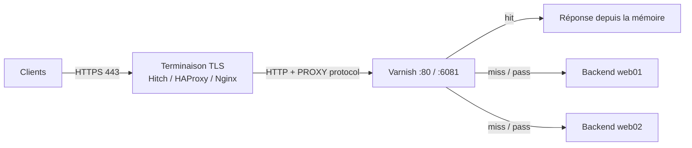

**Varnish Cache** est un **accélérateur HTTP** (reverse proxy cache) placé devant un ou plusieurs serveurs web. Il garde en mémoire les réponses et les sert en quelques microsecondes, absorbant l'essentiel de la charge des sites à fort trafic (médias, e-commerce, API publiques). Sa force est le langage **VCL** qui permet de décider finement quoi mettre en cache, combien de temps, et comment le varier.

## Architecture



| Composant | Rôle |
| --- | --- |
| Processus **gestionnaire** (`varnishd` parent) | Lit les paramètres, compile la VCL en C puis en code natif, surveille l'enfant |
| Processus **enfant** | Traite les requêtes (pools de threads), contient le cache |
| **VCL** | Logique de traitement compilée ; plusieurs VCL chargées, une active, bascule à chaud |
| **Stockage** | `malloc` (mémoire, recommandé), `file` (fichier mappé), *Massive Storage Engine* (version Enterprise) |
| **VSM / VSL** | Mémoire partagée pour les statistiques et journaux (lus par `varnishstat`, `varnishlog`) |
| CLI d'administration | Port local (6082) protégé par un secret, utilisé par `varnishadm` |

> [!IMPORTANT]
> **Varnish Cache (open source) ne gère pas le TLS** côté client. On place devant lui un terminateur TLS (**Hitch**, du même éditeur, ou HAProxy/Nginx) qui transmet en HTTP avec le **protocole PROXY** pour conserver l'IP du client. (La version commerciale *Varnish Enterprise* intègre le TLS.)

## Varnish ou cache du serveur web ?

| Critère | Varnish | Cache Nginx / HAProxy |
| --- | --- | --- |
| Logique de cache programmable | **VCL complète** | Directives |
| Invalidation (purge, ban, tags) | Riche (ban par expression, xkey) | Limitée (purge en version commerciale) |
| ESI (assemblage de fragments) | Oui | Non |
| Grace / contenu périmé | Très fin | Oui |
| TLS | Non (terminateur externe) | Oui |

## Versions

Varnish Cache publie deux versions par an (ex. 7.6, 7.7, 8.0) et maintient une **6.0 LTS**. Le dépôt officiel de packagecloud (`varnishcache`) fournit les versions récentes pour Debian, Ubuntu et RHEL.

## Installation

### Debian / Ubuntu

```bash
# Version de la distribution
sudo apt install varnish

# Ou dépôt officiel (adapter « varnish77 » à la branche voulue)
curl -s https://packagecloud.io/install/repositories/varnishcache/varnish77/script.deb.sh | sudo bash
sudo apt install varnish
varnishd -V
```

### RHEL / Rocky / Alma

```bash
curl -s https://packagecloud.io/install/repositories/varnishcache/varnish77/script.rpm.sh | sudo bash
sudo dnf install varnish
sudo systemctl enable --now varnish
sudo firewall-cmd --permanent --add-service=http && sudo firewall-cmd --reload
sudo setsebool -P varnishd_connect_any on      # SELinux : backends sur des ports non standard
```

### macOS

```bash
brew install varnish
brew services start varnish        # écoute sur 8080 ; VCL : $(brew --prefix)/etc/varnish/default.vcl
```

### Windows

Pas de version Windows : utiliser une VM Linux, WSL2 ou un conteneur.

### Docker

```bash
docker run -d --name varnish -p 80:80 --tmpfs /var/lib/varnish/varnishd:exec \
  -v /srv/varnish/default.vcl:/etc/varnish/default.vcl:ro \
  -e VARNISH_SIZE=2G varnish:stable
```

## Paramètres de démarrage

Les options se règlent dans l'unité systemd :

```bash
sudo systemctl edit varnish
```

```ini /etc/systemd/system/varnish.service.d/override.conf
[Service]
ExecStart=
ExecStart=/usr/sbin/varnishd \
  -a :80 \
  -a 127.0.0.1:8443,PROXY \
  -a localhost:6081 \
  -T localhost:6082 \
  -S /etc/varnish/secret \
  -f /etc/varnish/default.vcl \
  -s malloc,4G \
  -p thread_pools=2 \
  -p thread_pool_min=200 \
  -p thread_pool_max=5000 \
  -p default_grace=3600
LimitNOFILE=131072
LimitMEMLOCK=85983232
```

| Option | Rôle |
| --- | --- |
| `-a adresse:port[,PROXY]` | Écoute (HTTP), éventuellement avec le protocole PROXY (depuis Hitch/HAProxy) |
| `-T` / `-S` | Interface d'administration et son secret |
| `-f` | Fichier VCL au démarrage |
| `-s malloc,4G` | Stockage en mémoire de 4 Go (prévoir ~1 Ko de surcoût par objet en plus) |
| `-p paramètre=valeur` | Paramètres d'exécution (`varnishadm param.show` pour la liste) |
| `-n nom` | Instance nommée (plusieurs Varnish sur un même serveur) |

```bash
sudo systemctl daemon-reload && sudo systemctl restart varnish
varnishadm status && varnishadm backend.list
curl -sI http://localhost/ | grep -iE "x-varnish|age|via"
```

## Fichiers

| Élément | Emplacement |
| --- | --- |
| VCL | `/etc/varnish/default.vcl` |
| Secret d'administration | `/etc/varnish/secret` |
| Mémoire partagée (VSM) | `/var/lib/varnish/<nom>/` |
| Journaux | En mémoire : `varnishlog`, `varnishncsa` (service optionnel pour écrire un fichier) |

## Suite du parcours

1. [[02-vcl-base|VCL : backends, sondes et flux de traitement]]
2. [[03-cache-avance|Cache avancé : invalidation, grâce, ESI, variations]]
3. [[04-tls-haute-disponibilite|TLS avec Hitch et haute disponibilité]]
4. [[05-exploitation-outils|Exploitation et outils]]
