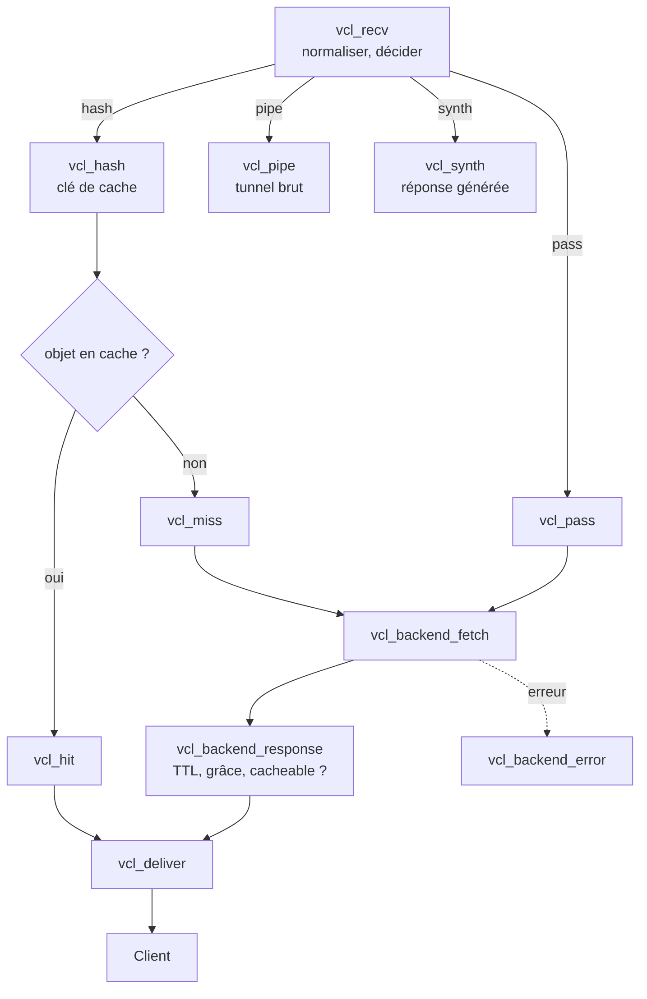

## Cycle de traitement d'une requête



| Sous-routine | Côté | Rôle typique |
| --- | --- | --- |
| `vcl_recv` | client | Choisir le backend, nettoyer les cookies, refuser, décider `pass`/`hash` |
| `vcl_hash` | client | Composer la clé de cache (URL + Host par défaut) |
| `vcl_hit` / `vcl_miss` | client | Agir selon la présence de l'objet |
| `vcl_backend_fetch` | backend | Modifier la requête envoyée au backend |
| `vcl_backend_response` | backend | Fixer TTL et grâce, rendre non cacheable, ESI |
| `vcl_backend_error` | backend | Page d'erreur si le backend ne répond pas |
| `vcl_deliver` | client | En-têtes de réponse (indicateurs de HIT, nettoyage) |
| `vcl_synth` | client | Réponses générées (redirections, 403, maintenance) |

Si une sous-routine ne se termine pas par `return (…)`, Varnish exécute la **VCL intégrée** (*builtin.vcl*) correspondante, qui applique des règles prudentes : pas de cache s'il y a un `Authorization` ou un `Cookie`, pas de cache pour POST, respect de `Cache-Control: private/no-store`, `Set-Cookie` rendant l'objet non cacheable.

## Backends et sondes

```vcl /etc/varnish/default.vcl
vcl 4.1;

import directors;
import std;

probe sante {
    .request =
        "HEAD /health HTTP/1.1"
        "Host: www.exemple.fr"
        "Connection: close"
        "User-Agent: Varnish Health Probe";
    .interval = 5s;
    .timeout = 2s;
    .window = 5;          # sur les 5 dernières sondes…
    .threshold = 3;       # …au moins 3 réussies = sain
    .expected_response = 200;
}

backend web01 {
    .host = "10.0.20.11";
    .port = "8080";
    .probe = sante;
    .connect_timeout = 3s;
    .first_byte_timeout = 60s;
    .between_bytes_timeout = 10s;
    .max_connections = 300;
}

backend web02 {
    .host = "10.0.20.12";
    .port = "8080";
    .probe = sante;
}

backend api {
    .host = "10.0.20.31";
    .port = "8080";
    .probe = sante;
}

sub vcl_init {
    new ferme = directors.round_robin();
    ferme.add_backend(web01);
    ferme.add_backend(web02);
}

sub vcl_recv {
    if (req.http.host ~ "^api\.") {
        set req.backend_hint = api;
    } else {
        set req.backend_hint = ferme.backend();
    }
}
```

| Directeur | Comportement |
| --- | --- |
| `round_robin` | Tourniquet |
| `random` | Aléatoire pondéré |
| `fallback` | Le premier sain dans l'ordre (actif/passif) |
| `hash` | Selon une clé (affinité) |
| `shard` | Hachage cohérent (répartir le cache entre plusieurs Varnish, affinité de session) |

## VCL de départ commentée

```vcl
sub vcl_recv {
    # Seules les méthodes connues
    if (req.method !~ "^(GET|HEAD|POST|PUT|PATCH|DELETE|OPTIONS)$") {
        return (synth(405, "Méthode non autorisée"));
    }
    # Pas de cache pour ce qui modifie ou est personnel
    if (req.method != "GET" && req.method != "HEAD") {
        return (pass);
    }
    if (req.url ~ "^/(admin|panier|compte|wp-admin|wp-login)") {
        return (pass);
    }

    # Normaliser : supprimer les paramètres de suivi (meilleur taux de HIT)
    set req.url = regsuball(req.url, "([?&])(utm_[a-z]+|fbclid|gclid)=[^&]*", "\1");
    set req.url = regsub(req.url, "[?&]+$", "");
    set req.url = std.querysort(req.url);

    # Statiques : ignorer les cookies
    if (req.url ~ "\.(css|js|png|jpe?g|gif|svg|webp|avif|woff2?|ico)(\?.*)?$") {
        unset req.http.Cookie;
        return (hash);
    }

    # Ne garder que les cookies utiles à l'application (ex. session)
    if (req.http.Cookie) {
        set req.http.Cookie = ";" + req.http.Cookie;
        set req.http.Cookie = regsuball(req.http.Cookie, "; +", ";");
        set req.http.Cookie = regsuball(req.http.Cookie, ";(SESSIONID|PHPSESSID)=", "; \1=");
        set req.http.Cookie = regsuball(req.http.Cookie, ";[^ ][^;]*", "");
        set req.http.Cookie = regsuball(req.http.Cookie, "^[; ]+|[; ]+$", "");
        if (req.http.Cookie == "") {
            unset req.http.Cookie;
        }
    }
    # S'il reste un cookie de session : la VCL intégrée passera la requête (pass)
}

sub vcl_backend_response {
    # Statiques : longue durée, sans cookie
    if (bereq.url ~ "\.(css|js|png|jpe?g|gif|svg|webp|avif|woff2?|ico)(\?.*)?$") {
        unset beresp.http.Set-Cookie;
        set beresp.ttl = 7d;
    }
    # TTL par défaut si le backend n'en donne pas
    if (!beresp.http.Cache-Control && !beresp.http.Expires) {
        set beresp.ttl = 2m;
    }
    # Garder les objets périmés 6 h pour la grâce (voir l'article suivant)
    set beresp.grace = 6h;
    # Ne pas mettre en cache les erreurs serveur
    if (beresp.status >= 500) {
        set beresp.uncacheable = true;
        set beresp.ttl = 10s;
        return (deliver);
    }
}

sub vcl_deliver {
    if (obj.hits > 0) {
        set resp.http.X-Cache = "HIT";
        set resp.http.X-Cache-Hits = obj.hits;
    } else {
        set resp.http.X-Cache = "MISS";
    }
    unset resp.http.Via;
    unset resp.http.X-Varnish;
    unset resp.http.X-Powered-By;
    unset resp.http.Server;
}
```

> [!WARNING]
> Ne supprimez **jamais** aveuglément les cookies sur des pages dynamiques : un utilisateur connecté pourrait recevoir la page mise en cache d'un autre. Mettez en cache le contenu **anonyme** et passez (`pass`) tout ce qui porte une session.

## IP réelle du client

```vcl
sub vcl_recv {
    # Avec -a …,PROXY, client.ip est l'IP réelle transmise par Hitch/HAProxy
    set req.http.X-Real-IP = client.ip;
    # X-Forwarded-For est complété automatiquement par Varnish
}
```

## Réponses synthétiques : redirections, maintenance

```vcl
sub vcl_recv {
    if (req.http.host == "exemple.fr") {
        return (synth(750, "https://www.exemple.fr" + req.url));
    }
}
sub vcl_synth {
    if (resp.status == 750) {
        set resp.status = 301;
        set resp.http.Location = resp.reason;
        return (deliver);
    }
}

sub vcl_backend_error {
    set beresp.http.Content-Type = "text/html; charset=utf-8";
    synthetic({"<html><body><h1>Service momentanément indisponible</h1></body></html>"});
    return (deliver);
}
```

## Charger une VCL à chaud

```bash
sudo varnishadm vcl.load v20260115 /etc/varnish/default.vcl     # compile ; erreur affichée si VCL invalide
sudo varnishadm vcl.use v20260115                               # bascule immédiate, cache conservé
sudo varnishadm vcl.list
sudo varnishadm vcl.discard v20260101                           # libérer une ancienne VCL
# ou : sudo systemctl reload varnish (script varnishreload)
```

Compiler sans charger : `varnishd -C -f /etc/varnish/default.vcl > /dev/null`.
