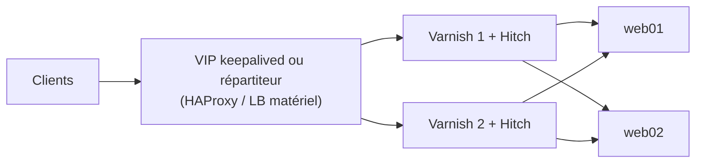

## Terminaison TLS avec Hitch

**Hitch** est un terminateur TLS léger, conçu par l'éditeur de Varnish, qui transmet le trafic déchiffré à Varnish avec le **protocole PROXY v2** (IP client, informations TLS, ALPN pour HTTP/2).

```bash
sudo apt install hitch           # RHEL : dnf install hitch (EPEL ou dépôt varnishcache)
```

```ini /etc/hitch/hitch.conf
frontend = {
    host = "*"
    port = "443"
}
backend = "[127.0.0.1]:8443"          # Varnish écoute avec -a 127.0.0.1:8443,PROXY
workers = 4
daemon = on
user = "_hitch"
group = "_hitch"
write-proxy-v2 = on
alpn-protos = "h2, http/1.1"
tls-protos = TLSv1.2 TLSv1.3
ciphers = "ECDHE-ECDSA-AES128-GCM-SHA256:ECDHE-RSA-AES128-GCM-SHA256:ECDHE-ECDSA-AES256-GCM-SHA384:ECDHE-RSA-AES256-GCM-SHA384"
ocsp-dir = "/var/lib/hitch-ocsp"

pem-file = "/etc/hitch/certs/www.exemple.fr.pem"      # certificat + chaîne + clé, sélection par SNI
pem-file = "/etc/hitch/certs/api.exemple.fr.pem"
```

```bash
sudo systemctl enable --now hitch
# HTTP/2 côté Varnish : activer la fonctionnalité
#   varnishd … -p feature=+http2
```

Renouvellement Let's Encrypt : obtenir le certificat avec certbot (webroot servi par Varnish ou défi DNS), concaténer `fullchain.pem` + `privkey.pem` dans le `.pem` de Hitch, puis `systemctl reload hitch`.

### Alternatives : HAProxy ou Nginx devant Varnish

```haproxy
frontend fe_https
    bind :443 ssl crt /etc/haproxy/certs/ alpn h2,http/1.1
    default_backend be_varnish
backend be_varnish
    server varnish01 127.0.0.1:8443 send-proxy-v2 check
```

Voir [[01-haproxy/05-tls|TLS avec HAProxy]] et [[03-nginx/04-https-tls|TLS avec Nginx]].

## Redirection HTTP → HTTPS

Les requêtes HTTP arrivent directement sur Varnish (port 80) ; celles venant de Hitch arrivent sur le port 8443 :

```vcl
import std;
import proxy;      # vmod livré avec Varnish : informations du protocole PROXY

sub vcl_recv {
    if (std.port(server.ip) == 80 && req.url !~ "^/\.well-known/acme-challenge/") {
        return (synth(750, "https://" + req.http.host + req.url));
    }
    if (proxy.is_ssl()) {
        set req.http.X-Forwarded-Proto = "https";
    } else {
        set req.http.X-Forwarded-Proto = "http";
    }
}

sub vcl_hash {
    hash_data(req.http.X-Forwarded-Proto);    # ne pas mélanger les variantes HTTP et HTTPS si l'application les distingue
}
```

## Backends en HTTPS

Varnish Cache open source ne parle pas TLS vers les backends. Solutions :

- Backends en HTTP sur un réseau maîtrisé (VLAN/VRF dédié) — cas le plus courant ;
- un proxy local (HAProxy, stunnel, Nginx) qui rechiffre : Varnish → `127.0.0.1:9443` → backend HTTPS ;
- Varnish Enterprise (TLS natif vers les backends).

## Haute disponibilité



| Approche | Principe | Avantage / inconvénient |
| --- | --- | --- |
| **Deux Varnish indépendants** (actif/actif) | Chaque nœud a son propre cache | Simple ; deux fois plus de requêtes vers les backends au démarrage, invalidation à envoyer aux deux |
| **Actif/passif** (VIP keepalived) | Un seul nœud sert | Cache « froid » après bascule |
| **Sharding** (directeur `shard`) | Chaque objet n'est stocké que sur un nœud ; les nœuds se transmettent les requêtes | Capacité de cache cumulée ; plus complexe |

### Sharding entre deux Varnish

```vcl
import directors;

backend varnish01 { .host = "10.0.15.11"; .port = "80"; }
backend varnish02 { .host = "10.0.15.12"; .port = "80"; }
backend app       { .host = "10.0.20.11"; .port = "8080"; }

sub vcl_init {
    new cluster = directors.shard();
    cluster.add_backend(varnish01);
    cluster.add_backend(varnish02);
    cluster.reconfigure();
}

acl noeuds_cluster {
    "10.0.15.11";
    "10.0.15.12";
}

sub vcl_recv {
    if (client.ip ~ noeuds_cluster) {
        # Requête relayée par un nœud du cluster (ou par nous-même) : nous sommes le propriétaire
        set req.backend_hint = app;
    } else {
        # Requête d'un client : l'envoyer au nœud propriétaire de cette URL
        set req.backend_hint = cluster.backend(by=URL);
    }
}
```

Quand le nœud choisi est le nœud courant, la requête lui revient avec sa propre IP (dans l'ACL) et part donc vers l'application : un saut local supplémentaire, mais une VCL identique sur tous les nœuds.

> [!NOTE]
> Le sharding exige une VCL soignée (identité de chaque nœud, prévention des boucles). Pour la plupart des sites, **deux Varnish indépendants** derrière un répartiteur et une invalidation diffusée aux deux suffisent.

### Invalider sur tous les nœuds

L'application (ou un script) envoie la purge/ban à **chaque** nœud :

```bash
for v in varnish01 varnish02; do
  curl -s -X PURGE -H "Host: www.exemple.fr" "http://$v/actualites/article-42"
done
```

Des outils comme **varnish-broadcaster** (Enterprise) ou une file de messages (RabbitMQ) simplifient la diffusion à grande échelle.

## Dimensionnement

| Ressource | Conseil |
| --- | --- |
| Mémoire | `-s malloc` = taille du « jeu chaud » + marge ; laisser de la RAM au système (surcoût ~1 Ko/objet, ~50 % de fragmentation possible) |
| Threads | `thread_pools` = nombre de cœurs (2 souvent suffisant) ; `thread_pool_max` ≥ connexions simultanées attendues |
| Réseau | Varnish sature souvent la carte réseau avant le CPU : 10 Gbit/s recommandé pour les gros volumes |
| Système | `LimitNOFILE` élevé, `vm.swappiness=1`, désactiver la transparence des « huge pages » si latences |
