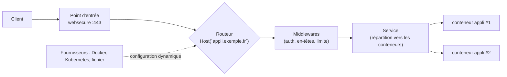

**Traefik** (Traefik Labs, MIT) est un reverse proxy **dynamique** : il lit en continu ses **fournisseurs** (Docker, Kubernetes, fichiers, Consul…) et configure automatiquement les routes quand un conteneur ou un service apparaît, avec des **certificats Let's Encrypt** obtenus sans intervention. Il est très utilisé devant les plateformes de conteneurs ([[01-docker/01-presentation-installation|Docker]], [[05-k3s/01-presentation-installation|K3s]] l'intègre par défaut).

## Concepts



| Notion | Rôle |
| --- | --- |
| **Point d'entrée** (*entryPoint*) | Port d'écoute (`web` :80, `websecure` :443, ports TCP/UDP) |
| **Routeur** | Règle de correspondance (`Host`, `PathPrefix`, `Headers`, `HostSNI` pour TCP) → service |
| **Service** | Serveurs de destination, répartition, vérification d'état, sessions collantes |
| **Middleware** | Traitement intermédiaire : redirection HTTPS, authentification, en-têtes, limitation de débit, liste d'IP |
| **Fournisseur** (*provider*) | Source de la configuration dynamique |
| Résolveur de certificats | Client ACME (Let's Encrypt, ACME interne) |

| Configuration | Contenu | Changement |
| --- | --- | --- |
| **Statique** (`traefik.yml`, arguments, variables) | Points d'entrée, fournisseurs, résolveurs, journaux | Redémarrage |
| **Dynamique** | Routeurs, services, middlewares, TLS | À chaud |

## Installation binaire

```bash
VERSION=v3.5.3   # vérifier la dernière version v3
wget https://github.com/traefik/traefik/releases/download/${VERSION}/traefik_${VERSION}_linux_amd64.tar.gz
sudo tar xzf traefik_${VERSION}_linux_amd64.tar.gz -C /usr/local/bin traefik
sudo useradd -r -s /usr/sbin/nologin traefik
sudo mkdir -p /etc/traefik/dynamique /var/lib/traefik && sudo chown traefik: /var/lib/traefik
sudo setcap 'cap_net_bind_service=+ep' /usr/local/bin/traefik     # ports < 1024 sans root
```

```yaml /etc/traefik/traefik.yml
entryPoints:
  web:
    address: ":80"
    http:
      redirections:
        entryPoint:
          to: websecure
          scheme: https
  websecure:
    address: ":443"
    http3: {}

providers:
  file:
    directory: /etc/traefik/dynamique
    watch: true

certificatesResolvers:
  letsencrypt:
    acme:
      email: admin@exemple.fr
      storage: /var/lib/traefik/acme.json
      httpChallenge:
        entryPoint: web

api:
  dashboard: true

log:
  level: INFO
accessLog:
  filePath: /var/log/traefik/acces.log
  format: json
```

```ini /etc/systemd/system/traefik.service
[Unit]
Description=Traefik
After=network-online.target

[Service]
User=traefik
ExecStart=/usr/local/bin/traefik --configFile=/etc/traefik/traefik.yml
Restart=on-failure
AmbientCapabilities=CAP_NET_BIND_SERVICE
NoNewPrivileges=true

[Install]
WantedBy=multi-user.target
```

```yaml /etc/traefik/dynamique/intranet.yml
http:
  routers:
    intranet:
      rule: "Host(`intranet.exemple.fr`)"
      entryPoints: [websecure]
      service: intranet
      tls:
        certResolver: letsencrypt
  services:
    intranet:
      loadBalancer:
        servers:
          - url: "http://10.0.20.11:8080"
          - url: "http://10.0.20.12:8080"
        healthCheck:
          path: /health
          interval: 10s
```

**Windows** : binaire `traefik.exe` (service via NSSM/WinSW) ; **macOS** : `brew install traefik`.

## En conteneur avec Docker

```yaml compose.yaml
services:
  traefik:
    image: traefik:v3.5
    command:
      - --providers.docker=true
      - --providers.docker.exposedbydefault=false
      - --entrypoints.web.address=:80
      - --entrypoints.web.http.redirections.entrypoint.to=websecure
      - --entrypoints.websecure.address=:443
      - --certificatesresolvers.le.acme.email=admin@exemple.fr
      - --certificatesresolvers.le.acme.storage=/acme/acme.json
      - --certificatesresolvers.le.acme.tlschallenge=true
    ports: ["80:80", "443:443"]
    volumes:
      - /var/run/docker.sock:/var/run/docker.sock:ro
      - ./acme:/acme
    restart: always

  whoami:
    image: traefik/whoami
    labels:
      - traefik.enable=true
      - traefik.http.routers.whoami.rule=Host(`whoami.exemple.fr`)
      - traefik.http.routers.whoami.entrypoints=websecure
      - traefik.http.routers.whoami.tls.certresolver=le
      - traefik.http.services.whoami.loadbalancer.server.port=80
```

`exposedbydefault=false` : seuls les conteneurs avec `traefik.enable=true` sont publiés. Monter le **socket Docker** donne un contrôle total de l'hôte : utilisez un **proxy de socket** en lecture seule (ex. *docker-socket-proxy*) en production.

## Kubernetes

```bash
helm repo add traefik https://traefik.github.io/charts && helm repo update
helm install traefik traefik/traefik -n traefik --create-namespace
```

Traefik lit les objets **Ingress**, **Gateway API** et ses propres CRD (`IngressRoute`, `Middleware`). Voir [[04-kubernetes/04-reseau-services-ingress|réseau Kubernetes]].

## Tableau de bord

Le tableau de bord (routeurs, services, erreurs de configuration) ne doit **jamais** être exposé sans protection :

```yaml /etc/traefik/dynamique/tableau-de-bord.yml
http:
  routers:
    dashboard:
      rule: "Host(`traefik.corp.exemple.fr`)"
      entryPoints: [websecure]
      service: api@internal
      middlewares: [admin-ip, admin-auth]
      tls: {}
  middlewares:
    admin-ip:
      ipAllowList:
        sourceRange: ["10.0.99.0/24"]
    admin-auth:
      basicAuth:
        users:
          - "admin:$2y$05$hachéBcryptGénéréParHtpasswd"
```

Suite : [[02-middlewares-tls|middlewares, TLS et TCP]].
