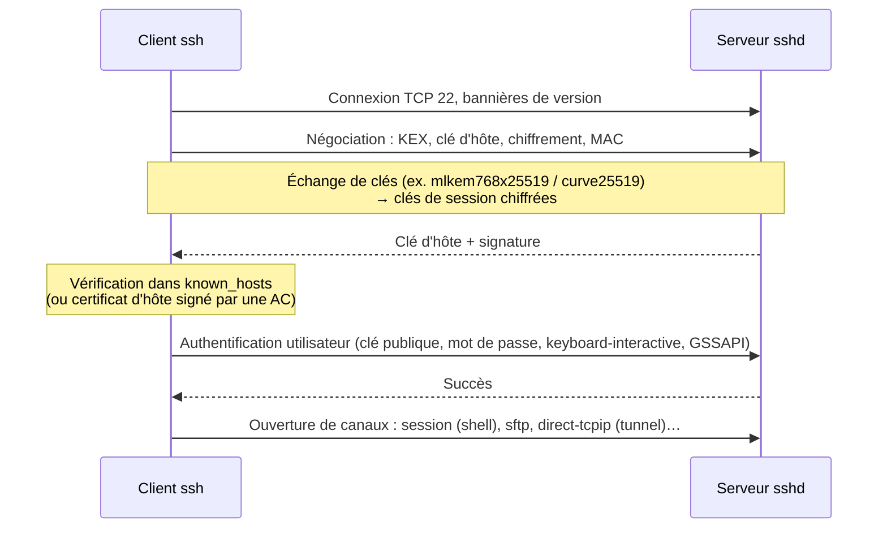
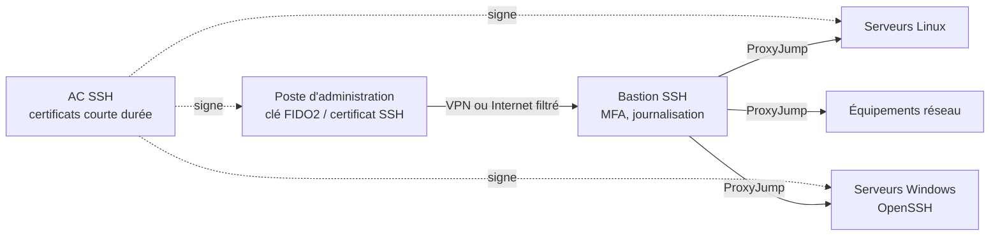

**OpenSSH**, développé par l'équipe OpenBSD, est l'implémentation de référence du protocole **SSH** (*Secure Shell*). C'est l'outil de base de l'administration des serveurs Linux/Unix, des équipements réseau et désormais de Windows : shell distant chiffré, exécution de commandes, transfert de fichiers (**SFTP**, SCP, rsync), redirections de ports et bastions.

## Usages

| Usage | Outil / fonction |
| --- | --- |
| Shell distant, commandes, automatisation (Ansible) | `ssh` / `sshd` |
| Transfert de fichiers | **SFTP** (`sftp`, WinSCP, FileZilla), `scp`, `rsync -e ssh` |
| Accès à un réseau interne via un rebond | `ProxyJump` (bastion) |
| Redirection de ports, proxy SOCKS | `-L`, `-R`, `-D` |
| Montage de systèmes de fichiers | `sshfs` |
| Authentification forte sans mot de passe | Clés Ed25519, clés matérielles FIDO2, **certificats SSH** |
| Signature de fichiers et de commits Git | `ssh-keygen -Y sign` |

## Le protocole SSH

| Couche | Rôle |
| --- | --- |
| **Transport** | Échange de clés, chiffrement (AES-GCM, ChaCha20-Poly1305), intégrité, authentification du **serveur** par sa clé d'hôte |
| **Authentification** | Identification de l'**utilisateur** : clé publique, mot de passe, keyboard-interactive (OTP), GSSAPI (Kerberos) |
| **Connexion** | Multiplexage de canaux : shell, commandes, sous-systèmes (sftp), redirections |

> [!IMPORTANT]
> La sécurité de SSH repose sur la **vérification de la clé d'hôte**. Accepter sans vérifier le message « *The authenticity of host … can't be established* » expose à une attaque de l'homme du milieu. En entreprise, diffusez les empreintes (DNS `SSHFP` signé DNSSEC) ou, mieux, utilisez des **certificats d'hôte** ([[04-cles-certificats]]).

## Composants

| Composant | Rôle |
| --- | --- |
| `sshd` | Serveur (écoute 22/TCP). Depuis 9.8, chaque session tourne dans un processus `sshd-session` distinct |
| `ssh` | Client |
| `scp`, `sftp` | Transfert de fichiers (scp utilise désormais le protocole SFTP par défaut) |
| `ssh-keygen` | Génération et gestion de clés, certificats, empreintes, révocation (KRL) |
| `ssh-agent`, `ssh-add` | Agent de clés (garde les clés déchiffrées en mémoire) |
| `ssh-copy-id` | Déposer une clé publique sur un serveur |
| `ssh-keyscan` | Récupérer les clés d'hôte de serveurs |
| `/etc/ssh/sshd_config` | Configuration du serveur |
| `/etc/ssh/ssh_config`, `~/.ssh/config` | Configuration du client |
| `~/.ssh/authorized_keys` | Clés autorisées pour un compte |
| `~/.ssh/known_hosts` | Clés d'hôte connues |

## Versions récentes

| Version | Nouveautés notables |
| --- | --- |
| 8.x | Clés matérielles FIDO2 (`ed25519-sk`), `Include` dans sshd_config |
| 9.0 | Échange de clés post-quantique hybride `sntrup761x25519` par défaut, `scp` via SFTP |
| 9.8 | Séparation `sshd` / `sshd-session`, pénalités par source (`PerSourcePenalties`) contre le brute force |
| **10.0** (2025) | `mlkem768x25519-sha256` (ML-KEM) par défaut, suppression de DSA, nettoyage d'algorithmes faibles |

Debian 12 : 9.2 ; Debian 13 / Ubuntu 25.x : 10.x ; RHEL 9 : 8.7 (avec rétroportages) ; Windows : OpenSSH for Windows 9.x ; macOS récents : 9.x.

## Ports et flux

| Port | Usage |
| --- | --- |
| TCP 22 | SSH / SFTP / SCP (port modifiable) |
| TCP 830 | NETCONF sur SSH (équipements réseau) |

> [!NOTE]
> Changer le port 22 réduit le bruit des robots dans les journaux mais **n'est pas une mesure de sécurité**. Les vraies protections : clés au lieu de mots de passe, filtrage réseau (VPN, bastion, listes d'IP), MFA, mises à jour.

## Architecture d'administration recommandée

## Suite du parcours

1. [[02-installation|Installation (Linux, Windows, macOS)]]
2. [[03-configuration-durcissement|Configuration du serveur et durcissement]]
3. [[04-cles-certificats|Clés, agent, FIDO2, configuration client et certificats SSH]]
4. [[05-tunnels-bastion|Tunnels, redirections et bastions]]
5. [[06-sftp-chroot|Serveur SFTP chrooté (Linux et Windows)]]
6. [[07-mfa-annuaire-depannage|MFA, annuaire (AD, FreeIPA) et dépannage]]
