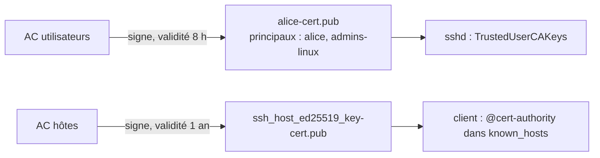

## Générer une clé

```bash
# Ed25519 (recommandé) ; -a : nombre de tours KDF pour protéger la phrase de passe
ssh-keygen -t ed25519 -a 100 -C "alice@poste-admin-2026" -f ~/.ssh/id_ed25519

# RSA si un équipement ancien l'exige
ssh-keygen -t rsa -b 4096 -a 100 -C "alice@poste-admin" -f ~/.ssh/id_rsa

# Changer la phrase de passe d'une clé existante
ssh-keygen -p -f ~/.ssh/id_ed25519

# Empreinte et clé publique
ssh-keygen -lf ~/.ssh/id_ed25519.pub
ssh-keygen -y -f ~/.ssh/id_ed25519 > ~/.ssh/id_ed25519.pub     # régénérer la publique depuis la privée
```

```powershell
# Windows (client OpenSSH intégré)
ssh-keygen -t ed25519 -C "alice@poste-admin"
Get-Content $env:USERPROFILE\.ssh\id_ed25519.pub
```

> [!IMPORTANT]
> Une clé privée **toujours protégée par une phrase de passe** (ou sur un support matériel) ; une clé par personne et par poste ; jamais de clé privée partagée entre administrateurs ni copiée sur les serveurs.

## Déposer la clé publique

```bash
ssh-copy-id -i ~/.ssh/id_ed25519.pub alice@srv01.corp.exemple.fr
# Manuellement :
cat ~/.ssh/id_ed25519.pub | ssh alice@srv01 'umask 077; mkdir -p ~/.ssh; cat >> ~/.ssh/authorized_keys'
```

Droits exigés par `StrictModes` : `~/.ssh` en `700`, `authorized_keys` en `600`, dossier personnel non inscriptible par d'autres.

```powershell
# Windows → serveur Linux (pas de ssh-copy-id natif)
type $env:USERPROFILE\.ssh\id_ed25519.pub | ssh alice@srv01 "umask 077; mkdir -p ~/.ssh; cat >> ~/.ssh/authorized_keys"
```

## Clés matérielles FIDO2 (YubiKey, SoloKey, Titan)

La clé privée **ne quitte jamais** le jeton ; chaque connexion exige une présence physique (toucher), voire un code PIN.

```bash
ssh-keygen -t ed25519-sk -O resident -O verify-required -O application=ssh:corp -C "alice@yubikey"
# -O resident : clé stockée sur le jeton (récupérable sur un autre poste avec « ssh-keygen -K »)
# -O verify-required : PIN exigé en plus du toucher
```

Le serveur doit accepter `sk-ssh-ed25519@openssh.com` (OpenSSH ≥ 8.2). Sous Windows, les clés `-sk` fonctionnent avec le client OpenSSH intégré (via Windows Hello / API WebAuthn).

## Agent SSH

```bash
eval "$(ssh-agent -s)"
ssh-add -t 8h ~/.ssh/id_ed25519      # garder la clé déchiffrée 8 heures
ssh-add -l                            # clés chargées
ssh-add -D                            # tout retirer
```

```powershell
# Windows : service ssh-agent
Get-Service ssh-agent | Set-Service -StartupType Automatic
Start-Service ssh-agent
ssh-add $env:USERPROFILE\.ssh\id_ed25519
```

> [!WARNING]
> Le **transfert d'agent** (`ssh -A`, `ForwardAgent yes`) permet à un administrateur du serveur distant d'utiliser votre agent pendant votre session. Préférez **`ProxyJump`** pour rebondir (voir [[05-tunnels-bastion]]) et laissez `AllowAgentForwarding no`.

## Configuration du client : ~/.ssh/config

```sshconfig ~/.ssh/config
# Valeurs par défaut
Host *
    AddKeysToAgent yes
    IdentitiesOnly yes
    ServerAliveInterval 60
    ServerAliveCountMax 3
    HashKnownHosts yes
    UpdateHostKeys yes

# Bastion
Host bastion
    HostName bastion.exemple.fr
    User alice
    IdentityFile ~/.ssh/id_ed25519_sk

# Serveurs internes, joints via le bastion
Host srv-* *.corp.exemple.fr
    User alice
    ProxyJump bastion
    IdentityFile ~/.ssh/id_ed25519

# Multiplexage : une seule connexion TCP réutilisée (Ansible, scp en rafale)
Host srv-*
    ControlMaster auto
    ControlPath ~/.ssh/cm-%r@%h:%p
    ControlPersist 10m

# Équipement réseau
Host sw-core-01
    HostName 10.0.1.1
    User admin
    KexAlgorithms +diffie-hellman-group14-sha1
```

Avec cette configuration, `ssh srv-web01` passe automatiquement par le bastion.

## known_hosts et vérification des hôtes

```bash
ssh-keygen -R srv01.corp.exemple.fr               # supprimer une ancienne clé (serveur réinstallé)
ssh-keygen -F srv01.corp.exemple.fr               # chercher une entrée (known_hosts haché)
ssh-keyscan -t ed25519 srv01 >> ~/.ssh/known_hosts   # (à vérifier : ne protège pas d'une attaque en cours)
```

Diffusion par DNS : `ssh-keygen -r srv01.corp.exemple.fr` produit des enregistrements **SSHFP** à publier dans une zone signée DNSSEC ; côté client `VerifyHostKeyDNS yes`.

## Autorité de certification SSH

Avec des **certificats SSH**, plus besoin de distribuer des clés publiques dans des centaines de `authorized_keys` ni des empreintes dans `known_hosts` : serveurs et clients font confiance à une **AC**.



### Créer les AC

```bash
# Sur une machine protégée (idéalement hors ligne ou dans un HSM / Vault)
ssh-keygen -t ed25519 -f ca_utilisateurs -C "AC SSH utilisateurs Exemple"
ssh-keygen -t ed25519 -f ca_hotes -C "AC SSH hôtes Exemple"
```

### Certificats utilisateurs

```bash
# Signer la clé d'Alice : identité, principaux (comptes/rôles autorisés), validité 8 h
ssh-keygen -s ca_utilisateurs -I "alice-$(date +%F)" -n alice,admins-linux -V +8h -z 1001 alice_id_ed25519.pub
ssh-keygen -Lf alice_id_ed25519-cert.pub        # afficher le certificat
```

Côté serveurs :

```sshconfig /etc/ssh/sshd_config.d/30-ac.conf
TrustedUserCAKeys /etc/ssh/ca_utilisateurs.pub
AuthorizedPrincipalsFile /etc/ssh/principaux/%u     # quels principaux peuvent ouvrir quel compte
RevokedKeys /etc/ssh/revoked.krl
```

```text /etc/ssh/principaux/root
admins-linux
```

Ici, tout certificat portant le principal `admins-linux` peut se connecter en `root` (si `PermitRootLogin prohibit-password`) — sans aucune clé dans `/root/.ssh/authorized_keys`.

### Certificats d'hôtes

```bash
# Signer la clé d'hôte du serveur (noms par lesquels on le joint)
ssh-keygen -s ca_hotes -I "srv01" -h -n srv01,srv01.corp.exemple.fr,10.0.20.11 -V +52w /etc/ssh/ssh_host_ed25519_key.pub
```

```sshconfig /etc/ssh/sshd_config.d/30-ac.conf
HostCertificate /etc/ssh/ssh_host_ed25519_key-cert.pub
```

```text ~/.ssh/known_hosts (ou /etc/ssh/ssh_known_hosts sur tous les postes)
@cert-authority *.corp.exemple.fr,10.0.* ssh-ed25519 AAAAC3NzaC1lZDI1NTE5AAAA… AC SSH hôtes Exemple
```

Plus aucun avertissement « *authenticity of host* » pour les serveurs signés.

### Révocation

```bash
ssh-keygen -k -f /etc/ssh/revoked.krl -z 2 alice_id_ed25519-cert.pub      # créer / compléter la KRL
ssh-keygen -Qf /etc/ssh/revoked.krl alice_id_ed25519-cert.pub              # tester
```

> [!TIP]
> Automatisez l'émission : **HashiCorp Vault** (moteur *SSH secrets*), **step-ca**, **Teleport** ou **Smallstep** délivrent des certificats de courte durée après une authentification SSO (Entra ID, Keycloak). Des certificats valables quelques heures rendent la révocation presque inutile.
