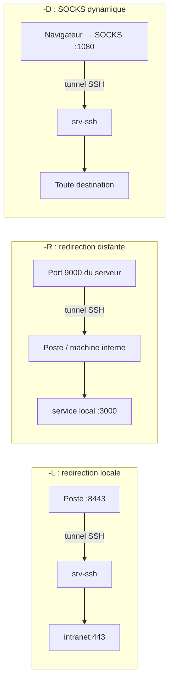

## Les trois types de redirection



### -L : accéder à un service interne

```bash
# Interface web d'un équipement joignable seulement depuis srv-admin
ssh -L 8443:10.0.1.1:443 alice@srv-admin.corp.exemple.fr
# puis https://localhost:8443 sur le poste

# Base de données derrière le bastion, sans shell (-N), en arrière-plan (-f)
ssh -f -N -L 5432:db01.corp.exemple.fr:5432 bastion
```

### -R : exposer un service local à travers un serveur

```bash
# Le port 9000 du serveur relais renvoie vers le port 3000 de la machine locale
ssh -N -R 9000:localhost:3000 relais.exemple.fr
# Prise en main d'une machine derrière un NAT (support) : elle ouvre un tunnel inverse vers un relais
ssh -N -R 2222:localhost:22 support@relais.exemple.fr
```

Par défaut le port distant n'écoute que sur 127.0.0.1 ; `GatewayPorts clientspecified` côté serveur permet `-R 0.0.0.0:9000:…`.

### -D : proxy SOCKS

```bash
ssh -D 1080 -N bastion
# Navigateur / outils configurés avec le proxy SOCKS5 localhost:1080
curl --socks5-hostname localhost:1080 https://intranet.corp.exemple.fr
```

> [!WARNING]
> Les redirections permettent de **contourner le pare-feu**. Sur les serveurs, laissez `AllowTcpForwarding no` par défaut et autorisez-les uniquement aux groupes et adresses qui en ont besoin (`Match`), éventuellement limitées à certaines destinations : `PermitOpen db01.corp.exemple.fr:5432`.

## Rebonds : ProxyJump

```bash
ssh -J bastion.exemple.fr alice@srv-web01.corp.exemple.fr
ssh -J bastion1,bastion2 srv-interne                    # plusieurs rebonds
scp -J bastion fichier.tar.gz srv-web01:/tmp/
rsync -e "ssh -J bastion" -av ./site/ srv-web01:/srv/www/
```

Avec `ProxyJump`, la session vers la cible est chiffrée **de bout en bout** depuis le poste : le bastion ne voit qu'un flux chiffré et l'authentification sur la cible utilise vos clés locales (pas besoin de transfert d'agent).

## Tunnels persistants

### autossh

```bash
sudo apt install autossh
autossh -M 0 -f -N -o "ServerAliveInterval 30" -o "ServerAliveCountMax 3" -o "ExitOnForwardFailure yes" \
  -L 15432:db01.corp.exemple.fr:5432 tunnel@bastion
```

### Service systemd

```ini /etc/systemd/system/tunnel-db.service
[Unit]
Description=Tunnel SSH vers la base de données
After=network-online.target
Wants=network-online.target

[Service]
User=tunnel
ExecStart=/usr/bin/ssh -N -o ServerAliveInterval=30 -o ServerAliveCountMax=3 -o ExitOnForwardFailure=yes \
  -i /home/tunnel/.ssh/id_ed25519 -L 15432:db01.corp.exemple.fr:5432 tunnel@bastion.exemple.fr
Restart=always
RestartSec=10

[Install]
WantedBy=multi-user.target
```

```bash
sudo systemctl enable --now tunnel-db
```

Côté bastion, restreignez la clé du compte `tunnel` : `restrict,port-forwarding,permitopen="db01.corp.exemple.fr:5432" ssh-ed25519 …`.

## VPN rudimentaire : ssh -w

```bash
# Sur le serveur : PermitTunnel point-to-point (ou yes) ; connexion en root nécessaire pour créer les interfaces
sudo ssh -w 0:0 root@serveur        # crée tun0 de chaque côté
sudo ip addr add 10.99.0.1/30 dev tun0 && sudo ip link set tun0 up          # client
# côté serveur : 10.99.0.2/30 + routage / NAT
```

Utile en dépannage ; pour un vrai VPN, utilisez [[03-wireguard/01-presentation-installation|WireGuard]] ou [[02-openvpn/01-presentation|OpenVPN]]. L'outil **sshuttle** (VPN « du pauvre » sur SSH, sans droits root côté serveur) est une alternative pratique : `sshuttle -r alice@bastion 10.0.0.0/8`.

## Concevoir un bastion SSH

| Principe | Mise en œuvre |
| --- | --- |
| **Point d'entrée unique** | Les serveurs n'acceptent SSH que depuis l'IP du bastion (pare-feu, `Match Address`) |
| Bastion minimal | Pas d'autre service, pas de données, mises à jour automatiques |
| Comptes nominatifs | Pas de compte partagé ; certificats SSH de courte durée ou clés FIDO2 |
| **MFA** | Second facteur sur le bastion (voir [[07-mfa-annuaire-depannage]]) |
| Rebond sans shell | Compte de rebond avec `ForceCommand /bin/false` + `AllowTcpForwarding yes` et `PermitOpen` vers les seules cibles autorisées |
| Journalisation | Connexions, empreintes des clés, destinations (`LogLevel VERBOSE`) vers le SIEM |
| **Enregistrement des sessions** | Si le bastion termine les sessions (pas en ProxyJump) : `tlog`, `pam_tty_audit`, ou un bastion applicatif |

```sshconfig /etc/ssh/sshd_config.d/40-bastion.conf (bastion de rebond pur)
Match Group rebond
    ForceCommand /usr/sbin/nologin
    PermitTTY no
    AllowTcpForwarding yes
    PermitOpen srv-web01.corp.exemple.fr:22 10.0.20.11:22 10.0.20.12:22 *:22
    X11Forwarding no
    AllowAgentForwarding no
```

`PermitOpen` accepte des noms ou adresses exacts, ou `*` pour « n'importe quel hôte » (ici : tout hôte mais uniquement le port 22). Il n'accepte pas de motifs partiels comme `*.corp.exemple.fr` : filtrez alors les destinations au pare-feu du bastion.

### Bastions applicatifs

| Produit | Points forts |
| --- | --- |
| **Teleport** (open source / entreprise) | Certificats courts, SSO, enregistrement des sessions SSH/RDP/Kubernetes/bases, demandes d'accès |
| **Warpgate** (open source) | Bastion transparent SSH/HTTPS/MySQL/PostgreSQL, enregistrement, OIDC |
| **HashiCorp Boundary** | Accès par identité aux cibles, intégration Vault |
| **Apache Guacamole** | Accès SSH/RDP/VNC depuis un navigateur, enregistrement |
| Solutions certifiées (Wallix, CyberArk) | Exigences réglementaires (PAM, certification ANSSI) |
