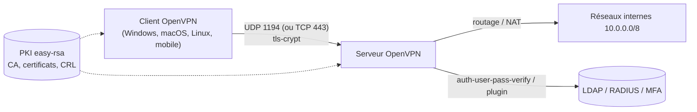

**OpenVPN** est un VPN open source fondé sur **TLS** : chaque client s'authentifie avec un certificat X.509 (et souvent un identifiant/mot de passe ou un OTP), puis le trafic IP est encapsulé dans UDP ou TCP. Très répandu pour l'**accès distant** des collaborateurs et les liaisons simples entre sites, il passe facilement les pare-feu (y compris sur TCP 443) et s'intègre à LDAP, RADIUS et aux solutions MFA.

## Architecture

| Élément | Rôle |
| --- | --- |
| **Canal de contrôle** | Négociation TLS (certificats, échange de clés), authentification, envoi des paramètres (`push`) |
| **Canal de données** | Paquets IP chiffrés (AES-256-GCM, ChaCha20-Poly1305) |
| **tls-crypt / tls-crypt-v2** | Chiffre et authentifie le canal de contrôle avec une clé partagée : le serveur ignore tout paquet non signé (protection contre les scans et le DoS, masque le certificat) |
| **DCO** (*Data Channel Offload*, 2.6+) | Le chiffrement du canal de données passe dans un **module noyau** (Linux, Windows) : débit multiplié |
| Interface **TUN** | Couche 3 (IP routé) — **recommandé** |
| Interface **TAP** | Couche 2 (Ethernet ponté) — besoins spécifiques (broadcast, protocoles non IP) |

## Topologies

| Topologie | Usage |
| --- | --- |
| **Serveur d'accès distant** (`server`, `topology subnet`) | Des dizaines à des milliers de clients itinérants |
| **Site à site** | Un serveur, des routeurs/serveurs clients d'agences (`iroute`), ou point à point |
| **Hub and spoke** | Agences reliées via le siège (`client-to-client` ou routage) |

## Éditions

| Édition | Description |
| --- | --- |
| **OpenVPN Community** (libre) | Le démon `openvpn`, configuré par fichiers — objet de ce wiki |
| **OpenVPN Access Server** | Serveur commercial avec interface web, gestion des utilisateurs, MFA, SAML ; gratuit pour 2 connexions simultanées |
| **CloudConnexa** | Service hébergé (SaaS) |
| Pare-feu intégrant OpenVPN | pfSense, OPNsense, IPFire, routeurs MikroTik, Synology… (interface + génération des profils) |

## OpenVPN, WireGuard ou IPsec ?

| Critère | OpenVPN | [[03-wireguard/01-presentation-installation\|WireGuard]] | [[04-strongswan/01-presentation\|IPsec (strongSwan)]] |
| --- | --- | --- | --- |
| Authentification | Certificats + login/MFA, LDAP/RADIUS natifs | Clés publiques uniquement | Certificats, PSK, EAP (RADIUS) |
| Performances | Bonnes (excellentes avec DCO) | **Excellentes** | Très bonnes |
| Passage des pare-feu | **Excellent** (TCP 443 possible) | UDP uniquement | UDP 500/4500, parfois filtré |
| Clients natifs | Non (client à installer) | Non (sauf certains OS/routeurs) | **Oui** (Windows, macOS, iOS, Android) |
| Interopérabilité avec pare-feu commerciaux | Limitée | Croissante | **Standard** (site à site) |
| Complexité de configuration | Moyenne (PKI) | Faible | Élevée |

> [!TIP]
> Choix courant : **OpenVPN** ou **WireGuard** pour l'accès distant des collaborateurs selon l'intégration MFA souhaitée ; **IPsec** pour les tunnels site à site avec des équipements tiers et les clouds publics.

## Ports

| Port | Usage |
| --- | --- |
| **UDP 1194** | Port standard (UDP recommandé : pas de « TCP sur TCP ») |
| TCP 443 | Contournement des réseaux restrictifs (hôtels, entreprises) ; partageable avec un serveur web (`port-share`) |
| TCP 7505 (local) | Interface de gestion (`management`) |

## Versions

| Branche | Remarques |
| --- | --- |
| 2.5 | Négociation des chiffrements `data-ciphers`, tls-crypt-v2 |
| **2.6** | **DCO**, `peer-fingerprint` (sans PKI pour de petits déploiements), améliorations de performance — Debian 12/13, Ubuntu 24.04, RHEL 9 (EPEL) |
| 2.7 | En cours (multi-socket, nouvelles fonctions DCO) |

## Suite du parcours

1. [[02-installation-pki|Installation et PKI avec easy-rsa]]
2. [[03-serveur-acces-distant|Serveur d'accès distant]]
3. [[04-authentification-ldap-radius-mfa|Authentification LDAP, RADIUS et MFA]]
4. [[05-site-a-site-avance|Site à site et configurations avancées]]
5. [[06-clients-exploitation-depannage|Clients, exploitation et dépannage]]
