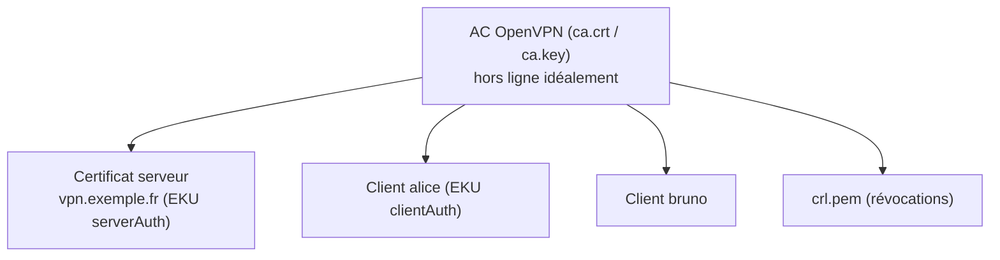

## Installation

### Debian / Ubuntu

```bash
sudo apt update && sudo apt install openvpn easy-rsa
openvpn --version | head -1

# Dépôt officiel OpenVPN (versions récentes, DCO)
sudo mkdir -p /etc/apt/keyrings
curl -fsSL https://swupdate.openvpn.net/repos/repo-public.gpg | sudo gpg --dearmor -o /etc/apt/keyrings/openvpn-repo-public.gpg
echo "deb [signed-by=/etc/apt/keyrings/openvpn-repo-public.gpg] https://build.openvpn.net/debian/openvpn/release/2.6 $(lsb_release -cs) main" | sudo tee /etc/apt/sources.list.d/openvpn.list
sudo apt update && sudo apt install openvpn openvpn-dco-dkms
```

### RHEL / Rocky / Alma

```bash
sudo dnf install epel-release
sudo dnf install openvpn easy-rsa
# DCO : paquet kmod-ovpn-dco / dkms selon la version (ou module ovpn intégré aux noyaux Linux récents)
```

### Windows

- **Client** : installer *OpenVPN Community* (MSI) — interface **OpenVPN GUI**, pilote **ovpn-dco** (par défaut) ou Wintun/TAP-Windows.
- **Serveur** : le même MSI installe le service **OpenVPNService** (lance chaque configuration de `C:\Program Files\OpenVPN\config-auto\`) ; easy-rsa est fourni (`EasyRSA-Start.bat`). Un serveur Windows convient aux petits besoins ; pour la production, préférez Linux ou un pare-feu.

```powershell
Get-Service OpenVPNService
New-NetFirewallRule -DisplayName "OpenVPN UDP 1194" -Direction Inbound -Protocol UDP -LocalPort 1194 -Action Allow
```

### macOS

- Client : **Tunnelblick** (libre) ou **OpenVPN Connect**.
- Ligne de commande / serveur de test : `brew install openvpn easy-rsa`.

## PKI avec easy-rsa 3



> [!IMPORTANT]
> Utilisez une **AC dédiée** à OpenVPN (ne réutilisez pas l'AC de votre PKI Web) : avec `remote-cert-tls client`, tout certificat client signé par l'AC est accepté. Conservez la clé de l'AC hors du serveur VPN (machine d'administration, coffre).

### Initialiser

```bash
make-cadir ~/pki-openvpn && cd ~/pki-openvpn       # Debian ; sinon copier /usr/share/easy-rsa
```

```bash ~/pki-openvpn/vars
set_var EASYRSA_ALGO         ec
set_var EASYRSA_CURVE        secp384r1
set_var EASYRSA_DIGEST       "sha384"
set_var EASYRSA_CA_EXPIRE    3650
set_var EASYRSA_CERT_EXPIRE  825
set_var EASYRSA_CRL_DAYS     180
set_var EASYRSA_REQ_COUNTRY  "FR"
set_var EASYRSA_REQ_ORG      "Exemple"
set_var EASYRSA_REQ_OU       "VPN"
set_var EASYRSA_DN           "org"
```

```bash
./easyrsa init-pki
./easyrsa build-ca                                  # phrase de passe pour ca.key (à conserver !)
./easyrsa --san=DNS:vpn.exemple.fr build-server-full vpn.exemple.fr nopass
./easyrsa build-client-full alice nopass            # ou sans « nopass » : clé client protégée par phrase de passe
./easyrsa build-client-full bruno
./easyrsa gen-crl
```

| Fichier produit | Usage |
| --- | --- |
| `pki/ca.crt` | Certificat de l'AC (serveur et clients) |
| `pki/issued/vpn.exemple.fr.crt`, `pki/private/vpn.exemple.fr.key` | Serveur |
| `pki/issued/alice.crt`, `pki/private/alice.key` | Client |
| `pki/crl.pem` | Liste de révocation (serveur) |

Avec des courbes elliptiques, aucun fichier Diffie-Hellman n'est nécessaire (`dh none` côté serveur).

### Clé tls-crypt

```bash
openvpn --genkey tls-crypt /etc/openvpn/server/tc.key        # 2.5+
# tls-crypt-v2 : une clé serveur + une clé dérivée par client (révocable individuellement)
openvpn --genkey tls-crypt-v2-server /etc/openvpn/server/tc2-serveur.key
openvpn --tls-crypt-v2 /etc/openvpn/server/tc2-serveur.key --genkey tls-crypt-v2-client alice-tc2.key
```

### Installer les fichiers sur le serveur

```bash
sudo install -d -m 700 /etc/openvpn/server
sudo cp pki/ca.crt pki/crl.pem pki/issued/vpn.exemple.fr.crt /etc/openvpn/server/
sudo install -m 600 pki/private/vpn.exemple.fr.key /etc/openvpn/server/
sudo chmod 644 /etc/openvpn/server/crl.pem          # lue après la perte des privilèges (user nobody)
```

## Révoquer un client

```bash
cd ~/pki-openvpn
./easyrsa revoke bruno
./easyrsa gen-crl
sudo cp pki/crl.pem /etc/openvpn/server/crl.pem
# La CRL est relue à chaque nouvelle connexion ; couper la session en cours via l'interface de gestion :
echo "kill bruno" | nc 127.0.0.1 7505
```

> [!WARNING]
> La CRL a une **date d'expiration** (`EASYRSA_CRL_DAYS`). Une CRL expirée fait **échouer toutes les connexions** (`CRL has expired`). Planifiez sa régénération (tâche mensuelle) et supervisez sa date `nextUpdate` : `openssl crl -in crl.pem -noout -nextupdate`.

## Automatiser la création des profils clients

```bash /usr/local/bin/nouveau-client-vpn.sh
#!/bin/bash
# Usage : nouveau-client-vpn.sh <nom>
set -euo pipefail
NOM=$1; PKI=~/pki-openvpn; OUT=~/profils-vpn
cd "$PKI" && ./easyrsa --batch build-client-full "$NOM" nopass
mkdir -p "$OUT"
{
  cat /etc/openvpn/client-modele.ovpn
  echo "<ca>";        cat pki/ca.crt;                                   echo "</ca>"
  echo "<cert>";      openssl x509 -in "pki/issued/$NOM.crt";           echo "</cert>"
  echo "<key>";       cat "pki/private/$NOM.key";                       echo "</key>"
  echo "<tls-crypt>"; sudo cat /etc/openvpn/server/tc.key;              echo "</tls-crypt>"
} > "$OUT/$NOM.ovpn"
chmod 600 "$OUT/$NOM.ovpn"
echo "Profil : $OUT/$NOM.ovpn"
```

Le profil `.ovpn` contient la clé privée du client : transmettez-le par un canal sûr (portail authentifié, archive chiffrée) et jamais par courriel en clair.

## Alternative : AC d'entreprise

Les certificats peuvent venir d'**AD CS** (modèle dédié, auto-inscription des postes) : le serveur fait confiance à l'AC émettrice et vérifie un attribut (`verify-x509-name`, `x509-username-field`) pour n'accepter que les certificats prévus pour le VPN. Voir [[01-active-directory/10-adcs-pki|AD CS]].
