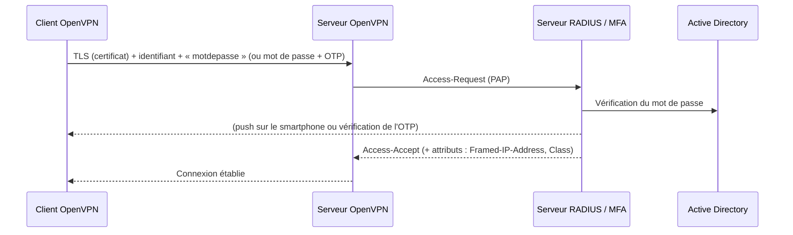

## Modèles d'authentification

| Modèle | Directives serveur | Sécurité |
| --- | --- | --- |
| Certificat seul | (défaut) | Possession du fichier ; révocation par CRL |
| **Certificat + identifiant/mot de passe** | `plugin …` ou `auth-user-pass-verify` | Possession + connaissance (recommandé) |
| **Certificat + mot de passe + OTP** | Plugin RADIUS/PAM vers un serveur MFA | **Recommandé** pour l'accès distant |
| Identifiant seul (sans certificat client) | `verify-client-cert none` + `username-as-common-name` | Plus simple à distribuer (un profil identique pour tous), mais repose entièrement sur le mot de passe/MFA |

Côté client, ajouter `auth-user-pass` dans le profil `.ovpn` (la fenêtre de saisie apparaît à la connexion).

## Active Directory via PAM + SSSD (simple et robuste)

Si le serveur VPN est joint au domaine avec SSSD (voir [[01-openssh/07-mfa-annuaire-depannage|SSSD]]) :

```text /etc/pam.d/openvpn
auth    required  pam_sss.so
account required  pam_sss.so
```

```openvpn /etc/openvpn/server/serveur.conf (extrait)
plugin /usr/lib/x86_64-linux-gnu/openvpn/plugins/openvpn-plugin-auth-pam.so openvpn
username-as-common-name
```

L'accès est restreint à un groupe AD par la règle d'accès SSSD (`realm permit -g vpn-utilisateurs`) ou `simple_allow_groups` dans `sssd.conf`.

> [!NOTE]
> Chemin du plugin selon la distribution : `/usr/lib/x86_64-linux-gnu/openvpn/plugins/` (Debian/Ubuntu), `/usr/lib64/openvpn/plugins/` (RHEL).

## LDAP direct (openvpn-auth-ldap)

```bash
sudo apt install openvpn-auth-ldap
```

```xml /etc/openvpn/server/auth-ldap.conf
<LDAP>
    URL             ldaps://dc01.corp.exemple.fr
    BindDN          "CN=svc-openvpn,OU=Comptes-de-service,OU=Corp,DC=corp,DC=exemple,DC=fr"
    Password        "MotDePasseDuCompteDeService"
    Timeout         15
    TLSEnable       no
    FollowReferrals no
    TLSCACertFile   /etc/ssl/certs/corp-ca.pem
</LDAP>
<Authorization>
    BaseDN          "OU=Utilisateurs,OU=Corp,DC=corp,DC=exemple,DC=fr"
    SearchFilter    "(&(sAMAccountName=%u)(memberOf:1.2.840.113556.1.4.1941:=CN=GG-VPN,OU=Groupes,OU=Corp,DC=corp,DC=exemple,DC=fr))"
    RequireGroup    false
</Authorization>
```

```openvpn
plugin /usr/lib/openvpn/openvpn-auth-ldap.so /etc/openvpn/server/auth-ldap.conf
```

## RADIUS et MFA

Déléguer l'authentification à un serveur RADIUS permet d'ajouter un **second facteur** sans toucher au serveur VPN : [[01-freeradius/01-presentation|FreeRADIUS]] avec privacyIDEA, Microsoft NPS avec l'extension MFA Entra ID, Duo Authentication Proxy, Fortinet FortiAuthenticator…



```bash
sudo apt install libpam-radius-auth
```

```text /etc/pam_radius_auth.conf
# serveur[:port]   secret               délai
10.0.10.31         SecretVpnRadius      10
10.0.10.32         SecretVpnRadius      10
```

```text /etc/pam.d/openvpn
auth    required  pam_radius_auth.so
account required  pam_permit.so
```

```openvpn
plugin /usr/lib/x86_64-linux-gnu/openvpn/plugins/openvpn-plugin-auth-pam.so openvpn
username-as-common-name
reneg-sec 0                    # ne pas renégocier (sinon nouvelle demande d'OTP toutes les heures)
auth-gen-token 43200           # jeton de session de 12 h : reconnexions sans redemander l'OTP
```

> [!TIP]
> Avec un OTP saisi dans le champ mot de passe, la convention la plus répandue est `motdepasse` + `code` concaténés, ou la saisie du code dans une **fenêtre de défi** (*challenge/response* : `static-challenge "Code OTP" 1` côté client pour OpenVPN GUI). Les envois *push* (Duo, Entra MFA) ne demandent aucune saisie supplémentaire.

Déclarer le serveur VPN comme client dans FreeRADIUS (`clients.conf`, secret dédié) et, si besoin, renvoyer une IP fixe par l'attribut `Framed-IP-Address` (exploité par le plugin `radiusplugin`) ou par un script `client-connect`.

## Script auth-user-pass-verify

Pour une logique personnalisée (base locale, API d'un IdP, liste d'exceptions) :

```openvpn
script-security 2
auth-user-pass-verify /etc/openvpn/server/verifier.sh via-file
```

```bash /etc/openvpn/server/verifier.sh
#!/bin/bash
# $1 = fichier temporaire : ligne 1 identifiant, ligne 2 mot de passe. Code 0 = accepté.
UTILISATEUR=$(sed -n 1p "$1"); MOTDEPASSE=$(sed -n 2p "$1")
# Exemple : vérification par une API interne
curl -sf -m 5 -u "$UTILISATEUR:$MOTDEPASSE" https://idp.corp.exemple.fr/api/verifier-vpn >/dev/null
```

```bash
sudo chmod 750 /etc/openvpn/server/verifier.sh && sudo chown root:nogroup /etc/openvpn/server/verifier.sh
```

> [!WARNING]
> Le script s'exécute de façon **synchrone** : un IdP lent bloque toutes les connexions. Préférez les plugins (asynchrones avec `auth-user-pass-verify … via-file` + `deferred` dans les plugins récents) pour les déploiements importants.

## Hooks de connexion : adresses et règles par groupe

```openvpn
script-security 2
client-connect /etc/openvpn/server/connexion.sh
client-disconnect /etc/openvpn/server/deconnexion.sh
```

```bash /etc/openvpn/server/connexion.sh
#!/bin/bash
# $1 = fichier où écrire des directives dynamiques (comme un fichier ccd)
# Variables disponibles : $common_name, $username, $trusted_ip, $ifconfig_pool_remote_ip…
if id -nG "$username" 2>/dev/null | grep -qw vpn-admins; then
  echo 'push "route 10.0.1.0 255.255.255.0"' >> "$1"      # réseau d'administration
fi
logger -t openvpn "connexion $username depuis $trusted_ip → $ifconfig_pool_remote_ip"
exit 0
```

## Bonnes pratiques

- Certificat client **et** identifiant + **MFA** pour l'accès distant.
- Groupe AD dédié au VPN ; désactivation du compte AD = coupure de l'accès à la reconnexion (et `kill` immédiat via l'interface de gestion).
- Profils différenciés (adresses / règles de pare-feu) selon le rôle.
- `auth-nocache` côté client : le mot de passe n'est pas gardé en mémoire.
- Journaliser chaque connexion (utilisateur, IP réelle, IP VPN, durée, volume) vers le SIEM.
