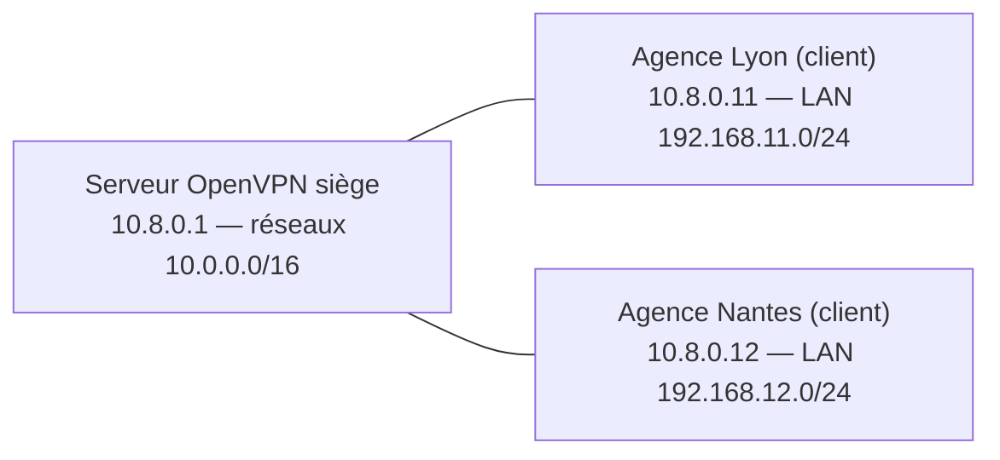

## Agences clientes d'un serveur central

Chaque agence fait tourner un client OpenVPN (routeur, pare-feu ou petit serveur) et annonce le réseau local qui se trouve derrière elle.



### Côté serveur

```openvpn /etc/openvpn/server/serveur.conf (extraits)
server 10.8.0.0 255.255.255.0
topology subnet
client-config-dir /etc/openvpn/server/ccd

# Le noyau du serveur doit savoir que ces réseaux sont joignables par tun0…
route 192.168.11.0 255.255.255.0
route 192.168.12.0 255.255.255.0
# …et les agences doivent connaître le siège (et entre elles si client-to-client)
push "route 10.0.0.0 255.255.0.0"
push "route 192.168.11.0 255.255.255.0"
push "route 192.168.12.0 255.255.255.0"
client-to-client                      # agences ↔ agences directement par le serveur OpenVPN (sinon via le pare-feu)
```

```openvpn /etc/openvpn/server/ccd/agence-lyon
ifconfig-push 10.8.0.11 255.255.255.0
iroute 192.168.11.0 255.255.255.0     # ce réseau est DERRIÈRE ce client (routage interne d'OpenVPN)
```

> [!IMPORTANT]
> Il faut **les deux** : `route` (table de routage du noyau du serveur → tun0) **et** `iroute` dans le fichier ccd du client (table interne d'OpenVPN → quel client). Oublier l'un des deux est la cause n°1 des tunnels « montés mais sans trafic ».

### Côté agence

```openvpn /etc/openvpn/client/agence-lyon.conf
client
dev tun
proto udp
remote vpn.exemple.fr 1194
nobind
persist-key
persist-tun
remote-cert-tls server
verify-x509-name vpn.exemple.fr name
ca ca.crt
cert agence-lyon.crt
key agence-lyon.key
tls-crypt tc.key
data-ciphers AES-256-GCM:CHACHA20-POLY1305
keepalive 10 60
verb 3
```

```bash
sudo systemctl enable --now openvpn-client@agence-lyon
echo "net.ipv4.ip_forward=1" | sudo tee /etc/sysctl.d/90-vpn.conf && sudo sysctl --system
```

Les postes de l'agence utilisent leur passerelle habituelle : celle-ci doit router `10.0.0.0/16` vers le client OpenVPN de l'agence (ou le client OpenVPN **est** la passerelle).

## Point à point sans PKI (2.6+)

Pour un lien unique entre deux serveurs, `peer-fingerprint` évite de créer une AC : chaque côté a un certificat auto-signé et vérifie l'empreinte de l'autre.

```bash
openssl req -x509 -newkey ec:<(openssl ecparam -name secp384r1) -keyout lyon.key -out lyon.crt -nodes -sha256 -days 3650 -subj /CN=lyon
openssl x509 -fingerprint -sha256 -noout -in lyon.crt
```

```openvpn
# Site A (serveur)
dev tun
proto udp
port 1195
tls-server
ifconfig 10.99.0.1 10.99.0.2
cert paris.crt
key paris.key
dh none
peer-fingerprint "AB:CD:…:EF"          # empreinte du certificat de Lyon
route 192.168.11.0 255.255.255.0
```

## TCP 443 et partage de port

```openvpn /etc/openvpn/server/tcp443.conf
proto tcp-server
port 443
port-share 127.0.0.1 8443          # le trafic non OpenVPN (HTTPS) est transmis au serveur web local
server 10.9.0.0 255.255.255.0
# … reste identique (certificats, tls-crypt, push)
```

> [!NOTE]
> OpenVPN sur TCP souffre de l'effet « TCP sur TCP » (retransmissions en cascade sur un lien dégradé). Proposez **UDP en premier** et TCP 443 en secours dans le profil client (`remote … 1194 udp` puis `remote … 443 tcp`).

## Performances

| Levier | Effet |
| --- | --- |
| **DCO** (`ovpn-dco`) | Chiffrement dans le noyau : débit x2 à x5, moins de CPU. Activé automatiquement si le module est chargé (`lsmod \| grep ovpn`) et la configuration compatible (AEAD, pas de compression, pas de `fragment`) |
| AES-GCM avec AES-NI | Le plus rapide sur x86 ; ChaCha20 pour les processeurs ARM sans accélération |
| UDP | Toujours préférable |
| Plusieurs instances / processus | OpenVPN (hors DCO) est mono-thread par instance : une instance par cœur derrière un répartiteur |
| `sndbuf` / `rcvbuf` | Tampons réseau (0 = laisser le système décider) |

```bash
sudo journalctl -u openvpn-server@serveur | grep -i dco      # « DCO device tun0 opened »
```

## MTU et fragmentation

Symptôme typique : le tunnel monte, le ping passe, mais les pages web ou les transferts **se figent** (paquets trop gros).

```openvpn
tun-mtu 1420
mssfix 1360           # réduit la taille des segments TCP qui traversent le tunnel
# fragment 1300       # dernier recours (UDP uniquement, désactive DCO, à mettre des deux côtés)
```

Test : `ping -M do -s 1372 10.0.20.10` (Linux) ou `ping -f -l 1372 10.0.20.10` (Windows) en diminuant jusqu'à ce que ça passe.

## IPv6

```openvpn
server-ipv6 fd42:8::/64
push "route-ipv6 fd00:10::/48"
# Tunnel complet IPv6 :
# push "redirect-gateway ipv6"
# push "route-ipv6 2000::/3"
```

## Haute disponibilité

| Approche | Mise en œuvre |
| --- | --- |
| Plusieurs serveurs dans le profil | `remote vpn1 …` + `remote vpn2 …` + `remote-random` : répartition et bascule côté client ; pools d'adresses **différents** par serveur et routage adapté |
| Enregistrement DNS multiple | `vpn.exemple.fr` résolu en plusieurs IP |
| Actif/passif | VIP keepalived (même configuration, mêmes certificats) ; les clients se reconnectent en quelques secondes |
| Répartiteur | Répartition UDP par hachage de la source (HAProxy ne fait pas d'UDP ; utiliser LVS/IPVS, Nginx `stream udp`, ou le répartiteur du cloud) |

## Compression

> [!CAUTION]
> N'activez pas la compression (`compress`, `comp-lzo`) : elle expose aux attaques de type **VORACLE** et désactive DCO. Les versions récentes la refusent par défaut (`allow-compression no`).
