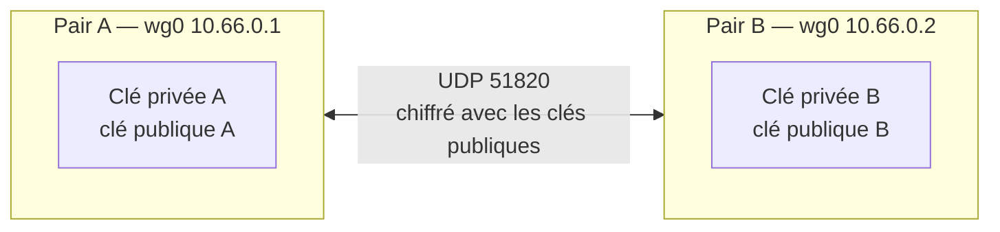

**WireGuard** est un VPN moderne conçu pour être **simple, rapide et sûr** : environ 4 000 lignes de code dans le noyau Linux (depuis la version 5.6), une cryptographie fixe et éprouvée (Curve25519, ChaCha20-Poly1305, BLAKE2s, protocole *Noise*), et une configuration réduite à quelques lignes. Il sert pour l'accès distant, les liaisons entre sites et comme brique de base de solutions maillées ([[05-tailscale-headscale/01-presentation-installation|Tailscale]], Netmaker, Firezone).

## Principes



| Notion | Description |
| --- | --- |
| **Interface** (`wg0`) | Interface réseau virtuelle avec une clé privée et un port UDP d'écoute |
| **Pair** (*peer*) | Un correspondant, identifié uniquement par sa **clé publique** |
| **AllowedIPs** | **Routage cryptographique** : en sortie, quelles destinations envoyer à ce pair ; en entrée, quelles adresses sources ce pair a le droit d'utiliser |
| **Endpoint** | Adresse IP:port où joindre le pair (facultatif côté serveur : appris dynamiquement) |
| **PersistentKeepalive** | Paquet périodique pour maintenir l'état NAT d'un pair derrière un routeur |
| **PresharedKey** | Clé symétrique supplémentaire (protection face aux futurs ordinateurs quantiques) |

Caractéristiques importantes :

- **Silencieux** : un serveur WireGuard ne répond à **aucun** paquet non authentifié → invisible aux scans.
- **Sans état de connexion** : pas de « session » au sens OpenVPN ; une poignée de main a lieu toutes les 2 minutes quand il y a du trafic. Le roaming (changement d'IP du client, passage Wi-Fi/4G) est transparent.
- **Couche 3 uniquement**, UDP uniquement.

## Forces et limites

| Forces | Limites |
| --- | --- |
| Performances (noyau, multi-cœur) | Pas d'authentification utilisateur ni de MFA intégrés (clés uniquement) |
| Configuration minimale, audit facile | Pas de distribution d'adresses ni de DNS dynamiques (sauf outils tiers) |
| Roaming transparent, reconnexion instantanée | UDP seulement (bloqué sur certains réseaux) |
| Pas d'algorithmes à choisir (pas de mauvaise configuration crypto) | Gestion des clés à grande échelle à outiller |
| Faible consommation (mobiles) | Clé privée = identité : la perte du poste impose la révocation (retrait du pair) |

## Installation

### Linux

```bash
# Debian / Ubuntu (module noyau intégré, outils en espace utilisateur)
sudo apt install wireguard-tools
# RHEL / Rocky / Alma 9
sudo dnf install wireguard-tools
modinfo wireguard | head -3
```

### Windows

Installer l'application officielle **WireGuard for Windows** (`wireguard.com/install`) : interface graphique, pilote **WireGuardNT** (noyau), et gestion des tunnels comme **services Windows**.

```powershell
# Installer un tunnel comme service (démarre avec la machine, sans session utilisateur)
& "C:\Program Files\WireGuard\wireguard.exe" /installtunnelservice "C:\ProgramData\WireGuard\siege.conf"
& "C:\Program Files\WireGuard\wireguard.exe" /uninstalltunnelservice siege
Get-Service 'WireGuardTunnel$siege'
# Outil en ligne de commande
& "C:\Program Files\WireGuard\wg.exe" show
```

Windows peut aussi servir de **serveur** WireGuard (petit site, poste de test), mais Linux ou un pare-feu (OPNsense, pfSense, MikroTik, FortiGate récents) sont plus adaptés.

### macOS et mobiles

- macOS : application **WireGuard** de l'App Store, ou `brew install wireguard-tools` (outils `wg`, `wg-quick` avec wireguard-go).
- iOS / Android : application officielle, import par **QR code** ou fichier.

### Équipements

OPNsense, pfSense, MikroTik RouterOS 7, OpenWrt, Ubiquiti, FortiGate (7.x), Synology, UniFi… intègrent WireGuard.

## Outils

| Outil | Rôle |
| --- | --- |
| `wg` | Configuration bas niveau et état : `wg show`, `wg genkey`, `wg set`, `wg syncconf` |
| `wg-quick` | Monte une interface à partir d'un fichier `/etc/wireguard/<nom>.conf` (adresses, routes, DNS, règles) |
| `wg-quick@<nom>.service` | Unité systemd |
| NetworkManager | `nmcli connection import type wireguard file wg0.conf` |
| systemd-networkd | Fichiers `.netdev` / `.network` (alternative à wg-quick) |

## Générer les clés

```bash
umask 077
wg genkey | tee serveur.key | wg pubkey > serveur.pub
wg genkey | tee alice.key | wg pubkey > alice.pub
wg genpsk > alice-serveur.psk         # clé prépartagée facultative, une par couple de pairs
```

> [!IMPORTANT]
> La **clé privée** ne quitte jamais la machine qui l'utilise ; seule la clé publique est échangée. Générez idéalement la clé du client **sur le client** (l'application Windows/macOS/mobile le fait) et transmettez au serveur uniquement la clé publique.

## Suite du parcours

1. [[02-acces-distant|Serveur d'accès distant]]
2. [[03-site-a-site-routage|Site à site, maillage et routage]]
3. [[04-gestion-securite|Gestion à grande échelle et sécurité]]
4. [[05-exploitation-depannage|Exploitation et dépannage]]
