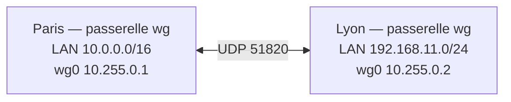

## Deux sites



```wireguard /etc/wireguard/wg0.conf (Paris)
[Interface]
Address = 10.255.0.1/30
ListenPort = 51820
PrivateKey = <clé privée Paris>

[Peer]
# Lyon
PublicKey = <clé publique Lyon>
Endpoint = lyon.exemple.fr:51820
AllowedIPs = 10.255.0.2/32, 192.168.11.0/24
PersistentKeepalive = 25
```

```wireguard /etc/wireguard/wg0.conf (Lyon)
[Interface]
Address = 10.255.0.2/30
ListenPort = 51820
PrivateKey = <clé privée Lyon>

[Peer]
# Paris
PublicKey = <clé publique Paris>
Endpoint = paris.exemple.fr:51820
AllowedIPs = 10.255.0.1/32, 10.0.0.0/16
PersistentKeepalive = 25
```

`wg-quick` crée automatiquement les **routes** du noyau correspondant aux `AllowedIPs` (ici `192.168.11.0/24 dev wg0` à Paris). Il reste :

- `net.ipv4.ip_forward=1` sur les deux passerelles ;
- si la passerelle WireGuard n'est **pas** la passerelle par défaut du LAN : une route sur le routeur du site (`192.168.11.0/24 via <IP LAN de la passerelle wg>`) ;
- les règles de pare-feu `forward`.

> [!NOTE]
> Si un seul site a une IP publique fixe, omettez `Endpoint` côté site « serveur » : il apprendra l'adresse du site distant à la première poignée de main, et `PersistentKeepalive` côté site distant maintient le passage du NAT.

## Plusieurs agences en étoile (hub and spoke)

```wireguard /etc/wireguard/wg0.conf (siège = hub)
[Interface]
Address = 10.255.0.1/24
ListenPort = 51820
PrivateKey = <clé siège>

[Peer]
# Lyon
PublicKey = <clé Lyon>
AllowedIPs = 10.255.0.11/32, 192.168.11.0/24

[Peer]
# Nantes
PublicKey = <clé Nantes>
AllowedIPs = 10.255.0.12/32, 192.168.12.0/24
```

```wireguard (agence Lyon)
[Peer]
# Siège : tout ce qui n'est pas local passe par le hub (siège + autres agences)
PublicKey = <clé siège>
Endpoint = vpn.exemple.fr:51820
AllowedIPs = 10.255.0.0/24, 10.0.0.0/16, 192.168.12.0/24
PersistentKeepalive = 25
```

Le trafic Lyon ↔ Nantes transite par le siège (qui doit avoir l'IP forwarding et autoriser ce flux).

## Maillage complet

Chaque site déclare tous les autres comme pairs avec leur `Endpoint` : trafic direct entre agences, mais configuration en N×(N−1). Au-delà de quelques sites, automatisez (Ansible, Netmaker, [[05-tailscale-headscale/01-presentation-installation|Tailscale/Headscale]]).

## Routage dynamique (OSPF / BGP) sur WireGuard

Pour des topologies redondantes (deux liens Internet, plusieurs hubs), laissez un protocole de routage choisir les chemins. WireGuard exige alors des `AllowedIPs` **larges** et ne doit **pas** installer de routes lui-même.

```wireguard /etc/wireguard/wg-paris-lyon.conf
[Interface]
Address = 10.255.1.1/31
ListenPort = 51821
PrivateKey = <clé>
Table = off                                   # wg-quick n'ajoute pas de routes : FRR s'en charge

[Peer]
PublicKey = <clé Lyon>
Endpoint = lyon.exemple.fr:51821
AllowedIPs = 0.0.0.0/0, 224.0.0.5/32          # tout (FRR décide), multicast OSPF
PersistentKeepalive = 25
```

Une interface WireGuard **par voisin** (un seul pair) est la règle : avec `AllowedIPs = 0.0.0.0/0`, il ne peut y avoir qu'un pair par interface.

```text /etc/frr/frr.conf (extrait OSPF)
interface wg-paris-lyon
 ip ospf network point-to-point
 ip ospf cost 10
 ip ospf hello-interval 5
 ip ospf dead-interval 20
!
router ospf
 ospf router-id 10.255.255.1
 network 10.255.1.0/31 area 0
 network 10.0.0.0/16 area 0
 passive-interface default
 no passive-interface wg-paris-lyon
```

```bash
sudo vtysh -c "show ip ospf neighbor"
sudo vtysh -c "show ip route ospf"
```

BGP (`bgpd`) est préférable avec de nombreux sites ou des politiques de routage fines (communautés, préférence d'un lien).

## MTU

WireGuard ajoute 60 octets (IPv4) ou 80 octets (IPv6) d'en-tête : MTU par défaut **1420**. Sur des liens PPPoE (1492) ou des tunnels imbriqués, réduisez :

```wireguard
[Interface]
MTU = 1380
```

et ajoutez un ajustement MSS sur les passerelles pour le TCP qui traverse :

```bash
nft add rule inet filter forward oifname "wg0" tcp flags syn tcp option maxseg size set rt mtu
```

## IPv6

WireGuard transporte IPv4 et IPv6 indifféremment, et peut lui-même circuler sur IPv4 ou IPv6 (`Endpoint = [2001:db8::1]:51820`). Ajoutez les préfixes IPv6 dans `Address` et `AllowedIPs`.

## Tunnel complet sur un serveur Linux : ce que fait wg-quick

Avec `AllowedIPs = 0.0.0.0/0`, `wg-quick` utilise une table de routage dédiée et le marquage des paquets (`FwMark`) pour que les paquets **chiffrés** sortent par l'interface physique et le reste par `wg0` :

```bash
ip rule show          # « not from all fwmark 0xca6c lookup 51820 »
ip route show table 51820
```

Pour une gestion manuelle (passerelle spécifique, plusieurs tunnels), utilisez `Table = <n>` et vos propres règles `ip rule`.
