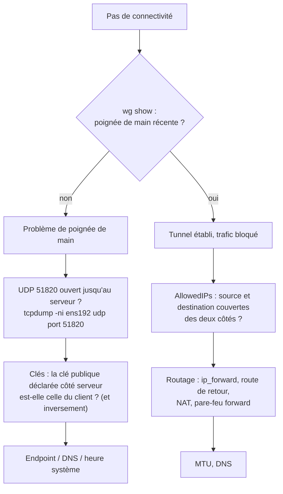

## État

```bash
sudo wg show                     # toutes les interfaces
sudo wg show wg0 latest-handshakes
sudo wg show wg0 transfer
sudo wg show wg0 endpoints
sudo wg showconf wg0             # configuration active (format fichier)
ip -br addr show wg0
ip route | grep wg0
```

| Indicateur | Interprétation |
| --- | --- |
| `latest handshake` < 2-3 min | Tunnel établi et actif |
| Pas de ligne `latest handshake` | Aucune poignée de main n'a jamais abouti avec ce pair |
| Poignée de main ancienne (> 3 min) | Pas de trafic récent, ou le pair ne répond plus |
| `transfer` : reçu = 0 | Les paquets partent mais rien ne revient |
| `endpoint` | IP:port publics vus du pair (utile derrière un NAT) |

> [!NOTE]
> Une poignée de main n'a lieu que lorsqu'il y a du trafic à envoyer. Un tunnel inactif sans `PersistentKeepalive` n'affiche pas de poignée de main récente : ce n'est pas une panne. Envoyez un `ping` pour la déclencher.

## Journaux

WireGuard est volontairement silencieux. Sous Linux, activez les messages de débogage du module :

```bash
echo "module wireguard +p" | sudo tee /sys/kernel/debug/dynamic_debug/control
sudo dmesg -wT | grep wireguard
# « Receiving handshake initiation from peer 3 », « Invalid handshake initiation from … », « Packet has unallowed src IP »
echo "module wireguard -p" | sudo tee /sys/kernel/debug/dynamic_debug/control
```

Windows : journal de l'application WireGuard (onglet *Journal*) ou `wireguard.exe /dumplog`.

## Supervision

| Outil | Méthode |
| --- | --- |
| **Prometheus** | `prometheus_wireguard_exporter` : poignées de main, octets par pair |
| **Centreon / Nagios** | Script vérifiant l'âge de la dernière poignée de main des liens site à site |
| Zabbix | Modèle WireGuard (agent + `wg show … dump`) |

```bash /usr/local/lib/nagios/check_wg_handshake.sh
#!/bin/bash
# Usage : check_wg_handshake.sh <interface> <clé publique> <seuil critique en secondes>
IF=$1; PAIR=$2; CRIT=${3:-300}
TS=$(wg show "$IF" latest-handshakes | awk -v p="$PAIR" '$1==p {print $2}')
[ -z "$TS" ] && { echo "UNKNOWN: pair inconnu"; exit 3; }
[ "$TS" -eq 0 ] && { echo "CRITICAL: aucune poignée de main"; exit 2; }
AGE=$(( $(date +%s) - TS ))
[ "$AGE" -gt "$CRIT" ] && { echo "CRITICAL: dernière poignée de main il y a ${AGE}s | age=${AGE}s"; exit 2; }
echo "OK: dernière poignée de main il y a ${AGE}s | age=${AGE}s"; exit 0
```

Exécuté par un agent (NRPE, SSH, CMA) sur la passerelle — voir [[01-centreon/05-supervision-agents|supervision par agent]].

## Méthode de dépannage



```bash
# Le paquet chiffré arrive-t-il au serveur ?
sudo tcpdump -ni ens192 udp port 51820
# Le trafic déchiffré sort-il du tunnel côté serveur ?
sudo tcpdump -ni wg0
# Et vers le réseau interne ?
sudo tcpdump -ni ens224 host 10.66.0.10
```

## Problèmes fréquents

| Symptôme | Cause | Solution |
| --- | --- | --- |
| Aucune poignée de main | Port UDP filtré (pare-feu, opérateur, Wi-Fi public), mauvais `Endpoint`, clés inversées | `tcpdump`, vérifier la clé **publique** de chaque côté (`wg pubkey < cle.key`) |
| `Invalid handshake initiation` (dmesg) | Clé publique du pair inconnue du serveur ou PSK différente | Corriger la clé / la PSK |
| `Packet has unallowed src IP` | L'adresse source n'est pas dans les `AllowedIPs` du pair côté réception | Ajouter le réseau source aux `AllowedIPs` (site à site) |
| Poignée de main OK, pas de trafic vers le LAN | `ip_forward=0`, pas de route de retour vers le réseau du tunnel, pas de NAT, pare-feu `forward` | Voir [[02-acces-distant]] |
| Tout fonctionne sauf les noms | `DNS =` ignoré (Linux sans resolvconf/systemd-resolved), DNS interne non joignable | `resolvectl status wg0`, autoriser UDP/TCP 53 vers le DNS interne |
| Pages web qui ne se chargent qu'en partie | MTU | `MTU = 1380` et MSS clamping |
| Le tunnel complet coupe Internet | Route par défaut sans exception pour l'endpoint (configuration manuelle), DNS public inaccessible | Laisser `wg-quick` gérer (`FwMark`, table dédiée), ou ajouter une route spécifique vers l'endpoint |
| Deux pairs, un seul fonctionne | `AllowedIPs` qui se chevauchent (même /32 ou /0 sur deux pairs) | Une plage unique par pair |
| Coupure après changement de réseau (mobile) | Pas de `PersistentKeepalive` et NAT expiré côté serveur | `PersistentKeepalive = 25` côté client |
| Windows : « Unable to create network adapter » | Pilote / reste d'une ancienne installation | Réinstaller l'application WireGuard, redémarrer |
| Windows : tunnel actif mais ressources internes injoignables | Pare-feu Windows (profil *Public* sur l'interface WireGuard) | Définir le profil réseau de l'interface comme *Privé* / *Domaine*, adapter les règles |
| Conteneur : `RTNETLINK answers: Operation not permitted` | Capacités manquantes | `--cap-add NET_ADMIN` (+ `SYS_MODULE` si chargement du module) |
