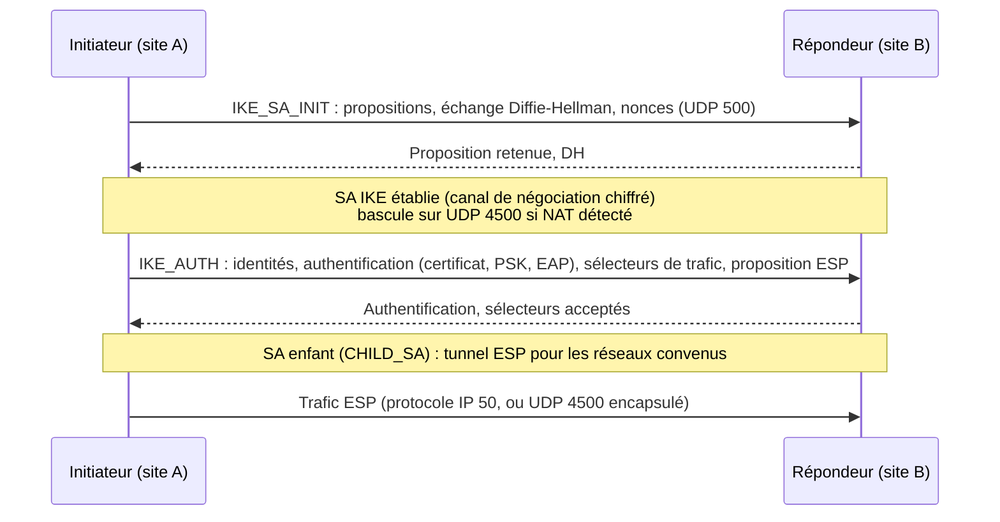

**strongSwan** est l'implémentation IPsec open source de référence sous Linux. Elle établit des tunnels **IKEv2** (et IKEv1 pour les équipements anciens) **interopérables** avec les pare-feu du marché (Cisco, Fortinet, Palo Alto, Stormshield, pfSense), les clouds publics (Azure, AWS, GCP) et les **clients VPN natifs** de Windows, macOS, iOS et Android.

## Concepts IPsec

| Notion | Description |
| --- | --- |
| **IKE** (v2) | Protocole de négociation et d'authentification (UDP 500, puis 4500 avec NAT) |
| **SA IKE** | Association de sécurité du canal de contrôle ; renouvelée (*rekey*) périodiquement |
| **SA enfant** (*CHILD_SA*) | Association protégeant le trafic utilisateur (une paire par sens) |
| **ESP** | Protocole IP 50 : chiffrement + intégrité des paquets |
| **AH** | Intégrité sans chiffrement (rarement utilisé, incompatible avec le NAT) |
| **Mode tunnel** | Le paquet IP complet est encapsulé (site à site, accès distant) |
| **Mode transport** | Seule la charge est protégée (hôte à hôte, L2TP/IPsec) |
| **Sélecteurs de trafic** (*TS*) | Réseaux locaux/distants que la SA enfant protège (ex. `10.0.0.0/16 ↔ 192.168.11.0/24`) |
| **Proposition** | Combinaison d'algorithmes : chiffrement, intégrité/PRF, groupe DH (ex. `aes256gcm16-prfsha384-ecp384`) |
| **PFS** | *Perfect Forward Secrecy* : nouvel échange DH à chaque renouvellement de SA enfant |
| **NAT-T** | Encapsulation UDP 4500 quand un NAT est détecté |
| **DPD** | *Dead Peer Detection* : détection d'un pair disparu |
| **MOBIKE** | Changement d'adresse d'un client mobile sans renégociation |

## Policy-based ou route-based ?

| Approche | Principe | Usage |
| --- | --- | --- |
| **Policy-based** (par défaut) | Les politiques IPsec du noyau (XFRM) interceptent le trafic correspondant aux sélecteurs | Simple pour quelques réseaux fixes |
| **Route-based** (interfaces XFRM / VTI) | Une interface virtuelle par tunnel ; on y route ce qu'on veut, protocoles de routage possibles | Nombreux réseaux, OSPF/BGP, redondance, interopérabilité avec les VPN « route-based » des clouds et pare-feu |

## Architecture de strongSwan

| Composant | Rôle |
| --- | --- |
| **charon** | Démon IKE (négociation) ; le chiffrement ESP est fait par le **noyau** (XFRM) |
| **swanctl** | Outil de configuration et de contrôle moderne (`/etc/swanctl/swanctl.conf`), via l'interface **VICI** |
| `ipsec` (stroke, `ipsec.conf`) | Ancienne interface, **dépréciée** (retirée de strongSwan 6) — à migrer vers swanctl |
| **Plugins** | Méthodes EAP, RADIUS (`eap-radius`), attribution d'adresses, PKCS#11, OpenSSL, journalisation… |
| `pki` | Outil de génération de clés et certificats |

## Choix cryptographiques recommandés

| Élément | Recommandé | À éviter |
| --- | --- | --- |
| Chiffrement | AES-GCM (128/256), ChaCha20-Poly1305 | 3DES, DES, AES-CBC sans nécessité |
| Intégrité / PRF | SHA-256 / SHA-384 | MD5, SHA-1 |
| Groupe DH | ECP-256/384 (19/20), Curve25519 (31), MODP-3072+ ; **ML-KEM** (post-quantique hybride, strongSwan 6) | MODP-1024 (2), MODP-1536 (5) |
| Authentification | Certificats ECDSA/RSA ≥ 3072, ou EAP | PSK courte ou partagée entre de nombreux sites |

## Ports et protocoles

| Flux | Port / protocole |
| --- | --- |
| IKE | UDP **500** |
| IKE + ESP avec NAT-T | UDP **4500** |
| ESP sans NAT | Protocole IP **50** |

## Versions

| Version | Remarques |
| --- | --- |
| 5.9.x | Debian 12, Ubuntu 22.04/24.04, RHEL 9 (EPEL) |
| **6.0** (2024) | Échange de clés post-quantique ML-KEM, IKE multi-échanges, suppression de l'interface stroke (`ipsec.conf`) |

## Alternatives

| Logiciel | Remarque |
| --- | --- |
| **Libreswan** | Implémentation IPsec par défaut de RHEL (configuration `ipsec.conf`/`ipsec.d`), compatible |
| Pare-feu (pfSense/OPNsense) | Utilisent strongSwan avec interface graphique |
| **RRAS** (Windows Server) | Serveur IKEv2/SSTP/L2TP natif Windows (prévu dans la feuille de route) |

## Suite du parcours

1. [[02-installation|Installation (Linux, Windows, macOS)]]
2. [[03-site-a-site|Tunnels site à site et interopérabilité]]
3. [[04-acces-distant-ikev2|Accès distant IKEv2 (clients natifs, EAP, RADIUS)]]
4. [[05-pki-certificats|PKI et certificats pour IPsec]]
5. [[06-exploitation-depannage|Exploitation et dépannage]]
