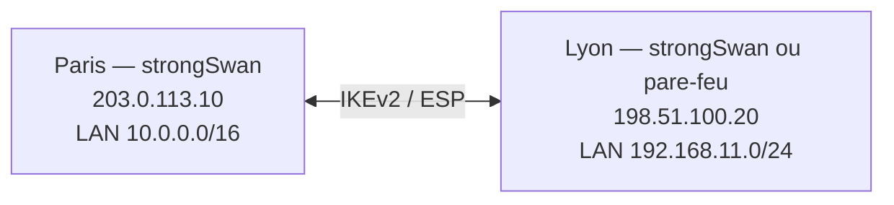

## Tunnel site à site avec clé prépartagée



```swanctl /etc/swanctl/conf.d/paris-lyon.conf (Paris)
connections {
    paris-lyon {
        version = 2
        local_addrs  = 203.0.113.10
        remote_addrs = 198.51.100.20
        proposals = aes256gcm16-prfsha384-ecp384, aes256-sha256-modp3072
        dpd_delay = 30s
        rekey_time = 8h
        local {
            auth = psk
            id = paris.exemple.fr
        }
        remote {
            auth = psk
            id = lyon.exemple.fr
        }
        children {
            lan-lan {
                local_ts  = 10.0.0.0/16
                remote_ts = 192.168.11.0/24
                esp_proposals = aes256gcm16-ecp384, aes256-sha256-modp3072
                rekey_time = 1h
                dpd_action = restart
                start_action = start          # établir au démarrage (côté « initiateur »)
                close_action = start          # rétablir si le pair ferme
            }
        }
    }
}

secrets {
    ike-paris-lyon {
        id-1 = paris.exemple.fr
        id-2 = lyon.exemple.fr
        secret = "0sBASE64-cle-aleatoire-de-48-octets=="     # « 0s » = valeur en base64
    }
}
```

```bash
openssl rand -base64 48                  # générer la clé prépartagée
sudo swanctl --load-all
sudo swanctl --initiate --child lan-lan
sudo swanctl --list-sas
ping -I 10.0.0.1 192.168.11.1            # depuis une adresse du LAN local (sélecteur de trafic)
```

Le site de Lyon a une configuration symétrique (adresses, `id` et sélecteurs inversés). Les deux côtés peuvent avoir `start_action = start`, ou un seul (l'autre en `trap` : le tunnel se monte au premier paquet).

| `start_action` | Comportement |
| --- | --- |
| `none` | Attendre que le pair initie |
| `trap` | Installer les politiques ; négocier au premier paquet correspondant |
| `start` | Négocier dès le chargement |

> [!WARNING]
> Une **clé prépartagée** commune à plusieurs sites, courte ou envoyée par courriel est la faiblesse la plus fréquente. Utilisez une clé aléatoire longue par tunnel, ou des **certificats** ([[05-pki-certificats]]).

## Authentification par certificats

```swanctl
connections {
    paris-lyon {
        local_addrs  = 203.0.113.10
        remote_addrs = 198.51.100.20
        proposals = aes256gcm16-prfsha384-ecp384
        local {
            auth = pubkey
            certs = paris.exemple.fr.crt          # dans /etc/swanctl/x509/
            id = paris.exemple.fr                 # doit figurer dans le SAN du certificat
        }
        remote {
            auth = pubkey
            id = lyon.exemple.fr
            cacerts = ac-vpn.crt                  # n'accepter que des certificats de cette AC
        }
        children { lan-lan { local_ts = 10.0.0.0/16  remote_ts = 192.168.11.0/24  start_action = start } }
    }
}
```

## Plusieurs réseaux

```swanctl
children {
    lan-lan {
        local_ts  = 10.0.0.0/16, 10.10.0.0/16
        remote_ts = 192.168.11.0/24, 192.168.111.0/24
    }
}
```

Avec IKEv2, plusieurs sélecteurs tiennent dans une seule SA enfant. Certains équipements n'acceptent qu'**une paire de réseaux par SA** : créez alors un `child` par paire.

## Route-based : interfaces XFRM

Préférable dès qu'il y a plusieurs réseaux, de la redondance ou du routage dynamique.

```swanctl
connections {
    paris-lyon-vti {
        local_addrs  = 203.0.113.10
        remote_addrs = 198.51.100.20
        proposals = aes256gcm16-prfsha384-ecp384
        if_id_in = 11
        if_id_out = 11
        local  { auth = psk  id = paris.exemple.fr }
        remote { auth = psk  id = lyon.exemple.fr }
        children {
            tout {
                local_ts  = 0.0.0.0/0
                remote_ts = 0.0.0.0/0
                start_action = start
                dpd_action = restart
            }
        }
    }
}
```

```bash
sudo ip link add ipsec-lyon type xfrm dev ens192 if_id 11
sudo ip addr add 169.254.11.1/30 dev ipsec-lyon
sudo ip link set ipsec-lyon up mtu 1400
sudo ip route add 192.168.11.0/24 dev ipsec-lyon
# Persistance : systemd-networkd (Kind=xfrm) ou script « updown »
```

Sur l'interface `ipsec-lyon`, on peut faire tourner **OSPF ou BGP** (FRRouting), comme avec les tunnels VTI des pare-feu et des clouds — même principe que pour [[03-wireguard/03-site-a-site-routage|WireGuard]].

## Interopérabilité

### Cisco IOS / IOS-XE (IKEv2, route-based VTI)

```cisco
crypto ikev2 proposal PROP-AES256
 encryption aes-gcm-256
 prf sha384
 group 20
crypto ikev2 policy POL-AES256
 proposal PROP-AES256
crypto ikev2 keyring KR-PARIS
 peer PARIS
  address 203.0.113.10
  identity fqdn paris.exemple.fr
  pre-shared-key 0 CleAleatoireLongue
crypto ikev2 profile PROF-PARIS
 match identity remote fqdn paris.exemple.fr
 identity local fqdn lyon.exemple.fr
 authentication remote pre-share
 authentication local pre-share
 keyring local KR-PARIS
 dpd 30 5 on-demand
crypto ipsec transform-set TS-GCM esp-gcm 256
 mode tunnel
crypto ipsec profile IPSEC-PARIS
 set transform-set TS-GCM
 set ikev2-profile PROF-PARIS
 set pfs group20
!
interface Tunnel11
 ip address 169.254.11.2 255.255.255.252
 tunnel source GigabitEthernet0/0/0
 tunnel mode ipsec ipv4
 tunnel destination 203.0.113.10
 tunnel protection ipsec profile IPSEC-PARIS
!
ip route 10.0.0.0 255.255.0.0 Tunnel11
```

Côté strongSwan : `proposals = aes256gcm16-prfsha384-ecp384`, `esp_proposals = aes256gcm16-ecp384`, sélecteurs `0.0.0.0/0` (VTI) et interface XFRM.

### FortiGate

```text
config vpn ipsec phase1-interface
    edit "vers-paris"
        set interface "wan1"
        set ike-version 2
        set peertype any
        set net-device disable
        set proposal aes256gcm-prfsha384
        set dhgrp 20
        set remote-gw 203.0.113.10
        set psksecret CleAleatoireLongue
        set localid "lyon.exemple.fr"
        set dpd on-idle
    next
end
config vpn ipsec phase2-interface
    edit "vers-paris-p2"
        set phase1name "vers-paris"
        set proposal aes256gcm
        set dhgrp 20
        set src-subnet 192.168.11.0 255.255.255.0
        set dst-subnet 10.0.0.0 255.255.0.0
        set auto-negotiate enable
    next
end
```

Ajoutez une route statique vers `10.0.0.0/16` sur l'interface `vers-paris` et les règles de pare-feu dans les deux sens.

### Clouds publics

| Cloud | Particularités |
| --- | --- |
| **Azure VPN Gateway** | IKEv2, route-based ; deux instances (actif/actif possible) ; BGP optionnel ; respecter les politiques IPsec personnalisées si vous imposez des algorithmes |
| **AWS Site-to-Site VPN** | **Deux tunnels** par connexion (deux IP AWS) : configurer les deux, idéalement en route-based avec BGP ; `dpd_action = restart` |
| **Google Cloud HA VPN** | Deux interfaces, BGP obligatoire |

Les clouds fournissent souvent un fichier de configuration d'exemple pour strongSwan (ou « Generic ») : partez-en et convertissez au format swanctl.

## Redémarrage automatique et robustesse

- `dpd_delay` + `dpd_action = restart` : rétablir le tunnel si le pair ne répond plus.
- `close_action = start` : rétablir si le pair ferme proprement le tunnel.
- `keyingtries = 0` (dans la connexion) : réessayer indéfiniment l'établissement.
- Surveillez les tunnels (voir [[06-exploitation-depannage]]).
